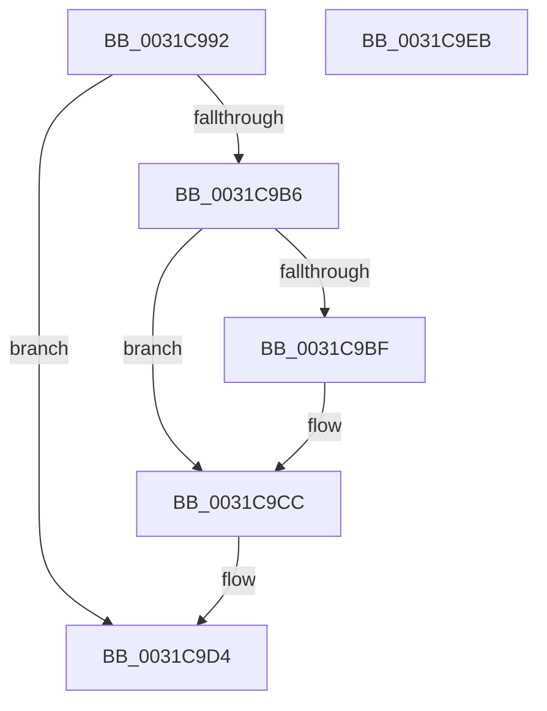

# sub_0031C992

- RVA: `0x0031C992`–`0x0031C9F0` (길이 `94` bytes)
- VA: `0x000000014031C992`
- 실행 섹션: `.text`
- PDB 이름 있음: `아니요`; PDB Function 태그: `아니요`
- unwind 정보 RVA: `0x00074E08`
- 디코드: `25`개 명령, `94/94` bytes 표시
- 미해석 바이트: `0` (있으면 어셈블리에 `.byte`로 보존)

> 이 문서는 커널 이미지의 기계어와 PDB 기호를 분석해 생성했습니다. 4번과 5번은 함수 원형과 자료형을 바이너리 사용 방식에서 추정한 C 해석이며 원본 소스 복구 결과는 아닙니다.

## 1. Dependencies

- 직접 호출 지점: **2**; 고유 호출 대상: **2**
- 직접 호출자로 확인된 함수: **0**
- RIP 상대 이미지 참조: **1**

### Outgoing calls
- `0x0031C998` → [MiIdentifyPfn](MiIdentifyPfn_function_0031CAC0.md) (function, `0x0031CAC0`)
- `0x0031C9C7` → [KiLowerIrqlProcessIrqlFlags](../4F/KiLowerIrqlProcessIrqlFlags_function_004F5698.md) (function, `0x004F5698`)

### Direct callers
- 이 함수 시작 RVA로 연결되는 직접 call은 확인되지 않았습니다. 간접 호출은 완전히 역산할 수 없습니다.

### Static image references
- `0x0031C9B6` → RVA `0x00FC6D20` (`ALMOSTRO`; read)

## 2. Other-region calls and transfers

- 다른 실행 섹션으로 향하는 call: **0**
- 별도 외부 분기/꼬리 이동을 확인하지 못했습니다.

## 3. Assembly (complete function range)

```asm
0031C992  49 8B D7                        mov rdx, r15
0031C995  48 8B CF                        mov rcx, rdi
0031C998  E8 23 01 00 00                  call 0x14031cac0
0031C99D  48 8B D8                        mov rbx, rax
0031C9A0  48 B8 FF FF FF FF FF FF FF 7F   movabs rax, 0x7fffffffffffffff
0031C9AA  F0 49 21 44 24 18               lock and qword ptr [r12 + 0x18], rax
0031C9B0  40 80 FE 02                     cmp sil, 2
0031C9B4  73 1E                           jae 0x14031c9d4
0031C9B6  83 3D 63 A3 CA 00 00            cmp dword ptr [rip + 0xcaa363], 0
0031C9BD  74 0D                           je 0x14031c9cc
0031C9BF  44 0F 20 C1                     mov rcx, cr8
0031C9C3  40 0F B6 D6                     movzx edx, sil
0031C9C7  E8 CC 8C 1D 00                  call 0x1404f5698
0031C9CC  40 0F B6 C6                     movzx eax, sil
0031C9D0  44 0F 22 C0                     mov cr8, rax
0031C9D4  48 8B C3                        mov rax, rbx
0031C9D7  48 8B 5C 24 48                  mov rbx, qword ptr [rsp + 0x48]
0031C9DC  48 8B 74 24 50                  mov rsi, qword ptr [rsp + 0x50]
0031C9E1  48 83 C4 20                     add rsp, 0x20
0031C9E5  41 5F                           pop r15
0031C9E7  41 5C                           pop r12
0031C9E9  5F                              pop rdi
0031C9EA  C3                              ret
0031C9EB  CC                              int3
0031C9EC  0F 1F 40 00                     nop dword ptr [rax]
```

## 4. C-style interpretation (structured pseudocode)

```c
__int64 __fastcall sub_0031C992(__int64 a1, __int64 a2, __int64 a3, __int64 a4, __int64 a5, __int64 a6, __int64 a7, __int64 a8, __int64 a9, __int64 a10)
{
    __int64 result;
    __int64 v_rsp;

    result = MiIdentifyPfn(v_rdi, v_r15, a3, a4);
    if (((unsigned __int8)(v_rsi)) >= 2) goto loc_0031C9D4;
    if ((*(unsigned int *)(v_rip + 13280099)) != 0) {
        a1 = v_cr8;
        a2 = (unsigned __int8)(v_rsi);
        result = KiLowerIrqlProcessIrqlFlags(a1, a2, a3, a4);
    }
loc_0031C9D4:
    v_rsp = (v_rsp) + (32);
    return result;
}
```

## 5. (Beta) C Style

```c
int64_t sub_0031C992(int64_t Arg1, int64_t Arg2, int64_t Arg3, int64_t Arg4, uint64_t Arg5, uint64_t Arg6, uint64_t Arg7, uint64_t Arg8, int64_t Arg9, int64_t Arg10)
{
    int64_t result;
    int64_t local_rsp;

    result = MiIdentifyPfn(local_rdi, local_r15, Arg3, Arg4);
    if (((uint8_t)(local_rsi)) >= 2) goto loc_0031C9D4;
    if ((*(uint32_t *)(v_rip + 0xCAA363)) != 0) {
        Arg1 = v_cr8;
        Arg2 = (uint8_t)(local_rsi);
        result = KiLowerIrqlProcessIrqlFlags(Arg1, Arg2, Arg3, Arg4);
    }
loc_0031C9D4:
    local_rsp = (local_rsp) + (32);
    return result;
}
```

## 6. Execution-region graph

[열기: 2D/3D 그래프와 함수 탐색 컨트롤 패널](../../../control-panel.html?section=text&rva=0x0031C992&view=graph)

- 2D 그래프는 위에서 아래로 흐르고, 3D 그래프는 빈 공간을 드래그해 회전합니다. Shift+드래그는 이동, 휠은 확대·축소, 함수 노드 선택은 대상 보고서 이동입니다.

### Static fallback


