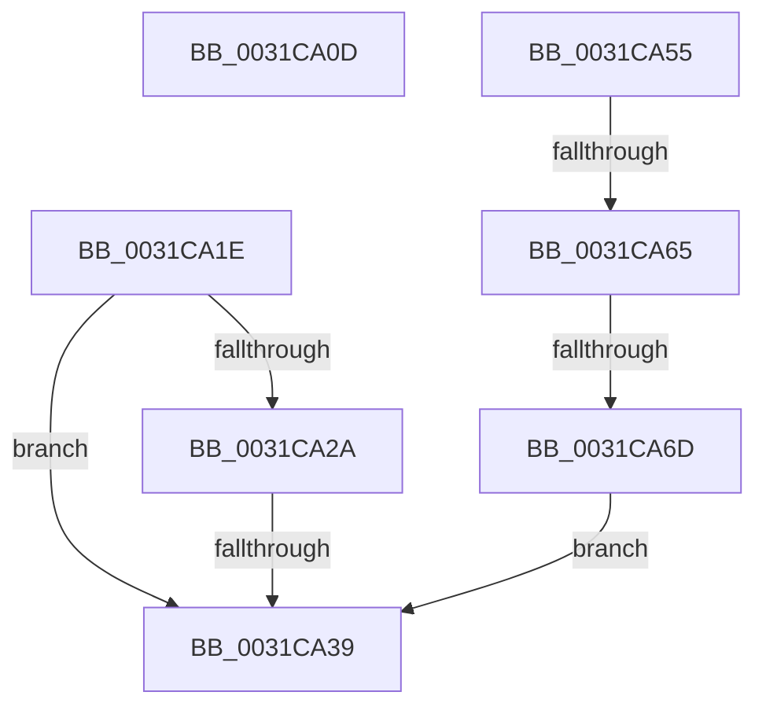

# sub_0031CA0D

- RVA: `0x0031CA0D`–`0x0031CA77` (길이 `106` bytes)
- VA: `0x000000014031CA0D`
- 실행 섹션: `.text`
- PDB 이름 있음: `아니요`; PDB Function 태그: `아니요`
- unwind 정보 RVA: `0x00074E30`
- 디코드: `25`개 명령, `106/106` bytes 표시
- 미해석 바이트: `0` (있으면 어셈블리에 `.byte`로 보존)

> 이 문서는 커널 이미지의 기계어와 PDB 기호를 분석해 생성했습니다. 4번과 5번은 함수 원형과 자료형을 바이너리 사용 방식에서 추정한 C 해석이며 원본 소스 복구 결과는 아닙니다.

## 1. Dependencies

- 직접 호출 지점: **2**; 고유 호출 대상: **2**
- 직접 호출자로 확인된 함수: **0**
- RIP 상대 이미지 참조: **2**

### Outgoing calls
- `0x0031CA14` → [KiRaiseIrqlProcessIrqlFlags](../4F/KiRaiseIrqlProcessIrqlFlags_function_004F56FC.md) (function, `0x004F56FC`)
- `0x0031CA58` → [MiIsDecayPfn](../2B/MiIsDecayPfn_function_002B9240.md) (function, `0x002B9240`)

### Direct callers
- 이 함수 시작 RVA로 연결되는 직접 call은 확인되지 않았습니다. 간접 호출은 완전히 역산할 수 없습니다.

### Static image references
- `0x0031CA1E` → RVA `0x00E35C00` (`.data`; read)
- `0x0031CA65` → RVA `0x00FC6D20` (`ALMOSTRO`; read)

## 2. Other-region calls and transfers

- 다른 실행 섹션으로 향하는 call: **0**
- call이 아닌 외부 분기/꼬리 이동: **5**
  - `0x0031CA19` → [MiIdentifyPfnWrapper + 0x73](MiIdentifyPfnWrapper_function_0031C8F0.md) (`tail-transfer`)
  - `0x0031CA33` → [MiIdentifyPfnWrapper + 0x4B](MiIdentifyPfnWrapper_function_0031C8F0.md) (`tail-transfer`)
  - `0x0031CA53` → [sub_0031C992 + 0x45](Unknown_function_0031C992.md) (`tail-transfer`)
  - `0x0031CA5F` → [sub_0031C972](Unknown_function_0031C972.md) (`tail-transfer`)
  - `0x0031CA6B` → [sub_0031CA9F](Unknown_function_0031CA9F.md) (`tail-transfer`)

## 3. Assembly (complete function range)

```asm
0031CA0D  0F B6 D0                        movzx edx, al
0031CA10  40 0F B6 CE                     movzx ecx, sil
0031CA14  E8 E3 8C 1D 00                  call 0x1404f56fc
0031CA19  E9 45 FF FF FF                  jmp 0x14031c963
0031CA1E  48 8B 05 DB 91 B1 00            mov rax, qword ptr [rip + 0xb191db]
0031CA25  48 3B F8                        cmp rdi, rax
0031CA28  72 0F                           jb 0x14031ca39
0031CA2A  48 05 00 08 00 00               add rax, 0x800
0031CA30  48 3B F8                        cmp rdi, rax
0031CA33  0F 82 02 FF FF FF               jb 0x14031c93b
0031CA39  49 C7 07 00 00 00 00            mov qword ptr [r15], 0
0031CA40  49 C7 47 10 00 00 00 00         mov qword ptr [r15 + 0x10], 0
0031CA48  49 83 4F 10 02                  or qword ptr [r15 + 0x10], 2
0031CA4D  33 C0                           xor eax, eax
0031CA4F  49 89 7F 08                     mov qword ptr [r15 + 8], rdi
0031CA53  EB 82                           jmp 0x14031c9d7
0031CA55  48 8B CF                        mov rcx, rdi
0031CA58  E8 E3 C7 F9 FF                  call 0x1402b9240
0031CA5D  85 C0                           test eax, eax
0031CA5F  0F 85 0D FF FF FF               jne 0x14031c972
0031CA65  39 05 B5 A2 CA 00               cmp dword ptr [rip + 0xcaa2b5], eax
0031CA6B  75 32                           jne 0x14031ca9f
0031CA6D  40 0F B6 C6                     movzx eax, sil
0031CA71  44 0F 22 C0                     mov cr8, rax
0031CA75  EB C2                           jmp 0x14031ca39
```

## 4. C-style interpretation (structured pseudocode)

```c
__int64 __fastcall sub_0031CA0D(void)
{
    __int64 result;

    result = KiRaiseIrqlProcessIrqlFlags((unsigned __int8)(v_rsi), (unsigned __int8)(result), a3, a4);
}
```

## 5. (Beta) C Style

```c
void sub_0031CA0D(void)
{
    int64_t result;

    result = KiRaiseIrqlProcessIrqlFlags((uint8_t)(local_rsi), (uint8_t)(result), a3, a4);
}
```

## 6. Execution-region graph

[열기: 2D/3D 그래프와 함수 탐색 컨트롤 패널](../../../control-panel.html?section=text&rva=0x0031CA0D&view=graph)

- 2D 그래프는 위에서 아래로 흐르고, 3D 그래프는 빈 공간을 드래그해 회전합니다. Shift+드래그는 이동, 휠은 확대·축소, 함수 노드 선택은 대상 보고서 이동입니다.

### Static fallback


