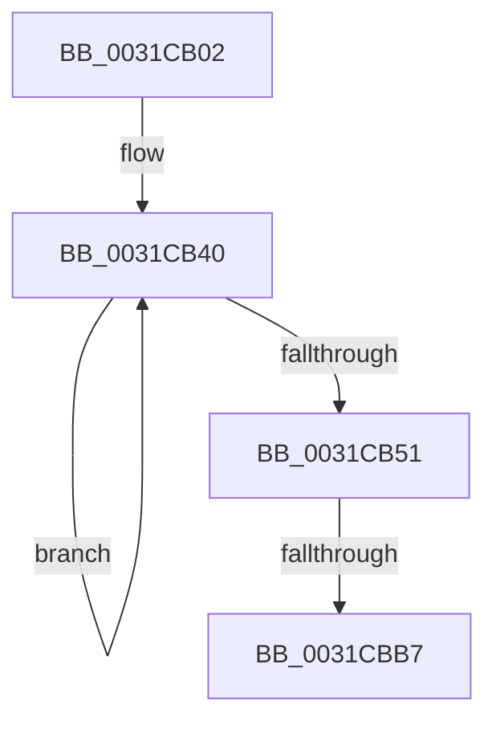

# sub_0031CB02

- RVA: `0x0031CB02`–`0x0031CBBA` (길이 `184` bytes)
- VA: `0x000000014031CB02`
- 실행 섹션: `.text`
- PDB 이름 있음: `아니요`; PDB Function 태그: `아니요`
- unwind 정보 RVA: `0x00074E74`
- 디코드: `44`개 명령, `184/184` bytes 표시
- 미해석 바이트: `0` (있으면 어셈블리에 `.byte`로 보존)

> 이 문서는 커널 이미지의 기계어와 PDB 기호를 분석해 생성했습니다. 4번과 5번은 함수 원형과 자료형을 바이너리 사용 방식에서 추정한 C 해석이며 원본 소스 복구 결과는 아닙니다.

## 1. Dependencies

- 직접 호출 지점: **1**; 고유 호출 대상: **1**
- 직접 호출자로 확인된 함수: **0**
- RIP 상대 이미지 참조: **0**

### Outgoing calls
- `0x0031CB83` → [MiGetPfnPriority](../32/MiGetPfnPriority_function_003226F0.md) (function, `0x003226F0`)

### Direct callers
- 이 함수 시작 RVA로 연결되는 직접 call은 확인되지 않았습니다. 간접 호출은 완전히 역산할 수 없습니다.

### Static image references
- 디코드된 RIP-relative 메모리 참조가 없습니다.

## 2. Other-region calls and transfers

- 다른 실행 섹션으로 향하는 call: **0**
- call이 아닌 외부 분기/꼬리 이동: **1**
  - `0x0031CBB1` → [sub_0031CCAF](Unknown_function_0031CCAF.md) (`tail-transfer`)

## 3. Assembly (complete function range)

```asm
0031CB02  48 89 9C 24 B0 00 00 00         mov qword ptr [rsp + 0xb0], rbx
0031CB0A  4B 8D 1C 76                     lea rbx, [r14 + r14*2]
0031CB0E  48 89 BC 24 88 00 00 00         mov qword ptr [rsp + 0x88], rdi
0031CB16  48 C1 E3 04                     shl rbx, 4
0031CB1A  48 BF 00 00 00 00 00 DE FF FF   movabs rdi, 0xffffde0000000000
0031CB24  48 8B C7                        mov rax, rdi
0031CB27  48 03 D8                        add rbx, rax
0031CB2A  4C 8D 45 EF                     lea r8, [rbp - 0x11]
0031CB2E  48 89 5D DF                     mov qword ptr [rbp - 0x21], rbx
0031CB32  48 8B C3                        mov rax, rbx
0031CB35  4C 2B C3                        sub r8, rbx
0031CB38  BA 06 00 00 00                  mov edx, 6
0031CB3D  0F 1F 00                        nop dword ptr [rax]
0031CB40  48 8B 08                        mov rcx, qword ptr [rax]
0031CB43  4A 89 0C 00                     mov qword ptr [rax + r8], rcx
0031CB47  48 8D 40 08                     lea rax, [rax + 8]
0031CB4B  48 83 EA 01                     sub rdx, 1
0031CB4F  75 EF                           jne 0x14031cb40
0031CB51  0F B6 45 11                     movzx eax, byte ptr [rbp + 0x11]
0031CB55  83 E0 07                        and eax, 7
0031CB58  4C 89 A4 24 80 00 00 00         mov qword ptr [rsp + 0x80], r12
0031CB60  8B C8                           mov ecx, eax
0031CB62  44 8B D8                        mov r11d, eax
0031CB65  48 8B 06                        mov rax, qword ptr [rsi]
0031CB68  48 C1 E1 04                     shl rcx, 4
0031CB6C  48 83 E0 8F                     and rax, 0xffffffffffffff8f
0031CB70  48 0B C8                        or rcx, rax
0031CB73  4C 89 7C 24 70                  mov qword ptr [rsp + 0x70], r15
0031CB78  48 89 0E                        mov qword ptr [rsi], rcx
0031CB7B  48 8D 4D EF                     lea rcx, [rbp - 0x11]
0031CB7F  4C 89 76 08                     mov qword ptr [rsi + 8], r14
0031CB83  E8 68 5B 00 00                  call 0x1403226f0
0031CB88  44 8B D0                        mov r10d, eax
0031CB8B  48 B9 FF FF FF FF FF FF FF F1   movabs rcx, 0xf1ffffffffffffff
0031CB95  49 C1 E2 39                     shl r10, 0x39
0031CB99  49 8B C2                        mov rax, r10
0031CB9C  48 33 06                        xor rax, qword ptr [rsi]
0031CB9F  48 23 C1                        and rax, rcx
0031CBA2  49 33 C2                        xor rax, r10
0031CBA5  48 89 06                        mov qword ptr [rsi], rax
0031CBA8  48 8B 45 17                     mov rax, qword ptr [rbp + 0x17]
0031CBAC  48 0F BA E0 28                  bt rax, 0x28
0031CBB1  0F 83 F8 00 00 00               jae 0x14031ccaf
0031CBB7  48 8B CB                        mov rcx, rbx
```

## 4. C-style interpretation (structured pseudocode)

```c
__int64 __fastcall sub_0031CB02(void)
{
    __int64 result;
    __int64 v_r10;
    __int64 v_rbx;
    unsigned __int64 v_stack_p70;
    unsigned __int64 v_stack_p80;
    unsigned __int64 v_stack_p88;
    unsigned __int64 v_stack_pB0;

    v_stack_pB0 = v_rbx;
    v_stack_p88 = v_rdi;
    v_rbx = (v_r14 + v_r14 * 2) << (4);
    v_rbx = (v_rbx) + (v_rdi);
    *(unsigned __int64 *)(v_rbp - 33) = v_rbx;
    a3 = (v_rbp - 17) - (v_rbx);
loc_0031CB40:
    *(unsigned __int64 *)(v_rbx + a3 * 1) = *(unsigned __int64 *)(v_rbx);
    a2 = (6) - (1);
    if (condition_is_not_equal) goto loc_0031CB40;
    result = (unsigned int)((*(unsigned __int8 *)(v_rbp + 17)) & (7));
    v_stack_p80 = v_r12;
    a1 = ((unsigned int)((unsigned int)(result))) << (4);
    result = (*(unsigned __int64 *)(v_rsi)) & (-113);
    a1 = (a1) | (result);
    v_stack_p70 = v_r15;
    *(unsigned __int64 *)(v_rsi) = a1;
    *(unsigned __int64 *)(v_rsi + 8) = v_r14;
    result = MiGetPfnPriority(v_rbp - 17, a2, a3, a4);
    v_r10 = ((unsigned int)((unsigned int)(result))) << (57);
    result = (v_r10) ^ (*(unsigned __int64 *)(v_rsi));
    result = (result) & (v_rbp - 17);
    result = (result) ^ (v_r10);
    *(unsigned __int64 *)(v_rsi) = result;
    return *(unsigned __int64 *)(v_rbp + 23);
}
```

## 5. (Beta) C Style

```c
void sub_0031CB02(void)
{
    int64_t result;
    int64_t local_r10;
    int64_t local_rbx;
    uint64_t v_stack_p70;
    uint64_t v_stack_p80;
    uint64_t v_stack_p88;
    uint64_t v_stack_pB0;

    v_stack_pB0 = local_rbx;
    v_stack_p88 = local_rdi;
    local_rbx = (local_r14 + local_r14 * 2) << (4);
    local_rbx = (local_rbx) + (local_rdi);
    *(uint64_t *)(local_rbp - 0x21) = local_rbx;
    a3 = (local_rbp - 17) - (local_rbx);
loc_0031CB40:
    *(uint64_t *)(local_rbx + a3 * 1) = *(uint64_t *)(local_rbx);
    a2 = (6) - (1);
    if (condition_is_not_equal) goto loc_0031CB40;
    result = (uint32_t)((*(uint8_t *)(local_rbp + 0x11)) & (7));
    v_stack_p80 = local_r12;
    a1 = ((uint32_t)((uint32_t)(result))) << (4);
    result = (*(uint64_t *)(local_rsi)) & (-113);
    a1 = (a1) | (result);
    v_stack_p70 = local_r15;
    *(uint64_t *)(local_rsi) = a1;
    *(uint64_t *)(local_rsi + 0x8) = local_r14;
    result = MiGetPfnPriority(local_rbp - 17, a2, a3, a4);
    local_r10 = ((uint32_t)((uint32_t)(result))) << (57);
    result = (local_r10) ^ (*(uint64_t *)(local_rsi));
    result = (result) & (local_rbp - 17);
    result = (result) ^ (local_r10);
    *(uint64_t *)(local_rsi) = result;
    return *(uint64_t *)(local_rbp + 0x17);
}
```

## 6. Execution-region graph

[열기: 2D/3D 그래프와 함수 탐색 컨트롤 패널](../../../control-panel.html?section=text&rva=0x0031CB02&view=graph)

- 2D 그래프는 위에서 아래로 흐르고, 3D 그래프는 빈 공간을 드래그해 회전합니다. Shift+드래그는 이동, 휠은 확대·축소, 함수 노드 선택은 대상 보고서 이동입니다.

### Static fallback


