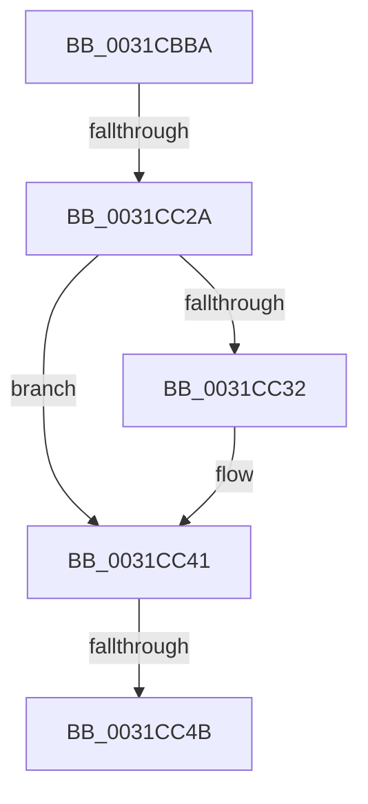

# sub_0031CBBA

- RVA: `0x0031CBBA`–`0x0031CC85` (길이 `203` bytes)
- VA: `0x000000014031CBBA`
- 실행 섹션: `.text`
- PDB 이름 있음: `아니요`; PDB Function 태그: `아니요`
- unwind 정보 RVA: `0x00074E94`
- 디코드: `44`개 명령, `203/203` bytes 표시
- 미해석 바이트: `0` (있으면 어셈블리에 `.byte`로 보존)

> 이 문서는 커널 이미지의 기계어와 PDB 기호를 분석해 생성했습니다. 4번과 5번은 함수 원형과 자료형을 바이너리 사용 방식에서 추정한 C 해석이며 원본 소스 복구 결과는 아닙니다.

## 1. Dependencies

- 직접 호출 지점: **2**; 고유 호출 대상: **2**
- 직접 호출자로 확인된 함수: **0**
- RIP 상대 이미지 참조: **1**

### Outgoing calls
- `0x0031CBBF` → [MiGetBaseResidentPage](MiGetBaseResidentPage_function_0031C750.md) (function, `0x0031C750`)
- `0x0031CBD3` → [MiGetPfnPageSizeIndex](MiGetPfnPageSizeIndex_function_0031C710.md) (function, `0x0031C710`)

### Direct callers
- 이 함수 시작 RVA로 연결되는 직접 call은 확인되지 않았습니다. 간접 호출은 완전히 역산할 수 없습니다.

### Static image references
- `0x0031CBDD` → RVA `0x00000000` (`image boundary/outside`; read)

## 2. Other-region calls and transfers

- 다른 실행 섹션으로 향하는 call: **0**
- call이 아닌 외부 분기/꼬리 이동: **2**
  - `0x0031CC24` → [sub_0031D09C](Unknown_function_0031D09C.md) (`tail-transfer`)
  - `0x0031CC45` → [sub_0031CCD9](Unknown_function_0031CCD9.md) (`tail-transfer`)

## 3. Assembly (complete function range)

```asm
0031CBBA  4C 89 6C 24 78                  mov qword ptr [rsp + 0x78], r13
0031CBBF  E8 8C FB FF FF                  call 0x14031c750
0031CBC4  48 8B C8                        mov rcx, rax
0031CBC7  48 8B F8                        mov rdi, rax
0031CBCA  44 0F B6 78 22                  movzx r15d, byte ptr [rax + 0x22]
0031CBCF  41 83 E7 07                     and r15d, 7
0031CBD3  E8 38 FB FF FF                  call 0x14031c710
0031CBD8  45 33 E4                        xor r12d, r12d
0031CBDB  8B C8                           mov ecx, eax
0031CBDD  48 8D 15 1C 34 CE FF            lea rdx, [rip - 0x31cbe4]
0031CBE4  4C 89 65 77                     mov qword ptr [rbp + 0x77], r12
0031CBE8  45 8B CC                        mov r9d, r12d
0031CBEB  49 BB FF FF FE FF FF 7F 00 00   movabs r11, 0x7ffffffeffff
0031CBF5  4C 8B AC CA 60 1C 01 00         mov r13, qword ptr [rdx + rcx*8 + 0x11c60]
0031CBFD  45 8D 54 24 01                  lea r10d, [r12 + 1]
0031CC02  48 BA 00 00 00 00 80 F6 FF FF   movabs rdx, 0xfffff68000000000
0031CC0C  4D 8D 45 FF                     lea r8, [r13 - 1]
0031CC10  4D 2B EE                        sub r13, r14
0031CC13  49 F7 D0                        not r8
0031CC16  4D 23 C6                        and r8, r14
0031CC19  4D 03 E8                        add r13, r8
0031CC1C  4C 89 6D E7                     mov qword ptr [rbp - 0x19], r13
0031CC20  41 83 FF 06                     cmp r15d, 6
0031CC24  0F 84 72 04 00 00               je 0x14031d09c
0031CC2A  41 8B C9                        mov ecx, r9d
0031CC2D  48 3B FB                        cmp rdi, rbx
0031CC30  74 0F                           je 0x14031cc41
0031CC32  48 B8 FF FF FF FF FF FF FF 7F   movabs rax, 0x7fffffffffffffff
0031CC3C  F0 48 21 47 18                  lock and qword ptr [rdi + 0x18], rax
0031CC41  41 83 FF 06                     cmp r15d, 6
0031CC45  0F 84 8E 00 00 00               je 0x14031ccd9
0031CC4B  41 83 FF 05                     cmp r15d, 5
0031CC4F  48 B8 FF FF FF FF FF FF 1F FF   movabs rax, 0xff1fffffffffffff
0031CC59  48 B9 8F FF FF FF FF FF FF F1   movabs rcx, 0xf1ffffffffffff8f
0031CC63  45 0F 44 FA                     cmove r15d, r10d
0031CC67  41 8B DF                        mov ebx, r15d
0031CC6A  48 23 D8                        and rbx, rax
0031CC6D  48 8B 06                        mov rax, qword ptr [rsi]
0031CC70  48 23 C1                        and rax, rcx
0031CC73  48 C1 E3 04                     shl rbx, 4
0031CC77  48 0B D8                        or rbx, rax
0031CC7A  48 89 1E                        mov qword ptr [rsi], rbx
0031CC7D  49 8B C5                        mov rax, r13
0031CC80  4C 8B 6C 24 78                  mov r13, qword ptr [rsp + 0x78]
```

## 4. C-style interpretation (structured pseudocode)

```c
__int64 __fastcall sub_0031CBBA(__int64 a1, __int64 a2, __int64 a3, __int64 a4, __int64 a5, __int64 a6, __int64 a7, __int64 a8, __int64 a9, __int64 a10, __int64 a11, __int64 a12, __int64 a13, __int64 a14, __int64 a15)
{
    __int64 result;
    __int64 v_r12;
    __int64 v_r13;
    __int64 v_r15;
    __int64 v_rbx;
    unsigned __int64 v_stack_p78;

    v_stack_p78 = v_r13;
    result = MiGetBaseResidentPage(a1, a2, a3, a4);
    v_r15 = (unsigned int)((*(unsigned __int8 *)(result + 34)) & (7));
    result = MiGetPfnPageSizeIndex(result, a2, a3, a4);
    v_r12 = 0;
    *(unsigned __int64 *)(v_rbp + 119) = 0;
    v_r13 = (*(unsigned __int64 *)(v_rip - 3263460 + (unsigned int)((unsigned int)(result)) * 8 + 72800)) - (v_r14);
    a3 = ~(*(unsigned __int64 *)(v_rip - 3263460 + (unsigned int)((unsigned int)(result)) * 8 + 72800) - 1);
    a3 = (a3) & (v_r14);
    v_r13 = (v_r13) + (a3);
    *(unsigned __int64 *)(v_rbp - 25) = v_r13;
    if (result != v_rbx) {
    }
    if (((unsigned int)(v_r15)) == 5) { v_r15 = (unsigned int)(v_r12 + 1); }
    v_rbx = ((unsigned int)((unsigned int)(v_r15))) & (result);
    result = (*(unsigned __int64 *)(v_rsi)) & (0);
    v_rbx = (v_rbx) << (4);
    v_rbx = (v_rbx) | (result);
    *(unsigned __int64 *)(v_rsi) = v_rbx;
    return v_r13;
}
```

## 5. (Beta) C Style

```c
int64_t sub_0031CBBA(int64_t Arg1, int64_t Arg2, int64_t Arg3, int64_t Arg4, uint64_t Arg5, uint64_t Arg6, uint64_t Arg7, uint64_t Arg8, uint64_t Arg9, uint64_t Arg10, uint64_t Arg11, uint64_t Arg12, uint64_t Arg13, uint64_t Arg14, int64_t Arg15)
{
    int64_t result;
    int64_t local_r12;
    int64_t local_r13;
    int64_t local_r15;
    int64_t local_rbx;
    uint64_t v_stack_p78;

    v_stack_p78 = local_r13;
    result = MiGetBaseResidentPage(Arg1, Arg2, Arg3, Arg4);
    local_r15 = (uint32_t)((*(uint8_t *)(result + 0x22)) & (7));
    result = MiGetPfnPageSizeIndex(result, Arg2, Arg3, Arg4);
    local_r12 = 0;
    *(uint64_t *)(local_rbp + 0x77) = 0;
    local_r13 = (*(uint64_t *)(v_rip - 0x31CBE4 + (uint32_t)((uint32_t)(result)) * 8 + 0x11C60)) - (local_r14);
    Arg3 = ~(*(uint64_t *)(v_rip - 0x31CBE4 + (uint32_t)((uint32_t)(result)) * 8 + 0x11C60) - 1);
    Arg3 = (Arg3) & (local_r14);
    local_r13 = (local_r13) + (Arg3);
    *(uint64_t *)(local_rbp - 0x19) = local_r13;
    if (result != local_rbx) {
    }
    if (((uint32_t)(local_r15)) == 5) { local_r15 = (uint32_t)(local_r12 + 1); }
    local_rbx = ((uint32_t)((uint32_t)(local_r15))) & (result);
    result = (*(uint64_t *)(local_rsi)) & (0);
    local_rbx = (local_rbx) << (4);
    local_rbx = (local_rbx) | (result);
    *(uint64_t *)(local_rsi) = local_rbx;
    return local_r13;
}
```

## 6. Execution-region graph

[열기: 2D/3D 그래프와 함수 탐색 컨트롤 패널](../../../control-panel.html?section=text&rva=0x0031CBBA&view=graph)

- 2D 그래프는 위에서 아래로 흐르고, 3D 그래프는 빈 공간을 드래그해 회전합니다. Shift+드래그는 이동, 휠은 확대·축소, 함수 노드 선택은 대상 보고서 이동입니다.

### Static fallback


