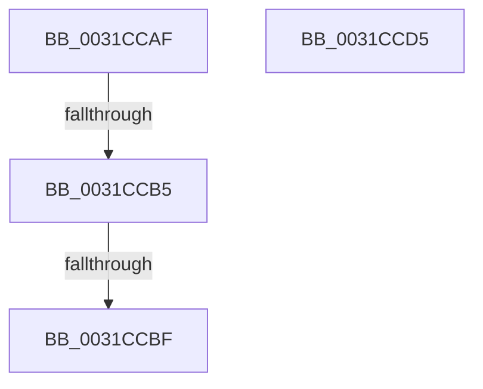

# sub_0031CCAF

- RVA: `0x0031CCAF`–`0x0031CCD9` (길이 `42` bytes)
- VA: `0x000000014031CCAF`
- 실행 섹션: `.text`
- PDB 이름 있음: `아니요`; PDB Function 태그: `아니요`
- unwind 정보 RVA: `0x00074ECC`
- 디코드: `13`개 명령, `42/42` bytes 표시
- 미해석 바이트: `0` (있으면 어셈블리에 `.byte`로 보존)

> 이 문서는 커널 이미지의 기계어와 PDB 기호를 분석해 생성했습니다. 4번과 5번은 함수 원형과 자료형을 바이너리 사용 방식에서 추정한 C 해석이며 원본 소스 복구 결과는 아닙니다.

## 1. Dependencies

- 직접 호출 지점: **0**; 고유 호출 대상: **0**
- 직접 호출자로 확인된 함수: **0**
- RIP 상대 이미지 참조: **1**

### Outgoing calls
- 직접 디코드된 call 명령이 없습니다.

### Direct callers
- 이 함수 시작 RVA로 연결되는 직접 call은 확인되지 않았습니다. 간접 호출은 완전히 역산할 수 없습니다.

### Static image references
- `0x0031CCBF` → RVA `0x00000000` (`image boundary/outside`; read)

## 2. Other-region calls and transfers

- 다른 실행 섹션으로 향하는 call: **0**
- call이 아닌 외부 분기/꼬리 이동: **2**
  - `0x0031CCB3` → [sub_0031CD16](Unknown_function_0031CD16.md) (`tail-transfer`)
  - `0x0031CCB9` → [sub_0031CD16 + 0x280](Unknown_function_0031CD16.md) (`tail-transfer`)

## 3. Assembly (complete function range)

```asm
0031CCAF  41 83 FB 06                     cmp r11d, 6
0031CCB3  74 61                           je 0x14031cd16
0031CCB5  41 83 FB 04                     cmp r11d, 4
0031CCB9  0F 84 D7 02 00 00               je 0x14031cf96
0031CCBF  48 8D 15 3A 33 CE FF            lea rdx, [rip - 0x31ccc6]
0031CCC6  49 63 C3                        movsxd rax, r11d
0031CCC9  8B 84 82 F4 D5 31 00            mov eax, dword ptr [rdx + rax*4 + 0x31d5f4]
0031CCD0  48 03 C2                        add rax, rdx
0031CCD3  FF E0                           jmp rax
0031CCD5  CC                              int3
0031CCD6  CC                              int3
0031CCD7  CC                              int3
0031CCD8  CC                              int3
```

## 4. C-style interpretation (structured pseudocode)

```c
__int64 __fastcall sub_0031CCAF(void)
{
    __int64 result;

    result = ((unsigned int)(*(unsigned int *)(v_rip - 3263686 + (int)((unsigned int)(v_r11)) * 4 + 3266036))) + (v_rip - 3263686);
}
```

## 5. (Beta) C Style

```c
void sub_0031CCAF(void)
{
    int64_t result;

    result = ((uint32_t)(*(uint32_t *)(v_rip - 0x31CCC6 + (int32_t)((uint32_t)(local_r11)) * 4 + 0x31D5F4))) + (v_rip - 3263686);
}
```

## 6. Execution-region graph

[열기: 2D/3D 그래프와 함수 탐색 컨트롤 패널](../../../control-panel.html?section=text&rva=0x0031CCAF&view=graph)

- 2D 그래프는 위에서 아래로 흐르고, 3D 그래프는 빈 공간을 드래그해 회전합니다. Shift+드래그는 이동, 휠은 확대·축소, 함수 노드 선택은 대상 보고서 이동입니다.

### Static fallback


