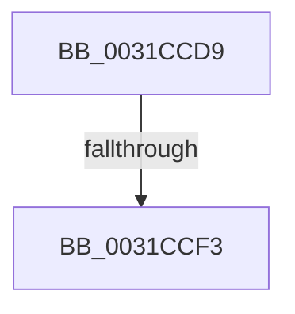

# sub_0031CCD9

- RVA: `0x0031CCD9`–`0x0031CD16` (길이 `61` bytes)
- VA: `0x000000014031CCD9`
- 실행 섹션: `.text`
- PDB 이름 있음: `아니요`; PDB Function 태그: `아니요`
- unwind 정보 RVA: `0x00074EEC`
- 디코드: `14`개 명령, `61/61` bytes 표시
- 미해석 바이트: `0` (있으면 어셈블리에 `.byte`로 보존)

> 이 문서는 커널 이미지의 기계어와 PDB 기호를 분석해 생성했습니다. 4번과 5번은 함수 원형과 자료형을 바이너리 사용 방식에서 추정한 C 해석이며 원본 소스 복구 결과는 아닙니다.

## 1. Dependencies

- 직접 호출 지점: **0**; 고유 호출 대상: **0**
- 직접 호출자로 확인된 함수: **0**
- RIP 상대 이미지 참조: **0**

### Outgoing calls
- 직접 디코드된 call 명령이 없습니다.

### Direct callers
- 이 함수 시작 RVA로 연결되는 직접 call은 확인되지 않았습니다. 간접 호출은 완전히 역산할 수 없습니다.

### Static image references
- 디코드된 RIP-relative 메모리 참조가 없습니다.

## 2. Other-region calls and transfers

- 다른 실행 섹션으로 향하는 call: **0**
- call이 아닌 외부 분기/꼬리 이동: **2**
  - `0x0031CCED` → [sub_0031D027](Unknown_function_0031D027.md) (`tail-transfer`)
  - `0x0031CD11` → [sub_0031CBBA + 0xC3](Unknown_function_0031CBBA.md) (`tail-transfer`)

## 3. Assembly (complete function range)

```asm
0031CCD9  48 8B 1E                        mov rbx, qword ptr [rsi]
0031CCDC  48 83 E3 EF                     and rbx, 0xffffffffffffffef
0031CCE0  48 81 CB 60 01 00 00            or rbx, 0x160
0031CCE7  48 89 1E                        mov qword ptr [rsi], rbx
0031CCEA  45 85 C9                        test r9d, r9d
0031CCED  0F 84 34 03 00 00               je 0x14031d027
0031CCF3  41 8B CC                        mov ecx, r12d
0031CCF6  48 BA F9 01 00 00 00 00 00 FE   movabs rdx, 0xfe000000000001f9
0031CD00  48 C1 E1 09                     shl rcx, 9
0031CD04  48 23 DA                        and rbx, rdx
0031CD07  48 0B CB                        or rcx, rbx
0031CD0A  48 83 C9 09                     or rcx, 9
0031CD0E  48 89 0E                        mov qword ptr [rsi], rcx
0031CD11  E9 67 FF FF FF                  jmp 0x14031cc7d
```

## 4. C-style interpretation (structured pseudocode)

```c
void __fastcall sub_0031CCD9(__int64 a1, __int64 a2, __int64 a3, int a4)
{
    __int64 v_rbx;

    v_rbx = (*(unsigned __int64 *)(v_rsi)) & (-17);
    v_rbx = (v_rbx) | (352);
    *(unsigned __int64 *)(v_rsi) = v_rbx;
    a1 = ((unsigned int)((unsigned int)(v_r12))) << (9);
    v_rbx = (v_rbx) & (a2);
    a1 = (a1) | (v_rbx);
    a1 = (a1) | (9);
    *(unsigned __int64 *)(v_rsi) = a1;
}
```

## 5. (Beta) C Style

```c
void sub_0031CCD9(int64_t Arg1, int64_t Arg2, int64_t Arg3, int32_t Arg4)
{
    int64_t local_rbx;

    local_rbx = (*(uint64_t *)(local_rsi)) & (-17);
    local_rbx = (local_rbx) | (352);
    *(uint64_t *)(local_rsi) = local_rbx;
    Arg1 = ((uint32_t)((uint32_t)(local_r12))) << (9);
    local_rbx = (local_rbx) & (Arg2);
    Arg1 = (Arg1) | (local_rbx);
    Arg1 = (Arg1) | (9);
    *(uint64_t *)(local_rsi) = Arg1;
}
```

## 6. Execution-region graph

[열기: 2D/3D 그래프와 함수 탐색 컨트롤 패널](../../../control-panel.html?section=text&rva=0x0031CCD9&view=graph)

- 2D 그래프는 위에서 아래로 흐르고, 3D 그래프는 빈 공간을 드래그해 회전합니다. Shift+드래그는 이동, 휠은 확대·축소, 함수 노드 선택은 대상 보고서 이동입니다.

### Static fallback


