# sub_0031CD16

- RVA: `0x0031CD16`–`0x0031D027` (길이 `785` bytes)
- VA: `0x000000014031CD16`
- 실행 섹션: `.text`
- PDB 이름 있음: `아니요`; PDB Function 태그: `아니요`
- unwind 정보 RVA: `0x00074F10`
- 디코드: `189`개 명령, `785/785` bytes 표시
- 미해석 바이트: `0` (있으면 어셈블리에 `.byte`로 보존)

> 이 문서는 커널 이미지의 기계어와 PDB 기호를 분석해 생성했습니다. 4번과 5번은 함수 원형과 자료형을 바이너리 사용 방식에서 추정한 C 해석이며 원본 소스 복구 결과는 아닙니다.

## 1. Dependencies

- 직접 호출 지점: **7**; 고유 호출 대상: **6**
- 직접 호출자로 확인된 함수: **0**
- RIP 상대 이미지 참조: **2**

### Outgoing calls
- `0x0031CD7E` → [ExAcquireSpinLockExclusiveAtDpcLevel](../24/ExAcquireSpinLockExclusiveAtDpcLevel_function_00248E80.md) (function, `0x00248E80`)
- `0x0031CD9D` → [ExReleaseSpinLockExclusiveFromDpcLevel](../24/ExReleaseSpinLockExclusiveFromDpcLevel_function_002497E0.md) (function, `0x002497E0`)
- `0x0031CDE9` → [MiStartingOffset](../34/MiStartingOffset_function_003482E0.md) (function, `0x003482E0`)
- `0x0031CE56` → [MiGetSystemRegionType](../28/MiGetSystemRegionType_function_0028EC80.md) (function, `0x0028EC80`)
- `0x0031CEB2` → [MiGetSystemRegionType](../28/MiGetSystemRegionType_function_0028EC80.md) (function, `0x0028EC80`)
- `0x0031CF2D` → [MiGetTopLevelPfn](../2B/MiGetTopLevelPfn_function_002B44E0.md) (function, `0x002B44E0`)
- `0x0031CF3D` → [MiGetPfnPidSafe](../43/MiGetPfnPidSafe_function_00438D88.md) (function, `0x00438D88`)

### Direct callers
- 이 함수 시작 RVA로 연결되는 직접 call은 확인되지 않았습니다. 간접 호출은 완전히 역산할 수 없습니다.

### Static image references
- `0x0031CD54` → RVA `0x00E2DC80` (`.data`; read)
- `0x0031CF7B` → RVA `0x00E2F380` (`.data`; read)

## 2. Other-region calls and transfers

- 다른 실행 섹션으로 향하는 call: **0**
- call이 아닌 외부 분기/꼬리 이동: **19**
  - `0x0031CD4E` → [sub_0031D18E + 0x1F](Unknown_function_0031D18E.md) (`tail-transfer`)
  - `0x0031CD8F` → [sub_0031D18E](Unknown_function_0031D18E.md) (`tail-transfer`)
  - `0x0031CDC9` → [sub_0031D54F + 0x8F](Unknown_function_0031D54F.md) (`tail-transfer`)
  - `0x0031CE26` → [sub_0031CC85](Unknown_function_0031CC85.md) (`tail-transfer`)
  - `0x0031CE5E` → [sub_0031D44C](Unknown_function_0031D44C.md) (`tail-transfer`)
  - `0x0031CE68` → [sub_0031D2E0 + 0xDF](Unknown_function_0031D2E0.md) (`tail-transfer`)
  - `0x0031CE7A` → [sub_0031D54F + 0x44](Unknown_function_0031D54F.md) (`tail-transfer`)
  - `0x0031CE8D` → [sub_0031D066 + 0x31](Unknown_function_0031D066.md) (`tail-transfer`)
  - `0x0031CE97` → [sub_0031D287](Unknown_function_0031D287.md) (`tail-transfer`)
  - `0x0031CEBC` → [sub_0031D18E + 0x93](Unknown_function_0031D18E.md) (`tail-transfer`)
  - `0x0031CEED` → [sub_0031D18E + 0xAF](Unknown_function_0031D18E.md) (`tail-transfer`)
  - `0x0031CF00` → [sub_0031D066](Unknown_function_0031D066.md) (`tail-transfer`)
  - `0x0031CF16` → [sub_0031D2E0](Unknown_function_0031D2E0.md) (`tail-transfer`)
  - `0x0031CF24` → [sub_0031D2E0](Unknown_function_0031D2E0.md) (`tail-transfer`)
  - `0x0031CF82` → [sub_0031D2E0 + 0xAA](Unknown_function_0031D2E0.md) (`tail-transfer`)
  - `0x0031CF91` → [sub_0031CC85](Unknown_function_0031CC85.md) (`tail-transfer`)
  - `0x0031CFAF` → [sub_0031D2E0 + 0x102](Unknown_function_0031D2E0.md) (`tail-transfer`)
  - `0x0031CFF4` → [sub_0031CC85](Unknown_function_0031CC85.md) (`tail-transfer`)
  - `0x0031D022` → [sub_0031CC85](Unknown_function_0031CC85.md) (`tail-transfer`)

## 3. Assembly (complete function range)

```asm
0031CD16  48 8B 45 EF                     mov rax, qword ptr [rbp - 0x11]
0031CD1A  A8 01                           test al, 1
0031CD1C  74 13                           je 0x14031cd31
0031CD1E  8B 45 0F                        mov eax, dword ptr [rbp + 0xf]
0031CD21  C1 E8 18                        shr eax, 0x18
0031CD24  A8 08                           test al, 8
0031CD26  75 09                           jne 0x14031cd31
0031CD28  8B 45 0F                        mov eax, dword ptr [rbp + 0xf]
0031CD2B  66 83 F8 01                     cmp ax, 1
0031CD2F  76 07                           jbe 0x14031cd38
0031CD31  48 81 0E 00 01 00 00            or qword ptr [rsi], 0x100
0031CD38  48 8B 45 17                     mov rax, qword ptr [rbp + 0x17]
0031CD3C  48 85 C0                        test rax, rax
0031CD3F  0F 89 E6 00 00 00               jns 0x14031ce2b
0031CD45  4C 8B 75 FF                     mov r14, qword ptr [rbp - 1]
0031CD49  49 0F BA E6 0A                  bt r14, 0xa
0031CD4E  0F 83 59 04 00 00               jae 0x14031d1ad
0031CD54  48 8B 0D 25 0F B1 00            mov rcx, qword ptr [rip + 0xb10f25]
0031CD5B  49 8B C6                        mov rax, r14
0031CD5E  48 85 C9                        test rcx, rcx
0031CD61  74 0D                           je 0x14031cd70
0031CD63  A8 10                           test al, 0x10
0031CD65  75 09                           jne 0x14031cd70
0031CD67  4C 8B F1                        mov r14, rcx
0031CD6A  49 F7 D6                        not r14
0031CD6D  4C 23 F0                        and r14, rax
0031CD70  49 C1 FE 10                     sar r14, 0x10
0031CD74  49 8B 3E                        mov rdi, qword ptr [r14]
0031CD77  8B 5F 38                        mov ebx, dword ptr [rdi + 0x38]
0031CD7A  48 8D 4F 48                     lea rcx, [rdi + 0x48]
0031CD7E  E8 FD C0 F2 FF                  call 0x140248e80
0031CD83  48 8B 47 40                     mov rax, qword ptr [rdi + 0x40]
0031CD87  48 8D 4F 48                     lea rcx, [rdi + 0x48]
0031CD8B  48 83 E0 F0                     and rax, 0xfffffffffffffff0
0031CD8F  0F 84 F9 03 00 00               je 0x14031d18e
0031CD95  48 8B 40 18                     mov rax, qword ptr [rax + 0x18]
0031CD99  48 89 46 10                     mov qword ptr [rsi + 0x10], rax
0031CD9D  E8 3E CA F2 FF                  call 0x1402497e0
0031CDA2  8B CB                           mov ecx, ebx
0031CDA4  48 C1 E9 05                     shr rcx, 5
0031CDA8  48 8B C1                        mov rax, rcx
0031CDAB  48 33 46 10                     xor rax, qword ptr [rsi + 0x10]
0031CDAF  48 83 E0 FE                     and rax, 0xfffffffffffffffe
0031CDB3  48 33 C1                        xor rax, rcx
0031CDB6  48 89 46 10                     mov qword ptr [rsi + 0x10], rax
0031CDBA  49 83 7E 08 00                  cmp qword ptr [r14 + 8], 0
0031CDBF  74 46                           je 0x14031ce07
0031CDC1  41 8B 46 20                     mov eax, dword ptr [r14 + 0x20]
0031CDC5  0F BA E0 11                     bt eax, 0x11
0031CDC9  0F 82 0F 08 00 00               jb 0x14031d5de
0031CDCF  48 8B 55 F7                     mov rdx, qword ptr [rbp - 9]
0031CDD3  48 B9 00 00 00 00 00 00 00 80   movabs rcx, 0x8000000000000000
0031CDDD  48 0B D1                        or rdx, rcx
0031CDE0  41 B8 FF FF FF FF               mov r8d, 0xffffffff
0031CDE6  49 8B CE                        mov rcx, r14
0031CDE9  E8 F2 B4 02 00                  call 0x1403482e0
0031CDEE  48 8B C8                        mov rcx, rax
0031CDF1  48 BA FF 01 00 00 00 00 00 FE   movabs rdx, 0xfe000000000001ff
0031CDFB  48 33 0E                        xor rcx, qword ptr [rsi]
0031CDFE  48 23 CA                        and rcx, rdx
0031CE01  48 33 C8                        xor rcx, rax
0031CE04  48 89 0E                        mov qword ptr [rsi], rcx
0031CE07  48 8B 06                        mov rax, qword ptr [rsi]
0031CE0A  80 E3 09                        and bl, 9
0031CE0D  80 FB 08                        cmp bl, 8
0031CE10  0F 85 CE 01 00 00               jne 0x14031cfe4
0031CE16  48 83 E0 F8                     and rax, 0xfffffffffffffff8
0031CE1A  48 83 C8 08                     or rax, 8
0031CE1E  48 89 06                        mov qword ptr [rsi], rax
0031CE21  B8 01 00 00 00                  mov eax, 1
0031CE26  E9 5A FE FF FF                  jmp 0x14031cc85
0031CE2B  4C 8B 65 F7                     mov r12, qword ptr [rbp - 9]
0031CE2F  4D 85 E4                        test r12, r12
0031CE32  74 1F                           je 0x14031ce53
0031CE34  48 8B 45 17                     mov rax, qword ptr [rbp + 0x17]
0031CE38  48 C1 E8 3C                     shr rax, 0x3c
0031CE3C  24 07                           and al, 7
0031CE3E  3C 01                           cmp al, 1
0031CE40  74 11                           je 0x14031ce53
0031CE42  4C 8B 65 F7                     mov r12, qword ptr [rbp - 9]
0031CE46  48 B9 00 00 00 00 00 00 00 80   movabs rcx, 0x8000000000000000
0031CE50  4C 0B E1                        or r12, rcx
0031CE53  49 8B CC                        mov rcx, r12
0031CE56  E8 25 1E F7 FF                  call 0x14028ec80
0031CE5B  83 F8 04                        cmp eax, 4
0031CE5E  0F 84 E8 05 00 00               je 0x14031d44c
0031CE64  49 83 FC F8                     cmp r12, -8
0031CE68  0F 84 51 05 00 00               je 0x14031d3bf
0031CE6E  48 8B 45 17                     mov rax, qword ptr [rbp + 0x17]
0031CE72  48 C1 E8 3C                     shr rax, 0x3c
0031CE76  24 07                           and al, 7
0031CE78  3C 01                           cmp al, 1
0031CE7A  0F 84 13 07 00 00               je 0x14031d593
0031CE80  48 BF 00 00 00 00 80 F6 FF FF   movabs rdi, 0xfffff68000000000
0031CE8A  4D 85 E4                        test r12, r12
0031CE8D  0F 84 04 02 00 00               je 0x14031d097
0031CE93  49 83 FC FD                     cmp r12, -3
0031CE97  0F 87 EA 03 00 00               ja 0x14031d287
0031CE9D  49 C1 E4 19                     shl r12, 0x19
0031CEA1  48 8B C7                        mov rax, rdi
0031CEA4  48 C1 E0 19                     shl rax, 0x19
0031CEA8  4C 2B E0                        sub r12, rax
0031CEAB  49 C1 FC 10                     sar r12, 0x10
0031CEAF  49 8B CC                        mov rcx, r12
0031CEB2  E8 C9 1D F7 FF                  call 0x14028ec80
0031CEB7  8B C8                           mov ecx, eax
0031CEB9  83 F8 04                        cmp eax, 4
0031CEBC  0F 84 5F 03 00 00               je 0x14031d221
0031CEC2  48 BA FF FF FF FF FF 00 00 00   movabs rdx, 0xffffffffff
0031CECC  49 8B C4                        mov rax, r12
0031CECF  48 25 00 F0 FF FF               and rax, 0xfffffffffffff000
0031CED5  48 89 46 10                     mov qword ptr [rsi + 0x10], rax
0031CED9  48 8B 45 17                     mov rax, qword ptr [rbp + 0x17]
0031CEDD  48 23 C2                        and rax, rdx
0031CEE0  48 BA FE FF FF FF 3F 00 00 00   movabs rdx, 0x3ffffffffe
0031CEEA  48 3B C2                        cmp rax, rdx
0031CEED  0F 84 4A 03 00 00               je 0x14031d23d
0031CEF3  48 BA FF FF FE FF FF 7F 00 00   movabs rdx, 0x7ffffffeffff
0031CEFD  4C 3B E2                        cmp r12, rdx
0031CF00  0F 87 60 01 00 00               ja 0x14031d066
0031CF06  0F B6 45 11                     movzx eax, byte ptr [rbp + 0x11]
0031CF0A  24 07                           and al, 7
0031CF0C  3C 06                           cmp al, 6
0031CF0E  75 1A                           jne 0x14031cf2a
0031CF10  48 8B 45 EF                     mov rax, qword ptr [rbp - 0x11]
0031CF14  A8 01                           test al, 1
0031CF16  0F 84 C4 03 00 00               je 0x14031d2e0
0031CF1C  8B 45 0F                        mov eax, dword ptr [rbp + 0xf]
0031CF1F  C1 E8 18                        shr eax, 0x18
0031CF22  A8 08                           test al, 8
0031CF24  0F 85 B6 03 00 00               jne 0x14031d2e0
0031CF2A  48 8B CB                        mov rcx, rbx
0031CF2D  E8 AE 75 F9 FF                  call 0x1402b44e0
0031CF32  BA 02 00 00 00                  mov edx, 2
0031CF37  48 8B C8                        mov rcx, rax
0031CF3A  4C 8B D8                        mov r11, rax
0031CF3D  E8 46 BE 11 00                  call 0x140438d88
0031CF42  48 8B 0E                        mov rcx, qword ptr [rsi]
0031CF45  48 BA FF 01 00 00 00 00 00 FE   movabs rdx, 0xfe000000000001ff
0031CF4F  48 23 CA                        and rcx, rdx
0031CF52  44 8B D0                        mov r10d, eax
0031CF55  49 C1 E2 09                     shl r10, 9
0031CF59  4C 0B D1                        or r10, rcx
0031CF5C  4C 89 16                        mov qword ptr [rsi], r10
0031CF5F  4C 3B DB                        cmp r11, rbx
0031CF62  74 0F                           je 0x14031cf73
0031CF64  48 B8 FF FF FF FF FF FF FF 7F   movabs rax, 0x7fffffffffffffff
0031CF6E  F0 49 21 43 18                  lock and qword ptr [r11 + 0x18], rax
0031CF73  48 8B C7                        mov rax, rdi
0031CF76  4C 3B E0                        cmp r12, rax
0031CF79  73 7E                           jae 0x14031cff9
0031CF7B  4C 3B 25 FE 23 B1 00            cmp r12, qword ptr [rip + 0xb123fe]
0031CF82  0F 83 02 04 00 00               jae 0x14031d38a
0031CF88  48 83 26 F0                     and qword ptr [rsi], 0xfffffffffffffff0
0031CF8C  B8 01 00 00 00                  mov eax, 1
0031CF91  E9 EF FC FF FF                  jmp 0x14031cc85
0031CF96  8B 45 0F                        mov eax, dword ptr [rbp + 0xf]
0031CF99  66 83 F8 01                     cmp ax, 1
0031CF9D  72 07                           jb 0x14031cfa6
0031CF9F  48 81 0E 00 01 00 00            or qword ptr [rsi], 0x100
0031CFA6  48 8B 45 07                     mov rax, qword ptr [rbp + 7]
0031CFAA  48 0F BA E0 3E                  bt rax, 0x3e
0031CFAF  0F 82 2D 04 00 00               jb 0x14031d3e2
0031CFB5  48 8B 55 FF                     mov rdx, qword ptr [rbp - 1]
0031CFB9  48 8B CA                        mov rcx, rdx
0031CFBC  48 8B C2                        mov rax, rdx
0031CFBF  48 C1 E9 03                     shr rcx, 3
0031CFC3  48 C1 E8 0B                     shr rax, 0xb
0031CFC7  48 0F BA E2 0A                  bt rdx, 0xa
0031CFCC  48 0F 43 C1                     cmovae rax, rcx
0031CFD0  A8 01                           test al, 1
0031CFD2  0F 84 60 FD FF FF               je 0x14031cd38
0031CFD8  48 81 0E 80 00 00 00            or qword ptr [rsi], 0x80
0031CFDF  E9 54 FD FF FF                  jmp 0x14031cd38
0031CFE4  48 83 E0 F1                     and rax, 0xfffffffffffffff1
0031CFE8  48 83 C8 01                     or rax, 1
0031CFEC  48 89 06                        mov qword ptr [rsi], rax
0031CFEF  B8 01 00 00 00                  mov eax, 1
0031CFF4  E9 8C FC FF FF                  jmp 0x14031cc85
0031CFF9  48 B9 FF FF FF FF FF F6 FF FF   movabs rcx, 0xfffff6ffffffffff
0031D003  48 8B C1                        mov rax, rcx
0031D006  4C 3B E0                        cmp r12, rax
0031D009  0F 87 6C FF FF FF               ja 0x14031cf7b
0031D00F  48 8B 06                        mov rax, qword ptr [rsi]
0031D012  48 83 E0 F3                     and rax, 0xfffffffffffffff3
0031D016  48 83 C8 03                     or rax, 3
0031D01A  48 89 06                        mov qword ptr [rsi], rax
0031D01D  B8 01 00 00 00                  mov eax, 1
0031D022  E9 5E FC FF FF                  jmp 0x14031cc85
```

## 4. C-style interpretation (structured pseudocode)

```c
__int64 __fastcall sub_0031CD16(void)
{
    __int64 result;
    __int64 v_r10;
    __int64 v_r12;
    __int64 v_r14;
    __int64 v_rbx;

    if ((((unsigned __int8)(*(unsigned __int64 *)(v_rbp - 17))) & (1)) == 0) goto loc_0031CD31;
    result = (unsigned int)(((unsigned int)(*(unsigned int *)(v_rbp + 15))) >> (24));
    if ((((unsigned __int8)(result)) & (8)) != 0) goto loc_0031CD31;
    if (((unsigned __int16)((unsigned int)(*(unsigned int *)(v_rbp + 15)))) >= = 1) {
    }
    if (!sign_flag) goto loc_0031CE2B;
    if (*(unsigned __int64 *)(v_rip + 11603749) == 0) goto loc_0031CD70;
    v_r14 = *(unsigned __int64 *)(v_rbp - 1);
    if ((((unsigned __int8)(*(unsigned __int64 *)(v_rbp - 1))) & (16)) == 0) {
        v_r14 = *(unsigned __int64 *)(v_rip + 11603749);
        v_r14 = ~(v_r14);
        v_r14 = (v_r14) & (*(unsigned __int64 *)(v_rbp - 1));
    }
    v_r14 = (v_r14) >> (16);
    result = ExAcquireSpinLockExclusiveAtDpcLevel(*(unsigned __int64 *)(v_r14) + 72, a2, a3, a4);
    result = (*(unsigned __int64 *)(*(unsigned __int64 *)(v_r14) + 64)) & (-16);
    *(unsigned __int64 *)(v_rsi + 16) = *(unsigned __int64 *)(result + 24);
    result = ExReleaseSpinLockExclusiveFromDpcLevel(*(unsigned __int64 *)(v_r14) + 72, a2, a3, a4);
    a1 = ((unsigned int)((unsigned int)((unsigned int)(*(unsigned int *)(*(unsigned __int64 *)(v_r14) + 56))))) >> (5);
    result = (a1) ^ (*(unsigned __int64 *)(v_rsi + 16));
    result = (result) & (-2);
    result = (result) ^ (a1);
    *(unsigned __int64 *)(v_rsi + 16) = result;
    if ((*(unsigned __int64 *)(v_r14 + 8)) == 0) goto loc_0031CE07;
    a2 = (*(unsigned __int64 *)(v_rbp - 9)) | (a1);
    result = MiStartingOffset(v_r14, a2, (unsigned int)(0xFFFFFFFFULL), a4);
    a1 = (result) ^ (*(unsigned __int64 *)(v_rsi));
    a1 = (a1) & (a2);
    a1 = (a1) ^ (result);
    *(unsigned __int64 *)(v_rsi) = a1;
loc_0031CE07:
    v_rbx = (unsigned __int8)(((unsigned int)(*(unsigned int *)(*(unsigned __int64 *)(v_r14) + 56))) & (9));
    if (((unsigned __int8)(v_rbx)) != 8) goto loc_0031CFE4;
    result = (*(unsigned __int64 *)(v_rsi)) & (-8);
    result = (result) | (8);
    *(unsigned __int64 *)(v_rsi) = result;
loc_0031CE2B:
    if (*(unsigned __int64 *)(v_rbp - 9) == 0) goto loc_0031CE53;
    result = (*(unsigned __int64 *)(v_rbp + 23)) >> (60);
    result = (unsigned __int8)((result) & (7));
    v_r12 = *(unsigned __int64 *)(v_rbp - 9);
    if (((unsigned __int8)(result)) != 1) {
        v_r12 = *(unsigned __int64 *)(v_rbp - 9);
        v_r12 = (v_r12) | (a1);
    }
    result = MiGetSystemRegionType(v_r12, a2, (unsigned int)(0xFFFFFFFFULL), a4);
    result = (*(unsigned __int64 *)(v_rbp + 23)) >> (60);
    result = (unsigned __int8)((result) & (7));
    v_r12 = (v_r12) << (25);
    result = (*(unsigned __int64 *)(v_r14)) << (25);
    v_r12 = (v_r12) - (result);
    v_r12 = (v_r12) >> (16);
    result = MiGetSystemRegionType(v_r12, a2, (unsigned int)(0xFFFFFFFFULL), a4);
    result = (v_r12) & (0xFFFFFFFFFFFFF000ULL);
    *(unsigned __int64 *)(v_rsi + 16) = result;
    result = (*(unsigned __int64 *)(v_rbp + 23)) & (a2);
    result = (unsigned __int8)((*(unsigned __int8 *)(v_rbp + 17)) & (7));
    if (((unsigned __int8)(result)) != 6) goto loc_0031CF2A;
    result = (unsigned int)(((unsigned int)(*(unsigned int *)(v_rbp + 15))) >> (24));
loc_0031CF2A:
    result = MiGetTopLevelPfn(v_rbx, a2, (unsigned int)(0xFFFFFFFFULL), a4);
    result = MiGetPfnPidSafe(result, 2, (unsigned int)(0xFFFFFFFFULL), a4);
    a1 = (*(unsigned __int64 *)(v_rsi)) & (2);
    v_r10 = ((unsigned int)((unsigned int)(result))) << (9);
    v_r10 = (v_r10) | (a1);
    *(unsigned __int64 *)(v_rsi) = v_r10;
    if (result != v_rbx) {
    }
    if (v_r12 >= (*(unsigned __int64 *)(v_r14))) goto loc_0031CFF9;
loc_0031CF7B:
loc_0031CFE4:
    result = (1) & (-15);
    result = (result) | (1);
    *(unsigned __int64 *)(v_rsi) = result;
loc_0031CFF9:
    if (v_r12 > a1) goto loc_0031CF7B;
    result = (*(unsigned __int64 *)(v_rsi)) & (-13);
    result = (result) | (3);
    *(unsigned __int64 *)(v_rsi) = result;
}
```

## 5. (Beta) C Style

```c
void sub_0031CD16(void)
{
    int64_t result;
    int64_t local_r10;
    int64_t local_r12;
    int64_t local_r14;
    int64_t local_rbx;

    if ((((uint8_t)(*(uint64_t *)(local_rbp - 0x11))) & (1)) == 0) goto loc_0031CD31;
    result = (uint32_t)(((uint32_t)(*(uint32_t *)(local_rbp + 0xF))) >> (24));
    if ((((uint8_t)(result)) & (8)) != 0) goto loc_0031CD31;
    if (((uint16_t)((uint32_t)(*(uint32_t *)(local_rbp + 0xF)))) >= = 1) {
    }
    if (!sign_flag) goto loc_0031CE2B;
    if (*(uint64_t *)(v_rip + 0xB10F25) == 0) goto loc_0031CD70;
    local_r14 = *(uint64_t *)(local_rbp - 0x1);
    if ((((uint8_t)(*(uint64_t *)(local_rbp - 0x1))) & (16)) == 0) {
        local_r14 = *(uint64_t *)(v_rip + 0xB10F25);
        local_r14 = ~(local_r14);
        local_r14 = (local_r14) & (*(uint64_t *)(local_rbp - 0x1));
    }
    local_r14 = (local_r14) >> (16);
    result = ExAcquireSpinLockExclusiveAtDpcLevel(*(uint64_t *)(local_r14) + 72, a2, a3, a4);
    result = (*(uint64_t *)(*(uint64_t *)(local_r14) + 0x40)) & (-16);
    *(uint64_t *)(local_rsi + 0x10) = *(uint64_t *)(result + 0x18);
    result = ExReleaseSpinLockExclusiveFromDpcLevel(*(uint64_t *)(local_r14) + 72, a2, a3, a4);
    a1 = ((uint32_t)((uint32_t)((uint32_t)(*(uint32_t *)(*(uint64_t *)(local_r14) + 0x38))))) >> (5);
    result = (a1) ^ (*(uint64_t *)(local_rsi + 0x10));
    result = (result) & (-2);
    result = (result) ^ (a1);
    *(uint64_t *)(local_rsi + 0x10) = result;
    if ((*(uint64_t *)(local_r14 + 0x8)) == 0) goto loc_0031CE07;
    a2 = (*(uint64_t *)(local_rbp - 0x9)) | (a1);
    result = MiStartingOffset(local_r14, a2, (uint32_t)(0xFFFFFFFFULL), a4);
    a1 = (result) ^ (*(uint64_t *)(local_rsi));
    a1 = (a1) & (a2);
    a1 = (a1) ^ (result);
    *(uint64_t *)(local_rsi) = a1;
loc_0031CE07:
    local_rbx = (uint8_t)(((uint32_t)(*(uint32_t *)(*(uint64_t *)(local_r14) + 0x38))) & (9));
    if (((uint8_t)(local_rbx)) != 8) goto loc_0031CFE4;
    result = (*(uint64_t *)(local_rsi)) & (-8);
    result = (result) | (8);
    *(uint64_t *)(local_rsi) = result;
loc_0031CE2B:
    if (*(uint64_t *)(local_rbp - 0x9) == 0) goto loc_0031CE53;
    result = (*(uint64_t *)(local_rbp + 0x17)) >> (60);
    result = (uint8_t)((result) & (7));
    local_r12 = *(uint64_t *)(local_rbp - 0x9);
    if (((uint8_t)(result)) != 1) {
        local_r12 = *(uint64_t *)(local_rbp - 0x9);
        local_r12 = (local_r12) | (a1);
    }
    result = MiGetSystemRegionType(local_r12, a2, (uint32_t)(0xFFFFFFFFULL), a4);
    result = (*(uint64_t *)(local_rbp + 0x17)) >> (60);
    result = (uint8_t)((result) & (7));
    local_r12 = (local_r12) << (25);
    result = (*(uint64_t *)(local_r14)) << (25);
    local_r12 = (local_r12) - (result);
    local_r12 = (local_r12) >> (16);
    result = MiGetSystemRegionType(local_r12, a2, (uint32_t)(0xFFFFFFFFULL), a4);
    result = (local_r12) & (0xFFFFFFFFFFFFF000ULL);
    *(uint64_t *)(local_rsi + 0x10) = result;
    result = (*(uint64_t *)(local_rbp + 0x17)) & (a2);
    result = (uint8_t)((*(uint8_t *)(local_rbp + 0x11)) & (7));
    if (((uint8_t)(result)) != 6) goto loc_0031CF2A;
    result = (uint32_t)(((uint32_t)(*(uint32_t *)(local_rbp + 0xF))) >> (24));
loc_0031CF2A:
    result = MiGetTopLevelPfn(local_rbx, a2, (uint32_t)(0xFFFFFFFFULL), a4);
    result = MiGetPfnPidSafe(result, 2, (uint32_t)(0xFFFFFFFFULL), a4);
    a1 = (*(uint64_t *)(local_rsi)) & (2);
    local_r10 = ((uint32_t)((uint32_t)(result))) << (9);
    local_r10 = (local_r10) | (a1);
    *(uint64_t *)(local_rsi) = local_r10;
    if (result != local_rbx) {
    }
    if (local_r12 >= (*(uint64_t *)(local_r14))) goto loc_0031CFF9;
loc_0031CF7B:
loc_0031CFE4:
    result = (1) & (-15);
    result = (result) | (1);
    *(uint64_t *)(local_rsi) = result;
loc_0031CFF9:
    if (local_r12 > a1) goto loc_0031CF7B;
    result = (*(uint64_t *)(local_rsi)) & (-13);
    result = (result) | (3);
    *(uint64_t *)(local_rsi) = result;
}
```

## 6. Execution-region graph

[열기: 2D/3D 그래프와 함수 탐색 컨트롤 패널](../../../control-panel.html?section=text&rva=0x0031CD16&view=graph)

- 2D 그래프는 위에서 아래로 흐르고, 3D 그래프는 빈 공간을 드래그해 회전합니다. Shift+드래그는 이동, 휠은 확대·축소, 함수 노드 선택은 대상 보고서 이동입니다.

### Static fallback

```mermaid
flowchart TD
  bb_0031CD16[BB_0031CD16]
  bb_0031CD1E[BB_0031CD1E]
  bb_0031CD28[BB_0031CD28]
  bb_0031CD31[BB_0031CD31]
  bb_0031CD38[BB_0031CD38]
  bb_0031CD45[BB_0031CD45]
  bb_0031CD54[BB_0031CD54]
  bb_0031CD63[BB_0031CD63]
  bb_0031CD67[BB_0031CD67]
  bb_0031CD70[BB_0031CD70]
  bb_0031CD95[BB_0031CD95]
  bb_0031CDC1[BB_0031CDC1]
  bb_0031CDCF[BB_0031CDCF]
  bb_0031CE07[BB_0031CE07]
  bb_0031CE16[BB_0031CE16]
  bb_0031CE2B[BB_0031CE2B]
  bb_0031CE34[BB_0031CE34]
  bb_0031CE42[BB_0031CE42]
  bb_0031CE53[BB_0031CE53]
  bb_0031CE64[BB_0031CE64]
  bb_0031CE6E[BB_0031CE6E]
  bb_0031CE80[BB_0031CE80]
  bb_0031CE93[BB_0031CE93]
  bb_0031CE9D[BB_0031CE9D]
  bb_0031CEC2[BB_0031CEC2]
  bb_0031CEF3[BB_0031CEF3]
  bb_0031CF06[BB_0031CF06]
  bb_0031CF10[BB_0031CF10]
  bb_0031CF1C[BB_0031CF1C]
  bb_0031CF2A[BB_0031CF2A]
  bb_0031CF64[BB_0031CF64]
  bb_0031CF73[BB_0031CF73]
  bb_0031CF7B[BB_0031CF7B]
  bb_0031CF88[BB_0031CF88]
  bb_0031CF96[BB_0031CF96]
  bb_0031CF9F[BB_0031CF9F]
  bb_0031CFA6[BB_0031CFA6]
  bb_0031CFB5[BB_0031CFB5]
  bb_0031CFD8[BB_0031CFD8]
  bb_0031CFE4[BB_0031CFE4]
  bb_0031CFF9[BB_0031CFF9]
  bb_0031D00F[BB_0031D00F]
  bb_0031CD16 -->|branch| bb_0031CD31
  bb_0031CD16 -->|fallthrough| bb_0031CD1E
  bb_0031CD1E -->|branch| bb_0031CD31
  bb_0031CD1E -->|fallthrough| bb_0031CD28
  bb_0031CD28 -->|branch| bb_0031CD38
  bb_0031CD28 -->|fallthrough| bb_0031CD31
  bb_0031CD31 -->|flow| bb_0031CD38
  bb_0031CD38 -->|branch| bb_0031CE2B
  bb_0031CD38 -->|fallthrough| bb_0031CD45
  bb_0031CD45 -->|fallthrough| bb_0031CD54
  bb_0031CD54 -->|branch| bb_0031CD70
  bb_0031CD54 -->|fallthrough| bb_0031CD63
  bb_0031CD63 -->|branch| bb_0031CD70
  bb_0031CD63 -->|fallthrough| bb_0031CD67
  bb_0031CD67 -->|flow| bb_0031CD70
  bb_0031CD70 -->|fallthrough| bb_0031CD95
  bb_0031CD95 -->|branch| bb_0031CE07
  bb_0031CD95 -->|fallthrough| bb_0031CDC1
  bb_0031CDC1 -->|fallthrough| bb_0031CDCF
  bb_0031CDCF -->|flow| bb_0031CE07
  bb_0031CE07 -->|branch| bb_0031CFE4
  bb_0031CE07 -->|fallthrough| bb_0031CE16
  bb_0031CE2B -->|branch| bb_0031CE53
  bb_0031CE2B -->|fallthrough| bb_0031CE34
  bb_0031CE34 -->|branch| bb_0031CE53
  bb_0031CE34 -->|fallthrough| bb_0031CE42
  bb_0031CE42 -->|flow| bb_0031CE53
  bb_0031CE53 -->|fallthrough| bb_0031CE64
  bb_0031CE64 -->|fallthrough| bb_0031CE6E
  bb_0031CE6E -->|fallthrough| bb_0031CE80
  bb_0031CE80 -->|fallthrough| bb_0031CE93
  bb_0031CE93 -->|fallthrough| bb_0031CE9D
  bb_0031CE9D -->|fallthrough| bb_0031CEC2
  bb_0031CEC2 -->|fallthrough| bb_0031CEF3
  bb_0031CEF3 -->|fallthrough| bb_0031CF06
  bb_0031CF06 -->|branch| bb_0031CF2A
  bb_0031CF06 -->|fallthrough| bb_0031CF10
  bb_0031CF10 -->|fallthrough| bb_0031CF1C
  bb_0031CF1C -->|fallthrough| bb_0031CF2A
  bb_0031CF2A -->|branch| bb_0031CF73
  bb_0031CF2A -->|fallthrough| bb_0031CF64
  bb_0031CF64 -->|flow| bb_0031CF73
  bb_0031CF73 -->|branch| bb_0031CFF9
  bb_0031CF73 -->|fallthrough| bb_0031CF7B
  bb_0031CF7B -->|fallthrough| bb_0031CF88
  bb_0031CF96 -->|branch| bb_0031CFA6
  bb_0031CF96 -->|fallthrough| bb_0031CF9F
  bb_0031CF9F -->|flow| bb_0031CFA6
  bb_0031CFA6 -->|fallthrough| bb_0031CFB5
  bb_0031CFB5 -->|branch| bb_0031CD38
  bb_0031CFB5 -->|fallthrough| bb_0031CFD8
  bb_0031CFD8 -->|branch| bb_0031CD38
  bb_0031CFF9 -->|branch| bb_0031CF7B
  bb_0031CFF9 -->|fallthrough| bb_0031D00F
```


