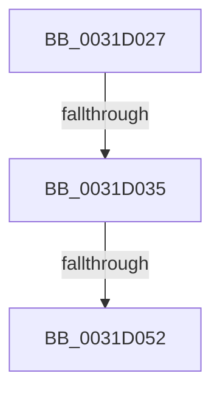

# sub_0031D027

- RVA: `0x0031D027`–`0x0031D066` (길이 `63` bytes)
- VA: `0x000000014031D027`
- 실행 섹션: `.text`
- PDB 이름 있음: `아니요`; PDB Function 태그: `아니요`
- unwind 정보 RVA: `0x00074F30`
- 디코드: `15`개 명령, `63/63` bytes 표시
- 미해석 바이트: `0` (있으면 어셈블리에 `.byte`로 보존)

> 이 문서는 커널 이미지의 기계어와 PDB 기호를 분석해 생성했습니다. 4번과 5번은 함수 원형과 자료형을 바이너리 사용 방식에서 추정한 C 해석이며 원본 소스 복구 결과는 아닙니다.

## 1. Dependencies

- 직접 호출 지점: **3**; 고유 호출 대상: **2**
- 직접 호출자로 확인된 함수: **0**
- RIP 상대 이미지 참조: **0**

### Outgoing calls
- `0x0031D027` → [MiGetSystemRegionType](../28/MiGetSystemRegionType_function_0028EC80.md) (function, `0x0028EC80`)
- `0x0031D039` → [MiGetLeafVa](../27/MiGetLeafVa_function_0027C0A0.md) (function, `0x0027C0A0`)
- `0x0031D044` → [MiGetSystemRegionType](../28/MiGetSystemRegionType_function_0028EC80.md) (function, `0x0028EC80`)

### Direct callers
- 이 함수 시작 RVA로 연결되는 직접 call은 확인되지 않았습니다. 간접 호출은 완전히 역산할 수 없습니다.

### Static image references
- 디코드된 RIP-relative 메모리 참조가 없습니다.

## 2. Other-region calls and transfers

- 다른 실행 섹션으로 향하는 call: **0**
- call이 아닌 외부 분기/꼬리 이동: **3**
  - `0x0031D02F` → [sub_006E146C + 0x83](../6E/Unknown_function_006E146C.md) (`tail-transfer`)
  - `0x0031D04C` → [sub_0031D25A](Unknown_function_0031D25A.md) (`tail-transfer`)
  - `0x0031D061` → [sub_0031CBBA + 0xC3](Unknown_function_0031CBBA.md) (`tail-transfer`)

## 3. Assembly (complete function range)

```asm
0031D027  E8 54 1C F7 FF                  call 0x14028ec80
0031D02C  83 F8 04                        cmp eax, 4
0031D02F  0F 84 BA 44 3C 00               je 0x1406e14ef
0031D035  48 8B 4D 77                     mov rcx, qword ptr [rbp + 0x77]
0031D039  E8 62 F0 F5 FF                  call 0x14027c0a0
0031D03E  48 8B C8                        mov rcx, rax
0031D041  48 8B F8                        mov rdi, rax
0031D044  E8 37 1C F7 FF                  call 0x14028ec80
0031D049  83 F8 04                        cmp eax, 4
0031D04C  0F 85 08 02 00 00               jne 0x14031d25a
0031D052  48 83 E3 F5                     and rbx, 0xfffffffffffffff5
0031D056  48 89 7E 10                     mov qword ptr [rsi + 0x10], rdi
0031D05A  48 83 CB 05                     or rbx, 5
0031D05E  48 89 1E                        mov qword ptr [rsi], rbx
0031D061  E9 17 FC FF FF                  jmp 0x14031cc7d
```

## 4. C-style interpretation (structured pseudocode)

```c
__int64 __fastcall sub_0031D027(void)
{
    __int64 result;
    __int64 v_rbx;

    result = MiGetSystemRegionType(a1, a2, a3, a4);
    result = MiGetLeafVa(*(unsigned __int64 *)(v_rbp + 119), a2, a3, a4);
    result = MiGetSystemRegionType(result, a2, a3, a4);
    v_rbx = (v_rbx) & (-11);
    *(unsigned __int64 *)(v_rsi + 16) = result;
    v_rbx = (v_rbx) | (5);
    *(unsigned __int64 *)(v_rsi) = v_rbx;
}
```

## 5. (Beta) C Style

```c
void sub_0031D027(void)
{
    int64_t result;
    int64_t local_rbx;

    result = MiGetSystemRegionType(a1, a2, a3, a4);
    result = MiGetLeafVa(*(uint64_t *)(local_rbp + 0x77), a2, a3, a4);
    result = MiGetSystemRegionType(result, a2, a3, a4);
    local_rbx = (local_rbx) & (-11);
    *(uint64_t *)(local_rsi + 0x10) = result;
    local_rbx = (local_rbx) | (5);
    *(uint64_t *)(local_rsi) = local_rbx;
}
```

## 6. Execution-region graph

[열기: 2D/3D 그래프와 함수 탐색 컨트롤 패널](../../../control-panel.html?section=text&rva=0x0031D027&view=graph)

- 2D 그래프는 위에서 아래로 흐르고, 3D 그래프는 빈 공간을 드래그해 회전합니다. Shift+드래그는 이동, 휠은 확대·축소, 함수 노드 선택은 대상 보고서 이동입니다.

### Static fallback


