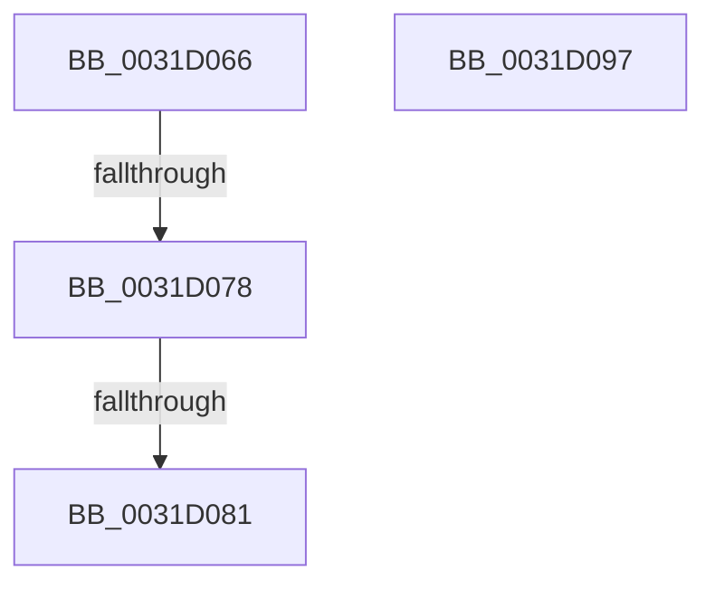

# sub_0031D066

- RVA: `0x0031D066`–`0x0031D09C` (길이 `54` bytes)
- VA: `0x000000014031D066`
- 실행 섹션: `.text`
- PDB 이름 있음: `아니요`; PDB Function 태그: `아니요`
- unwind 정보 RVA: `0x00074F54`
- 디코드: `14`개 명령, `54/54` bytes 표시
- 미해석 바이트: `0` (있으면 어셈블리에 `.byte`로 보존)

> 이 문서는 커널 이미지의 기계어와 PDB 기호를 분석해 생성했습니다. 4번과 5번은 함수 원형과 자료형을 바이너리 사용 방식에서 추정한 C 해석이며 원본 소스 복구 결과는 아닙니다.

## 1. Dependencies

- 직접 호출 지점: **0**; 고유 호출 대상: **0**
- 직접 호출자로 확인된 함수: **0**
- RIP 상대 이미지 참조: **0**

### Outgoing calls
- 직접 디코드된 call 명령이 없습니다.

### Direct callers
- 이 함수 시작 RVA로 연결되는 직접 call은 확인되지 않았습니다. 간접 호출은 완전히 역산할 수 없습니다.

### Static image references
- 디코드된 RIP-relative 메모리 참조가 없습니다.

## 2. Other-region calls and transfers

- 다른 실행 섹션으로 향하는 call: **0**
- call이 아닌 외부 분기/꼬리 이동: **4**
  - `0x0031D072` → [sub_0031D287 + 0x21](Unknown_function_0031D287.md) (`tail-transfer`)
  - `0x0031D07B` → [sub_0031D18E + 0x64](Unknown_function_0031D18E.md) (`tail-transfer`)
  - `0x0031D092` → [sub_0031CC85](Unknown_function_0031CC85.md) (`tail-transfer`)
  - `0x0031D097` → [sub_0031CD16 + 0x199](Unknown_function_0031CD16.md) (`tail-transfer`)

## 3. Assembly (complete function range)

```asm
0031D066  48 8B 45 17                     mov rax, qword ptr [rbp + 0x17]
0031D06A  48 C1 E8 3C                     shr rax, 0x3c
0031D06E  24 07                           and al, 7
0031D070  3C 02                           cmp al, 2
0031D072  0F 84 30 02 00 00               je 0x14031d2a8
0031D078  83 F9 05                        cmp ecx, 5
0031D07B  0F 85 71 01 00 00               jne 0x14031d1f2
0031D081  48 8B 06                        mov rax, qword ptr [rsi]
0031D084  48 83 E0 F4                     and rax, 0xfffffffffffffff4
0031D088  48 83 C8 04                     or rax, 4
0031D08C  48 89 06                        mov qword ptr [rsi], rax
0031D08F  8D 41 FC                        lea eax, [rcx - 4]
0031D092  E9 EE FB FF FF                  jmp 0x14031cc85
0031D097  E9 13 FE FF FF                  jmp 0x14031ceaf
```

## 4. C-style interpretation (structured pseudocode)

```c
__int64 __fastcall sub_0031D066(__int64 a1)
{
    __int64 result;

    result = (*(unsigned __int64 *)(v_rbp + 23)) >> (60);
    result = (unsigned __int8)((result) & (7));
    result = (*(unsigned __int64 *)(v_rsi)) & (-12);
    result = (result) | (4);
    *(unsigned __int64 *)(v_rsi) = result;
}
```

## 5. (Beta) C Style

```c
int64_t sub_0031D066(int64_t Arg1)
{
    int64_t result;

    result = (*(uint64_t *)(local_rbp + 0x17)) >> (60);
    result = (uint8_t)((result) & (7));
    result = (*(uint64_t *)(local_rsi)) & (-12);
    result = (result) | (4);
    *(uint64_t *)(local_rsi) = result;
}
```

## 6. Execution-region graph

[열기: 2D/3D 그래프와 함수 탐색 컨트롤 패널](../../../control-panel.html?section=text&rva=0x0031D066&view=graph)

- 2D 그래프는 위에서 아래로 흐르고, 3D 그래프는 빈 공간을 드래그해 회전합니다. Shift+드래그는 이동, 휠은 확대·축소, 함수 노드 선택은 대상 보고서 이동입니다.

### Static fallback


