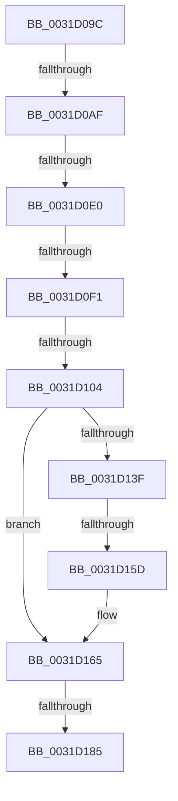

# sub_0031D09C

- RVA: `0x0031D09C`–`0x0031D18E` (길이 `242` bytes)
- VA: `0x000000014031D09C`
- 실행 섹션: `.text`
- PDB 이름 있음: `아니요`; PDB Function 태그: `아니요`
- unwind 정보 RVA: `0x00074F74`
- 디코드: `58`개 명령, `242/242` bytes 표시
- 미해석 바이트: `0` (있으면 어셈블리에 `.byte`로 보존)

> 이 문서는 커널 이미지의 기계어와 PDB 기호를 분석해 생성했습니다. 4번과 5번은 함수 원형과 자료형을 바이너리 사용 방식에서 추정한 C 해석이며 원본 소스 복구 결과는 아닙니다.

## 1. Dependencies

- 직접 호출 지점: **1**; 고유 호출 대상: **1**
- 직접 호출자로 확인된 함수: **0**
- RIP 상대 이미지 참조: **0**

### Outgoing calls
- `0x0031D177` → [MiGetLeafVa](../27/MiGetLeafVa_function_0027C0A0.md) (function, `0x0027C0A0`)

### Direct callers
- 이 함수 시작 RVA로 연결되는 직접 call은 확인되지 않았습니다. 간접 호출은 완전히 역산할 수 없습니다.

### Static image references
- 디코드된 RIP-relative 메모리 참조가 없습니다.

## 2. Other-region calls and transfers

- 다른 실행 섹션으로 향하는 call: **0**
- call이 아닌 외부 분기/꼬리 이동: **7**
  - `0x0031D0A9` → [sub_0031D533](Unknown_function_0031D533.md) (`tail-transfer`)
  - `0x0031D0DA` → [sub_0031D533 + 0x8](Unknown_function_0031D533.md) (`tail-transfer`)
  - `0x0031D0EB` → [sub_0031CBBA + 0x73](Unknown_function_0031CBBA.md) (`tail-transfer`)
  - `0x0031D0FE` → [sub_0031D533 + 0x14](Unknown_function_0031D533.md) (`tail-transfer`)
  - `0x0031D157` → [sub_0031D2C0](Unknown_function_0031D2C0.md) (`tail-transfer`)
  - `0x0031D17F` → [sub_006E146C](../6E/Unknown_function_006E146C.md) (`tail-transfer`)
  - `0x0031D189` → [sub_0031CBBA + 0x73](Unknown_function_0031CBBA.md) (`tail-transfer`)

## 3. Assembly (complete function range)

```asm
0031D09C  48 8B 47 28                     mov rax, qword ptr [rdi + 0x28]
0031D0A0  48 C1 E8 3C                     shr rax, 0x3c
0031D0A4  24 07                           and al, 7
0031D0A6  41 3A C2                        cmp al, r10b
0031D0A9  0F 84 84 04 00 00               je 0x14031d533
0031D0AF  48 8B 47 10                     mov rax, qword ptr [rdi + 0x10]
0031D0B3  48 8B D0                        mov rdx, rax
0031D0B6  48 8B C8                        mov rcx, rax
0031D0B9  81 E2 00 04 00 00               and edx, 0x400
0031D0BF  48 C1 E9 0B                     shr rcx, 0xb
0031D0C3  48 C1 E8 03                     shr rax, 3
0031D0C7  48 85 D2                        test rdx, rdx
0031D0CA  48 BA 00 00 00 00 80 F6 FF FF   movabs rdx, 0xfffff68000000000
0031D0D4  0F 45 C1                        cmovne eax, ecx
0031D0D7  41 84 C2                        test r10b, al
0031D0DA  0F 85 5B 04 00 00               jne 0x14031d53b
0031D0E0  48 8B 4F 08                     mov rcx, qword ptr [rdi + 8]
0031D0E4  48 89 4D 77                     mov qword ptr [rbp + 0x77], rcx
0031D0E8  48 85 C9                        test rcx, rcx
0031D0EB  0F 84 3C FB FF FF               je 0x14031cc2d
0031D0F1  48 8B 47 28                     mov rax, qword ptr [rdi + 0x28]
0031D0F5  48 C1 E8 3C                     shr rax, 0x3c
0031D0F9  24 07                           and al, 7
0031D0FB  41 3A C2                        cmp al, r10b
0031D0FE  0F 84 43 04 00 00               je 0x14031d547
0031D104  48 8B 47 08                     mov rax, qword ptr [rdi + 8]
0031D108  48 B9 00 00 00 00 00 00 00 80   movabs rcx, 0x8000000000000000
0031D112  48 0B C1                        or rax, rcx
0031D115  48 89 45 77                     mov qword ptr [rbp + 0x77], rax
0031D119  48 8B CA                        mov rcx, rdx
0031D11C  48 C1 E1 19                     shl rcx, 0x19
0031D120  48 89 4D 7F                     mov qword ptr [rbp + 0x7f], rcx
0031D124  48 8B C8                        mov rcx, rax
0031D127  48 C1 E1 19                     shl rcx, 0x19
0031D12B  48 2B 4D 7F                     sub rcx, qword ptr [rbp + 0x7f]
0031D12F  48 C1 F9 10                     sar rcx, 0x10
0031D133  48 89 4D D7                     mov qword ptr [rbp - 0x29], rcx
0031D137  48 8B C2                        mov rax, rdx
0031D13A  48 3B C8                        cmp rcx, rax
0031D13D  72 26                           jb 0x14031d165
0031D13F  4C 8B 6D D7                     mov r13, qword ptr [rbp - 0x29]
0031D143  48 8B 5D 7F                     mov rbx, qword ptr [rbp + 0x7f]
0031D147  48 B9 FF FF FF FF FF F6 FF FF   movabs rcx, 0xfffff6ffffffffff
0031D151  48 8B C1                        mov rax, rcx
0031D154  4C 3B E8                        cmp r13, rax
0031D157  0F 86 63 01 00 00               jbe 0x14031d2c0
0031D15D  48 8B 5D DF                     mov rbx, qword ptr [rbp - 0x21]
0031D161  4C 8B 6D E7                     mov r13, qword ptr [rbp - 0x19]
0031D165  48 8B 45 77                     mov rax, qword ptr [rbp + 0x77]
0031D169  4D 2B F0                        sub r14, r8
0031D16C  4A 8D 04 F0                     lea rax, [rax + r14*8]
0031D170  48 8B C8                        mov rcx, rax
0031D173  48 89 45 77                     mov qword ptr [rbp + 0x77], rax
0031D177  E8 24 EF F5 FF                  call 0x14027c0a0
0031D17C  49 3B C3                        cmp rax, r11
0031D17F  0F 86 E7 42 3C 00               jbe 0x1406e146c
0031D185  48 8B 4D 77                     mov rcx, qword ptr [rbp + 0x77]
0031D189  E9 9F FA FF FF                  jmp 0x14031cc2d
```

## 4. C-style interpretation (structured pseudocode)

```c
__int64 __fastcall sub_0031D09C(__int64 a1, __int64 a2, __int64 a3)
{
    __int64 result;
    __int64 v_r14;

    result = (*(unsigned __int64 *)(v_rdi + 40)) >> (60);
    result = (unsigned __int8)((result) & (7));
    a2 = (unsigned int)((*(unsigned __int64 *)(v_rdi + 16)) & (0x400ULL));
    a1 = (*(unsigned __int64 *)(v_rdi + 16)) >> (11);
    result = (*(unsigned __int64 *)(v_rdi + 16)) >> (3);
    if (a2 != 0) { result = (unsigned int)(a1); }
    *(unsigned __int64 *)(v_rbp + 119) = *(unsigned __int64 *)(v_rdi + 8);
    result = (*(unsigned __int64 *)(v_rdi + 40)) >> (60);
    result = (unsigned __int8)((result) & (7));
    result = (*(unsigned __int64 *)(v_rdi + 8)) | (*(unsigned __int64 *)(v_rdi + 8));
    *(unsigned __int64 *)(v_rbp + 119) = result;
    a1 = (a2) << (25);
    *(unsigned __int64 *)(v_rbp + 127) = a1;
    a1 = (result) << (25);
    a1 = (a1) - (*(unsigned __int64 *)(v_rbp + 127));
    a1 = (a1) >> (16);
    *(unsigned __int64 *)(v_rbp - 41) = a1;
    if (a1 < a2) goto loc_0031D165;
loc_0031D165:
    v_r14 = (v_r14) - (a3);
    *(unsigned __int64 *)(v_rbp + 119) = *(unsigned __int64 *)(v_rbp + 119) + v_r14 * 8;
    result = MiGetLeafVa(*(unsigned __int64 *)(v_rbp + 119) + v_r14 * 8, a2, a3, a4);
}
```

## 5. (Beta) C Style

```c
int64_t sub_0031D09C(int64_t Arg1, int64_t Arg2, int64_t Arg3)
{
    int64_t result;
    int64_t local_r14;

    result = (*(uint64_t *)(local_rdi + 0x28)) >> (60);
    result = (uint8_t)((result) & (7));
    Arg2 = (uint32_t)((*(uint64_t *)(local_rdi + 0x10)) & (0x400ULL));
    Arg1 = (*(uint64_t *)(local_rdi + 0x10)) >> (11);
    result = (*(uint64_t *)(local_rdi + 0x10)) >> (3);
    if (Arg2 != 0) { result = (uint32_t)(Arg1); }
    *(uint64_t *)(local_rbp + 0x77) = *(uint64_t *)(local_rdi + 0x8);
    result = (*(uint64_t *)(local_rdi + 0x28)) >> (60);
    result = (uint8_t)((result) & (7));
    result = (*(uint64_t *)(local_rdi + 0x8)) | (*(uint64_t *)(local_rdi + 0x8));
    *(uint64_t *)(local_rbp + 0x77) = result;
    Arg1 = (Arg2) << (25);
    *(uint64_t *)(local_rbp + 0x7F) = Arg1;
    Arg1 = (result) << (25);
    Arg1 = (Arg1) - (*(uint64_t *)(local_rbp + 0x7F));
    Arg1 = (Arg1) >> (16);
    *(uint64_t *)(local_rbp - 0x29) = Arg1;
    if (Arg1 < Arg2) goto loc_0031D165;
loc_0031D165:
    local_r14 = (local_r14) - (Arg3);
    *(uint64_t *)(local_rbp + 0x77) = *(uint64_t *)(local_rbp + 0x77) + local_r14 * 8;
    result = MiGetLeafVa(*(uint64_t *)(local_rbp + 0x77) + local_r14 * 8, Arg2, Arg3, a4);
}
```

## 6. Execution-region graph

[열기: 2D/3D 그래프와 함수 탐색 컨트롤 패널](../../../control-panel.html?section=text&rva=0x0031D09C&view=graph)

- 2D 그래프는 위에서 아래로 흐르고, 3D 그래프는 빈 공간을 드래그해 회전합니다. Shift+드래그는 이동, 휠은 확대·축소, 함수 노드 선택은 대상 보고서 이동입니다.

### Static fallback


