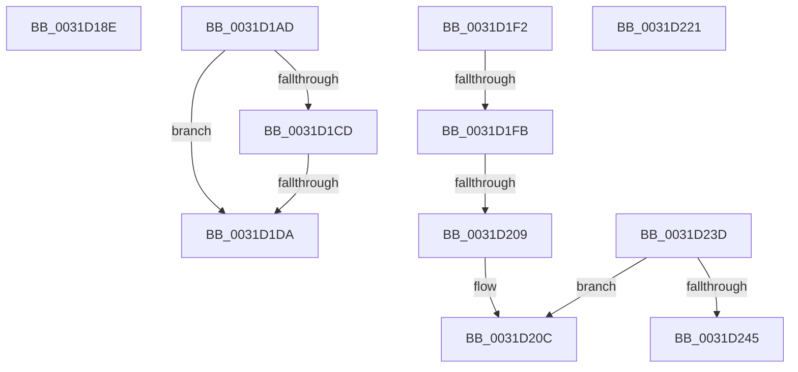

# sub_0031D18E

- RVA: `0x0031D18E`–`0x0031D25A` (길이 `204` bytes)
- VA: `0x000000014031D18E`
- 실행 섹션: `.text`
- PDB 이름 있음: `아니요`; PDB Function 태그: `아니요`
- unwind 정보 RVA: `0x00074F98`
- 디코드: `49`개 명령, `204/204` bytes 표시
- 미해석 바이트: `0` (있으면 어셈블리에 `.byte`로 보존)

> 이 문서는 커널 이미지의 기계어와 PDB 기호를 분석해 생성했습니다. 4번과 5번은 함수 원형과 자료형을 바이너리 사용 방식에서 추정한 C 해석이며 원본 소스 복구 결과는 아닙니다.

## 1. Dependencies

- 직접 호출 지점: **1**; 고유 호출 대상: **1**
- 직접 호출자로 확인된 함수: **0**
- RIP 상대 이미지 참조: **0**

### Outgoing calls
- `0x0031D19E` → [ExReleaseSpinLockExclusiveFromDpcLevel](../24/ExReleaseSpinLockExclusiveFromDpcLevel_function_002497E0.md) (function, `0x002497E0`)

### Direct callers
- 이 함수 시작 RVA로 연결되는 직접 call은 확인되지 않았습니다. 간접 호출은 완전히 역산할 수 없습니다.

### Static image references
- 디코드된 RIP-relative 메모리 참조가 없습니다.

## 2. Other-region calls and transfers

- 다른 실행 섹션으로 향하는 call: **0**
- call이 아닌 외부 분기/꼬리 이동: **8**
  - `0x0031D1A8` → [sub_0031CC85](Unknown_function_0031CC85.md) (`tail-transfer`)
  - `0x0031D1D4` → [sub_0031D2E0 + 0x50](Unknown_function_0031D2E0.md) (`tail-transfer`)
  - `0x0031D1ED` → [sub_0031CC85](Unknown_function_0031CC85.md) (`tail-transfer`)
  - `0x0031D1F5` → [sub_0031CD16 + 0x1F0](Unknown_function_0031CD16.md) (`tail-transfer`)
  - `0x0031D203` → [sub_0031CD16 + 0x1F0](Unknown_function_0031CD16.md) (`tail-transfer`)
  - `0x0031D21C` → [sub_0031CC85](Unknown_function_0031CC85.md) (`tail-transfer`)
  - `0x0031D238` → [sub_0031CC85](Unknown_function_0031CC85.md) (`tail-transfer`)
  - `0x0031D255` → [sub_0031CC85](Unknown_function_0031CC85.md) (`tail-transfer`)

## 3. Assembly (complete function range)

```asm
0031D18E  48 8B 06                        mov rax, qword ptr [rsi]
0031D191  48 25 9F FE FF FF               and rax, 0xfffffffffffffe9f
0031D197  48 83 C8 10                     or rax, 0x10
0031D19B  48 89 06                        mov qword ptr [rsi], rax
0031D19E  E8 3D C6 F2 FF                  call 0x1402497e0
0031D1A3  B8 01 00 00 00                  mov eax, 1
0031D1A8  E9 D8 FA FF FF                  jmp 0x14031cc85
0031D1AD  48 8B 45 F7                     mov rax, qword ptr [rbp - 9]
0031D1B1  48 B9 00 00 00 00 00 00 00 80   movabs rcx, 0x8000000000000000
0031D1BB  48 0B C1                        or rax, rcx
0031D1BE  48 89 46 10                     mov qword ptr [rsi + 0x10], rax
0031D1C2  48 8B 45 17                     mov rax, qword ptr [rbp + 0x17]
0031D1C6  48 0F BA E0 28                  bt rax, 0x28
0031D1CB  72 0D                           jb 0x14031d1da
0031D1CD  48 8B 45 F7                     mov rax, qword ptr [rbp - 9]
0031D1D1  48 85 C0                        test rax, rax
0031D1D4  0F 89 56 01 00 00               jns 0x14031d330
0031D1DA  48 8B 06                        mov rax, qword ptr [rsi]
0031D1DD  48 83 E0 F2                     and rax, 0xfffffffffffffff2
0031D1E1  48 83 C8 02                     or rax, 2
0031D1E5  48 89 06                        mov qword ptr [rsi], rax
0031D1E8  B8 01 00 00 00                  mov eax, 1
0031D1ED  E9 93 FA FF FF                  jmp 0x14031cc85
0031D1F2  83 F9 11                        cmp ecx, 0x11
0031D1F5  0F 87 0B FD FF FF               ja 0x14031cf06
0031D1FB  B8 00 A9 02 00                  mov eax, 0x2a900
0031D200  0F A3 C8                        bt eax, ecx
0031D203  0F 83 FD FC FF FF               jae 0x14031cf06
0031D209  48 8B 06                        mov rax, qword ptr [rsi]
0031D20C  48 83 E0 F6                     and rax, 0xfffffffffffffff6
0031D210  48 83 C8 06                     or rax, 6
0031D214  48 89 06                        mov qword ptr [rsi], rax
0031D217  B8 01 00 00 00                  mov eax, 1
0031D21C  E9 64 FA FF FF                  jmp 0x14031cc85
0031D221  48 8B 06                        mov rax, qword ptr [rsi]
0031D224  48 83 E0 F5                     and rax, 0xfffffffffffffff5
0031D228  4C 89 66 10                     mov qword ptr [rsi + 0x10], r12
0031D22C  48 83 C8 05                     or rax, 5
0031D230  48 89 06                        mov qword ptr [rsi], rax
0031D233  B8 01 00 00 00                  mov eax, 1
0031D238  E9 48 FA FF FF                  jmp 0x14031cc85
0031D23D  48 8B 06                        mov rax, qword ptr [rsi]
0031D240  83 F9 08                        cmp ecx, 8
0031D243  74 C7                           je 0x14031d20c
0031D245  48 83 E0 FA                     and rax, 0xfffffffffffffffa
0031D249  48 83 C8 0A                     or rax, 0xa
0031D24D  48 89 06                        mov qword ptr [rsi], rax
0031D250  B8 01 00 00 00                  mov eax, 1
0031D255  E9 2B FA FF FF                  jmp 0x14031cc85
```

## 4. C-style interpretation (structured pseudocode)

```c
__int64 __fastcall sub_0031D18E(void)
{
    __int64 result;

    result = (*(unsigned __int64 *)(v_rsi)) & (-353);
    result = (result) | (16);
    *(unsigned __int64 *)(v_rsi) = result;
    result = ExReleaseSpinLockExclusiveFromDpcLevel(a1, a2, a3, a4);
}
```

## 5. (Beta) C Style

```c
void sub_0031D18E(void)
{
    int64_t result;

    result = (*(uint64_t *)(local_rsi)) & (-353);
    result = (result) | (16);
    *(uint64_t *)(local_rsi) = result;
    result = ExReleaseSpinLockExclusiveFromDpcLevel(a1, a2, a3, a4);
}
```

## 6. Execution-region graph

[열기: 2D/3D 그래프와 함수 탐색 컨트롤 패널](../../../control-panel.html?section=text&rva=0x0031D18E&view=graph)

- 2D 그래프는 위에서 아래로 흐르고, 3D 그래프는 빈 공간을 드래그해 회전합니다. Shift+드래그는 이동, 휠은 확대·축소, 함수 노드 선택은 대상 보고서 이동입니다.

### Static fallback


