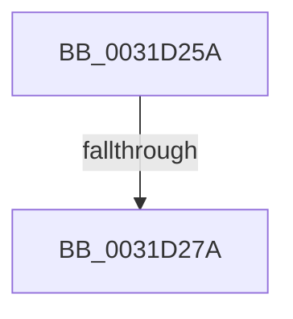

# sub_0031D25A

- RVA: `0x0031D25A`–`0x0031D287` (길이 `45` bytes)
- VA: `0x000000014031D25A`
- 실행 섹션: `.text`
- PDB 이름 있음: `아니요`; PDB Function 태그: `아니요`
- unwind 정보 RVA: `0x00074FB8`
- 디코드: `9`개 명령, `45/45` bytes 표시
- 미해석 바이트: `0` (있으면 어셈블리에 `.byte`로 보존)

> 이 문서는 커널 이미지의 기계어와 PDB 기호를 분석해 생성했습니다. 4번과 5번은 함수 원형과 자료형을 바이너리 사용 방식에서 추정한 C 해석이며 원본 소스 복구 결과는 아닙니다.

## 1. Dependencies

- 직접 호출 지점: **0**; 고유 호출 대상: **0**
- 직접 호출자로 확인된 함수: **0**
- RIP 상대 이미지 참조: **0**

### Outgoing calls
- 직접 디코드된 call 명령이 없습니다.

### Direct callers
- 이 함수 시작 RVA로 연결되는 직접 call은 확인되지 않았습니다. 간접 호출은 완전히 역산할 수 없습니다.

### Static image references
- 디코드된 RIP-relative 메모리 참조가 없습니다.

## 2. Other-region calls and transfers

- 다른 실행 섹션으로 향하는 call: **0**
- call이 아닌 외부 분기/꼬리 이동: **2**
  - `0x0031D274` → [sub_0031D41F](Unknown_function_0031D41F.md) (`tail-transfer`)
  - `0x0031D282` → [sub_0031CBBA + 0xC0](Unknown_function_0031CBBA.md) (`tail-transfer`)

## 3. Assembly (complete function range)

```asm
0031D25A  48 8B C7                        mov rax, rdi
0031D25D  48 BA FF FF FE FF FF 7F 00 00   movabs rdx, 0x7ffffffeffff
0031D267  48 25 00 F0 FF FF               and rax, 0xfffffffffffff000
0031D26D  48 89 46 10                     mov qword ptr [rsi + 0x10], rax
0031D271  48 3B FA                        cmp rdi, rdx
0031D274  0F 86 A5 01 00 00               jbe 0x14031d41f
0031D27A  48 83 E3 F6                     and rbx, 0xfffffffffffffff6
0031D27E  48 83 CB 06                     or rbx, 6
0031D282  E9 F3 F9 FF FF                  jmp 0x14031cc7a
```

## 4. C-style interpretation (structured pseudocode)

```c
__int64 __fastcall sub_0031D25A(void)
{
    __int64 result;
    __int64 v_rbx;

    result = (v_rdi) & (0xFFFFFFFFFFFFF000ULL);
    *(unsigned __int64 *)(v_rsi + 16) = result;
    v_rbx = (v_rbx) & (-10);
    v_rbx = (v_rbx) | (6);
}
```

## 5. (Beta) C Style

```c
void sub_0031D25A(void)
{
    int64_t result;
    int64_t local_rbx;

    result = (local_rdi) & (0xFFFFFFFFFFFFF000ULL);
    *(uint64_t *)(local_rsi + 0x10) = result;
    local_rbx = (local_rbx) & (-10);
    local_rbx = (local_rbx) | (6);
}
```

## 6. Execution-region graph

[열기: 2D/3D 그래프와 함수 탐색 컨트롤 패널](../../../control-panel.html?section=text&rva=0x0031D25A&view=graph)

- 2D 그래프는 위에서 아래로 흐르고, 3D 그래프는 빈 공간을 드래그해 회전합니다. Shift+드래그는 이동, 휠은 확대·축소, 함수 노드 선택은 대상 보고서 이동입니다.

### Static fallback


