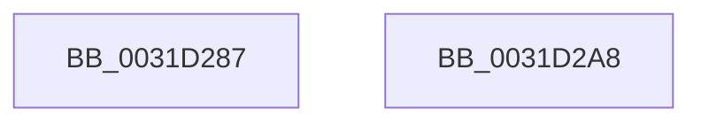

# sub_0031D287

- RVA: `0x0031D287`–`0x0031D2C0` (길이 `57` bytes)
- VA: `0x000000014031D287`
- 실행 섹션: `.text`
- PDB 이름 있음: `아니요`; PDB Function 태그: `아니요`
- unwind 정보 RVA: `0x00074FDC`
- 디코드: `13`개 명령, `57/57` bytes 표시
- 미해석 바이트: `0` (있으면 어셈블리에 `.byte`로 보존)

> 이 문서는 커널 이미지의 기계어와 PDB 기호를 분석해 생성했습니다. 4번과 5번은 함수 원형과 자료형을 바이너리 사용 방식에서 추정한 C 해석이며 원본 소스 복구 결과는 아닙니다.

## 1. Dependencies

- 직접 호출 지점: **0**; 고유 호출 대상: **0**
- 직접 호출자로 확인된 함수: **0**
- RIP 상대 이미지 참조: **0**

### Outgoing calls
- 직접 디코드된 call 명령이 없습니다.

### Direct callers
- 이 함수 시작 RVA로 연결되는 직접 call은 확인되지 않았습니다. 간접 호출은 완전히 역산할 수 없습니다.

### Static image references
- 디코드된 RIP-relative 메모리 참조가 없습니다.

## 2. Other-region calls and transfers

- 다른 실행 섹션으로 향하는 call: **0**
- call이 아닌 외부 분기/꼬리 이동: **2**
  - `0x0031D2A3` → [sub_0031CC85](Unknown_function_0031CC85.md) (`tail-transfer`)
  - `0x0031D2BB` → [sub_0031CC85](Unknown_function_0031CC85.md) (`tail-transfer`)

## 3. Assembly (complete function range)

```asm
0031D287  48 8B 06                        mov rax, qword ptr [rsi]
0031D28A  48 B9 9F FF FF FF FF FF FF F1   movabs rcx, 0xf1ffffffffffff9f
0031D294  48 23 C1                        and rax, rcx
0031D297  48 83 C8 10                     or rax, 0x10
0031D29B  48 89 06                        mov qword ptr [rsi], rax
0031D29E  B8 01 00 00 00                  mov eax, 1
0031D2A3  E9 DD F9 FF FF                  jmp 0x14031cc85
0031D2A8  48 8B 06                        mov rax, qword ptr [rsi]
0031D2AB  48 83 E0 FB                     and rax, 0xfffffffffffffffb
0031D2AF  48 83 C8 0B                     or rax, 0xb
0031D2B3  48 89 06                        mov qword ptr [rsi], rax
0031D2B6  B8 01 00 00 00                  mov eax, 1
0031D2BB  E9 C5 F9 FF FF                  jmp 0x14031cc85
```

## 4. C-style interpretation (structured pseudocode)

```c
__int64 __fastcall sub_0031D287(void)
{
    __int64 result;

    result = (*(unsigned __int64 *)(v_rsi)) & (a1);
    result = (result) | (16);
    *(unsigned __int64 *)(v_rsi) = result;
}
```

## 5. (Beta) C Style

```c
void sub_0031D287(void)
{
    int64_t result;

    result = (*(uint64_t *)(local_rsi)) & (a1);
    result = (result) | (16);
    *(uint64_t *)(local_rsi) = result;
}
```

## 6. Execution-region graph

[열기: 2D/3D 그래프와 함수 탐색 컨트롤 패널](../../../control-panel.html?section=text&rva=0x0031D287&view=graph)

- 2D 그래프는 위에서 아래로 흐르고, 3D 그래프는 빈 공간을 드래그해 회전합니다. Shift+드래그는 이동, 휠은 확대·축소, 함수 노드 선택은 대상 보고서 이동입니다.

### Static fallback


