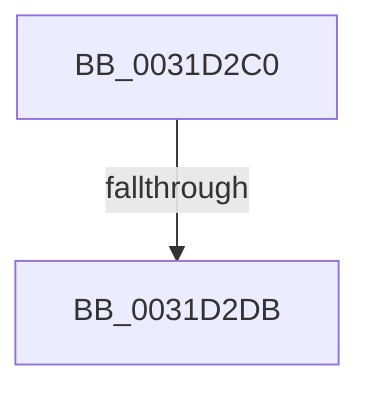

# sub_0031D2C0

- RVA: `0x0031D2C0`–`0x0031D2E0` (길이 `32` bytes)
- VA: `0x000000014031D2C0`
- 실행 섹션: `.text`
- PDB 이름 있음: `아니요`; PDB Function 태그: `아니요`
- unwind 정보 RVA: `0x00074FFC`
- 디코드: `8`개 명령, `32/32` bytes 표시
- 미해석 바이트: `0` (있으면 어셈블리에 `.byte`로 보존)

> 이 문서는 커널 이미지의 기계어와 PDB 기호를 분석해 생성했습니다. 4번과 5번은 함수 원형과 자료형을 바이너리 사용 방식에서 추정한 C 해석이며 원본 소스 복구 결과는 아닙니다.

## 1. Dependencies

- 직접 호출 지점: **0**; 고유 호출 대상: **0**
- 직접 호출자로 확인된 함수: **0**
- RIP 상대 이미지 참조: **0**

### Outgoing calls
- 직접 디코드된 call 명령이 없습니다.

### Direct callers
- 이 함수 시작 RVA로 연결되는 직접 call은 확인되지 않았습니다. 간접 호출은 완전히 역산할 수 없습니다.

### Static image references
- 디코드된 RIP-relative 메모리 참조가 없습니다.

## 2. Other-region calls and transfers

- 다른 실행 섹션으로 향하는 call: **0**
- call이 아닌 외부 분기/꼬리 이동: **2**
  - `0x0031D2D5` → [sub_0031D09C + 0xC1](Unknown_function_0031D09C.md) (`tail-transfer`)
  - `0x0031D2DB` → [sub_0031D09C + 0xB5](Unknown_function_0031D09C.md) (`tail-transfer`)

## 3. Assembly (complete function range)

```asm
0031D2C0  4C 89 6D 77                     mov qword ptr [rbp + 0x77], r13
0031D2C4  49 C1 E5 19                     shl r13, 0x19
0031D2C8  4C 2B EB                        sub r13, rbx
0031D2CB  49 C1 FD 10                     sar r13, 0x10
0031D2CF  48 8B C2                        mov rax, rdx
0031D2D2  4C 3B E8                        cmp r13, rax
0031D2D5  0F 82 82 FE FF FF               jb 0x14031d15d
0031D2DB  E9 71 FE FF FF                  jmp 0x14031d151
```

## 4. C-style interpretation (structured pseudocode)

```c
__int64 __fastcall sub_0031D2C0(__int64 a1, __int64 a2)
{
    __int64 v_r13;

    *(unsigned __int64 *)(v_rbp + 119) = v_r13;
    v_r13 = (v_r13) << (25);
    v_r13 = (v_r13) - (v_rbx);
    v_r13 = (v_r13) >> (16);
}
```

## 5. (Beta) C Style

```c
int64_t sub_0031D2C0(int64_t Arg1, int64_t Arg2)
{
    int64_t local_r13;

    *(uint64_t *)(local_rbp + 0x77) = local_r13;
    local_r13 = (local_r13) << (25);
    local_r13 = (local_r13) - (local_rbx);
    local_r13 = (local_r13) >> (16);
}
```

## 6. Execution-region graph

[열기: 2D/3D 그래프와 함수 탐색 컨트롤 패널](../../../control-panel.html?section=text&rva=0x0031D2C0&view=graph)

- 2D 그래프는 위에서 아래로 흐르고, 3D 그래프는 빈 공간을 드래그해 회전합니다. Shift+드래그는 이동, 휠은 확대·축소, 함수 노드 선택은 대상 보고서 이동입니다.

### Static fallback


