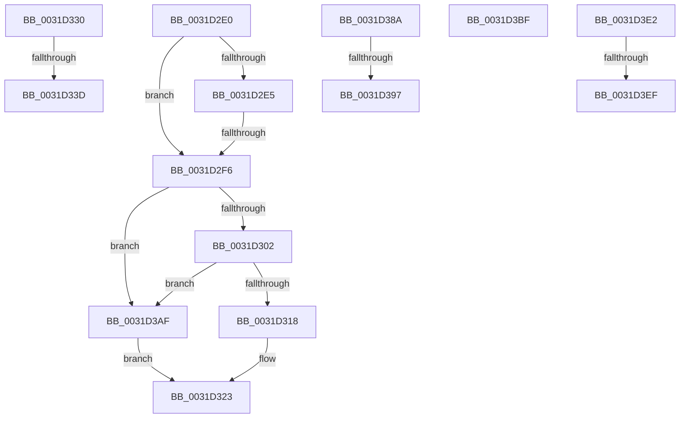

# sub_0031D2E0

- RVA: `0x0031D2E0`–`0x0031D41F` (길이 `319` bytes)
- VA: `0x000000014031D2E0`
- 실행 섹션: `.text`
- PDB 이름 있음: `아니요`; PDB Function 태그: `아니요`
- unwind 정보 RVA: `0x00075020`
- 디코드: `71`개 명령, `319/319` bytes 표시
- 미해석 바이트: `0` (있으면 어셈블리에 `.byte`로 보존)

> 이 문서는 커널 이미지의 기계어와 PDB 기호를 분석해 생성했습니다. 4번과 5번은 함수 원형과 자료형을 바이너리 사용 방식에서 추정한 C 해석이며 원본 소스 복구 결과는 아닙니다.

## 1. Dependencies

- 직접 호출 지점: **1**; 고유 호출 대상: **1**
- 직접 호출자로 확인된 함수: **0**
- RIP 상대 이미지 참조: **2**

### Outgoing calls
- `0x0031D2E9` → [MiHyperPage](MiHyperPage_function_0031DCD4.md) (function, `0x0031DCD4`)

### Direct callers
- 이 함수 시작 RVA로 연결되는 직접 call은 확인되지 않았습니다. 간접 호출은 완전히 역산할 수 없습니다.

### Static image references
- `0x0031D38A` → RVA `0x00E2F390` (`.data`; read)
- `0x0031D3CD` → RVA `0x00FC6C08` (`ALMOSTRO`; read)

## 2. Other-region calls and transfers

- 다른 실행 섹션으로 향하는 call: **0**
- call이 아닌 외부 분기/꼬리 이동: **9**
  - `0x0031D2F0` → [sub_006E1546 + 0xDB](../6E/Unknown_function_006E1546.md) (`tail-transfer`)
  - `0x0031D32B` → [sub_0031CC85](Unknown_function_0031CC85.md) (`tail-transfer`)
  - `0x0031D337` → [sub_0031D18E + 0x4C](Unknown_function_0031D18E.md) (`tail-transfer`)
  - `0x0031D385` → [sub_0031D18E + 0x4C](Unknown_function_0031D18E.md) (`tail-transfer`)
  - `0x0031D391` → [sub_0031CD16 + 0x272](Unknown_function_0031CD16.md) (`tail-transfer`)
  - `0x0031D3AA` → [sub_0031CC85](Unknown_function_0031CC85.md) (`tail-transfer`)
  - `0x0031D3DD` → [sub_0031CC85](Unknown_function_0031CC85.md) (`tail-transfer`)
  - `0x0031D3E9` → [sub_0031CD16 + 0x272](Unknown_function_0031CD16.md) (`tail-transfer`)
  - `0x0031D41A` → [sub_0031CD16 + 0x272](Unknown_function_0031CD16.md) (`tail-transfer`)

## 3. Assembly (complete function range)

```asm
0031D2E0  4C 3B E2                        cmp r12, rdx
0031D2E3  76 11                           jbe 0x14031d2f6
0031D2E5  48 8D 4D EF                     lea rcx, [rbp - 0x11]
0031D2E9  E8 E6 09 00 00                  call 0x14031dcd4
0031D2EE  85 C0                           test eax, eax
0031D2F0  0F 85 2B 43 3C 00               jne 0x1406e1621
0031D2F6  48 8B C7                        mov rax, rdi
0031D2F9  4C 3B E0                        cmp r12, rax
0031D2FC  0F 82 AD 00 00 00               jb 0x14031d3af
0031D302  48 B9 FF FF FF FF FF F6 FF FF   movabs rcx, 0xfffff6ffffffffff
0031D30C  48 8B C1                        mov rax, rcx
0031D30F  4C 3B E0                        cmp r12, rax
0031D312  0F 87 97 00 00 00               ja 0x14031d3af
0031D318  48 8B 06                        mov rax, qword ptr [rsi]
0031D31B  48 83 E0 F3                     and rax, 0xfffffffffffffff3
0031D31F  48 83 C8 03                     or rax, 3
0031D323  48 89 06                        mov qword ptr [rsi], rax
0031D326  B8 01 00 00 00                  mov eax, 1
0031D32B  E9 55 F9 FF FF                  jmp 0x14031cc85
0031D330  48 8B 45 F7                     mov rax, qword ptr [rbp - 9]
0031D334  48 85 C0                        test rax, rax
0031D337  0F 84 9D FE FF FF               je 0x14031d1da
0031D33D  48 8B 45 F7                     mov rax, qword ptr [rbp - 9]
0031D341  48 BA FF FF FF FF FF FF 00 00   movabs rdx, 0xffffffffffff
0031D34B  48 83 4E 10 01                  or qword ptr [rsi + 0x10], 1
0031D350  48 0B C1                        or rax, rcx
0031D353  48 8B 48 18                     mov rcx, qword ptr [rax + 0x18]
0031D357  48 B8 00 00 00 00 00 00 01 00   movabs rax, 0x1000000000000
0031D361  48 3B C8                        cmp rcx, rax
0031D364  48 0F 43 CA                     cmovae rcx, rdx
0031D368  48 BA FF 01 00 00 00 00 00 FE   movabs rdx, 0xfe000000000001ff
0031D372  48 C1 E1 09                     shl rcx, 9
0031D376  48 8B C1                        mov rax, rcx
0031D379  48 33 06                        xor rax, qword ptr [rsi]
0031D37C  48 23 C2                        and rax, rdx
0031D37F  48 33 C1                        xor rax, rcx
0031D382  48 89 06                        mov qword ptr [rsi], rax
0031D385  E9 50 FE FF FF                  jmp 0x14031d1da
0031D38A  4C 3B 25 FF 1F B1 00            cmp r12, qword ptr [rip + 0xb11fff]
0031D391  0F 87 F1 FB FF FF               ja 0x14031cf88
0031D397  48 8B 06                        mov rax, qword ptr [rsi]
0031D39A  48 83 E0 FC                     and rax, 0xfffffffffffffffc
0031D39E  48 83 C8 0C                     or rax, 0xc
0031D3A2  48 89 06                        mov qword ptr [rsi], rax
0031D3A5  B8 01 00 00 00                  mov eax, 1
0031D3AA  E9 D6 F8 FF FF                  jmp 0x14031cc85
0031D3AF  48 8B 06                        mov rax, qword ptr [rsi]
0031D3B2  48 83 E0 F5                     and rax, 0xfffffffffffffff5
0031D3B6  48 83 C8 05                     or rax, 5
0031D3BA  E9 64 FF FF FF                  jmp 0x14031d323
0031D3BF  48 8B 06                        mov rax, qword ptr [rsi]
0031D3C2  48 83 E0 F5                     and rax, 0xfffffffffffffff5
0031D3C6  48 83 C8 05                     or rax, 5
0031D3CA  48 89 06                        mov qword ptr [rsi], rax
0031D3CD  48 8B 05 34 98 CA 00            mov rax, qword ptr [rip + 0xca9834]
0031D3D4  48 89 46 10                     mov qword ptr [rsi + 0x10], rax
0031D3D8  B8 01 00 00 00                  mov eax, 1
0031D3DD  E9 A3 F8 FF FF                  jmp 0x14031cc85
0031D3E2  48 8B 45 17                     mov rax, qword ptr [rbp + 0x17]
0031D3E6  48 85 C0                        test rax, rax
0031D3E9  0F 88 99 FB FF FF               js 0x14031cf88
0031D3EF  48 8B 4D F7                     mov rcx, qword ptr [rbp - 9]
0031D3F3  48 C1 E1 19                     shl rcx, 0x19
0031D3F7  48 BF 00 00 00 00 80 F6 FF FF   movabs rdi, 0xfffff68000000000
0031D401  48 8B C7                        mov rax, rdi
0031D404  48 C1 E0 19                     shl rax, 0x19
0031D408  48 2B C8                        sub rcx, rax
0031D40B  48 C1 F9 10                     sar rcx, 0x10
0031D40F  48 81 E1 00 F0 FF FF            and rcx, 0xfffffffffffff000
0031D416  48 89 4E 10                     mov qword ptr [rsi + 0x10], rcx
0031D41A  E9 69 FB FF FF                  jmp 0x14031cf88
```

## 4. C-style interpretation (structured pseudocode)

```c
__int64 __fastcall sub_0031D2E0(__int64 a1, __int64 a2)
{
    __int64 result;

    if (v_r12 <= a2) goto loc_0031D2F6;
    result = MiHyperPage(v_rbp - 17, a2, a3, a4);
loc_0031D2F6:
    if (v_r12 < v_rdi) goto loc_0031D3AF;
    if (v_r12 > (v_rbp - 17)) goto loc_0031D3AF;
    result = (*(unsigned __int64 *)(v_rsi)) & (-13);
    result = (result) | (3);
loc_0031D323:
    *(unsigned __int64 *)(v_rsi) = result;
loc_0031D3AF:
    result = (*(unsigned __int64 *)(v_rsi)) & (-11);
    result = (result) | (5);
    goto loc_0031D323;
}
```

## 5. (Beta) C Style

```c
int64_t sub_0031D2E0(int64_t Arg1, int64_t Arg2)
{
    int64_t result;

    if (local_r12 <= Arg2) goto loc_0031D2F6;
    result = MiHyperPage(local_rbp - 17, Arg2, a3, a4);
loc_0031D2F6:
    if (local_r12 < local_rdi) goto loc_0031D3AF;
    if (local_r12 > (local_rbp - 17)) goto loc_0031D3AF;
    result = (*(uint64_t *)(local_rsi)) & (-13);
    result = (result) | (3);
loc_0031D323:
    *(uint64_t *)(local_rsi) = result;
loc_0031D3AF:
    result = (*(uint64_t *)(local_rsi)) & (-11);
    result = (result) | (5);
    goto loc_0031D323;
}
```

## 6. Execution-region graph

[열기: 2D/3D 그래프와 함수 탐색 컨트롤 패널](../../../control-panel.html?section=text&rva=0x0031D2E0&view=graph)

- 2D 그래프는 위에서 아래로 흐르고, 3D 그래프는 빈 공간을 드래그해 회전합니다. Shift+드래그는 이동, 휠은 확대·축소, 함수 노드 선택은 대상 보고서 이동입니다.

### Static fallback


