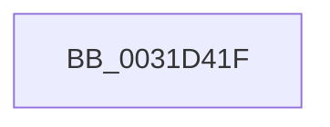

# sub_0031D41F

- RVA: `0x0031D41F`–`0x0031D44C` (길이 `45` bytes)
- VA: `0x000000014031D41F`
- 실행 섹션: `.text`
- PDB 이름 있음: `아니요`; PDB Function 태그: `아니요`
- unwind 정보 RVA: `0x00075040`
- 디코드: `11`개 명령, `45/45` bytes 표시
- 미해석 바이트: `0` (있으면 어셈블리에 `.byte`로 보존)

> 이 문서는 커널 이미지의 기계어와 PDB 기호를 분석해 생성했습니다. 4번과 5번은 함수 원형과 자료형을 바이너리 사용 방식에서 추정한 C 해석이며 원본 소스 복구 결과는 아닙니다.

## 1. Dependencies

- 직접 호출 지점: **0**; 고유 호출 대상: **0**
- 직접 호출자로 확인된 함수: **0**
- RIP 상대 이미지 참조: **0**

### Outgoing calls
- 직접 디코드된 call 명령이 없습니다.

### Direct callers
- 이 함수 시작 RVA로 연결되는 직접 call은 확인되지 않았습니다. 간접 호출은 완전히 역산할 수 없습니다.

### Static image references
- 디코드된 RIP-relative 메모리 참조가 없습니다.

## 2. Other-region calls and transfers

- 다른 실행 섹션으로 향하는 call: **0**
- call이 아닌 외부 분기/꼬리 이동: **1**
  - `0x0031D447` → [sub_0031CBBA + 0xC0](Unknown_function_0031CBBA.md) (`tail-transfer`)

## 3. Assembly (complete function range)

```asm
0031D41F  48 8B C3                        mov rax, rbx
0031D422  41 8B CC                        mov ecx, r12d
0031D425  48 C1 E1 09                     shl rcx, 9
0031D429  48 BA FF 01 00 00 00 00 00 FE   movabs rdx, 0xfe000000000001ff
0031D433  48 23 C2                        and rax, rdx
0031D436  48 8B D9                        mov rbx, rcx
0031D439  48 0B D8                        or rbx, rax
0031D43C  48 89 1E                        mov qword ptr [rsi], rbx
0031D43F  48 83 E3 FD                     and rbx, 0xfffffffffffffffd
0031D443  48 83 CB 0D                     or rbx, 0xd
0031D447  E9 2E F8 FF FF                  jmp 0x14031cc7a
```

## 4. C-style interpretation (structured pseudocode)

```c
__int64 __fastcall sub_0031D41F(void)
{
    __int64 result;
    __int64 v_rbx;

    a1 = ((unsigned int)((unsigned int)(v_r12))) << (9);
    result = (v_rbx) & (a2);
    v_rbx = (a1) | (result);
    *(unsigned __int64 *)(v_rsi) = v_rbx;
    v_rbx = (v_rbx) & (-3);
    v_rbx = (v_rbx) | (13);
}
```

## 5. (Beta) C Style

```c
void sub_0031D41F(void)
{
    int64_t result;
    int64_t local_rbx;

    a1 = ((uint32_t)((uint32_t)(local_r12))) << (9);
    result = (local_rbx) & (a2);
    local_rbx = (a1) | (result);
    *(uint64_t *)(local_rsi) = local_rbx;
    local_rbx = (local_rbx) & (-3);
    local_rbx = (local_rbx) | (13);
}
```

## 6. Execution-region graph

[열기: 2D/3D 그래프와 함수 탐색 컨트롤 패널](../../../control-panel.html?section=text&rva=0x0031D41F&view=graph)

- 2D 그래프는 위에서 아래로 흐르고, 3D 그래프는 빈 공간을 드래그해 회전합니다. Shift+드래그는 이동, 휠은 확대·축소, 함수 노드 선택은 대상 보고서 이동입니다.

### Static fallback


