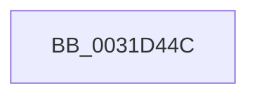

# sub_0031D44C

- RVA: `0x0031D44C`–`0x0031D4A9` (길이 `93` bytes)
- VA: `0x000000014031D44C`
- 실행 섹션: `.text`
- PDB 이름 있음: `아니요`; PDB Function 태그: `아니요`
- unwind 정보 RVA: `0x00075064`
- 디코드: `19`개 명령, `93/93` bytes 표시
- 미해석 바이트: `0` (있으면 어셈블리에 `.byte`로 보존)

> 이 문서는 커널 이미지의 기계어와 PDB 기호를 분석해 생성했습니다. 4번과 5번은 함수 원형과 자료형을 바이너리 사용 방식에서 추정한 C 해석이며 원본 소스 복구 결과는 아닙니다.

## 1. Dependencies

- 직접 호출 지점: **0**; 고유 호출 대상: **0**
- 직접 호출자로 확인된 함수: **0**
- RIP 상대 이미지 참조: **0**

### Outgoing calls
- 직접 디코드된 call 명령이 없습니다.

### Direct callers
- 이 함수 시작 RVA로 연결되는 직접 call은 확인되지 않았습니다. 간접 호출은 완전히 역산할 수 없습니다.

### Static image references
- 디코드된 RIP-relative 메모리 참조가 없습니다.

## 2. Other-region calls and transfers

- 다른 실행 섹션으로 향하는 call: **0**
- call이 아닌 외부 분기/꼬리 이동: **1**
  - `0x0031D4A4` → [sub_0031CC85](Unknown_function_0031CC85.md) (`tail-transfer`)

## 3. Assembly (complete function range)

```asm
0031D44C  41 8B 8C 24 A8 FE FF FF         mov ecx, dword ptr [r12 - 0x158]
0031D454  48 BA F3 01 00 00 00 00 00 FE   movabs rdx, 0xfe000000000001f3
0031D45E  48 8B 06                        mov rax, qword ptr [rsi]
0031D461  48 C1 E1 09                     shl rcx, 9
0031D465  48 23 C2                        and rax, rdx
0031D468  48 0B C8                        or rcx, rax
0031D46B  48 B8 68 DF BE 7D FB F6 FF FF   movabs rax, 0xfffff6fb7dbedf68
0031D475  48 83 C9 03                     or rcx, 3
0031D479  48 89 0E                        mov qword ptr [rsi], rcx
0031D47C  48 8B C8                        mov rcx, rax
0031D47F  48 C1 E1 19                     shl rcx, 0x19
0031D483  48 BF 00 00 00 00 80 F6 FF FF   movabs rdi, 0xfffff68000000000
0031D48D  48 8B C7                        mov rax, rdi
0031D490  48 C1 E0 19                     shl rax, 0x19
0031D494  48 2B C8                        sub rcx, rax
0031D497  B8 01 00 00 00                  mov eax, 1
0031D49C  48 C1 F9 10                     sar rcx, 0x10
0031D4A0  48 89 4E 10                     mov qword ptr [rsi + 0x10], rcx
0031D4A4  E9 DC F7 FF FF                  jmp 0x14031cc85
```

## 4. C-style interpretation (structured pseudocode)

```c
__int64 __fastcall sub_0031D44C(void)
{
    __int64 result;

    a1 = ((unsigned int)(*(unsigned int *)(v_r12 - 344))) << (9);
    result = (*(unsigned __int64 *)(v_rsi)) & (a2);
    a1 = (a1) | (result);
    a1 = (a1) | (3);
    *(unsigned __int64 *)(v_rsi) = a1;
    a1 = (result) << (25);
    result = (v_rdi) << (25);
    a1 = (a1) - (result);
    a1 = (a1) >> (16);
    *(unsigned __int64 *)(v_rsi + 16) = a1;
}
```

## 5. (Beta) C Style

```c
void sub_0031D44C(void)
{
    int64_t result;

    a1 = ((uint32_t)(*(uint32_t *)(local_r12 - 0x158))) << (9);
    result = (*(uint64_t *)(local_rsi)) & (a2);
    a1 = (a1) | (result);
    a1 = (a1) | (3);
    *(uint64_t *)(local_rsi) = a1;
    a1 = (result) << (25);
    result = (local_rdi) << (25);
    a1 = (a1) - (result);
    a1 = (a1) >> (16);
    *(uint64_t *)(local_rsi + 0x10) = a1;
}
```

## 6. Execution-region graph

[열기: 2D/3D 그래프와 함수 탐색 컨트롤 패널](../../../control-panel.html?section=text&rva=0x0031D44C&view=graph)

- 2D 그래프는 위에서 아래로 흐르고, 3D 그래프는 빈 공간을 드래그해 회전합니다. Shift+드래그는 이동, 휠은 확대·축소, 함수 노드 선택은 대상 보고서 이동입니다.

### Static fallback


