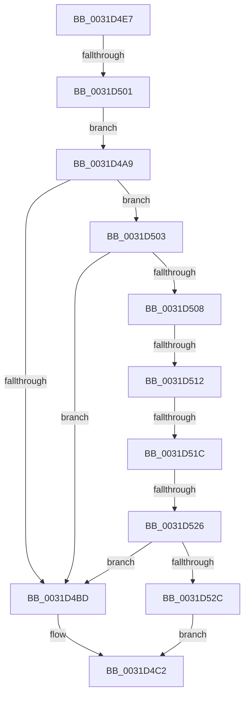

# sub_0031D4A9

- RVA: `0x0031D4A9`–`0x0031D533` (길이 `138` bytes)
- VA: `0x000000014031D4A9`
- 실행 섹션: `.text`
- PDB 이름 있음: `아니요`; PDB Function 태그: `아니요`
- unwind 정보 RVA: `0x00075084`
- 디코드: `37`개 명령, `138/138` bytes 표시
- 미해석 바이트: `0` (있으면 어셈블리에 `.byte`로 보존)

> 이 문서는 커널 이미지의 기계어와 PDB 기호를 분석해 생성했습니다. 4번과 5번은 함수 원형과 자료형을 바이너리 사용 방식에서 추정한 C 해석이며 원본 소스 복구 결과는 아닙니다.

## 1. Dependencies

- 직접 호출 지점: **0**; 고유 호출 대상: **0**
- 직접 호출자로 확인된 함수: **0**
- RIP 상대 이미지 참조: **1**

### Outgoing calls
- 직접 디코드된 call 명령이 없습니다.

### Direct callers
- 이 함수 시작 RVA로 연결되는 직접 call은 확인되지 않았습니다. 간접 호출은 완전히 역산할 수 없습니다.

### Static image references
- `0x0031D4A9` → RVA `0x00E300C0` (`.data`; read)

## 2. Other-region calls and transfers

- 다른 실행 섹션으로 향하는 call: **0**
- call이 아닌 외부 분기/꼬리 이동: **4**
  - `0x0031D4FB` → [sub_0031CB02](Unknown_function_0031CB02.md) (`tail-transfer`)
  - `0x0031D50C` → [sub_006E144E + 0x14](../6E/Unknown_function_006E144E.md) (`tail-transfer`)
  - `0x0031D516` → [sub_006E144E + 0xA](../6E/Unknown_function_006E144E.md) (`tail-transfer`)
  - `0x0031D520` → [sub_006E144E](../6E/Unknown_function_006E144E.md) (`tail-transfer`)

## 3. Assembly (complete function range)

```asm
0031D4A9  48 8B 05 10 2C B1 00            mov rax, qword ptr [rip + 0xb12c10]
0031D4B0  48 8B 0C C8                     mov rcx, qword ptr [rax + rcx*8]
0031D4B4  83 E1 07                        and ecx, 7
0031D4B7  48 83 F9 05                     cmp rcx, 5
0031D4BB  75 46                           jne 0x14031d503
0031D4BD  B8 7E 01 00 00                  mov eax, 0x17e
0031D4C2  48 89 02                        mov qword ptr [rdx], rax
0031D4C5  49 8B C6                        mov rax, r14
0031D4C8  48 25 00 00 FC FF               and rax, 0xfffffffffffc0000
0031D4CE  4C 89 72 08                     mov qword ptr [rdx + 8], r14
0031D4D2  49 2B C6                        sub rax, r14
0031D4D5  48 05 00 00 04 00               add rax, 0x40000
0031D4DB  48 81 C4 90 00 00 00            add rsp, 0x90
0031D4E2  41 5E                           pop r14
0031D4E4  5E                              pop rsi
0031D4E5  5D                              pop rbp
0031D4E6  C3                              ret
0031D4E7  CC                              int3
0031D4E8  48 C1 E9 12                     shr rcx, 0x12
0031D4EC  81 E1 FF FF 3F 00               and ecx, 0x3fffff
0031D4F2  48 0F A3 08                     bt qword ptr [rax], rcx
0031D4F6  0F 92 C0                        setb al
0031D4F9  84 C0                           test al, al
0031D4FB  0F 84 01 F6 FF FF               je 0x14031cb02
0031D501  EB A6                           jmp 0x14031d4a9
0031D503  48 85 C9                        test rcx, rcx
0031D506  74 B5                           je 0x14031d4bd
0031D508  48 83 E9 01                     sub rcx, 1
0031D50C  0F 84 50 3F 3C 00               je 0x1406e1462
0031D512  48 83 E9 01                     sub rcx, 1
0031D516  0F 84 3C 3F 3C 00               je 0x1406e1458
0031D51C  48 83 E9 01                     sub rcx, 1
0031D520  0F 84 28 3F 3C 00               je 0x1406e144e
0031D526  48 83 F9 01                     cmp rcx, 1
0031D52A  75 91                           jne 0x14031d4bd
0031D52C  B8 5E 01 00 00                  mov eax, 0x15e
0031D531  EB 8F                           jmp 0x14031d4c2
```

## 4. C-style interpretation (structured pseudocode)

```c
__int64 __fastcall sub_0031D4A9(__int64 a1, __int64 a2)
{
    __int64 result;
    __int64 v_rsp;

    a1 = (unsigned int)((*(unsigned __int64 *)(*(unsigned __int64 *)(v_rip + 11611152) + a1 * 8)) & (7));
    if (a1 != 5) goto loc_0031D503;
loc_0031D4BD:
loc_0031D4C2:
    *(unsigned __int64 *)(a2) = 382;
    result = (v_r14) & (0xFFFFFFFFFFFC0000ULL);
    *(unsigned __int64 *)(a2 + 8) = v_r14;
    result = (result) - (v_r14);
    result = (result) + (0x40000ULL);
    v_rsp = (v_rsp) + (144);
    return result;
loc_0031D503:
    if (a1 == 0) goto loc_0031D4BD;
    a1 = (a1) - (1);
    a1 = (a1) - (1);
    a1 = (a1) - (1);
    if (a1 != 1) goto loc_0031D4BD;
    goto loc_0031D4C2;
}
```

## 5. (Beta) C Style

```c
int64_t sub_0031D4A9(int64_t Arg1, void *Arg2)
{
    uint8_t *arg2 = (uint8_t *)Arg2;

    int64_t result;
    int64_t local_rsp;

    Arg1 = (uint32_t)((*(uint64_t *)(*(uint64_t *)(v_rip + 0xB12C10) + Arg1 * 8)) & (7));
    if (Arg1 != 5) goto loc_0031D503;
loc_0031D4BD:
loc_0031D4C2:
    *(uint64_t *)(arg2) = 382;
    result = (local_r14) & (0xFFFFFFFFFFFC0000ULL);
    *(uint64_t *)(arg2 + 0x8) = local_r14;
    result = (result) - (local_r14);
    result = (result) + (0x40000ULL);
    local_rsp = (local_rsp) + (144);
    return result;
loc_0031D503:
    if (Arg1 == 0) goto loc_0031D4BD;
    Arg1 = (Arg1) - (1);
    Arg1 = (Arg1) - (1);
    Arg1 = (Arg1) - (1);
    if (Arg1 != 1) goto loc_0031D4BD;
    goto loc_0031D4C2;
}
```

### 관측된 메모리 오프셋

구조체 형식이 확인되지 않은 접근은 인자 기준의 오프셋으로만 기록했습니다.

| 기준 인자 | 오프셋 표현 | 폭 (bit) | 접근 |
|---|---:|---:|---|
| `Arg2` | `+ 0x0` | `64` | `W` |
| `Arg2` | `+ 0x8` | `64` | `W` |

## 6. Execution-region graph

[열기: 2D/3D 그래프와 함수 탐색 컨트롤 패널](../../../control-panel.html?section=text&rva=0x0031D4A9&view=graph)

- 2D 그래프는 위에서 아래로 흐르고, 3D 그래프는 빈 공간을 드래그해 회전합니다. Shift+드래그는 이동, 휠은 확대·축소, 함수 노드 선택은 대상 보고서 이동입니다.

### Static fallback


