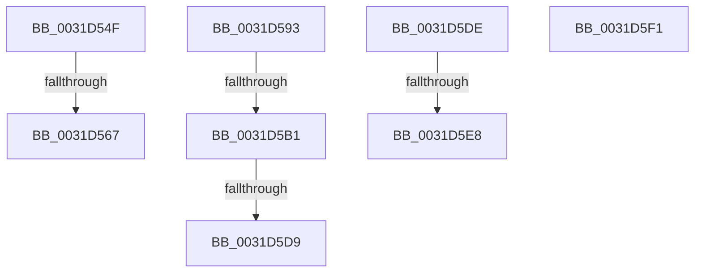

# sub_0031D54F

- RVA: `0x0031D54F`–`0x0031D614` (길이 `197` bytes)
- VA: `0x000000014031D54F`
- 실행 섹션: `.text`
- PDB 이름 있음: `아니요`; PDB Function 태그: `아니요`
- unwind 정보 RVA: `0x000750BC`
- 디코드: `57`개 명령, `197/197` bytes 표시
- 미해석 바이트: `2` (있으면 어셈블리에 `.byte`로 보존)

> 이 문서는 커널 이미지의 기계어와 PDB 기호를 분석해 생성했습니다. 4번과 5번은 함수 원형과 자료형을 바이너리 사용 방식에서 추정한 C 해석이며 원본 소스 복구 결과는 아닙니다.

## 1. Dependencies

- 직접 호출 지점: **1**; 고유 호출 대상: **1**
- 직접 호출자로 확인된 함수: **0**
- RIP 상대 이미지 참조: **1**

### Outgoing calls
- `0x0031D5A0` → [MiGetLeafPfnBuddy](../43/MiGetLeafPfnBuddy_function_00438E30.md) (function, `0x00438E30`)

### Direct callers
- 이 함수 시작 RVA로 연결되는 직접 call은 확인되지 않았습니다. 간접 호출은 완전히 역산할 수 없습니다.

### Static image references
- `0x0031D5B1` → RVA `0x00E2DCE0` (`.data`; read)

## 2. Other-region calls and transfers

- 다른 실행 섹션으로 향하는 call: **0**
- call이 아닌 외부 분기/꼬리 이동: **7**
  - `0x0031D561` → [sub_006E1546](../6E/Unknown_function_006E1546.md) (`tail-transfer`)
  - `0x0031D58E` → [sub_006E1546](../6E/Unknown_function_006E1546.md) (`tail-transfer`)
  - `0x0031D5AB` → [sub_006E1546 + 0x7D](../6E/Unknown_function_006E1546.md) (`tail-transfer`)
  - `0x0031D5D3` → [sub_006E1546 + 0x7D](../6E/Unknown_function_006E1546.md) (`tail-transfer`)
  - `0x0031D5D9` → [sub_006E1546 + 0x90](../6E/Unknown_function_006E1546.md) (`tail-transfer`)
  - `0x0031D5E2` → [sub_0031CD16 + 0xB9](Unknown_function_0031CD16.md) (`tail-transfer`)
  - `0x0031D5EC` → [sub_0031CD16 + 0xCA](Unknown_function_0031CD16.md) (`tail-transfer`)

## 3. Assembly (complete function range)

```asm
0031D54F  48 8B 4D F7                     mov rcx, qword ptr [rbp - 9]
0031D553  48 8B 45 17                     mov rax, qword ptr [rbp + 0x17]
0031D557  48 81 0E 00 01 00 00            or qword ptr [rsi], 0x100
0031D55E  48 85 C0                        test rax, rax
0031D561  0F 88 DF 3F 3C 00               js 0x1406e1546
0031D567  48 C1 E1 19                     shl rcx, 0x19
0031D56B  48 BF 00 00 00 00 80 F6 FF FF   movabs rdi, 0xfffff68000000000
0031D575  48 8B C7                        mov rax, rdi
0031D578  48 C1 E0 19                     shl rax, 0x19
0031D57C  48 2B C8                        sub rcx, rax
0031D57F  48 C1 F9 10                     sar rcx, 0x10
0031D583  48 81 E1 00 F0 FF FF            and rcx, 0xfffffffffffff000
0031D58A  48 89 4E 10                     mov qword ptr [rsi + 0x10], rcx
0031D58E  E9 B3 3F 3C 00                  jmp 0x1406e1546
0031D593  41 BA 01 00 00 00               mov r10d, 1
0031D599  48 8D 4D EF                     lea rcx, [rbp - 0x11]
0031D59D  41 8B D2                        mov edx, r10d
0031D5A0  E8 8B B8 11 00                  call 0x140438e30
0031D5A5  48 8B CF                        mov rcx, rdi
0031D5A8  48 3B C1                        cmp rax, rcx
0031D5AB  0F 82 12 40 3C 00               jb 0x1406e15c3
0031D5B1  48 8B 0D 28 07 B1 00            mov rcx, qword ptr [rip + 0xb10728]
0031D5B8  48 8D 14 49                     lea rdx, [rcx + rcx*2]
0031D5BC  48 B9 30 00 00 00 00 DE FF FF   movabs rcx, 0xffffde0000000030
0031D5C6  48 C1 E2 04                     shl rdx, 4
0031D5CA  48 8B C9                        mov rcx, rcx
0031D5CD  48 03 D1                        add rdx, rcx
0031D5D0  48 3B C2                        cmp rax, rdx
0031D5D3  0F 83 EA 3F 3C 00               jae 0x1406e15c3
0031D5D9  E9 F8 3F 3C 00                  jmp 0x1406e15d6
0031D5DE  0F BA E3 1B                     bt ebx, 0x1b
0031D5E2  0F 83 E7 F7 FF FF               jae 0x14031cdcf
0031D5E8  49 8B 56 08                     mov rdx, qword ptr [r14 + 8]
0031D5EC  E9 EF F7 FF FF                  jmp 0x14031cde0
0031D5F1  0F 1F 00                        nop dword ptr [rax]
0031D5F4  EF                              out dx, eax
0031D5F5  CF                              iretd
0031D5F6  31 00                           xor dword ptr [rax], eax
0031D5F8  EF                              out dx, eax
0031D5F9  CF                              iretd
0031D5FA  31 00                           xor dword ptr [rax], eax
0031D5FC  96                              xchg esi, eax
0031D5FD  CF                              iretd
0031D5FE  31 00                           xor dword ptr [rax], eax
0031D600  96                              xchg esi, eax
0031D601  CF                              iretd
0031D602  31 00                           xor dword ptr [rax], eax
0031D604  38 CD                           cmp ch, cl
0031D606  31 00                           xor dword ptr [rax], eax
0031D608  EF                              out dx, eax
0031D609  CF                              iretd
0031D60A  31 00                           xor dword ptr [rax], eax
0031D60C  38 CD                           cmp ch, cl
0031D60E  31 00                           xor dword ptr [rax], eax
0031D610  4F                              .byte 0x4f
0031D611  D5                              .byte 0xd5
0031D612  31 00                           xor dword ptr [rax], eax
```

## 4. C-style interpretation (structured pseudocode)

```c
__int64 __fastcall sub_0031D54F(void)
{
    __int64 result;

    a1 = (*(unsigned __int64 *)(v_rbp - 9)) << (25);
    result = (v_rdi) << (25);
    a1 = (a1) - (result);
    a1 = (a1) >> (16);
    a1 = (a1) & (0xFFFFFFFFFFFFF000ULL);
    *(unsigned __int64 *)(v_rsi + 16) = a1;
}
```

## 5. (Beta) C Style

```c
void sub_0031D54F(void)
{
    int64_t result;

    a1 = (*(uint64_t *)(local_rbp - 0x9)) << (25);
    result = (local_rdi) << (25);
    a1 = (a1) - (result);
    a1 = (a1) >> (16);
    a1 = (a1) & (0xFFFFFFFFFFFFF000ULL);
    *(uint64_t *)(local_rsi + 0x10) = a1;
}
```

## 6. Execution-region graph

[열기: 2D/3D 그래프와 함수 탐색 컨트롤 패널](../../../control-panel.html?section=text&rva=0x0031D54F&view=graph)

- 2D 그래프는 위에서 아래로 흐르고, 3D 그래프는 빈 공간을 드래그해 회전합니다. Shift+드래그는 이동, 휠은 확대·축소, 함수 노드 선택은 대상 보고서 이동입니다.

### Static fallback


