# sub_0031EA17

- RVA: `0x0031EA17`–`0x0031ED9E` (길이 `903` bytes)
- VA: `0x000000014031EA17`
- 실행 섹션: `.text`
- PDB 이름 있음: `아니요`; PDB Function 태그: `아니요`
- unwind 정보 RVA: `0x00075290`
- 디코드: `177`개 명령, `903/903` bytes 표시
- 미해석 바이트: `0` (있으면 어셈블리에 `.byte`로 보존)

> 이 문서는 커널 이미지의 기계어와 PDB 기호를 분석해 생성했습니다. 4번과 5번은 함수 원형과 자료형을 바이너리 사용 방식에서 추정한 C 해석이며 원본 소스 복구 결과는 아닙니다.

## 1. Dependencies

- 직접 호출 지점: **3**; 고유 호출 대상: **3**
- 직접 호출자로 확인된 함수: **0**
- RIP 상대 이미지 참조: **4**

### Outgoing calls
- `0x0031EA6D` → [MiSafeLockPage](../32/MiSafeLockPage_function_00321620.md) (function, `0x00321620`)
- `0x0031EBDA` → [MiGetLeafVa](../27/MiGetLeafVa_function_0027C0A0.md) (function, `0x0027C0A0`)
- `0x0031ED40` → [KiLowerIrqlProcessIrqlFlags](../4F/KiLowerIrqlProcessIrqlFlags_function_004F5698.md) (function, `0x004F5698`)

### Direct callers
- 이 함수 시작 RVA로 연결되는 직접 call은 확인되지 않았습니다. 간접 호출은 완전히 역산할 수 없습니다.

### Static image references
- `0x0031EB54` → RVA `0x00000000` (`image boundary/outside`; read)
- `0x0031EC0E` → RVA `0x00E2EE84` (`.data`; read)
- `0x0031ECAF` → RVA `0x00FC6A88` (`ALMOSTRO`; read)
- `0x0031ED2F` → RVA `0x00FC6D20` (`ALMOSTRO`; read)

## 2. Other-region calls and transfers

- 다른 실행 섹션으로 향하는 call: **0**
- call이 아닌 외부 분기/꼬리 이동: **6**
  - `0x0031EA85` → [sub_0031EDB1 + 0x12](Unknown_function_0031EDB1.md) (`tail-transfer`)
  - `0x0031EA9A` → [sub_0031EDB1](Unknown_function_0031EDB1.md) (`tail-transfer`)
  - `0x0031EADF` → [sub_0031EDB1 + 0xC5](Unknown_function_0031EDB1.md) (`tail-transfer`)
  - `0x0031EB44` → [sub_0031EEA5](Unknown_function_0031EEA5.md) (`tail-transfer`)
  - `0x0031EBAB` → [sub_0031EDB1 + 0x22](Unknown_function_0031EDB1.md) (`tail-transfer`)
  - `0x0031ECBD` → [sub_0031EDB1 + 0x95](Unknown_function_0031EDB1.md) (`tail-transfer`)

## 3. Assembly (complete function range)

```asm
0031EA17  4C 89 AC 24 88 00 00 00         mov qword ptr [rsp + 0x88], r13
0031EA1F  48 C1 E0 0C                     shl rax, 0xc
0031EA23  48 B9 FF FF FF FF 3F 00 00 00   movabs rcx, 0x3fffffffff
0031EA2D  48 89 44 24 50                  mov qword ptr [rsp + 0x50], rax
0031EA32  48 BA 00 00 00 00 00 DE FF FF   movabs rdx, 0xffffde0000000000
0031EA3C  4A 8D 1C E5 00 00 00 00         lea rbx, [r12*8]
0031EA44  4C 8B 6C 2B 18                  mov r13, qword ptr [rbx + rbp + 0x18]
0031EA49  49 C1 ED 0C                     shr r13, 0xc
0031EA4D  4C 23 E9                        and r13, rcx
0031EA50  4A 8D 0C 6D 00 00 00 00         lea rcx, [r13*2]
0031EA58  49 03 CD                        add rcx, r13
0031EA5B  48 C1 E1 04                     shl rcx, 4
0031EA5F  48 8B C2                        mov rax, rdx
0031EA62  48 03 C8                        add rcx, rax
0031EA65  48 89 4C 24 20                  mov qword ptr [rsp + 0x20], rcx
0031EA6A  49 8B CD                        mov rcx, r13
0031EA6D  E8 AE 2B 00 00                  call 0x140321620
0031EA72  48 8B 54 2B 18                  mov rdx, qword ptr [rbx + rbp + 0x18]
0031EA77  44 0F B6 D0                     movzx r10d, al
0031EA7B  88 84 24 E0 00 00 00            mov byte ptr [rsp + 0xe0], al
0031EA82  F6 C2 01                        test dl, 1
0031EA85  0F 85 38 03 00 00               jne 0x14031edc3
0031EA8B  48 83 7C 24 58 01               cmp qword ptr [rsp + 0x58], 1
0031EA91  4C 8B 4C 24 20                  mov r9, qword ptr [rsp + 0x20]
0031EA96  41 8B 41 20                     mov eax, dword ptr [r9 + 0x20]
0031EA9A  0F 84 11 03 00 00               je 0x14031edb1
0031EAA0  83 BC 24 E8 00 00 00 00         cmp dword ptr [rsp + 0xe8], 0
0031EAA8  75 27                           jne 0x14031ead1
0031EAAA  48 8B 4C 24 60                  mov rcx, qword ptr [rsp + 0x60]
0031EAAF  49 8B C7                        mov rax, r15
0031EAB2  48 C1 E0 0C                     shl rax, 0xc
0031EAB6  48 FF C8                        dec rax
0031EAB9  48 89 BE 20 01 00 00            mov qword ptr [rsi + 0x120], rdi
0031EAC0  48 03 C1                        add rax, rcx
0031EAC3  48 89 8E 28 01 00 00            mov qword ptr [rsi + 0x128], rcx
0031EACA  48 89 86 30 01 00 00            mov qword ptr [rsi + 0x130], rax
0031EAD1  41 8B 41 20                     mov eax, dword ptr [r9 + 0x20]
0031EAD5  B9 04 00 00 00                  mov ecx, 4
0031EADA  C1 E8 10                        shr eax, 0x10
0031EADD  3C 40                           cmp al, 0x40
0031EADF  0F 82 91 03 00 00               jb 0x14031ee76
0031EAE5  41 8B 41 20                     mov eax, dword ptr [r9 + 0x20]
0031EAE9  C1 E8 10                        shr eax, 0x10
0031EAEC  24 C0                           and al, 0xc0
0031EAEE  3C 80                           cmp al, 0x80
0031EAF0  75 05                           jne 0x14031eaf7
0031EAF2  B9 1C 00 00 00                  mov ecx, 0x1c
0031EAF7  41 B8 00 00 00 A4               mov r8d, 0xa4000000
0031EAFD  49 BB 00 00 00 00 80 F6 FF FF   movabs r11, 0xfffff68000000000
0031EB07  41 83 FE 01                     cmp r14d, 1
0031EB0B  BA 00 00 00 A0                  mov edx, 0xa0000000
0031EB10  48 BB F8 FF FF FF 7F 00 00 00   movabs rbx, 0x7ffffffff8
0031EB1A  44 0F 47 C2                     cmova r8d, edx
0031EB1E  44 0B C1                        or r8d, ecx
0031EB21  48 8B 4C 24 28                  mov rcx, qword ptr [rsp + 0x28]
0031EB26  48 C1 E9 09                     shr rcx, 9
0031EB2A  48 23 CB                        and rcx, rbx
0031EB2D  4C 89 84 24 E8 00 00 00         mov qword ptr [rsp + 0xe8], r8
0031EB35  49 8B C3                        mov rax, r11
0031EB38  48 03 C8                        add rcx, rax
0031EB3B  48 89 4C 24 38                  mov qword ptr [rsp + 0x38], rcx
0031EB40  41 83 FE 01                     cmp r14d, 1
0031EB44  0F 86 5B 03 00 00               jbe 0x14031eea5
0031EB4A  49 8B D8                        mov rbx, r8
0031EB4D  49 C1 E5 0C                     shl r13, 0xc
0031EB51  83 E3 1F                        and ebx, 0x1f
0031EB54  4C 8D 1D A5 14 CE FF            lea r11, [rip - 0x31eb5b]
0031EB5B  48 B8 7F 0E 00 00 00 00 F0 FF   movabs rax, 0xfff0000000000e7f
0031EB65  49 8B 9C DB 90 09 01 00         mov rbx, qword ptr [r11 + rbx*8 + 0x10990]
0031EB6D  48 23 D8                        and rbx, rax
0031EB70  49 0B DD                        or rbx, r13
0031EB73  49 BD 00 00 00 00 80 F6 FF FF   movabs r13, 0xfffff68000000000
0031EB7D  48 83 CB 21                     or rbx, 0x21
0031EB81  49 8B C5                        mov rax, r13
0031EB84  48 3B C8                        cmp rcx, rax
0031EB87  72 7B                           jb 0x14031ec04
0031EB89  48 B8 FF FF FF FF FF F6 FF FF   movabs rax, 0xfffff6ffffffffff
0031EB93  48 8B C0                        mov rax, rax
0031EB96  48 3B C8                        cmp rcx, rax
0031EB99  77 69                           ja 0x14031ec04
0031EB9B  48 B8 00 00 00 40 FB F6 FF FF   movabs rax, 0xfffff6fb40000000
0031EBA5  48 8B C0                        mov rax, rax
0031EBA8  48 3B C8                        cmp rcx, rax
0031EBAB  0F 83 22 02 00 00               jae 0x14031edd3
0031EBB1  48 8B D1                        mov rdx, rcx
0031EBB4  48 C1 E2 19                     shl rdx, 0x19
0031EBB8  49 8B C5                        mov rax, r13
0031EBBB  48 C1 E0 19                     shl rax, 0x19
0031EBBF  48 2B D0                        sub rdx, rax
0031EBC2  48 C1 FA 10                     sar rdx, 0x10
0031EBC6  41 81 E0 00 00 00 04            and r8d, 0x4000000
0031EBCD  4C 89 84 24 E8 00 00 00         mov qword ptr [rsp + 0xe8], r8
0031EBD5  74 13                           je 0x14031ebea
0031EBD7  48 8B CA                        mov rcx, rdx
0031EBDA  E8 C1 D4 F5 FF                  call 0x14027c0a0
0031EBDF  4C 8B 84 24 E8 00 00 00         mov r8, qword ptr [rsp + 0xe8]
0031EBE7  48 8B D0                        mov rdx, rax
0031EBEA  48 8B CB                        mov rcx, rbx
0031EBED  48 B8 FF FF FE FF FF 7F 00 00   movabs rax, 0x7ffffffeffff
0031EBF7  48 83 C9 04                     or rcx, 4
0031EBFB  48 3B D0                        cmp rdx, rax
0031EBFE  48 0F 47 CB                     cmova rcx, rbx
0031EC02  EB 0A                           jmp 0x14031ec0e
0031EC04  48 8B CB                        mov rcx, rbx
0031EC07  41 81 E0 00 00 00 04            and r8d, 0x4000000
0031EC0E  0F B6 15 6F 02 B1 00            movzx edx, byte ptr [rip + 0xb1026f]
0031EC15  48 83 C9 42                     or rcx, 0x42
0031EC19  48 C1 E2 08                     shl rdx, 8
0031EC1D  48 8B C2                        mov rax, rdx
0031EC20  C7 84 24 E8 00 00 00 00 00 00 00  mov dword ptr [rsp + 0xe8], 0
0031EC2B  48 33 C1                        xor rax, rcx
0031EC2E  48 0F BA F0 08                  btr rax, 8
0031EC33  48 33 C2                        xor rax, rdx
0031EC36  48 8B D8                        mov rbx, rax
0031EC39  48 0F BA EB 07                  bts rbx, 7
0031EC3E  45 85 C0                        test r8d, r8d
0031EC41  48 0F 44 D8                     cmove rbx, rax
0031EC45  48 B8 FF FF FF FF FF FF FF FA   movabs rax, 0xfaffffffffffffff
0031EC4F  48 23 D8                        and rbx, rax
0031EC52  48 B8 00 00 00 00 00 00 00 0A   movabs rax, 0xa00000000000000
0031EC5C  48 0B D8                        or rbx, rax
0031EC5F  48 8B 44 24 68                  mov rax, qword ptr [rsp + 0x68]
0031EC64  4A 8B 84 18 A8 45 01 00         mov rax, qword ptr [rax + r11 + 0x145a8]
0031EC6C  48 89 44 24 30                  mov qword ptr [rsp + 0x30], rax
0031EC71  48 85 C0                        test rax, rax
0031EC74  0F 84 A0 00 00 00               je 0x14031ed1a
0031EC7A  4C 8B 6C 24 38                  mov r13, qword ptr [rsp + 0x38]
0031EC7F  33 C0                           xor eax, eax
0031EC81  4C 8B 7C 24 30                  mov r15, qword ptr [rsp + 0x30]
0031EC86  48 BF 00 00 00 00 40 00 00 00   movabs rdi, 0x4000000000
0031EC90  48 BE 00 00 00 00 80 F6 FF FF   movabs rsi, 0xfffff68000000000
0031EC9A  49 BE FF 0F 00 00 00 00 F0 FF   movabs r14, 0xfff0000000000fff
0031ECA4  48 8D 0C C5 00 00 00 00         lea rcx, [rax*8]
0031ECAC  49 03 CD                        add rcx, r13
0031ECAF  48 0F BA 25 D0 7D CA 00 24      bt qword ptr [rip + 0xca7dd0], 0x24
0031ECB8  48 89 4C 24 30                  mov qword ptr [rsp + 0x30], rcx
0031ECBD  0F 82 83 01 00 00               jb 0x14031ee46
0031ECC3  48 89 19                        mov qword ptr [rcx], rbx
0031ECC6  48 8D 8B 00 10 00 00            lea rcx, [rbx + 0x1000]
0031ECCD  48 33 D9                        xor rbx, rcx
0031ECD0  49 23 DE                        and rbx, r14
0031ECD3  48 33 D9                        xor rbx, rcx
0031ECD6  8B 8C 24 E8 00 00 00            mov ecx, dword ptr [rsp + 0xe8]
0031ECDD  FF C1                           inc ecx
0031ECDF  8B C1                           mov eax, ecx
0031ECE1  89 8C 24 E8 00 00 00            mov dword ptr [rsp + 0xe8], ecx
0031ECE8  49 3B C7                        cmp rax, r15
0031ECEB  72 B7                           jb 0x14031eca4
0031ECED  48 8B 7C 24 40                  mov rdi, qword ptr [rsp + 0x40]
0031ECF2  48 8B B4 24 D0 00 00 00         mov rsi, qword ptr [rsp + 0xd0]
0031ECFA  48 8B 6C 24 48                  mov rbp, qword ptr [rsp + 0x48]
0031ECFF  44 8B B4 24 D8 00 00 00         mov r14d, dword ptr [rsp + 0xd8]
0031ED07  4C 8B 7C 24 70                  mov r15, qword ptr [rsp + 0x70]
0031ED0C  4C 8B 4C 24 20                  mov r9, qword ptr [rsp + 0x20]
0031ED11  44 0F B6 94 24 E0 00 00 00      movzx r10d, byte ptr [rsp + 0xe0]
0031ED1A  48 B8 FF FF FF FF FF FF FF 7F   movabs rax, 0x7fffffffffffffff
0031ED24  F0 49 21 41 18                  lock and qword ptr [r9 + 0x18], rax
0031ED29  41 80 FA 02                     cmp r10b, 2
0031ED2D  73 27                           jae 0x14031ed56
0031ED2F  83 3D EA 7F CA 00 00            cmp dword ptr [rip + 0xca7fea], 0
0031ED36  74 16                           je 0x14031ed4e
0031ED38  44 0F 20 C1                     mov rcx, cr8
0031ED3C  41 0F B6 D2                     movzx edx, r10b
0031ED40  E8 53 69 1D 00                  call 0x1404f5698
0031ED45  44 0F B6 94 24 E0 00 00 00      movzx r10d, byte ptr [rsp + 0xe0]
0031ED4E  41 0F B6 C2                     movzx eax, r10b
0031ED52  44 0F 22 C0                     mov cr8, rax
0031ED56  C7 84 24 E8 00 00 00 01 00 00 00  mov dword ptr [rsp + 0xe8], 1
0031ED61  48 8B 44 24 50                  mov rax, qword ptr [rsp + 0x50]
0031ED66  41 FF C4                        inc r12d
0031ED69  48 01 44 24 28                  add qword ptr [rsp + 0x28], rax
0031ED6E  48 B9 FF FF FF FF 3F 00 00 00   movabs rcx, 0x3fffffffff
0031ED78  48 BA 00 00 00 00 00 DE FF FF   movabs rdx, 0xffffde0000000000
0031ED82  44 3B A5 18 01 00 00            cmp r12d, dword ptr [rbp + 0x118]
0031ED89  0F 82 AD FC FF FF               jb 0x14031ea3c
0031ED8F  4C 8B AC 24 88 00 00 00         mov r13, qword ptr [rsp + 0x88]
0031ED97  8B 84 24 E8 00 00 00            mov eax, dword ptr [rsp + 0xe8]
```

## 4. C-style interpretation (structured pseudocode)

```c
__int64 __fastcall sub_0031EA17(__int64 a1, __int64 a2, __int64 a3, __int64 a4, __int64 a5, __int64 a6, __int64 a7, __int64 a8, __int64 a9, __int64 a10, __int64 a11, __int64 a12, __int64 a13, __int64 a14, __int64 a15, __int64 a16, __int64 a17, __int64 a18, __int64 a19, __int64 a20, __int64 a21, __int64 a22, __int64 a23, __int64 a24, __int64 a25, __int64 a26, unsigned int a27, unsigned __int8 a28, unsigned int a29)
{
    __int64 result;
    __int64 v_r10;
    __int64 v_r12;
    __int64 v_r13;
    __int64 v_rbx;
    unsigned __int64 v_stack_p20;
    unsigned __int64 v_stack_p30;
    unsigned __int64 v_stack_p38;
    unsigned __int64 v_stack_p50;
    unsigned __int64 v_stack_p88;
    unsigned __int8 v_stack_pE0;
    unsigned __int64 v_stack_pE8;

    v_stack_p88 = v_r13;
    result = (result) << (12);
    v_stack_p50 = result;
loc_0031EA3C:
    v_r13 = (*(unsigned __int64 *)(v_r12 * 8 + v_rbp * 1 + 24)) >> (12);
    v_r13 = (v_r13) & (a1);
    a1 = (v_r13 * 2) + (v_r13);
    a1 = (a1) << (4);
    a1 = (a1) + (a2);
    v_stack_p20 = a1;
    result = MiSafeLockPage(v_r13, a2, a3, a4);
    v_stack_pE0 = (unsigned __int8)(result);
    result = (unsigned int)(*(unsigned int *)(v_stack_p20 + 32));
    if (a29 == 0) {
        a1 = a12;
        result = v_r15;
        result = (result) << (12);
        result = (result) - 1;
        *(unsigned __int64 *)(v_rsi + 288) = v_rdi;
        result = (result) + (a1);
        *(unsigned __int64 *)(v_rsi + 296) = a1;
        *(unsigned __int64 *)(v_rsi + 304) = result;
    }
    result = (unsigned int)(((unsigned int)(*(unsigned int *)(v_stack_p20 + 32))) >> (16));
    result = (unsigned int)(((unsigned int)(*(unsigned int *)(v_stack_p20 + 32))) >> (16));
    result = (unsigned __int8)((result) & (192));
    if (((unsigned __int8)(result)) == 128) {
        a1 = 28;
    }
    a3 = (unsigned int)(0xA4000000ULL);
    if (((unsigned int)(v_r14)) > 1) { a3 = (unsigned int)((unsigned int)(0xA0000000ULL)); }
    a3 = (unsigned int)((a3) | ((unsigned int)(a1)));
    a1 = (a5) >> (9);
    a1 = (a1) & (v_r12 * 8);
    v_stack_pE8 = a3;
    a1 = (a1) + (v_r11);
    v_stack_p38 = a1;
    v_r13 = (v_r13) << (12);
    v_rbx = (unsigned int)((a3) & (31));
    v_rbx = (*(unsigned __int64 *)(v_rip - 3271515 + v_rbx * 8 + 67984)) & (v_r11);
    v_rbx = (v_rbx) | (v_r13);
    v_rbx = (v_rbx) | (33);
    if (a1 < v_r13) goto loc_0031EC04;
    if (a1 > v_r13) goto loc_0031EC04;
    a2 = (a1) << (25);
    result = (v_r13) << (25);
    a2 = (a2) - (result);
    a2 = (a2) >> (16);
    a3 = (unsigned int)((a3) & (0x4000000ULL));
    v_stack_pE8 = a3;
    if (!(condition_is_equal)) {
        a1 = a2;
        result = MiGetLeafVa(a1, a2, a3, v_stack_p20);
        a3 = a29;
        a2 = result;
    }
    a1 = (v_rbx) | (4);
    if (a2 > result) { a1 = v_rbx; }
    goto loc_0031EC0E;
loc_0031EC04:
    a3 = (unsigned int)((a3) & (0x4000000ULL));
loc_0031EC0E:
    a1 = (v_rbx) | (66);
    a2 = (*(unsigned __int8 *)(v_rip + 11600495)) << (8);
    v_stack_pE8 = 0;
    result = (a2) ^ (a1);
    result = (result) ^ (a2);
    v_rbx = result;
    if ((unsigned int)(a3) == 0) { v_rbx = result; }
    v_rbx = (v_rbx) & (result);
    v_rbx = (v_rbx) | (result);
    v_stack_p30 = *(unsigned __int64 *)(a13 + v_rip - 3271515 * 1 + 83368);
    if (*(unsigned __int64 *)(a13 + v_rip - 3271515 * 1 + 83368) == 0) goto loc_0031ED1A;
    result = 0;
loc_0031ECA4:
    a1 = (result * 8) + (a7);
    v_stack_p30 = a1;
    *(unsigned __int64 *)(a1) = v_rbx;
    v_rbx = (v_rbx) ^ (v_rbx + 4096);
    v_rbx = (v_rbx) & (v_r14);
    v_rbx = (v_rbx) ^ (v_rbx + 4096);
    a1 = (unsigned int)(((unsigned int)(a29)) + 1);
    v_stack_pE8 = (unsigned int)(a1);
    if (((unsigned int)((unsigned int)(a1))) < a6) goto loc_0031ECA4;
loc_0031ED1A:
    if (a28 >= 2) goto loc_0031ED56;
    result = (unsigned int)((unsigned int)(a1));
    v_r10 = a28;
    if ((*(unsigned int *)(v_rip + 13271018)) != 0) {
        a1 = v_cr8;
        a2 = a28;
        result = KiLowerIrqlProcessIrqlFlags(a1, a2, a3, v_stack_p20);
        v_r10 = a28;
    }
loc_0031ED56:
    v_stack_pE8 = 1;
    v_r12 = (unsigned int)((v_r12) + 1);
    if (((unsigned int)(v_r12)) < (*(unsigned int *)(a9 + 280))) goto loc_0031EA3C;
    return (unsigned int)(a29);
}
```

## 5. (Beta) C Style

```c
int64_t sub_0031EA17(int64_t Arg1, int64_t Arg2, int64_t Arg3, int64_t Arg4, int64_t Arg5, int64_t Arg6, int64_t Arg7, int64_t Arg8, int64_t Arg9, int64_t Arg10, int64_t Arg11, int64_t Arg12, void *Arg13, int64_t Arg14, uint64_t Arg15, uint64_t Arg16, int64_t Arg17, uint64_t Arg18, uint64_t Arg19, uint64_t Arg20, uint64_t Arg21, uint64_t Arg22, uint64_t Arg23, uint64_t Arg24, uint64_t Arg25, int64_t Arg26, uint32_t Arg27, uint8_t Arg28, uint32_t Arg29)
{
    uint8_t *arg13 = (uint8_t *)Arg13;

    int64_t result;
    int64_t local_r10;
    int64_t local_r12;
    int64_t local_r13;
    int64_t local_rbx;
    uint64_t v_stack_p20;
    uint64_t v_stack_p30;
    uint64_t v_stack_p38;
    uint64_t v_stack_p50;
    uint64_t v_stack_p88;
    uint8_t v_stack_pE0;
    uint64_t v_stack_pE8;

    v_stack_p88 = local_r13;
    result = (result) << (12);
    v_stack_p50 = result;
loc_0031EA3C:
    local_r13 = (*(uint64_t *)(local_r12 * 8 + local_rbp * 1 + 0x18)) >> (12);
    local_r13 = (local_r13) & (Arg1);
    Arg1 = (local_r13 * 2) + (local_r13);
    Arg1 = (Arg1) << (4);
    Arg1 = (Arg1) + (Arg2);
    v_stack_p20 = Arg1;
    result = MiSafeLockPage(local_r13, Arg2, Arg3, Arg4);
    v_stack_pE0 = (uint8_t)(result);
    result = (uint32_t)(*(uint32_t *)(v_stack_p20 + 0x20));
    if (Arg29 == 0) {
        Arg1 = Arg12;
        result = local_r15;
        result = (result) << (12);
        result = (result) - 1;
        *(uint64_t *)(local_rsi + 0x120) = local_rdi;
        result = (result) + (Arg1);
        *(uint64_t *)(local_rsi + 0x128) = Arg1;
        *(uint64_t *)(local_rsi + 0x130) = result;
    }
    result = (uint32_t)(((uint32_t)(*(uint32_t *)(v_stack_p20 + 0x20))) >> (16));
    result = (uint32_t)(((uint32_t)(*(uint32_t *)(v_stack_p20 + 0x20))) >> (16));
    result = (uint8_t)((result) & (192));
    if (((uint8_t)(result)) == 128) {
        Arg1 = 28;
    }
    Arg3 = (uint32_t)(0xA4000000ULL);
    if (((uint32_t)(local_r14)) > 1) { Arg3 = (uint32_t)((uint32_t)(0xA0000000ULL)); }
    Arg3 = (uint32_t)((Arg3) | ((uint32_t)(Arg1)));
    Arg1 = (Arg5) >> (9);
    Arg1 = (Arg1) & (local_r12 * 8);
    v_stack_pE8 = Arg3;
    Arg1 = (Arg1) + (local_r11);
    v_stack_p38 = Arg1;
    local_r13 = (local_r13) << (12);
    local_rbx = (uint32_t)((Arg3) & (31));
    local_rbx = (*(uint64_t *)(v_rip - 0x31EB5B + local_rbx * 8 + 0x10990)) & (local_r11);
    local_rbx = (local_rbx) | (local_r13);
    local_rbx = (local_rbx) | (33);
    if (Arg1 < local_r13) goto loc_0031EC04;
    if (Arg1 > local_r13) goto loc_0031EC04;
    Arg2 = (Arg1) << (25);
    result = (local_r13) << (25);
    Arg2 = (Arg2) - (result);
    Arg2 = (Arg2) >> (16);
    Arg3 = (uint32_t)((Arg3) & (0x4000000ULL));
    v_stack_pE8 = Arg3;
    if (!(condition_is_equal)) {
        Arg1 = Arg2;
        result = MiGetLeafVa(Arg1, Arg2, Arg3, v_stack_p20);
        Arg3 = Arg29;
        Arg2 = result;
    }
    Arg1 = (local_rbx) | (4);
    if (Arg2 > result) { Arg1 = local_rbx; }
    goto loc_0031EC0E;
loc_0031EC04:
    Arg3 = (uint32_t)((Arg3) & (0x4000000ULL));
loc_0031EC0E:
    Arg1 = (local_rbx) | (66);
    Arg2 = (*(uint8_t *)(v_rip + 0xB1026F)) << (8);
    v_stack_pE8 = 0;
    result = (Arg2) ^ (Arg1);
    result = (result) ^ (Arg2);
    local_rbx = result;
    if ((uint32_t)(Arg3) == 0) { local_rbx = result; }
    local_rbx = (local_rbx) & (result);
    local_rbx = (local_rbx) | (result);
    v_stack_p30 = *(uint64_t *)(arg13 + v_rip - 0x31EB5B * 1 + 0x145A8);
    if (*(uint64_t *)(arg13 + v_rip - 0x31EB5B * 1 + 0x145A8) == 0) goto loc_0031ED1A;
    result = 0;
loc_0031ECA4:
    Arg1 = (result * 8) + (Arg7);
    v_stack_p30 = Arg1;
    *(uint64_t *)(Arg1) = local_rbx;
    local_rbx = (local_rbx) ^ (local_rbx + 4096);
    local_rbx = (local_rbx) & (local_r14);
    local_rbx = (local_rbx) ^ (local_rbx + 4096);
    Arg1 = (uint32_t)(((uint32_t)(Arg29)) + 1);
    v_stack_pE8 = (uint32_t)(Arg1);
    if (((uint32_t)((uint32_t)(Arg1))) < Arg6) goto loc_0031ECA4;
loc_0031ED1A:
    if (Arg28 >= 2) goto loc_0031ED56;
    result = (uint32_t)((uint32_t)(Arg1));
    local_r10 = Arg28;
    if ((*(uint32_t *)(v_rip + 0xCA7FEA)) != 0) {
        Arg1 = v_cr8;
        Arg2 = Arg28;
        result = KiLowerIrqlProcessIrqlFlags(Arg1, Arg2, Arg3, v_stack_p20);
        local_r10 = Arg28;
    }
loc_0031ED56:
    v_stack_pE8 = 1;
    local_r12 = (uint32_t)((local_r12) + 1);
    if (((uint32_t)(local_r12)) < (*(uint32_t *)(Arg9 + 0x118))) goto loc_0031EA3C;
    return (uint32_t)(Arg29);
}
```

### 관측된 메모리 오프셋

구조체 형식이 확인되지 않은 접근은 인자 기준의 오프셋으로만 기록했습니다.

| 기준 인자 | 오프셋 표현 | 폭 (bit) | 접근 |
|---|---:|---:|---|
| `Arg13` | `+ 0x145A8 + r11*1` | `64` | `R` |

## 6. Execution-region graph

[열기: 2D/3D 그래프와 함수 탐색 컨트롤 패널](../../../control-panel.html?section=text&rva=0x0031EA17&view=graph)

- 2D 그래프는 위에서 아래로 흐르고, 3D 그래프는 빈 공간을 드래그해 회전합니다. Shift+드래그는 이동, 휠은 확대·축소, 함수 노드 선택은 대상 보고서 이동입니다.

### Static fallback

```mermaid
flowchart TD
  bb_0031EA17[BB_0031EA17]
  bb_0031EA3C[BB_0031EA3C]
  bb_0031EA8B[BB_0031EA8B]
  bb_0031EAA0[BB_0031EAA0]
  bb_0031EAAA[BB_0031EAAA]
  bb_0031EAD1[BB_0031EAD1]
  bb_0031EAE5[BB_0031EAE5]
  bb_0031EAF2[BB_0031EAF2]
  bb_0031EAF7[BB_0031EAF7]
  bb_0031EB4A[BB_0031EB4A]
  bb_0031EB89[BB_0031EB89]
  bb_0031EB9B[BB_0031EB9B]
  bb_0031EBB1[BB_0031EBB1]
  bb_0031EBD7[BB_0031EBD7]
  bb_0031EBEA[BB_0031EBEA]
  bb_0031EC04[BB_0031EC04]
  bb_0031EC0E[BB_0031EC0E]
  bb_0031EC7A[BB_0031EC7A]
  bb_0031ECA4[BB_0031ECA4]
  bb_0031ECC3[BB_0031ECC3]
  bb_0031ECED[BB_0031ECED]
  bb_0031ED1A[BB_0031ED1A]
  bb_0031ED2F[BB_0031ED2F]
  bb_0031ED38[BB_0031ED38]
  bb_0031ED4E[BB_0031ED4E]
  bb_0031ED56[BB_0031ED56]
  bb_0031ED8F[BB_0031ED8F]
  bb_0031EA17 -->|flow| bb_0031EA3C
  bb_0031EA3C -->|fallthrough| bb_0031EA8B
  bb_0031EA8B -->|fallthrough| bb_0031EAA0
  bb_0031EAA0 -->|branch| bb_0031EAD1
  bb_0031EAA0 -->|fallthrough| bb_0031EAAA
  bb_0031EAAA -->|flow| bb_0031EAD1
  bb_0031EAD1 -->|fallthrough| bb_0031EAE5
  bb_0031EAE5 -->|branch| bb_0031EAF7
  bb_0031EAE5 -->|fallthrough| bb_0031EAF2
  bb_0031EAF2 -->|flow| bb_0031EAF7
  bb_0031EAF7 -->|fallthrough| bb_0031EB4A
  bb_0031EB4A -->|branch| bb_0031EC04
  bb_0031EB4A -->|fallthrough| bb_0031EB89
  bb_0031EB89 -->|branch| bb_0031EC04
  bb_0031EB89 -->|fallthrough| bb_0031EB9B
  bb_0031EB9B -->|fallthrough| bb_0031EBB1
  bb_0031EBB1 -->|branch| bb_0031EBEA
  bb_0031EBB1 -->|fallthrough| bb_0031EBD7
  bb_0031EBD7 -->|flow| bb_0031EBEA
  bb_0031EBEA -->|branch| bb_0031EC0E
  bb_0031EC04 -->|flow| bb_0031EC0E
  bb_0031EC0E -->|branch| bb_0031ED1A
  bb_0031EC0E -->|fallthrough| bb_0031EC7A
  bb_0031EC7A -->|flow| bb_0031ECA4
  bb_0031ECA4 -->|fallthrough| bb_0031ECC3
  bb_0031ECC3 -->|branch| bb_0031ECA4
  bb_0031ECC3 -->|fallthrough| bb_0031ECED
  bb_0031ECED -->|flow| bb_0031ED1A
  bb_0031ED1A -->|branch| bb_0031ED56
  bb_0031ED1A -->|fallthrough| bb_0031ED2F
  bb_0031ED2F -->|branch| bb_0031ED4E
  bb_0031ED2F -->|fallthrough| bb_0031ED38
  bb_0031ED38 -->|flow| bb_0031ED4E
  bb_0031ED4E -->|flow| bb_0031ED56
  bb_0031ED56 -->|branch| bb_0031EA3C
  bb_0031ED56 -->|fallthrough| bb_0031ED8F
```


