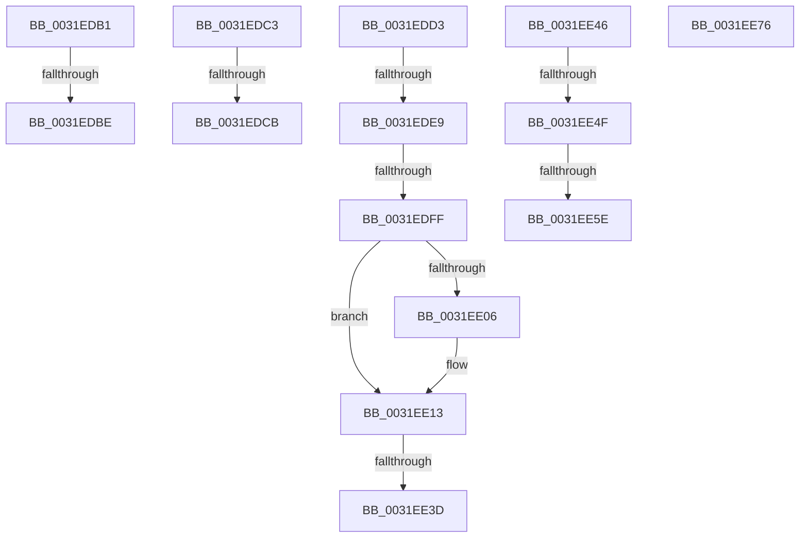

# sub_0031EDB1

- RVA: `0x0031EDB1`–`0x0031EE80` (길이 `207` bytes)
- VA: `0x000000014031EDB1`
- 실행 섹션: `.text`
- PDB 이름 있음: `아니요`; PDB Function 태그: `아니요`
- unwind 정보 RVA: `0x000752B8`
- 디코드: `43`개 명령, `207/207` bytes 표시
- 미해석 바이트: `0` (있으면 어셈블리에 `.byte`로 보존)

> 이 문서는 커널 이미지의 기계어와 PDB 기호를 분석해 생성했습니다. 4번과 5번은 함수 원형과 자료형을 바이너리 사용 방식에서 추정한 C 해석이며 원본 소스 복구 결과는 아닙니다.

## 1. Dependencies

- 직접 호출 지점: **2**; 고유 호출 대상: **2**
- 직접 호출자로 확인된 함수: **0**
- RIP 상대 이미지 참조: **2**

### Outgoing calls
- `0x0031EE13` → [MiUserPdeOrAbove](../2C/MiUserPdeOrAbove_function_002C57F0.md) (function, `0x002C57F0`)
- `0x0031EE67` → [MiCheckLinearProtectedPteAccessedBit](../29/MiCheckLinearProtectedPteAccessedBit_function_00292D80.md) (function, `0x00292D80`)

### Direct callers
- 이 함수 시작 RVA로 연결되는 직접 call은 확인되지 않았습니다. 간접 호출은 완전히 역산할 수 없습니다.

### Static image references
- `0x0031EDCB` → RVA `0x00EF5090` (`.data`; read/write)
- `0x0031EE1D` → RVA `0x00000000` (`image boundary/outside`; read)

## 2. Other-region calls and transfers

- 다른 실행 섹션으로 향하는 call: **0**
- call이 아닌 외부 분기/꼬리 이동: **12**
  - `0x0031EDB8` → [sub_0031EA17 + 0x89](Unknown_function_0031EA17.md) (`tail-transfer`)
  - `0x0031EDBE` → [sub_006E17A2](../6E/Unknown_function_006E17A2.md) (`tail-transfer`)
  - `0x0031EDC5` → [sub_0031EF0D](Unknown_function_0031EF0D.md) (`tail-transfer`)
  - `0x0031EDD1` → [sub_0031EA17 + 0x34A](Unknown_function_0031EA17.md) (`tail-transfer`)
  - `0x0031EDE3` → [sub_0031EA17 + 0x19A](Unknown_function_0031EA17.md) (`tail-transfer`)
  - `0x0031EDF9` → [sub_0031EEA5 + 0x25](Unknown_function_0031EEA5.md) (`tail-transfer`)
  - `0x0031EE37` → [sub_0031EA17 + 0x19A](Unknown_function_0031EA17.md) (`tail-transfer`)
  - `0x0031EE41` → [sub_0031EA17 + 0x19A](Unknown_function_0031EA17.md) (`tail-transfer`)
  - `0x0031EE49` → [sub_0031EA17 + 0x2AC](Unknown_function_0031EA17.md) (`tail-transfer`)
  - `0x0031EE58` → [sub_0031EA17 + 0x2AC](Unknown_function_0031EA17.md) (`tail-transfer`)
  - `0x0031EE71` → [sub_0031EA17 + 0x2AC](Unknown_function_0031EA17.md) (`tail-transfer`)
  - `0x0031EE7B` → [sub_0031EA17 + 0xE0](Unknown_function_0031EA17.md) (`tail-transfer`)

## 3. Assembly (complete function range)

```asm
0031EDB1  C1 E8 10                        shr eax, 0x10
0031EDB4  24 C0                           and al, 0xc0
0031EDB6  3C C0                           cmp al, 0xc0
0031EDB8  0F 85 E2 FC FF FF               jne 0x14031eaa0
0031EDBE  E9 DF 29 3C 00                  jmp 0x1406e17a2
0031EDC3  3C 11                           cmp al, 0x11
0031EDC5  0F 85 42 01 00 00               jne 0x14031ef0d
0031EDCB  FF 05 BF 62 BD 00               inc dword ptr [rip + 0xbd62bf]
0031EDD1  EB 8E                           jmp 0x14031ed61
0031EDD3  48 B8 FF FF FF 7F FB F6 FF FF   movabs rax, 0xfffff6fb7fffffff
0031EDDD  48 8B C0                        mov rax, rax
0031EDE0  48 3B C8                        cmp rcx, rax
0031EDE3  0F 87 C8 FD FF FF               ja 0x14031ebb1
0031EDE9  48 B8 68 DF BE 7D FB F6 FF FF   movabs rax, 0xfffff6fb7dbedf68
0031EDF3  48 8B C0                        mov rax, rax
0031EDF6  48 3B C8                        cmp rcx, rax
0031EDF9  0F 84 CB 00 00 00               je 0x14031eeca
0031EDFF  41 0F BA E0 1A                  bt r8d, 0x1a
0031EE04  72 0D                           jb 0x14031ee13
0031EE06  48 B8 FF FF FF FF FF FF FF 7F   movabs rax, 0x7fffffffffffffff
0031EE10  48 23 D8                        and rbx, rax
0031EE13  E8 D8 69 FA FF                  call 0x1402c57f0
0031EE18  4C 8B 4C 24 20                  mov r9, qword ptr [rsp + 0x20]
0031EE1D  4C 8D 1D DC 11 CE FF            lea r11, [rip - 0x31ee24]
0031EE24  4C 8B 84 24 E8 00 00 00         mov r8, qword ptr [rsp + 0xe8]
0031EE2C  44 0F B6 94 24 E0 00 00 00      movzx r10d, byte ptr [rsp + 0xe0]
0031EE35  85 C0                           test eax, eax
0031EE37  0F 84 74 FD FF FF               je 0x14031ebb1
0031EE3D  48 83 CB 04                     or rbx, 4
0031EE41  E9 6B FD FF FF                  jmp 0x14031ebb1
0031EE46  F6 C3 20                        test bl, 0x20
0031EE49  0F 85 74 FE FF FF               jne 0x14031ecc3
0031EE4F  48 8B C6                        mov rax, rsi
0031EE52  48 03 C7                        add rax, rdi
0031EE55  48 3B C8                        cmp rcx, rax
0031EE58  0F 82 65 FE FF FF               jb 0x14031ecc3
0031EE5E  41 B8 80 00 00 00               mov r8d, 0x80
0031EE64  48 8B D3                        mov rdx, rbx
0031EE67  E8 14 3F F7 FF                  call 0x140292d80
0031EE6C  48 8B 4C 24 30                  mov rcx, qword ptr [rsp + 0x30]
0031EE71  E9 4D FE FF FF                  jmp 0x14031ecc3
0031EE76  B9 0C 00 00 00                  mov ecx, 0xc
0031EE7B  E9 77 FC FF FF                  jmp 0x14031eaf7
```

## 4. C-style interpretation (structured pseudocode)

```c
__int64 __fastcall sub_0031EDB1(__int64 a1, __int64 a2, int a3)
{
    __int64 result;
    unsigned __int64 v_stack_p20;
    unsigned __int64 v_stack_p30;
    unsigned __int8 v_stack_pE0;
    unsigned __int64 v_stack_pE8;

    result = (unsigned int)((result) >> (16));
    result = (unsigned __int8)((result) & (192));
}
```

## 5. (Beta) C Style

```c
int64_t sub_0031EDB1(int64_t Arg1, int64_t Arg2, int32_t Arg3)
{
    int64_t result;
    uint64_t v_stack_p20;
    uint64_t v_stack_p30;
    uint8_t v_stack_pE0;
    uint64_t v_stack_pE8;

    result = (uint32_t)((result) >> (16));
    result = (uint8_t)((result) & (192));
}
```

## 6. Execution-region graph

[열기: 2D/3D 그래프와 함수 탐색 컨트롤 패널](../../../control-panel.html?section=text&rva=0x0031EDB1&view=graph)

- 2D 그래프는 위에서 아래로 흐르고, 3D 그래프는 빈 공간을 드래그해 회전합니다. Shift+드래그는 이동, 휠은 확대·축소, 함수 노드 선택은 대상 보고서 이동입니다.

### Static fallback


