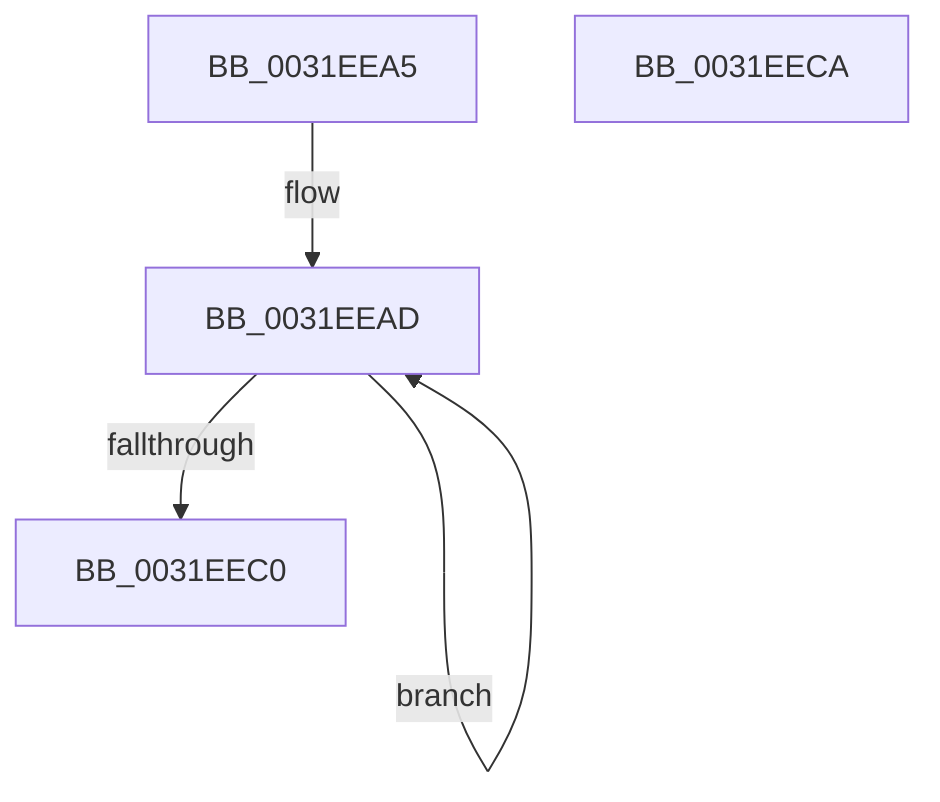

# sub_0031EEA5

- RVA: `0x0031EEA5`–`0x0031EEDC` (길이 `55` bytes)
- VA: `0x000000014031EEA5`
- 실행 섹션: `.text`
- PDB 이름 있음: `아니요`; PDB Function 태그: `아니요`
- unwind 정보 RVA: `0x000752DC`
- 디코드: `13`개 명령, `55/55` bytes 표시
- 미해석 바이트: `0` (있으면 어셈블리에 `.byte`로 보존)

> 이 문서는 커널 이미지의 기계어와 PDB 기호를 분석해 생성했습니다. 4번과 5번은 함수 원형과 자료형을 바이너리 사용 방식에서 추정한 C 해석이며 원본 소스 복구 결과는 아닙니다.

## 1. Dependencies

- 직접 호출 지점: **0**; 고유 호출 대상: **0**
- 직접 호출자로 확인된 함수: **0**
- RIP 상대 이미지 참조: **0**

### Outgoing calls
- 직접 디코드된 call 명령이 없습니다.

### Direct callers
- 이 함수 시작 RVA로 연결되는 직접 call은 확인되지 않았습니다. 간접 호출은 완전히 역산할 수 없습니다.

### Static image references
- 디코드된 RIP-relative 메모리 참조가 없습니다.

## 2. Other-region calls and transfers

- 다른 실행 섹션으로 향하는 call: **0**
- call이 아닌 외부 분기/꼬리 이동: **2**
  - `0x0031EEC5` → [sub_0031EA17 + 0x133](Unknown_function_0031EA17.md) (`tail-transfer`)
  - `0x0031EED7` → [sub_0031EDB1 + 0x62](Unknown_function_0031EDB1.md) (`tail-transfer`)

## 3. Assembly (complete function range)

```asm
0031EEA5  BA 02 00 00 00                  mov edx, 2
0031EEAA  41 2B D6                        sub edx, r14d
0031EEAD  48 C1 E9 09                     shr rcx, 9
0031EEB1  48 23 CB                        and rcx, rbx
0031EEB4  49 8B C3                        mov rax, r11
0031EEB7  48 03 C8                        add rcx, rax
0031EEBA  48 83 EA 01                     sub rdx, 1
0031EEBE  75 ED                           jne 0x14031eead
0031EEC0  48 89 4C 24 38                  mov qword ptr [rsp + 0x38], rcx
0031EEC5  E9 80 FC FF FF                  jmp 0x14031eb4a
0031EECA  48 B8 00 00 00 00 00 00 00 80   movabs rax, 0x8000000000000000
0031EED4  48 0B D8                        or rbx, rax
0031EED7  E9 37 FF FF FF                  jmp 0x14031ee13
```

## 4. C-style interpretation (structured pseudocode)

```c
__int64 __fastcall sub_0031EEA5(__int64 a1)
{
    unsigned __int64 v_stack_p38;

    a2 = (unsigned int)((2) - ((unsigned int)(v_r14)));
loc_0031EEAD:
    a1 = (a1) >> (9);
    a1 = (a1) & (v_rbx);
    a1 = (a1) + (v_r11);
    a2 = (a2) - (1);
    if (condition_is_not_equal) goto loc_0031EEAD;
    v_stack_p38 = a1;
}
```

## 5. (Beta) C Style

```c
int64_t sub_0031EEA5(int64_t Arg1)
{
    uint64_t v_stack_p38;

    a2 = (uint32_t)((2) - ((uint32_t)(local_r14)));
loc_0031EEAD:
    Arg1 = (Arg1) >> (9);
    Arg1 = (Arg1) & (local_rbx);
    Arg1 = (Arg1) + (local_r11);
    a2 = (a2) - (1);
    if (condition_is_not_equal) goto loc_0031EEAD;
    v_stack_p38 = Arg1;
}
```

## 6. Execution-region graph

[열기: 2D/3D 그래프와 함수 탐색 컨트롤 패널](../../../control-panel.html?section=text&rva=0x0031EEA5&view=graph)

- 2D 그래프는 위에서 아래로 흐르고, 3D 그래프는 빈 공간을 드래그해 회전합니다. Shift+드래그는 이동, 휠은 확대·축소, 함수 노드 선택은 대상 보고서 이동입니다.

### Static fallback


