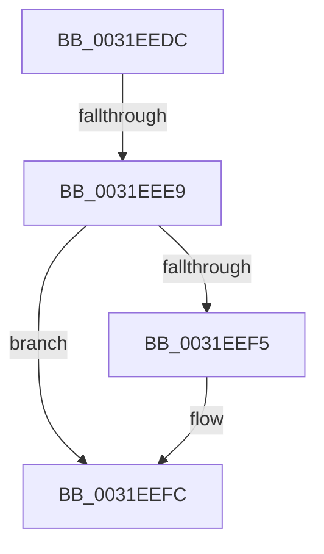

# sub_0031EEDC

- RVA: `0x0031EEDC`–`0x0031EF0D` (길이 `49` bytes)
- VA: `0x000000014031EEDC`
- 실행 섹션: `.text`
- PDB 이름 있음: `아니요`; PDB Function 태그: `아니요`
- unwind 정보 RVA: `0x000752F0`
- 디코드: `10`개 명령, `49/49` bytes 표시
- 미해석 바이트: `0` (있으면 어셈블리에 `.byte`로 보존)

> 이 문서는 커널 이미지의 기계어와 PDB 기호를 분석해 생성했습니다. 4번과 5번은 함수 원형과 자료형을 바이너리 사용 방식에서 추정한 C 해석이며 원본 소스 복구 결과는 아닙니다.

## 1. Dependencies

- 직접 호출 지점: **0**; 고유 호출 대상: **0**
- 직접 호출자로 확인된 함수: **0**
- RIP 상대 이미지 참조: **0**

### Outgoing calls
- 직접 디코드된 call 명령이 없습니다.

### Direct callers
- 이 함수 시작 RVA로 연결되는 직접 call은 확인되지 않았습니다. 간접 호출은 완전히 역산할 수 없습니다.

### Static image references
- 디코드된 RIP-relative 메모리 참조가 없습니다.

## 2. Other-region calls and transfers

- 다른 실행 섹션으로 향하는 call: **0**
- call이 아닌 외부 분기/꼬리 이동: **2**
  - `0x0031EEE3` → [MiMapBackgroundPagesToZero + 0x35](MiMapBackgroundPagesToZero_function_0031E940.md) (`tail-transfer`)
  - `0x0031EF08` → [MiMapBackgroundPagesToZero + 0x35](MiMapBackgroundPagesToZero_function_0031E940.md) (`tail-transfer`)

## 3. Assembly (complete function range)

```asm
0031EEDC  80 B9 46 01 00 00 00            cmp byte ptr [rcx + 0x146], 0
0031EEE3  0F 85 8C FA FF FF               jne 0x14031e975
0031EEE9  80 B9 44 01 00 00 00            cmp byte ptr [rcx + 0x144], 0
0031EEF0  48 8B C6                        mov rax, rsi
0031EEF3  75 07                           jne 0x14031eefc
0031EEF5  48 8B 81 48 02 00 00            mov rax, qword ptr [rcx + 0x248]
0031EEFC  48 85 C0                        test rax, rax
0031EEFF  48 0F 45 E8                     cmovne rbp, rax
0031EF03  48 89 6C 24 48                  mov qword ptr [rsp + 0x48], rbp
0031EF08  E9 68 FA FF FF                  jmp 0x14031e975
```

## 4. C-style interpretation (structured pseudocode)

```c
__int64 __fastcall sub_0031EEDC(__int64 a1)
{
    __int64 result;
    __int64 v_rbp;
    unsigned __int64 v_stack_p48;

    result = v_rsi;
    if ((*(unsigned __int8 *)(a1 + 324)) == 0) {
        result = *(unsigned __int64 *)(a1 + 584);
    }
    if (result != 0) { v_rbp = result; }
    v_stack_p48 = v_rbp;
}
```

## 5. (Beta) C Style

```c
int64_t sub_0031EEDC(void *Arg1)
{
    uint8_t *arg1 = (uint8_t *)Arg1;

    int64_t result;
    int64_t local_rbp;
    uint64_t v_stack_p48;

    result = local_rsi;
    if ((*(uint8_t *)(arg1 + 0x144)) == 0) {
        result = *(uint64_t *)(arg1 + 0x248);
    }
    if (result != 0) { local_rbp = result; }
    v_stack_p48 = local_rbp;
}
```

### 관측된 메모리 오프셋

구조체 형식이 확인되지 않은 접근은 인자 기준의 오프셋으로만 기록했습니다.

| 기준 인자 | 오프셋 표현 | 폭 (bit) | 접근 |
|---|---:|---:|---|
| `Arg1` | `+ 0x144` | `8` | `R` |
| `Arg1` | `+ 0x146` | `8` | `R` |
| `Arg1` | `+ 0x248` | `64` | `R` |

## 6. Execution-region graph

[열기: 2D/3D 그래프와 함수 탐색 컨트롤 패널](../../../control-panel.html?section=text&rva=0x0031EEDC&view=graph)

- 2D 그래프는 위에서 아래로 흐르고, 3D 그래프는 빈 공간을 드래그해 회전합니다. Shift+드래그는 이동, 휠은 확대·축소, 함수 노드 선택은 대상 보고서 이동입니다.

### Static fallback


