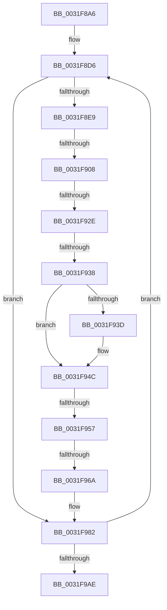

# sub_0031F8A6

- RVA: `0x0031F8A6`–`0x0031F9C0` (길이 `282` bytes)
- VA: `0x000000014031F8A6`
- 실행 섹션: `.text`
- PDB 이름 있음: `아니요`; PDB Function 태그: `아니요`
- unwind 정보 RVA: `0x00075374`
- 디코드: `56`개 명령, `282/282` bytes 표시
- 미해석 바이트: `0` (있으면 어셈블리에 `.byte`로 보존)

> 이 문서는 커널 이미지의 기계어와 PDB 기호를 분석해 생성했습니다. 4번과 5번은 함수 원형과 자료형을 바이너리 사용 방식에서 추정한 C 해석이며 원본 소스 복구 결과는 아닙니다.

## 1. Dependencies

- 직접 호출 지점: **2**; 고유 호출 대상: **2**
- 직접 호출자로 확인된 함수: **0**
- RIP 상대 이미지 참조: **0**

### Outgoing calls
- `0x0031F944` → [ExAcquireSpinLockExclusive](../24/ExAcquireSpinLockExclusive_function_00248690.md) (function, `0x00248690`)
- `0x0031F95A` → [MiSafeLockPage](../32/MiSafeLockPage_function_00321620.md) (function, `0x00321620`)

### Direct callers
- 이 함수 시작 RVA로 연결되는 직접 call은 확인되지 않았습니다. 간접 호출은 완전히 역산할 수 없습니다.

### Static image references
- 디코드된 RIP-relative 메모리 참조가 없습니다.

## 2. Other-region calls and transfers

- 다른 실행 섹션으로 향하는 call: **0**
- call이 아닌 외부 분기/꼬리 이동: **5**
  - `0x0031F902` → [sub_0031F9CC + 0xA7](Unknown_function_0031F9CC.md) (`tail-transfer`)
  - `0x0031F928` → [sub_0031F9CC + 0xE3](Unknown_function_0031F9CC.md) (`tail-transfer`)
  - `0x0031F932` → [sub_0031F9CC + 0x7C](Unknown_function_0031F9CC.md) (`tail-transfer`)
  - `0x0031F951` → [sub_0031F9CC + 0x1F](Unknown_function_0031F9CC.md) (`tail-transfer`)
  - `0x0031F968` → [sub_0031F9CC](Unknown_function_0031F9CC.md) (`tail-transfer`)

## 3. Assembly (complete function range)

```asm
0031F8A6  4C 89 74 24 38                  mov qword ptr [rsp + 0x38], r14
0031F8AB  49 BA FF FF FF FF 3F 00 00 00   movabs r10, 0x3fffffffff
0031F8B5  4C 89 A4 24 80 00 00 00         mov qword ptr [rsp + 0x80], r12
0031F8BD  49 BB FF FF FF FF FF FF FF 7F   movabs r11, 0x7fffffffffffffff
0031F8C7  4C 89 7C 24 30                  mov qword ptr [rsp + 0x30], r15
0031F8CC  49 B9 00 00 00 00 00 DE FF FF   movabs r9, 0xffffde0000000000
0031F8D6  4C 8B 44 FE 18                  mov r8, qword ptr [rsi + rdi*8 + 0x18]
0031F8DB  4C 8D 34 FE                     lea r14, [rsi + rdi*8]
0031F8DF  41 F6 C0 08                     test r8b, 8
0031F8E3  0F 84 99 00 00 00               je 0x14031f982
0031F8E9  48 8B 43 38                     mov rax, qword ptr [rbx + 0x38]
0031F8ED  4D 8B F8                        mov r15, r8
0031F8F0  49 C1 EF 0C                     shr r15, 0xc
0031F8F4  0F 57 C0                        xorps xmm0, xmm0
0031F8F7  4D 23 FA                        and r15, r10
0031F8FA  0F 11 44 24 20                  movups xmmword ptr [rsp + 0x20], xmm0
0031F8FF  48 85 C0                        test rax, rax
0031F902  0F 85 6B 01 00 00               jne 0x14031fa73
0031F908  4F 8D 24 7F                     lea r12, [r15 + r15*2]
0031F90C  C6 44 24 28 01                  mov byte ptr [rsp + 0x28], 1
0031F911  49 C1 E4 04                     shl r12, 4
0031F915  49 8B C1                        mov rax, r9
0031F918  4C 03 E0                        add r12, rax
0031F91B  48 83 BA A0 02 00 00 00         cmp qword ptr [rdx + 0x2a0], 0
0031F923  4C 89 64 24 20                  mov qword ptr [rsp + 0x20], r12
0031F928  0F 85 81 01 00 00               jne 0x14031faaf
0031F92E  83 7B 08 00                     cmp dword ptr [rbx + 8], 0
0031F932  0F 85 10 01 00 00               jne 0x14031fa48
0031F938  4D 85 ED                        test r13, r13
0031F93B  74 0F                           je 0x14031f94c
0031F93D  48 8D 8D 78 3B 00 00            lea rcx, [rbp + 0x3b78]
0031F944  E8 47 8D F2 FF                  call 0x140248690
0031F949  88 43 01                        mov byte ptr [rbx + 1], al
0031F94C  80 7C 24 28 00                  cmp byte ptr [rsp + 0x28], 0
0031F951  0F 84 94 00 00 00               je 0x14031f9eb
0031F957  49 8B CF                        mov rcx, r15
0031F95A  E8 C1 1C 00 00                  call 0x140321620
0031F95F  49 8B 4E 18                     mov rcx, qword ptr [r14 + 0x18]
0031F963  88 03                           mov byte ptr [rbx], al
0031F965  F6 C1 01                        test cl, 1
0031F968  75 62                           jne 0x14031f9cc
0031F96A  49 8B 46 18                     mov rax, qword ptr [r14 + 0x18]
0031F96E  48 83 C8 20                     or rax, 0x20
0031F972  FF 43 08                        inc dword ptr [rbx + 8]
0031F975  49 89 46 18                     mov qword ptr [r14 + 0x18], rax
0031F979  48 8B 54 24 78                  mov rdx, qword ptr [rsp + 0x78]
0031F97E  8B 4C 24 70                     mov ecx, dword ptr [rsp + 0x70]
0031F982  FF C7                           inc edi
0031F984  49 B9 00 00 00 00 00 DE FF FF   movabs r9, 0xffffde0000000000
0031F98E  49 BA FF FF FF FF 3F 00 00 00   movabs r10, 0x3fffffffff
0031F998  49 BB FF FF FF FF FF FF FF 7F   movabs r11, 0x7fffffffffffffff
0031F9A2  3B BE 18 01 00 00               cmp edi, dword ptr [rsi + 0x118]
0031F9A8  0F 82 28 FF FF FF               jb 0x14031f8d6
0031F9AE  4C 8B A4 24 80 00 00 00         mov r12, qword ptr [rsp + 0x80]
0031F9B6  4C 8B 7C 24 30                  mov r15, qword ptr [rsp + 0x30]
0031F9BB  4C 8B 74 24 38                  mov r14, qword ptr [rsp + 0x38]
```

## 4. C-style interpretation (structured pseudocode)

```c
__int64 __fastcall sub_0031F8A6(__int64 a1, __int64 a2, __int64 a3, __int64 a4, unsigned __int8 a5, __int64 a6, __int64 a7, __int64 a8, __int64 a9, __int64 a10, __int64 a11, __int64 a12, __int64 a13, unsigned int a14, __int64 a15, __int64 a16)
{
    __int64 result;
    __int64 v_r12;
    __int64 v_r15;
    __int64 v_rdi;
    unsigned __int64 v_stack_p20;
    unsigned __int8 v_stack_p28;
    unsigned __int64 v_stack_p30;
    unsigned __int64 v_stack_p38;
    unsigned __int64 v_stack_p80;

    v_stack_p38 = v_r14;
    v_stack_p80 = v_r12;
    v_stack_p30 = v_r15;
loc_0031F8D6:
    if ((((unsigned __int8)(*(unsigned __int64 *)(v_rsi + v_rdi * 8 + 24))) & (8)) == 0) goto loc_0031F982;
    v_r15 = (*(unsigned __int64 *)(v_rsi + v_rdi * 8 + 24)) >> (12);
    v_r15 = (v_r15) & (v_r10);
    v_stack_p20 = v_xmm0;
    v_stack_p28 = 1;
    v_r12 = (v_r15 + v_r15 * 2) << (4);
    v_r12 = (v_r12) + (a4);
    v_stack_p20 = v_r12;
    result = a4;
    if (v_r13 != 0) {
        a1 = v_rbp + 15224;
        result = ExAcquireSpinLockExclusive(a1, a2, *(unsigned __int64 *)(v_rsi + v_rdi * 8 + 24), a4);
        *(unsigned __int8 *)(v_rbx + 1) = (unsigned __int8)(result);
    }
    result = MiSafeLockPage(v_r15, a2, *(unsigned __int64 *)(v_rsi + v_rdi * 8 + 24), a4);
    *(unsigned __int8 *)(v_rbx) = (unsigned __int8)(result);
    result = (*(unsigned __int64 *)(v_rsi + v_rdi * 8 + 24)) | (32);
    *(unsigned __int64 *)(v_rsi + v_rdi * 8 + 24) = result;
loc_0031F982:
    v_rdi = (unsigned int)((v_rdi) + 1);
    if (((unsigned int)(v_rdi)) < (*(unsigned int *)(v_rsi + 280))) goto loc_0031F8D6;
    return result;
}
```

## 5. (Beta) C Style

```c
int64_t sub_0031F8A6(int64_t Arg1, int64_t Arg2, int64_t Arg3, int64_t Arg4, uint8_t Arg5, int64_t Arg6, int64_t Arg7, uint64_t Arg8, uint64_t Arg9, uint64_t Arg10, uint64_t Arg11, uint64_t Arg12, uint64_t Arg13, uint32_t Arg14, int64_t Arg15, int64_t Arg16)
{
    int64_t result;
    int64_t local_r12;
    int64_t local_r15;
    int64_t local_rdi;
    uint64_t v_stack_p20;
    uint8_t v_stack_p28;
    uint64_t v_stack_p30;
    uint64_t v_stack_p38;
    uint64_t v_stack_p80;

    v_stack_p38 = local_r14;
    v_stack_p80 = local_r12;
    v_stack_p30 = local_r15;
loc_0031F8D6:
    if ((((uint8_t)(*(uint64_t *)(local_rsi + local_rdi * 8 + 0x18))) & (8)) == 0) goto loc_0031F982;
    local_r15 = (*(uint64_t *)(local_rsi + local_rdi * 8 + 0x18)) >> (12);
    local_r15 = (local_r15) & (local_r10);
    v_stack_p20 = v_xmm0;
    v_stack_p28 = 1;
    local_r12 = (local_r15 + local_r15 * 2) << (4);
    local_r12 = (local_r12) + (Arg4);
    v_stack_p20 = local_r12;
    result = Arg4;
    if (local_r13 != 0) {
        Arg1 = local_rbp + 15224;
        result = ExAcquireSpinLockExclusive(Arg1, Arg2, *(uint64_t *)(local_rsi + local_rdi * 8 + 0x18), Arg4);
        *(uint8_t *)(local_rbx + 0x1) = (uint8_t)(result);
    }
    result = MiSafeLockPage(local_r15, Arg2, *(uint64_t *)(local_rsi + local_rdi * 8 + 0x18), Arg4);
    *(uint8_t *)(local_rbx) = (uint8_t)(result);
    result = (*(uint64_t *)(local_rsi + local_rdi * 8 + 0x18)) | (32);
    *(uint64_t *)(local_rsi + local_rdi * 8 + 0x18) = result;
loc_0031F982:
    local_rdi = (uint32_t)((local_rdi) + 1);
    if (((uint32_t)(local_rdi)) < (*(uint32_t *)(local_rsi + 0x118))) goto loc_0031F8D6;
    return result;
}
```

## 6. Execution-region graph

[열기: 2D/3D 그래프와 함수 탐색 컨트롤 패널](../../../control-panel.html?section=text&rva=0x0031F8A6&view=graph)

- 2D 그래프는 위에서 아래로 흐르고, 3D 그래프는 빈 공간을 드래그해 회전합니다. Shift+드래그는 이동, 휠은 확대·축소, 함수 노드 선택은 대상 보고서 이동입니다.

### Static fallback


