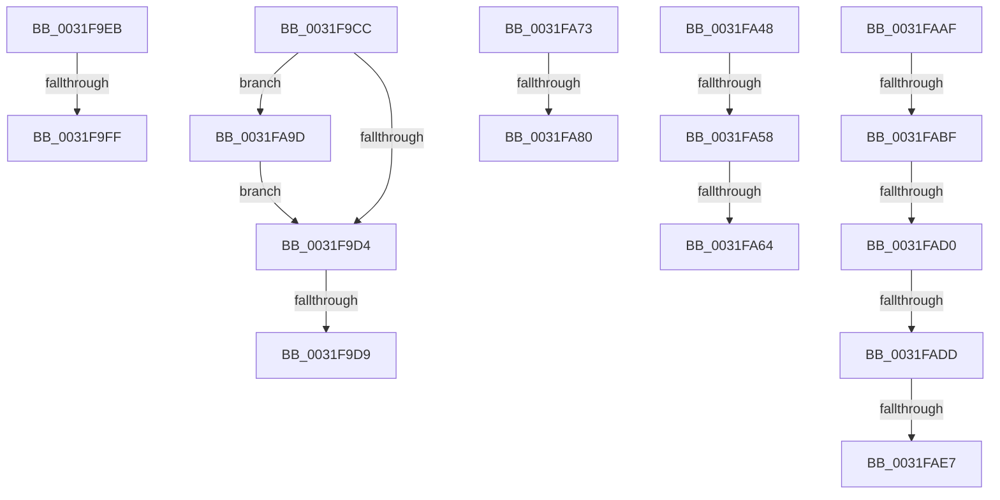

# sub_0031F9CC

- RVA: `0x0031F9CC`–`0x0031FAF0` (길이 `292` bytes)
- VA: `0x000000014031F9CC`
- 실행 섹션: `.text`
- PDB 이름 있음: `아니요`; PDB Function 태그: `아니요`
- unwind 정보 RVA: `0x000753A4`
- 디코드: `65`개 명령, `292/292` bytes 표시
- 미해석 바이트: `0` (있으면 어셈블리에 `.byte`로 보존)

> 이 문서는 커널 이미지의 기계어와 PDB 기호를 분석해 생성했습니다. 4번과 5번은 함수 원형과 자료형을 바이너리 사용 방식에서 추정한 C 해석이며 원본 소스 복구 결과는 아닙니다.

## 1. Dependencies

- 직접 호출 지점: **6**; 고유 호출 대상: **5**
- 직접 호출자로 확인된 함수: **0**
- RIP 상대 이미지 참조: **2**

### Outgoing calls
- `0x0031F9E4` → [MiReleaseSpinLockExclusive](../24/MiReleaseSpinLockExclusive_function_002482C0.md) (function, `0x002482C0`)
- `0x0031F9EE` → [MiLockHugePfnInternal](../3F/MiLockHugePfnInternal_function_003FBC80.md) (function, `0x003FBC80`)
- `0x0031FA3E` → [MiReleaseSpinLockExclusive](../24/MiReleaseSpinLockExclusive_function_002482C0.md) (function, `0x002482C0`)
- `0x0031FA4B` → [MiSafeTryLockNestedPageAtDpc](../49/MiSafeTryLockNestedPageAtDpc_function_00495E88.md) (function, `0x00495E88`)
- `0x0031FAA5` → [MiUnlockPage](MiUnlockPage_function_0031A3E0.md) (function, `0x0031A3E0`)
- `0x0031FAB2` → [MiColdPageSizeSupported](../45/MiColdPageSizeSupported_function_00454588.md) (function, `0x00454588`)

### Direct callers
- 이 함수 시작 RVA로 연결되는 직접 call은 확인되지 않았습니다. 간접 호출은 완전히 역산할 수 없습니다.

### Static image references
- `0x0031FA09` → RVA `0x00E300C0` (`.data`; read)
- `0x0031FA24` → RVA `0x00E300C8` (`.data`; read)

## 2. Other-region calls and transfers

- 다른 실행 섹션으로 향하는 call: **0**
- call이 아닌 외부 분기/꼬리 이동: **14**
  - `0x0031F9D7` → [sub_0031F8A6 + 0xD3](Unknown_function_0031F8A6.md) (`tail-transfer`)
  - `0x0031F9E9` → [sub_0031F8A6 + 0xD3](Unknown_function_0031F8A6.md) (`tail-transfer`)
  - `0x0031F9F9` → [sub_0031F8A6 + 0xC8](Unknown_function_0031F8A6.md) (`tail-transfer`)
  - `0x0031FA43` → [sub_0031F8A6 + 0xD3](Unknown_function_0031F8A6.md) (`tail-transfer`)
  - `0x0031FA52` → [sub_0031F8A6 + 0x108](Unknown_function_0031F8A6.md) (`tail-transfer`)
  - `0x0031FA5E` → [sub_0031F8A6 + 0xC8](Unknown_function_0031F8A6.md) (`tail-transfer`)
  - `0x0031FA6E` → [sub_0031F8A6 + 0xD3](Unknown_function_0031F8A6.md) (`tail-transfer`)
  - `0x0031FA7A` → [sub_0031F8A6 + 0x62](Unknown_function_0031F8A6.md) (`tail-transfer`)
  - `0x0031FA98` → [sub_0031F8A6 + 0x75](Unknown_function_0031F8A6.md) (`tail-transfer`)
  - `0x0031FAB9` → [sub_0031F8A6 + 0x88](Unknown_function_0031F8A6.md) (`tail-transfer`)
  - `0x0031FACA` → [sub_0031F8A6 + 0x88](Unknown_function_0031F8A6.md) (`tail-transfer`)
  - `0x0031FAD7` → [sub_0031F8A6 + 0x88](Unknown_function_0031F8A6.md) (`tail-transfer`)
  - `0x0031FAE1` → [sub_0031F8A6 + 0x88](Unknown_function_0031F8A6.md) (`tail-transfer`)
  - `0x0031FAEB` → [sub_0031F8A6 + 0x88](Unknown_function_0031F8A6.md) (`tail-transfer`)

## 3. Assembly (complete function range)

```asm
0031F9CC  3C 11                           cmp al, 0x11
0031F9CE  0F 85 C9 00 00 00               jne 0x14031fa9d
0031F9D4  4D 85 ED                        test r13, r13
0031F9D7  74 A0                           je 0x14031f979
0031F9D9  0F B6 53 01                     movzx edx, byte ptr [rbx + 1]
0031F9DD  48 8D 8D 78 3B 00 00            lea rcx, [rbp + 0x3b78]
0031F9E4  E8 D7 88 F2 FF                  call 0x1402482c0
0031F9E9  EB 8E                           jmp 0x14031f979
0031F9EB  49 8B CC                        mov rcx, r12
0031F9EE  E8 8D C2 0D 00                  call 0x1403fbc80
0031F9F3  49 8B 46 18                     mov rax, qword ptr [r14 + 0x18]
0031F9F7  A8 01                           test al, 1
0031F9F9  0F 84 6F FF FF FF               je 0x14031f96e
0031F9FF  48 8B 44 24 20                  mov rax, qword ptr [rsp + 0x20]
0031FA04  BA 01 00 00 00                  mov edx, 1
0031FA09  48 2B 05 B0 06 B1 00            sub rax, qword ptr [rip + 0xb106b0]
0031FA10  48 C1 F8 03                     sar rax, 3
0031FA14  25 FF FF 3F 00                  and eax, 0x3fffff
0031FA19  8B C8                           mov ecx, eax
0031FA1B  83 E1 1F                        and ecx, 0x1f
0031FA1E  D3 E2                           shl edx, cl
0031FA20  8B C8                           mov ecx, eax
0031FA22  F7 D2                           not edx
0031FA24  48 8B 05 9D 06 B1 00            mov rax, qword ptr [rip + 0xb1069d]
0031FA2B  48 C1 E9 05                     shr rcx, 5
0031FA2F  F0 21 14 88                     lock and dword ptr [rax + rcx*4], edx
0031FA33  0F B6 53 01                     movzx edx, byte ptr [rbx + 1]
0031FA37  48 8D 8D 78 3B 00 00            lea rcx, [rbp + 0x3b78]
0031FA3E  E8 7D 88 F2 FF                  call 0x1402482c0
0031FA43  E9 31 FF FF FF                  jmp 0x14031f979
0031FA48  49 8B CF                        mov rcx, r15
0031FA4B  E8 38 64 17 00                  call 0x140495e88
0031FA50  85 C0                           test eax, eax
0031FA52  0F 84 56 FF FF FF               je 0x14031f9ae
0031FA58  49 8B 46 18                     mov rax, qword ptr [r14 + 0x18]
0031FA5C  A8 01                           test al, 1
0031FA5E  0F 84 0A FF FF FF               je 0x14031f96e
0031FA64  48 8B 44 24 20                  mov rax, qword ptr [rsp + 0x20]
0031FA69  F0 4C 21 58 18                  lock and qword ptr [rax + 0x18], r11
0031FA6E  E9 06 FF FF FF                  jmp 0x14031f979
0031FA73  80 B8 44 01 00 00 00            cmp byte ptr [rax + 0x144], 0
0031FA7A  0F 84 88 FE FF FF               je 0x14031f908
0031FA80  48 8B 05 39 06 B1 00            mov rax, qword ptr [rip + 0xb10639]
0031FA87  49 8B CF                        mov rcx, r15
0031FA8A  81 E1 FF FF 3F 00               and ecx, 0x3fffff
0031FA90  4C 8D 24 C8                     lea r12, [rax + rcx*8]
0031FA94  8B 4C 24 70                     mov ecx, dword ptr [rsp + 0x70]
0031FA98  E9 7E FE FF FF                  jmp 0x14031f91b
0031FA9D  48 8B 4C 24 20                  mov rcx, qword ptr [rsp + 0x20]
0031FAA2  0F B6 D0                        movzx edx, al
0031FAA5  E8 36 A9 FF FF                  call 0x14031a3e0
0031FAAA  E9 25 FF FF FF                  jmp 0x14031f9d4
0031FAAF  48 8B D5                        mov rdx, rbp
0031FAB2  E8 D1 4A 13 00                  call 0x140454588
0031FAB7  85 C0                           test eax, eax
0031FAB9  0F 84 6F FE FF FF               je 0x14031f92e
0031FABF  48 8B 43 18                     mov rax, qword ptr [rbx + 0x18]
0031FAC3  80 B8 C3 00 00 00 00            cmp byte ptr [rax + 0xc3], 0
0031FACA  0F 85 5E FE FF FF               jne 0x14031f92e
0031FAD0  80 BE 44 01 00 00 00            cmp byte ptr [rsi + 0x144], 0
0031FAD7  0F 85 51 FE FF FF               jne 0x14031f92e
0031FADD  41 F6 C0 03                     test r8b, 3
0031FAE1  0F 85 47 FE FF FF               jne 0x14031f92e
0031FAE7  C6 43 04 01                     mov byte ptr [rbx + 4], 1
0031FAEB  E9 3E FE FF FF                  jmp 0x14031f92e
```

## 4. C-style interpretation (structured pseudocode)

```c
__int64 __fastcall sub_0031F9CC(__int64 a1, __int64 a2, unsigned __int8 a3)
{
    __int64 result;
    unsigned __int64 v_stack_p20;
    unsigned int v_stack_p70;

    if (((unsigned __int8)(result)) != 17) goto loc_0031FA9D;
loc_0031F9D4:
    result = MiReleaseSpinLockExclusive(v_rbp + 15224, *(unsigned __int8 *)(v_rbx + 1), a3, a4);
loc_0031FA9D:
    result = MiUnlockPage(v_stack_p20, (unsigned __int8)(result), a3, a4);
    goto loc_0031F9D4;
}
```

## 5. (Beta) C Style

```c
int64_t sub_0031F9CC(int64_t Arg1, int64_t Arg2, uint8_t Arg3)
{
    int64_t result;
    uint64_t v_stack_p20;
    uint32_t v_stack_p70;

    if (((uint8_t)(result)) != 17) goto loc_0031FA9D;
loc_0031F9D4:
    result = MiReleaseSpinLockExclusive(local_rbp + 15224, *(uint8_t *)(local_rbx + 0x1), Arg3, a4);
loc_0031FA9D:
    result = MiUnlockPage(v_stack_p20, (uint8_t)(result), Arg3, a4);
    goto loc_0031F9D4;
}
```

## 6. Execution-region graph

[열기: 2D/3D 그래프와 함수 탐색 컨트롤 패널](../../../control-panel.html?section=text&rva=0x0031F9CC&view=graph)

- 2D 그래프는 위에서 아래로 흐르고, 3D 그래프는 빈 공간을 드래그해 회전합니다. Shift+드래그는 이동, 휠은 확대·축소, 함수 노드 선택은 대상 보고서 이동입니다.

### Static fallback


