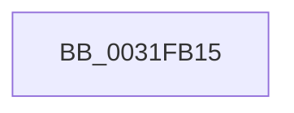

# sub_0031FB15

- RVA: `0x0031FB15`–`0x0031FB44` (길이 `47` bytes)
- VA: `0x000000014031FB15`
- 실행 섹션: `.text`
- PDB 이름 있음: `아니요`; PDB Function 태그: `아니요`
- unwind 정보 RVA: `0x000753CC`
- 디코드: `10`개 명령, `47/47` bytes 표시
- 미해석 바이트: `0` (있으면 어셈블리에 `.byte`로 보존)

> 이 문서는 커널 이미지의 기계어와 PDB 기호를 분석해 생성했습니다. 4번과 5번은 함수 원형과 자료형을 바이너리 사용 방식에서 추정한 C 해석이며 원본 소스 복구 결과는 아닙니다.

## 1. Dependencies

- 직접 호출 지점: **0**; 고유 호출 대상: **0**
- 직접 호출자로 확인된 함수: **0**
- RIP 상대 이미지 참조: **0**

### Outgoing calls
- 직접 디코드된 call 명령이 없습니다.

### Direct callers
- 이 함수 시작 RVA로 연결되는 직접 call은 확인되지 않았습니다. 간접 호출은 완전히 역산할 수 없습니다.

### Static image references
- 디코드된 RIP-relative 메모리 참조가 없습니다.

## 2. Other-region calls and transfers

- 다른 실행 섹션으로 향하는 call: **0**
- call이 아닌 외부 분기/꼬리 이동: **1**
  - `0x0031FB3E` → [sub_0031FC24](Unknown_function_0031FC24.md) (`tail-transfer`)

## 3. Assembly (complete function range)

```asm
0031FB15  48 89 6C 24 60                  mov qword ptr [rsp + 0x60], rbp
0031FB1A  48 8B 69 38                     mov rbp, qword ptr [rcx + 0x38]
0031FB1E  48 89 74 24 68                  mov qword ptr [rsp + 0x68], rsi
0031FB23  48 8B 71 40                     mov rsi, qword ptr [rcx + 0x40]
0031FB27  4C 89 74 24 38                  mov qword ptr [rsp + 0x38], r14
0031FB2C  4C 89 7C 24 30                  mov qword ptr [rsp + 0x30], r15
0031FB31  45 33 FF                        xor r15d, r15d
0031FB34  45 8B F7                        mov r14d, r15d
0031FB37  44 39 BE 18 01 00 00            cmp dword ptr [rsi + 0x118], r15d
0031FB3E  0F 86 E0 00 00 00               jbe 0x14031fc24
```

## 4. C-style interpretation (structured pseudocode)

```c
void __fastcall sub_0031FB15(__int64 a1)
{
    __int64 v_r15;
    unsigned __int64 v_stack_p30;
    unsigned __int64 v_stack_p38;
    unsigned __int64 v_stack_p60;
    unsigned __int64 v_stack_p68;

    v_stack_p60 = v_rbp;
    v_stack_p68 = v_rsi;
    v_stack_p38 = v_r14;
    v_stack_p30 = v_r15;
    v_r15 = 0;
}
```

## 5. (Beta) C Style

```c
void sub_0031FB15(void *Arg1)
{
    uint8_t *arg1 = (uint8_t *)Arg1;

    int64_t local_r15;
    uint64_t v_stack_p30;
    uint64_t v_stack_p38;
    uint64_t v_stack_p60;
    uint64_t v_stack_p68;

    v_stack_p60 = local_rbp;
    v_stack_p68 = local_rsi;
    v_stack_p38 = local_r14;
    v_stack_p30 = local_r15;
    local_r15 = 0;
}
```

### 관측된 메모리 오프셋

구조체 형식이 확인되지 않은 접근은 인자 기준의 오프셋으로만 기록했습니다.

| 기준 인자 | 오프셋 표현 | 폭 (bit) | 접근 |
|---|---:|---:|---|
| `Arg1` | `+ 0x38` | `64` | `R` |
| `Arg1` | `+ 0x40` | `64` | `R` |

## 6. Execution-region graph

[열기: 2D/3D 그래프와 함수 탐색 컨트롤 패널](../../../control-panel.html?section=text&rva=0x0031FB15&view=graph)

- 2D 그래프는 위에서 아래로 흐르고, 3D 그래프는 빈 공간을 드래그해 회전합니다. Shift+드래그는 이동, 휠은 확대·축소, 함수 노드 선택은 대상 보고서 이동입니다.

### Static fallback


