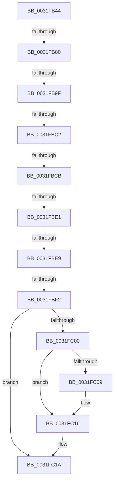

# sub_0031FB44

- RVA: `0x0031FB44`–`0x0031FC24` (길이 `224` bytes)
- VA: `0x000000014031FB44`
- 실행 섹션: `.text`
- PDB 이름 있음: `아니요`; PDB Function 태그: `아니요`
- unwind 정보 RVA: `0x000753EC`
- 디코드: `53`개 명령, `224/224` bytes 표시
- 미해석 바이트: `0` (있으면 어셈블리에 `.byte`로 보존)

> 이 문서는 커널 이미지의 기계어와 PDB 기호를 분석해 생성했습니다. 4번과 5번은 함수 원형과 자료형을 바이너리 사용 방식에서 추정한 C 해석이며 원본 소스 복구 결과는 아닙니다.

## 1. Dependencies

- 직접 호출 지점: **1**; 고유 호출 대상: **1**
- 직접 호출자로 확인된 함수: **0**
- RIP 상대 이미지 참조: **1**

### Outgoing calls
- `0x0031FC11` → [KiLowerIrqlProcessIrqlFlags](../4F/KiLowerIrqlProcessIrqlFlags_function_004F5698.md) (function, `0x004F5698`)

### Direct callers
- 이 함수 시작 RVA로 연결되는 직접 call은 확인되지 않았습니다. 간접 호출은 완전히 역산할 수 없습니다.

### Static image references
- `0x0031FC00` → RVA `0x00FC6D20` (`ALMOSTRO`; read)

## 2. Other-region calls and transfers

- 다른 실행 섹션으로 향하는 call: **0**
- call이 아닌 외부 분기/꼬리 이동: **7**
  - `0x0031FB7A` → [sub_0031FC44 + 0x46](Unknown_function_0031FC44.md) (`tail-transfer`)
  - `0x0031FB99` → [sub_0031FC44 + 0xA4](Unknown_function_0031FC44.md) (`tail-transfer`)
  - `0x0031FBBC` → [sub_0031FC44 + 0xCD](Unknown_function_0031FC44.md) (`tail-transfer`)
  - `0x0031FBC9` → [sub_0031FC44](Unknown_function_0031FC44.md) (`tail-transfer`)
  - `0x0031FBDF` → [sub_0031FC44 + 0x6](Unknown_function_0031FC44.md) (`tail-transfer`)
  - `0x0031FBE3` → [sub_0031FC44 + 0x57](Unknown_function_0031FC44.md) (`tail-transfer`)
  - `0x0031FBEC` → [sub_0031FC44 + 0x5E](Unknown_function_0031FC44.md) (`tail-transfer`)

## 3. Assembly (complete function range)

```asm
0031FB44  4C 89 64 24 70                  mov qword ptr [rsp + 0x70], r12
0031FB49  49 BB FF FF FF FF FF FF FF 7F   movabs r11, 0x7fffffffffffffff
0031FB53  4C 89 6C 24 40                  mov qword ptr [rsp + 0x40], r13
0031FB58  49 BC FF FF FF FF 3F 00 00 00   movabs r12, 0x3fffffffff
0031FB62  49 BD 00 00 00 00 00 DE FF FF   movabs r13, 0xffffde0000000000
0031FB6C  41 8B C6                        mov eax, r14d
0031FB6F  4C 8D 04 C6                     lea r8, [rsi + rax*8]
0031FB73  48 8B 44 C6 18                  mov rax, qword ptr [rsi + rax*8 + 0x18]
0031FB78  A8 20                           test al, 0x20
0031FB7A  0F 84 0A 01 00 00               je 0x14031fc8a
0031FB80  48 8B 4B 38                     mov rcx, qword ptr [rbx + 0x38]
0031FB84  48 8B D0                        mov rdx, rax
0031FB87  48 C1 EA 0C                     shr rdx, 0xc
0031FB8B  0F 57 C0                        xorps xmm0, xmm0
0031FB8E  49 23 D4                        and rdx, r12
0031FB91  0F 11 44 24 20                  movups xmmword ptr [rsp + 0x20], xmm0
0031FB96  48 85 C9                        test rcx, rcx
0031FB99  0F 85 49 01 00 00               jne 0x14031fce8
0031FB9F  41 B2 01                        mov r10b, 1
0031FBA2  4C 8D 0C 52                     lea r9, [rdx + rdx*2]
0031FBA6  44 88 54 24 28                  mov byte ptr [rsp + 0x28], r10b
0031FBAB  49 C1 E1 04                     shl r9, 4
0031FBAF  49 8B CD                        mov rcx, r13
0031FBB2  4C 03 C9                        add r9, rcx
0031FBB5  4C 89 4C 24 20                  mov qword ptr [rsp + 0x20], r9
0031FBBA  84 C0                           test al, al
0031FBBC  0F 88 4F 01 00 00               js 0x14031fd11
0031FBC2  48 83 E0 FB                     and rax, 0xfffffffffffffffb
0031FBC6  48 85 ED                        test rbp, rbp
0031FBC9  75 79                           jne 0x14031fc44
0031FBCB  48 83 E0 F7                     and rax, 0xfffffffffffffff7
0031FBCF  48 8B C8                        mov rcx, rax
0031FBD2  FF CF                           dec edi
0031FBD4  48 83 E1 9F                     and rcx, 0xffffffffffffff9f
0031FBD8  49 89 48 18                     mov qword ptr [r8 + 0x18], rcx
0031FBDC  45 84 D2                        test r10b, r10b
0031FBDF  74 69                           je 0x14031fc4a
0031FBE1  85 FF                           test edi, edi
0031FBE3  0F 85 B2 00 00 00               jne 0x14031fc9b
0031FBE9  48 85 ED                        test rbp, rbp
0031FBEC  0F 85 B0 00 00 00               jne 0x14031fca2
0031FBF2  0F B6 3B                        movzx edi, byte ptr [rbx]
0031FBF5  F0 4D 21 59 18                  lock and qword ptr [r9 + 0x18], r11
0031FBFA  40 80 FF 02                     cmp dil, 2
0031FBFE  73 1A                           jae 0x14031fc1a
0031FC00  44 39 3D 19 71 CA 00            cmp dword ptr [rip + 0xca7119], r15d
0031FC07  74 0D                           je 0x14031fc16
0031FC09  44 0F 20 C1                     mov rcx, cr8
0031FC0D  40 0F B6 D7                     movzx edx, dil
0031FC11  E8 82 5A 1D 00                  call 0x1404f5698
0031FC16  44 0F 22 C7                     mov cr8, rdi
0031FC1A  4C 8B 64 24 70                  mov r12, qword ptr [rsp + 0x70]
0031FC1F  4C 8B 6C 24 40                  mov r13, qword ptr [rsp + 0x40]
```

## 4. C-style interpretation (structured pseudocode)

```c
__int64 __fastcall sub_0031FB44(__int64 a1, __int64 a2, __int64 a3, __int64 a4, __int64 a5, __int64 a6, __int64 a7, __int64 a8, __int64 a9, __int64 a10, __int64 a11, __int64 a12, __int64 a13, __int64 a14)
{
    __int64 result;
    __int64 v_rdi;
    unsigned __int64 v_stack_p20;
    unsigned __int8 v_stack_p28;
    unsigned __int64 v_stack_p40;
    unsigned __int64 v_stack_p70;

    v_stack_p70 = v_r12;
    v_stack_p40 = v_r13;
    a2 = (*(unsigned __int64 *)(v_rsi + (unsigned int)((unsigned int)(v_r14)) * 8 + 24)) >> (12);
    a2 = (a2) & (v_r12);
    v_stack_p20 = v_xmm0;
    v_stack_p28 = 1;
    a4 = (a2 + a2 * 2) << (4);
    a4 = (a4) + (v_r13);
    v_stack_p20 = a4;
    result = (*(unsigned __int64 *)(v_rsi + (unsigned int)((unsigned int)(v_r14)) * 8 + 24)) & (-5);
    result = (result) & (-9);
    v_rdi = (unsigned int)((v_rdi) - 1);
    a1 = (result) & (-97);
    *(unsigned __int64 *)(v_rsi + (unsigned int)((unsigned int)(v_r14)) * 8 + 24) = a1;
    if (((unsigned __int8)(*(unsigned __int8 *)(v_rbx))) >= 2) goto loc_0031FC1A;
    if ((*(unsigned int *)(v_rip + 13267225)) != ((unsigned int)(v_r15))) {
        a1 = v_cr8;
        a2 = (unsigned __int8)(*(unsigned __int8 *)(v_rbx));
        result = KiLowerIrqlProcessIrqlFlags(a1, a2, v_rsi + (unsigned int)((unsigned int)(v_r14)) * 8, a4);
    }
loc_0031FC1A:
    return result;
}
```

## 5. (Beta) C Style

```c
int64_t sub_0031FB44(int64_t Arg1, int64_t Arg2, int64_t Arg3, int64_t Arg4, uint64_t Arg5, uint64_t Arg6, uint64_t Arg7, int64_t Arg8, uint64_t Arg9, uint64_t Arg10, uint64_t Arg11, uint64_t Arg12, uint64_t Arg13, int64_t Arg14)
{
    int64_t result;
    int64_t local_rdi;
    uint64_t v_stack_p20;
    uint8_t v_stack_p28;
    uint64_t v_stack_p40;
    uint64_t v_stack_p70;

    v_stack_p70 = local_r12;
    v_stack_p40 = local_r13;
    Arg2 = (*(uint64_t *)(local_rsi + (uint32_t)((uint32_t)(local_r14)) * 8 + 0x18)) >> (12);
    Arg2 = (Arg2) & (local_r12);
    v_stack_p20 = v_xmm0;
    v_stack_p28 = 1;
    Arg4 = (Arg2 + Arg2 * 2) << (4);
    Arg4 = (Arg4) + (local_r13);
    v_stack_p20 = Arg4;
    result = (*(uint64_t *)(local_rsi + (uint32_t)((uint32_t)(local_r14)) * 8 + 0x18)) & (-5);
    result = (result) & (-9);
    local_rdi = (uint32_t)((local_rdi) - 1);
    Arg1 = (result) & (-97);
    *(uint64_t *)(local_rsi + (uint32_t)((uint32_t)(local_r14)) * 8 + 0x18) = Arg1;
    if (((uint8_t)(*(uint8_t *)(local_rbx))) >= 2) goto loc_0031FC1A;
    if ((*(uint32_t *)(v_rip + 0xCA7119)) != ((uint32_t)(local_r15))) {
        Arg1 = v_cr8;
        Arg2 = (uint8_t)(*(uint8_t *)(local_rbx));
        result = KiLowerIrqlProcessIrqlFlags(Arg1, Arg2, local_rsi + (uint32_t)((uint32_t)(local_r14)) * 8, Arg4);
    }
loc_0031FC1A:
    return result;
}
```

## 6. Execution-region graph

[열기: 2D/3D 그래프와 함수 탐색 컨트롤 패널](../../../control-panel.html?section=text&rva=0x0031FB44&view=graph)

- 2D 그래프는 위에서 아래로 흐르고, 3D 그래프는 빈 공간을 드래그해 회전합니다. Shift+드래그는 이동, 휠은 확대·축소, 함수 노드 선택은 대상 보고서 이동입니다.

### Static fallback


