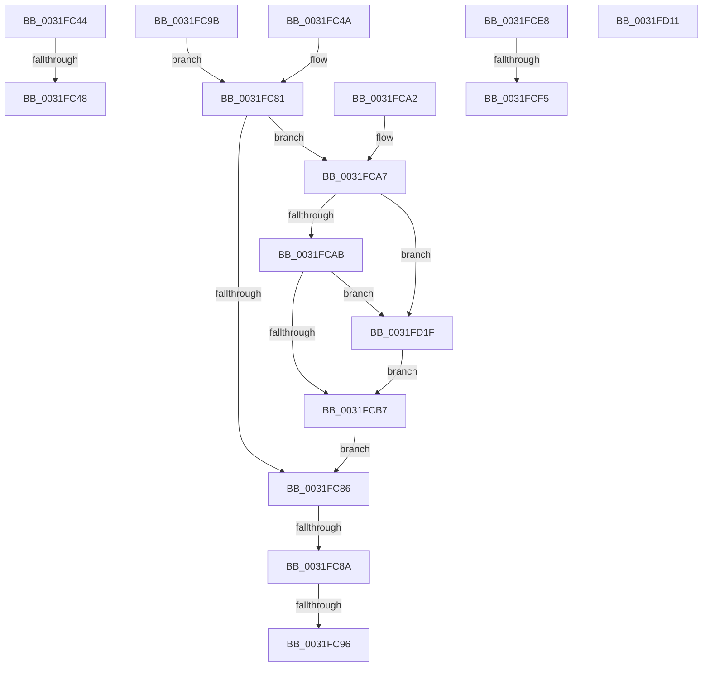

# sub_0031FC44

- RVA: `0x0031FC44`–`0x0031FD2A` (길이 `230` bytes)
- VA: `0x000000014031FC44`
- 실행 섹션: `.text`
- PDB 이름 있음: `아니요`; PDB Function 태그: `아니요`
- unwind 정보 RVA: `0x00075428`
- 디코드: `53`개 명령, `230/230` bytes 표시
- 미해석 바이트: `0` (있으면 어셈블리에 `.byte`로 보존)

> 이 문서는 커널 이미지의 기계어와 PDB 기호를 분석해 생성했습니다. 4번과 5번은 함수 원형과 자료형을 바이너리 사용 방식에서 추정한 C 해석이며 원본 소스 복구 결과는 아닙니다.

## 1. Dependencies

- 직접 호출 지점: **2**; 고유 호출 대상: **2**
- 직접 호출자로 확인된 함수: **0**
- RIP 상대 이미지 참조: **2**

### Outgoing calls
- `0x0031FCD7` → [MiReleaseSpinLockExclusive](../24/MiReleaseSpinLockExclusive_function_002482C0.md) (function, `0x002482C0`)
- `0x0031FD23` → [MiDereferenceHugeContext](../4D/MiDereferenceHugeContext_function_004D9664.md) (function, `0x004D9664`)

### Direct callers
- 이 함수 시작 RVA로 연결되는 직접 call은 확인되지 않았습니다. 간접 호출은 완전히 역산할 수 없습니다.

### Static image references
- `0x0031FC4A` → RVA `0x00E300C0` (`.data`; read)
- `0x0031FC6E` → RVA `0x00E300C8` (`.data`; read)

## 2. Other-region calls and transfers

- 다른 실행 섹션으로 향하는 call: **0**
- call이 아닌 외부 분기/꼬리 이동: **8**
  - `0x0031FC46` → [sub_0031FB44 + 0x8B](Unknown_function_0031FB44.md) (`tail-transfer`)
  - `0x0031FC48` → [sub_0031FB44 + 0x87](Unknown_function_0031FB44.md) (`tail-transfer`)
  - `0x0031FC88` → [sub_0031FB44 + 0xD6](Unknown_function_0031FB44.md) (`tail-transfer`)
  - `0x0031FC94` → [sub_0031FB44 + 0xD6](Unknown_function_0031FB44.md) (`tail-transfer`)
  - `0x0031FC96` → [sub_0031FB44 + 0x28](Unknown_function_0031FB44.md) (`tail-transfer`)
  - `0x0031FCEF` → [sub_0031FB44 + 0x5B](Unknown_function_0031FB44.md) (`tail-transfer`)
  - `0x0031FD0C` → [sub_0031FB44 + 0x71](Unknown_function_0031FB44.md) (`tail-transfer`)
  - `0x0031FD1A` → [sub_0031FB44 + 0x7E](Unknown_function_0031FB44.md) (`tail-transfer`)

## 3. Assembly (complete function range)

```asm
0031FC44  A8 40                           test al, 0x40
0031FC46  74 87                           je 0x14031fbcf
0031FC48  EB 81                           jmp 0x14031fbcb
0031FC4A  4C 2B 0D 6F 04 B1 00            sub r9, qword ptr [rip + 0xb1046f]
0031FC51  41 B8 01 00 00 00               mov r8d, 1
0031FC57  49 C1 F9 03                     sar r9, 3
0031FC5B  41 81 E1 FF FF 3F 00            and r9d, 0x3fffff
0031FC62  41 8B C9                        mov ecx, r9d
0031FC65  41 8B D1                        mov edx, r9d
0031FC68  83 E1 1F                        and ecx, 0x1f
0031FC6B  41 D3 E0                        shl r8d, cl
0031FC6E  48 8B 0D 53 04 B1 00            mov rcx, qword ptr [rip + 0xb10453]
0031FC75  41 F7 D0                        not r8d
0031FC78  48 C1 EA 05                     shr rdx, 5
0031FC7C  F0 44 21 04 91                  lock and dword ptr [rcx + rdx*4], r8d
0031FC81  48 85 ED                        test rbp, rbp
0031FC84  75 21                           jne 0x14031fca7
0031FC86  85 FF                           test edi, edi
0031FC88  74 90                           je 0x14031fc1a
0031FC8A  41 FF C6                        inc r14d
0031FC8D  44 3B B6 18 01 00 00            cmp r14d, dword ptr [rsi + 0x118]
0031FC94  73 84                           jae 0x14031fc1a
0031FC96  E9 D1 FE FF FF                  jmp 0x14031fb6c
0031FC9B  F0 4D 21 59 18                  lock and qword ptr [r9 + 0x18], r11
0031FCA0  EB DF                           jmp 0x14031fc81
0031FCA2  F0 4D 21 59 18                  lock and qword ptr [r9 + 0x18], r11
0031FCA7  A8 01                           test al, 1
0031FCA9  75 74                           jne 0x14031fd1f
0031FCAB  81 BD 40 02 00 00 00 02 00 00   cmp dword ptr [rbp + 0x240], 0x200
0031FCB5  74 68                           je 0x14031fd1f
0031FCB7  8B 43 10                        mov eax, dword ptr [rbx + 0x10]
0031FCBA  48 69 D0 80 DF 00 00            imul rdx, rax, 0xdf80
0031FCC1  48 8B 43 20                     mov rax, qword ptr [rbx + 0x20]
0031FCC5  48 8B 48 10                     mov rcx, qword ptr [rax + 0x10]
0031FCC9  48 81 C1 78 3B 00 00            add rcx, 0x3b78
0031FCD0  48 03 CA                        add rcx, rdx
0031FCD3  0F B6 53 01                     movzx edx, byte ptr [rbx + 1]
0031FCD7  E8 E4 85 F2 FF                  call 0x1402482c0
0031FCDC  49 BB FF FF FF FF FF FF FF 7F   movabs r11, 0x7fffffffffffffff
0031FCE6  EB 9E                           jmp 0x14031fc86
0031FCE8  44 38 B9 44 01 00 00            cmp byte ptr [rcx + 0x144], r15b
0031FCEF  0F 84 AA FE FF FF               je 0x14031fb9f
0031FCF5  48 8B 0D C4 03 B1 00            mov rcx, qword ptr [rip + 0xb103c4]
0031FCFC  81 E2 FF FF 3F 00               and edx, 0x3fffff
0031FD02  44 0F B6 54 24 28               movzx r10d, byte ptr [rsp + 0x28]
0031FD08  4C 8D 0C D1                     lea r9, [rcx + rdx*8]
0031FD0C  E9 A4 FE FF FF                  jmp 0x14031fbb5
0031FD11  C6 43 03 01                     mov byte ptr [rbx + 3], 1
0031FD15  48 0F BA F0 07                  btr rax, 7
0031FD1A  E9 A3 FE FF FF                  jmp 0x14031fbc2
0031FD1F  48 8B 4B 28                     mov rcx, qword ptr [rbx + 0x28]
0031FD23  E8 3C 99 1B 00                  call 0x1404d9664
0031FD28  EB 8D                           jmp 0x14031fcb7
```

## 4. C-style interpretation (structured pseudocode)

```c
__int64 __fastcall sub_0031FC44(__int64 a1, __int64 a2, __int64 a3, __int64 a4)
{
    unsigned __int8 v_stack_p28;
}
```

## 5. (Beta) C Style

```c
int64_t sub_0031FC44(int64_t Arg1, int64_t Arg2, int64_t Arg3, int64_t Arg4)
{
    uint8_t v_stack_p28;
}
```

## 6. Execution-region graph

[열기: 2D/3D 그래프와 함수 탐색 컨트롤 패널](../../../control-panel.html?section=text&rva=0x0031FC44&view=graph)

- 2D 그래프는 위에서 아래로 흐르고, 3D 그래프는 빈 공간을 드래그해 회전합니다. Shift+드래그는 이동, 휠은 확대·축소, 함수 노드 선택은 대상 보고서 이동입니다.

### Static fallback


