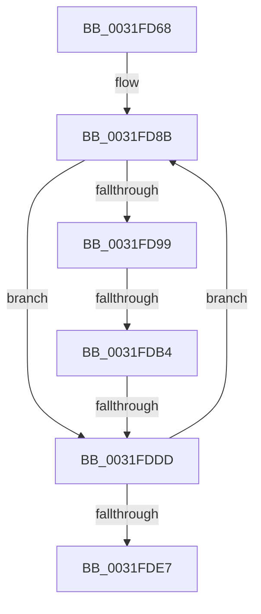

# sub_0031FD68

- RVA: `0x0031FD68`–`0x0031FDF6` (길이 `142` bytes)
- VA: `0x000000014031FD68`
- 실행 섹션: `.text`
- PDB 이름 있음: `아니요`; PDB Function 태그: `아니요`
- unwind 정보 RVA: `0x00075474`
- 디코드: `34`개 명령, `142/142` bytes 표시
- 미해석 바이트: `0` (있으면 어셈블리에 `.byte`로 보존)

> 이 문서는 커널 이미지의 기계어와 PDB 기호를 분석해 생성했습니다. 4번과 5번은 함수 원형과 자료형을 바이너리 사용 방식에서 추정한 C 해석이며 원본 소스 복구 결과는 아닙니다.

## 1. Dependencies

- 직접 호출 지점: **1**; 고유 호출 대상: **1**
- 직접 호출자로 확인된 함수: **0**
- RIP 상대 이미지 참조: **0**

### Outgoing calls
- `0x0031FDD2` → [MiPageFreeToZero](../33/MiPageFreeToZero_function_00337A30.md) (function, `0x00337A30`)

### Direct callers
- 이 함수 시작 RVA로 연결되는 직접 call은 확인되지 않았습니다. 간접 호출은 완전히 역산할 수 없습니다.

### Static image references
- 디코드된 RIP-relative 메모리 참조가 없습니다.

## 2. Other-region calls and transfers

- 다른 실행 섹션으로 향하는 call: **0**
- call이 아닌 외부 분기/꼬리 이동: **2**
  - `0x0031FDB2` → [sub_0031FE0C](Unknown_function_0031FE0C.md) (`tail-transfer`)
  - `0x0031FDDB` → [sub_0031FE0C + 0x2A](Unknown_function_0031FE0C.md) (`tail-transfer`)

## 3. Assembly (complete function range)

```asm
0031FD68  4C 89 64 24 68                  mov qword ptr [rsp + 0x68], r12
0031FD6D  4C 89 74 24 38                  mov qword ptr [rsp + 0x38], r14
0031FD72  4C 89 7C 24 30                  mov qword ptr [rsp + 0x30], r15
0031FD77  49 BF FF FF FF FF 3F 00 00 00   movabs r15, 0x3fffffffff
0031FD81  49 BC 00 00 00 00 00 DE FF FF   movabs r12, 0xffffde0000000000
0031FD8B  48 8B 54 FE 18                  mov rdx, qword ptr [rsi + rdi*8 + 0x18]
0031FD90  4C 8D 34 FE                     lea r14, [rsi + rdi*8]
0031FD94  F6 C2 40                        test dl, 0x40
0031FD97  74 44                           je 0x14031fddd
0031FD99  48 8B 43 38                     mov rax, qword ptr [rbx + 0x38]
0031FD9D  4C 8B CA                        mov r9, rdx
0031FDA0  49 C1 E9 0C                     shr r9, 0xc
0031FDA4  0F 57 C0                        xorps xmm0, xmm0
0031FDA7  4D 23 CF                        and r9, r15
0031FDAA  0F 11 44 24 20                  movups xmmword ptr [rsp + 0x20], xmm0
0031FDAF  48 85 C0                        test rax, rax
0031FDB2  75 58                           jne 0x14031fe0c
0031FDB4  4B 8D 0C 49                     lea rcx, [r9 + r9*2]
0031FDB8  C6 44 24 28 01                  mov byte ptr [rsp + 0x28], 1
0031FDBD  48 C1 E1 04                     shl rcx, 4
0031FDC1  49 8B C4                        mov rax, r12
0031FDC4  48 03 C8                        add rcx, rax
0031FDC7  44 8B C5                        mov r8d, ebp
0031FDCA  48 89 4C 24 20                  mov qword ptr [rsp + 0x20], rcx
0031FDCF  49 8B C9                        mov rcx, r9
0031FDD2  E8 59 7C 01 00                  call 0x140337a30
0031FDD7  0F BA E0 0A                     bt eax, 0xa
0031FDDB  72 59                           jb 0x14031fe36
0031FDDD  FF C7                           inc edi
0031FDDF  3B BE 18 01 00 00               cmp edi, dword ptr [rsi + 0x118]
0031FDE5  72 A4                           jb 0x14031fd8b
0031FDE7  4C 8B 7C 24 30                  mov r15, qword ptr [rsp + 0x30]
0031FDEC  4C 8B 74 24 38                  mov r14, qword ptr [rsp + 0x38]
0031FDF1  4C 8B 64 24 68                  mov r12, qword ptr [rsp + 0x68]
```

## 4. C-style interpretation (structured pseudocode)

```c
__int64 __fastcall sub_0031FD68(__int64 a1, __int64 a2, __int64 a3, __int64 a4, __int64 a5, __int64 a6, __int64 a7, __int64 a8, __int64 a9, __int64 a10, __int64 a11, __int64 a12, __int64 a13)
{
    __int64 result;
    __int64 v_rdi;
    unsigned __int64 v_stack_p20;
    unsigned __int8 v_stack_p28;
    unsigned __int64 v_stack_p30;
    unsigned __int64 v_stack_p38;
    unsigned __int64 v_stack_p68;

    v_stack_p68 = v_r12;
    v_stack_p38 = v_r14;
    v_stack_p30 = v_r15;
loc_0031FD8B:
    if ((((unsigned __int8)(*(unsigned __int64 *)(v_rsi + v_rdi * 8 + 24))) & (64)) == 0) goto loc_0031FDDD;
    a4 = (*(unsigned __int64 *)(v_rsi + v_rdi * 8 + 24)) >> (12);
    a4 = (a4) & (v_r15);
    v_stack_p20 = v_xmm0;
    v_stack_p28 = 1;
    a1 = (a4 + a4 * 2) << (4);
    a1 = (a1) + (v_r12);
    v_stack_p20 = a1;
    result = MiPageFreeToZero(a4, *(unsigned __int64 *)(v_rsi + v_rdi * 8 + 24), (unsigned int)((unsigned int)(v_rbp)), a4);
loc_0031FDDD:
    v_rdi = (unsigned int)((v_rdi) + 1);
    if (((unsigned int)(v_rdi)) < (*(unsigned int *)(v_rsi + 280))) goto loc_0031FD8B;
    return result;
}
```

## 5. (Beta) C Style

```c
int64_t sub_0031FD68(int64_t Arg1, int64_t Arg2, int64_t Arg3, int64_t Arg4, uint64_t Arg5, int64_t Arg6, int64_t Arg7, uint64_t Arg8, uint64_t Arg9, uint64_t Arg10, uint64_t Arg11, uint64_t Arg12, int64_t Arg13)
{
    int64_t result;
    int64_t local_rdi;
    uint64_t v_stack_p20;
    uint8_t v_stack_p28;
    uint64_t v_stack_p30;
    uint64_t v_stack_p38;
    uint64_t v_stack_p68;

    v_stack_p68 = local_r12;
    v_stack_p38 = local_r14;
    v_stack_p30 = local_r15;
loc_0031FD8B:
    if ((((uint8_t)(*(uint64_t *)(local_rsi + local_rdi * 8 + 0x18))) & (64)) == 0) goto loc_0031FDDD;
    Arg4 = (*(uint64_t *)(local_rsi + local_rdi * 8 + 0x18)) >> (12);
    Arg4 = (Arg4) & (local_r15);
    v_stack_p20 = v_xmm0;
    v_stack_p28 = 1;
    Arg1 = (Arg4 + Arg4 * 2) << (4);
    Arg1 = (Arg1) + (local_r12);
    v_stack_p20 = Arg1;
    result = MiPageFreeToZero(Arg4, *(uint64_t *)(local_rsi + local_rdi * 8 + 0x18), (uint32_t)((uint32_t)(local_rbp)), Arg4);
loc_0031FDDD:
    local_rdi = (uint32_t)((local_rdi) + 1);
    if (((uint32_t)(local_rdi)) < (*(uint32_t *)(local_rsi + 0x118))) goto loc_0031FD8B;
    return result;
}
```

## 6. Execution-region graph

[열기: 2D/3D 그래프와 함수 탐색 컨트롤 패널](../../../control-panel.html?section=text&rva=0x0031FD68&view=graph)

- 2D 그래프는 위에서 아래로 흐르고, 3D 그래프는 빈 공간을 드래그해 회전합니다. Shift+드래그는 이동, 휠은 확대·축소, 함수 노드 선택은 대상 보고서 이동입니다.

### Static fallback


