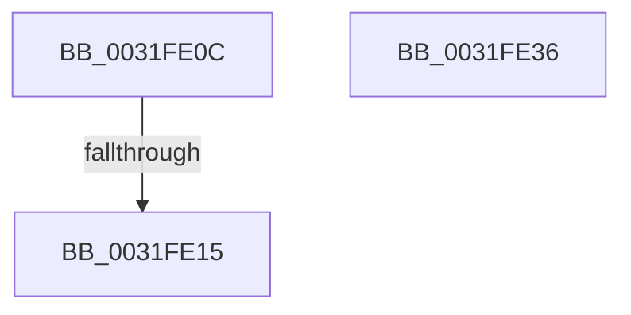

# sub_0031FE0C

- RVA: `0x0031FE0C`–`0x0031FE45` (길이 `57` bytes)
- VA: `0x000000014031FE0C`
- 실행 섹션: `.text`
- PDB 이름 있음: `아니요`; PDB Function 태그: `아니요`
- unwind 정보 RVA: `0x000754B4`
- 디코드: `13`개 명령, `57/57` bytes 표시
- 미해석 바이트: `0` (있으면 어셈블리에 `.byte`로 보존)

> 이 문서는 커널 이미지의 기계어와 PDB 기호를 분석해 생성했습니다. 4번과 5번은 함수 원형과 자료형을 바이너리 사용 방식에서 추정한 C 해석이며 원본 소스 복구 결과는 아닙니다.

## 1. Dependencies

- 직접 호출 지점: **1**; 고유 호출 대상: **1**
- 직접 호출자로 확인된 함수: **0**
- RIP 상대 이미지 참조: **1**

### Outgoing calls
- `0x0031FE2F` → [MiHugeRangeFreeToZero](../43/MiHugeRangeFreeToZero_function_00436A38.md) (function, `0x00436A38`)

### Direct callers
- 이 함수 시작 RVA로 연결되는 직접 call은 확인되지 않았습니다. 간접 호출은 완전히 역산할 수 없습니다.

### Static image references
- `0x0031FE15` → RVA `0x00E300C0` (`.data`; read)

## 2. Other-region calls and transfers

- 다른 실행 섹션으로 향하는 call: **0**
- call이 아닌 외부 분기/꼬리 이동: **3**
  - `0x0031FE13` → [sub_0031FD68 + 0x4C](Unknown_function_0031FD68.md) (`tail-transfer`)
  - `0x0031FE34` → [sub_0031FD68 + 0x75](Unknown_function_0031FD68.md) (`tail-transfer`)
  - `0x0031FE43` → [sub_0031FD68 + 0x75](Unknown_function_0031FD68.md) (`tail-transfer`)

## 3. Assembly (complete function range)

```asm
0031FE0C  80 B8 44 01 00 00 00            cmp byte ptr [rax + 0x144], 0
0031FE13  74 9F                           je 0x14031fdb4
0031FE15  48 8B 05 A4 02 B1 00            mov rax, qword ptr [rip + 0xb102a4]
0031FE1C  41 81 E1 FF FF 3F 00            and r9d, 0x3fffff
0031FE23  41 8B C9                        mov ecx, r9d
0031FE26  4A 8D 14 C8                     lea rdx, [rax + r9*8]
0031FE2A  48 89 54 24 20                  mov qword ptr [rsp + 0x20], rdx
0031FE2F  E8 04 6C 11 00                  call 0x140436a38
0031FE34  EB A7                           jmp 0x14031fddd
0031FE36  49 8B 46 18                     mov rax, qword ptr [r14 + 0x18]
0031FE3A  48 0F BA E8 07                  bts rax, 7
0031FE3F  49 89 46 18                     mov qword ptr [r14 + 0x18], rax
0031FE43  EB 98                           jmp 0x14031fddd
```

## 4. C-style interpretation (structured pseudocode)

```c
__int64 __fastcall sub_0031FE0C(__int64 a1, __int64 a2, __int64 a3, int a4)
{
    __int64 result;
    unsigned __int64 v_stack_p20;

    a4 = (unsigned int)((a4) & (0x3FFFFFULL));
    v_stack_p20 = *(unsigned __int64 *)(v_rip + 11600548) + a4 * 8;
    result = MiHugeRangeFreeToZero((unsigned int)(a4), *(unsigned __int64 *)(v_rip + 11600548) + a4 * 8, a3, a4);
}
```

## 5. (Beta) C Style

```c
int64_t sub_0031FE0C(int64_t Arg1, int64_t Arg2, int64_t Arg3, int32_t Arg4)
{
    int64_t result;
    uint64_t v_stack_p20;

    Arg4 = (uint32_t)((Arg4) & (0x3FFFFFULL));
    v_stack_p20 = *(uint64_t *)(v_rip + 0xB102A4) + Arg4 * 8;
    result = MiHugeRangeFreeToZero((uint32_t)(Arg4), *(uint64_t *)(v_rip + 0xB102A4) + Arg4 * 8, Arg3, Arg4);
}
```

## 6. Execution-region graph

[열기: 2D/3D 그래프와 함수 탐색 컨트롤 패널](../../../control-panel.html?section=text&rva=0x0031FE0C&view=graph)

- 2D 그래프는 위에서 아래로 흐르고, 3D 그래프는 빈 공간을 드래그해 회전합니다. Shift+드래그는 이동, 휠은 확대·축소, 함수 노드 선택은 대상 보고서 이동입니다.

### Static fallback


