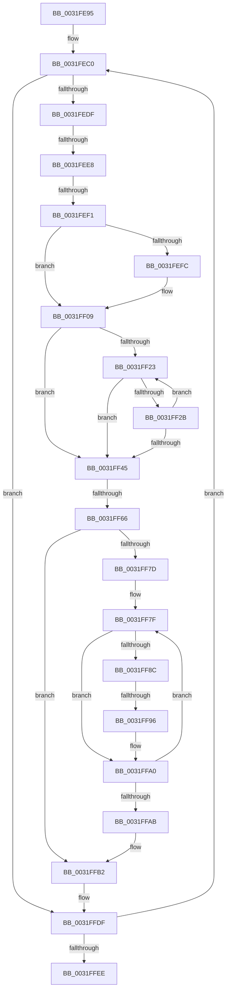

# sub_0031FE95

- RVA: `0x0031FE95`–`0x0032000E` (길이 `377` bytes)
- VA: `0x000000014031FE95`
- 실행 섹션: `.text`
- PDB 이름 있음: `아니요`; PDB Function 태그: `아니요`
- unwind 정보 RVA: `0x000754F4`
- 디코드: `82`개 명령, `377/377` bytes 표시
- 미해석 바이트: `0` (있으면 어셈블리에 `.byte`로 보존)

> 이 문서는 커널 이미지의 기계어와 PDB 기호를 분석해 생성했습니다. 4번과 5번은 함수 원형과 자료형을 바이너리 사용 방식에서 추정한 C 해석이며 원본 소스 복구 결과는 아닙니다.

## 1. Dependencies

- 직접 호출 지점: **1**; 고유 호출 대상: **1**
- 직접 호출자로 확인된 함수: **0**
- RIP 상대 이미지 참조: **2**

### Outgoing calls
- `0x0031FF16` → [memset](../6C/memset_function_006C6C40.md) (function, `0x006C6C40`)

### Direct callers
- 이 함수 시작 RVA로 연결되는 직접 call은 확인되지 않았습니다. 간접 호출은 완전히 역산할 수 없습니다.

### Static image references
- `0x0031FE99` → RVA `0x00000000` (`image boundary/outside`; read)
- `0x0031FF96` → RVA `0x00010880` (`.rdata`; read)

## 2. Other-region calls and transfers

- 다른 실행 섹션으로 향하는 call: **0**
- call이 아닌 외부 분기/꼬리 이동: **4**
  - `0x0031FEE2` → [sub_0032002D + 0x54](../32/Unknown_function_0032002D.md) (`tail-transfer`)
  - `0x0031FEEB` → [sub_0032002D + 0x39](../32/Unknown_function_0032002D.md) (`tail-transfer`)
  - `0x0031FF60` → [sub_0032002D](../32/Unknown_function_0032002D.md) (`tail-transfer`)
  - `0x0031FF90` → [sub_0032002D + 0x21](../32/Unknown_function_0032002D.md) (`tail-transfer`)

## 3. Assembly (complete function range)

```asm
0031FE95  49 89 5B 10                     mov qword ptr [r11 + 0x10], rbx
0031FE99  4C 8D 05 60 01 CE FF            lea r8, [rip - 0x31fea0]
0031FEA0  49 89 7B 18                     mov qword ptr [r11 + 0x18], rdi
0031FEA4  4D 89 63 20                     mov qword ptr [r11 + 0x20], r12
0031FEA8  4D 89 73 D8                     mov qword ptr [r11 - 0x28], r14
0031FEAC  49 BE 00 00 00 00 80 F6 FF FF   movabs r14, 0xfffff68000000000
0031FEB6  49 BC FF FF FF FF FF F6 FF FF   movabs r12, 0xfffff6ffffffffff
0031FEC0  48 8B 45 40                     mov rax, qword ptr [rbp + 0x40]
0031FEC4  8B CE                           mov ecx, esi
0031FEC6  48 8D 04 F0                     lea rax, [rax + rsi*8]
0031FECA  48 83 C0 18                     add rax, 0x18
0031FECE  48 89 44 24 20                  mov qword ptr [rsp + 0x20], rax
0031FED3  48 8B 18                        mov rbx, qword ptr [rax]
0031FED6  F6 C3 20                        test bl, 0x20
0031FED9  0F 84 00 01 00 00               je 0x14031ffdf
0031FEDF  F6 C3 01                        test bl, 1
0031FEE2  0F 85 99 01 00 00               jne 0x140320081
0031FEE8  48 85 D2                        test rdx, rdx
0031FEEB  0F 85 75 01 00 00               jne 0x140320066
0031FEF1  49 8B BF 20 01 00 00            mov rdi, qword ptr [r15 + 0x120]
0031FEF8  85 F6                           test esi, esi
0031FEFA  74 0D                           je 0x14031ff09
0031FEFC  4B 0F AF 8C E8 A8 45 01 00      imul rcx, qword ptr [r8 + r13*8 + 0x145a8]
0031FF05  48 8D 3C CF                     lea rdi, [rdi + rcx*8]
0031FF09  33 D2                           xor edx, edx
0031FF0B  48 8D 4C 24 40                  lea rcx, [rsp + 0x40]
0031FF10  41 B8 C8 00 00 00               mov r8d, 0xc8
0031FF16  E8 25 6D 3A 00                  call 0x1406c6c40
0031FF1B  49 8B C6                        mov rax, r14
0031FF1E  48 3B F8                        cmp rdi, rax
0031FF21  72 22                           jb 0x14031ff45
0031FF23  49 8B C4                        mov rax, r12
0031FF26  48 3B F8                        cmp rdi, rax
0031FF29  77 1A                           ja 0x14031ff45
0031FF2B  48 C1 E7 19                     shl rdi, 0x19
0031FF2F  49 8B C6                        mov rax, r14
0031FF32  48 C1 E0 19                     shl rax, 0x19
0031FF36  48 2B F8                        sub rdi, rax
0031FF39  48 C1 FF 10                     sar rdi, 0x10
0031FF3D  49 8B C6                        mov rax, r14
0031FF40  48 3B F8                        cmp rdi, rax
0031FF43  73 DE                           jae 0x14031ff23
0031FF45  48 C1 EF 09                     shr rdi, 9
0031FF49  49 B8 F8 FF FF FF 7F 00 00 00   movabs r8, 0x7ffffffff8
0031FF53  49 23 F8                        and rdi, r8
0031FF56  49 8B C6                        mov rax, r14
0031FF59  48 03 F8                        add rdi, rax
0031FF5C  41 83 FD 01                     cmp r13d, 1
0031FF60  0F 86 C7 00 00 00               jbe 0x14032002d
0031FF66  4C 8D 05 93 00 CE FF            lea r8, [rip - 0x31ff6d]
0031FF6D  45 33 F6                        xor r14d, r14d
0031FF70  4F 8B A4 E8 A8 45 01 00         mov r12, qword ptr [r8 + r13*8 + 0x145a8]
0031FF78  4D 85 E4                        test r12, r12
0031FF7B  74 35                           je 0x14031ffb2
0031FF7D  33 C0                           xor eax, eax
0031FF7F  48 8D 0C C7                     lea rcx, [rdi + rax*8]
0031FF83  48 8B 04 C7                     mov rax, qword ptr [rdi + rax*8]
0031FF87  48 85 C0                        test rax, rax
0031FF8A  74 14                           je 0x14031ffa0
0031FF8C  41 83 FD 01                     cmp r13d, 1
0031FF90  0F 86 B8 00 00 00               jbe 0x14032004e
0031FF96  48 8B 05 E3 08 CF FF            mov rax, qword ptr [rip - 0x30f71d]
0031FF9D  48 89 01                        mov qword ptr [rcx], rax
0031FFA0  41 FF C6                        inc r14d
0031FFA3  41 8B C6                        mov eax, r14d
0031FFA6  49 3B C4                        cmp rax, r12
0031FFA9  72 D4                           jb 0x14031ff7f
0031FFAB  4C 8D 05 4E 00 CE FF            lea r8, [rip - 0x31ffb2]
0031FFB2  48 8B 44 24 20                  mov rax, qword ptr [rsp + 0x20]
0031FFB7  48 83 CB 40                     or rbx, 0x40
0031FFBB  48 8B 54 24 28                  mov rdx, qword ptr [rsp + 0x28]
0031FFC0  49 BE 00 00 00 00 80 F6 FF FF   movabs r14, 0xfffff68000000000
0031FFCA  49 BC FF FF FF FF FF F6 FF FF   movabs r12, 0xfffff6ffffffffff
0031FFD4  48 89 18                        mov qword ptr [rax], rbx
0031FFD7  43 FF 84 A8 A4 50 EF 00         inc dword ptr [r8 + r13*4 + 0xef50a4]
0031FFDF  FF C6                           inc esi
0031FFE1  41 3B B7 18 01 00 00            cmp esi, dword ptr [r15 + 0x118]
0031FFE8  0F 82 D2 FE FF FF               jb 0x14031fec0
0031FFEE  4C 8B B4 24 20 01 00 00         mov r14, qword ptr [rsp + 0x120]
0031FFF6  4C 8B A4 24 68 01 00 00         mov r12, qword ptr [rsp + 0x168]
0031FFFE  48 8B BC 24 60 01 00 00         mov rdi, qword ptr [rsp + 0x160]
00320006  48 8B 9C 24 58 01 00 00         mov rbx, qword ptr [rsp + 0x158]
```

## 4. C-style interpretation (structured pseudocode)

```c
__int64 __fastcall sub_0031FE95(__int64 a1, __int64 a2, __int64 a3, __int64 a4, __int64 a5, __int64 a6, __int64 a7, __int64 a8, __int64 a9, __int64 a10, __int64 a11, __int64 a12, __int64 a13, __int64 a14, __int64 a15, __int64 a16, __int64 a17, __int64 a18, __int64 a19, __int64 a20, __int64 a21, __int64 a22, __int64 a23, __int64 a24, __int64 a25, __int64 a26, __int64 a27, __int64 a28, __int64 a29, __int64 a30, __int64 a31, __int64 a32, __int64 a33, __int64 a34, __int64 a35, __int64 a36, __int64 a37, __int64 a38, __int64 a39, __int64 a40, __int64 a41, __int64 a42, __int64 a43, __int64 a44, __int64 a45)
{
    __int64 result;
    __int64 v_r14;
    __int64 v_rbx;
    __int64 v_rdi;
    __int64 v_rsi;
    unsigned __int64 v_stack_p20;

    *(unsigned __int64 *)(v_r11 + 16) = v_rbx;
    *(unsigned __int64 *)(v_r11 + 24) = v_rdi;
    *(unsigned __int64 *)(v_r11 + 32) = v_r12;
    *(unsigned __int64 *)(v_r11 - 40) = v_r14;
loc_0031FEC0:
    result = (*(unsigned __int64 *)(v_rbp + 64) + v_rsi * 8) + (24);
    v_stack_p20 = result;
    if ((((unsigned __int8)(*(unsigned __int64 *)(result))) & (32)) == 0) goto loc_0031FFDF;
    v_rdi = *(unsigned __int64 *)(v_r15 + 288);
    if ((unsigned int)(v_rsi) != 0) {
        a1 = ((unsigned int)((unsigned int)(v_rsi))) * (*(unsigned __int64 *)(v_rip - 3276448 + v_r13 * 8 + 83368));
        v_rdi = *(unsigned __int64 *)(v_r15 + 288) + a1 * 8;
    }
    a2 = 0;
    result = memset(a8, a2, 200, a4);
    if (v_rdi < v_r14) goto loc_0031FF45;
loc_0031FF23:
    if (v_rdi > v_r12) goto loc_0031FF45;
    v_rdi = (v_rdi) << (25);
    result = (v_r14) << (25);
    v_rdi = (v_rdi) - (result);
    v_rdi = (v_rdi) >> (16);
    if (v_rdi >= v_r14) goto loc_0031FF23;
loc_0031FF45:
    v_rdi = (v_rdi) >> (9);
    v_rdi = (v_rdi) & (200);
    v_rdi = (v_rdi) + (v_r14);
    v_r14 = 0;
    if (*(unsigned __int64 *)(v_rip - 3276653 + v_r13 * 8 + 83368) == 0) goto loc_0031FFB2;
    result = 0;
loc_0031FF7F:
    if (*(unsigned __int64 *)(v_rdi + result * 8) == 0) goto loc_0031FFA0;
    *(unsigned __int64 *)(v_rdi + result * 8) = *(unsigned __int64 *)(v_rip - 3208989);
loc_0031FFA0:
    v_r14 = (unsigned int)((v_r14) + 1);
    if (((unsigned int)((unsigned int)(v_r14))) < (*(unsigned __int64 *)(v_rip - 3276653 + v_r13 * 8 + 83368))) goto loc_0031FF7F;
loc_0031FFB2:
    v_rbx = (*(unsigned __int64 *)(result)) | (64);
    *(unsigned __int64 *)(v_stack_p20) = v_rbx;
loc_0031FFDF:
    v_rsi = (unsigned int)((v_rsi) + 1);
    if (((unsigned int)(v_rsi)) < (*(unsigned int *)(v_r15 + 280))) goto loc_0031FEC0;
    return v_stack_p20;
}
```

## 5. (Beta) C Style

```c
int64_t sub_0031FE95(int64_t Arg1, int64_t Arg2, int64_t Arg3, int64_t Arg4, int64_t Arg5, uint64_t Arg6, uint64_t Arg7, int64_t Arg8, uint64_t Arg9, uint64_t Arg10, uint64_t Arg11, uint64_t Arg12, uint64_t Arg13, uint64_t Arg14, uint64_t Arg15, uint64_t Arg16, uint64_t Arg17, uint64_t Arg18, uint64_t Arg19, uint64_t Arg20, uint64_t Arg21, uint64_t Arg22, uint64_t Arg23, uint64_t Arg24, uint64_t Arg25, uint64_t Arg26, uint64_t Arg27, uint64_t Arg28, uint64_t Arg29, uint64_t Arg30, uint64_t Arg31, uint64_t Arg32, uint64_t Arg33, uint64_t Arg34, uint64_t Arg35, int64_t Arg36, uint64_t Arg37, uint64_t Arg38, uint64_t Arg39, uint64_t Arg40, uint64_t Arg41, uint64_t Arg42, int64_t Arg43, int64_t Arg44, int64_t Arg45)
{
    int64_t result;
    int64_t local_r14;
    int64_t local_rbx;
    int64_t local_rdi;
    int64_t local_rsi;
    uint64_t v_stack_p20;

    *(uint64_t *)(local_r11 + 0x10) = local_rbx;
    *(uint64_t *)(local_r11 + 0x18) = local_rdi;
    *(uint64_t *)(local_r11 + 0x20) = local_r12;
    *(uint64_t *)(local_r11 - 0x28) = local_r14;
loc_0031FEC0:
    result = (*(uint64_t *)(local_rbp + 0x40) + local_rsi * 8) + (24);
    v_stack_p20 = result;
    if ((((uint8_t)(*(uint64_t *)(result))) & (32)) == 0) goto loc_0031FFDF;
    local_rdi = *(uint64_t *)(local_r15 + 0x120);
    if ((uint32_t)(local_rsi) != 0) {
        Arg1 = ((uint32_t)((uint32_t)(local_rsi))) * (*(uint64_t *)(v_rip - 0x31FEA0 + local_r13 * 8 + 0x145A8));
        local_rdi = *(uint64_t *)(local_r15 + 0x120) + Arg1 * 8;
    }
    Arg2 = 0;
    result = memset(Arg8, Arg2, 200, Arg4);
    if (local_rdi < local_r14) goto loc_0031FF45;
loc_0031FF23:
    if (local_rdi > local_r12) goto loc_0031FF45;
    local_rdi = (local_rdi) << (25);
    result = (local_r14) << (25);
    local_rdi = (local_rdi) - (result);
    local_rdi = (local_rdi) >> (16);
    if (local_rdi >= local_r14) goto loc_0031FF23;
loc_0031FF45:
    local_rdi = (local_rdi) >> (9);
    local_rdi = (local_rdi) & (200);
    local_rdi = (local_rdi) + (local_r14);
    local_r14 = 0;
    if (*(uint64_t *)(v_rip - 0x31FF6D + local_r13 * 8 + 0x145A8) == 0) goto loc_0031FFB2;
    result = 0;
loc_0031FF7F:
    if (*(uint64_t *)(local_rdi + result * 8) == 0) goto loc_0031FFA0;
    *(uint64_t *)(local_rdi + result * 8) = *(uint64_t *)(v_rip - 0x30F71D);
loc_0031FFA0:
    local_r14 = (uint32_t)((local_r14) + 1);
    if (((uint32_t)((uint32_t)(local_r14))) < (*(uint64_t *)(v_rip - 0x31FF6D + local_r13 * 8 + 0x145A8))) goto loc_0031FF7F;
loc_0031FFB2:
    local_rbx = (*(uint64_t *)(result)) | (64);
    *(uint64_t *)(v_stack_p20) = local_rbx;
loc_0031FFDF:
    local_rsi = (uint32_t)((local_rsi) + 1);
    if (((uint32_t)(local_rsi)) < (*(uint32_t *)(local_r15 + 0x118))) goto loc_0031FEC0;
    return v_stack_p20;
}
```

## 6. Execution-region graph

[열기: 2D/3D 그래프와 함수 탐색 컨트롤 패널](../../../control-panel.html?section=text&rva=0x0031FE95&view=graph)

- 2D 그래프는 위에서 아래로 흐르고, 3D 그래프는 빈 공간을 드래그해 회전합니다. Shift+드래그는 이동, 휠은 확대·축소, 함수 노드 선택은 대상 보고서 이동입니다.

### Static fallback


