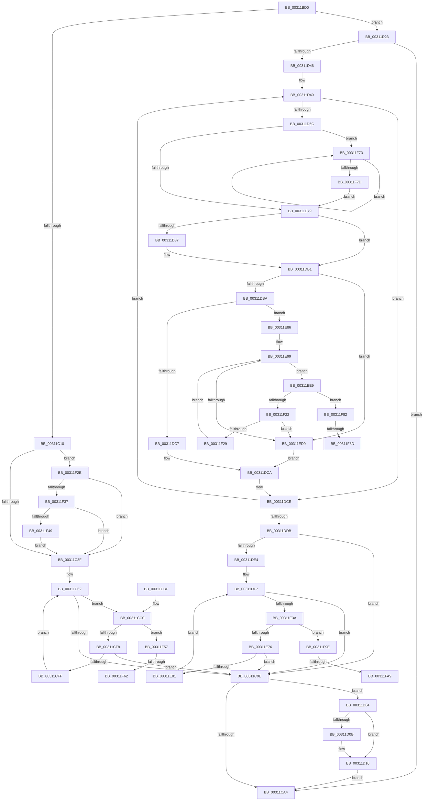

# VmpFlushTb

- RVA: `0x00311BD0`–`0x00311FBA` (길이 `1,002` bytes)
- VA: `0x0000000140311BD0`
- 실행 섹션: `.text`
- PDB 이름 있음: `예`; PDB Function 태그: `예`
- unwind 정보 RVA: `0x000741A8`
- 디코드: `250`개 명령, `1,002/1,002` bytes 표시
- 미해석 바이트: `0` (있으면 어셈블리에 `.byte`로 보존)

> 이 문서는 커널 이미지의 기계어와 PDB 기호를 분석해 생성했습니다. 4번과 5번은 함수 원형과 자료형을 바이너리 사용 방식에서 추정한 C 해석이며 원본 소스 복구 결과는 아닙니다.

## 1. Dependencies

- 직접 호출 지점: **18**; 고유 호출 대상: **8**
- 직접 호출자로 확인된 함수: **2**
- RIP 상대 이미지 참조: **1**

### Outgoing calls
- `0x00311C10` → [VmpProcessContextLockExclusive](VmpProcessContextLockExclusive_function_003147A4.md) (function, `0x003147A4`)
- `0x00311C8D` → [VmpConvertPortionVpnRangeToGpnRange](VmpConvertPortionVpnRangeToGpnRange_function_003147F0.md) (function, `0x003147F0`)
- `0x00311CD9` → [VmpInsertInvalidateListRange](../46/VmpInsertInvalidateListRange_function_00463B64.md) (function, `0x00463B64`)
- `0x00311CE7` → [VmpInvalidateOutstandingFaults](../46/VmpInvalidateOutstandingFaults_function_004639AC.md) (function, `0x004639AC`)
- `0x00311D11` → [VmpProcessInvalidateList](../42/VmpProcessInvalidateList_function_00428A54.md) (function, `0x00428A54`)
- `0x00311D1C` → [VmpProcessContextUnlockExclusive](../48/VmpProcessContextUnlockExclusive_function_004894C8.md) (function, `0x004894C8`)
- `0x00311D8A` → [VmpProcessContextLockExclusive](VmpProcessContextLockExclusive_function_003147A4.md) (function, `0x003147A4`)
- `0x00311E25` → [VmpConvertPortionVpnRangeToGpnRange](VmpConvertPortionVpnRangeToGpnRange_function_003147F0.md) (function, `0x003147F0`)
- `0x00311E53` → [VmpInsertInvalidateListRange](../46/VmpInsertInvalidateListRange_function_00463B64.md) (function, `0x00463B64`)
- `0x00311E61` → [VmpInvalidateOutstandingFaults](../46/VmpInvalidateOutstandingFaults_function_004639AC.md) (function, `0x004639AC`)
- `0x00311EC7` → [VmpConvertPortionVpnRangeToGpnRange](VmpConvertPortionVpnRangeToGpnRange_function_003147F0.md) (function, `0x003147F0`)
- `0x00311F02` → [VmpInsertInvalidateListRange](../46/VmpInsertInvalidateListRange_function_00463B64.md) (function, `0x00463B64`)
- `0x00311F11` → [VmpInvalidateOutstandingFaults](../46/VmpInvalidateOutstandingFaults_function_004639AC.md) (function, `0x004639AC`)
- `0x00311F3C` → [tlgKeywordOn](../42/tlgKeywordOn_function_0042EAA0.md) (function, `0x0042EAA0`)
- `0x00311F4D` → [VmpLogTbFlushSlatFlushEntire](../64/VmpLogTbFlushSlatFlushEntire_function_0064DD64.md) (function, `0x0064DD64`)
- `0x00311F68` → [VmpProcessInvalidateList](../42/VmpProcessInvalidateList_function_00428A54.md) (function, `0x00428A54`)
- `0x00311F93` → [VmpProcessInvalidateList](../42/VmpProcessInvalidateList_function_00428A54.md) (function, `0x00428A54`)
- `0x00311FAF` → [VmpProcessInvalidateList](../42/VmpProcessInvalidateList_function_00428A54.md) (function, `0x00428A54`)

### Direct callers
- [sub_003127BF](Unknown_function_003127BF.md) at `0x00312865`
- [VmFlushTb](VmFlushTb_function_00312BD0.md) at `0x00312BFF`

### Static image references
- `0x00311C28` → RVA `0x00F02458` (`.data`; read)

## 2. Other-region calls and transfers

- 다른 실행 섹션으로 향하는 call: **0**
- call이 아닌 외부 분기/꼬리 이동: **6**
  - `0x00311F5C` → [sub_006E0EF0](../6E/Unknown_function_006E0EF0.md) (`tail-transfer`)
  - `0x00311F6E` → [sub_006E0EF0](../6E/Unknown_function_006E0EF0.md) (`tail-transfer`)
  - `0x00311F87` → [sub_006E0EF0 + 0x4C](../6E/Unknown_function_006E0EF0.md) (`tail-transfer`)
  - `0x00311F99` → [sub_006E0EF0 + 0x4C](../6E/Unknown_function_006E0EF0.md) (`tail-transfer`)
  - `0x00311FA3` → [sub_006E0EF0 + 0x98](../6E/Unknown_function_006E0EF0.md) (`tail-transfer`)
  - `0x00311FB5` → [sub_006E0EF0 + 0x98](../6E/Unknown_function_006E0EF0.md) (`tail-transfer`)

## 3. Assembly (complete function range)

```asm
00311BD0  48 89 5C 24 08                  mov qword ptr [rsp + 8], rbx
00311BD5  55                              push rbp
00311BD6  56                              push rsi
00311BD7  57                              push rdi
00311BD8  41 54                           push r12
00311BDA  41 55                           push r13
00311BDC  41 56                           push r14
00311BDE  41 57                           push r15
00311BE0  48 8D 6C 24 D9                  lea rbp, [rsp - 0x27]
00311BE5  48 81 EC B0 00 00 00            sub rsp, 0xb0
00311BEC  33 C0                           xor eax, eax
00311BEE  49 83 CE FF                     or r14, 0xffffffffffffffff
00311BF2  33 DB                           xor ebx, ebx
00311BF4  48 89 45 17                     mov qword ptr [rbp + 0x17], rax
00311BF8  45 33 FF                        xor r15d, r15d
00311BFB  0F 57 C0                        xorps xmm0, xmm0
00311BFE  4D 8B E8                        mov r13, r8
00311C01  48 8B F9                        mov rdi, rcx
00311C04  0F 11 45 07                     movups xmmword ptr [rbp + 7], xmm0
00311C08  85 D2                           test edx, edx
00311C0A  0F 85 13 01 00 00               jne 0x140311d23
00311C10  E8 8F 2B 00 00                  call 0x1403147a4
00311C15  65 48 8B 0C 25 20 00 00 00      mov rcx, qword ptr gs:[0x20]
00311C1E  4C 8B F0                        mov r14, rax
00311C21  48 8B 99 50 8B 00 00            mov rbx, qword ptr [rcx + 0x8b50]
00311C28  48 8B 0D 29 08 BF 00            mov rcx, qword ptr [rip + 0xbf0829]
00311C2F  48 81 C3 00 12 00 00            add rbx, 0x1200
00311C36  48 85 C9                        test rcx, rcx
00311C39  0F 85 EF 02 00 00               jne 0x140311f2e
00311C3F  44 21 7D 6F                     and dword ptr [rbp + 0x6f], r15d
00311C43  0F 57 C0                        xorps xmm0, xmm0
00311C46  4C 21 7D B7                     and qword ptr [rbp - 0x49], r15
00311C4A  48 B8 01 00 00 00 00 00 10 00   movabs rax, 0x10000000000001
00311C54  0F 11 45 C7                     movups xmmword ptr [rbp - 0x39], xmm0
00311C58  48 89 45 BF                     mov qword ptr [rbp - 0x41], rax
00311C5C  41 BD 00 00 04 00               mov r13d, 0x40000
00311C62  48 8D 45 6F                     lea rax, [rbp + 0x6f]
00311C66  C7 44 24 30 01 00 00 00         mov dword ptr [rsp + 0x30], 1
00311C6E  48 89 44 24 28                  mov qword ptr [rsp + 0x28], rax
00311C73  4C 8D 4D 07                     lea r9, [rbp + 7]
00311C77  48 8D 45 C7                     lea rax, [rbp - 0x39]
00311C7B  4D 8B C5                        mov r8, r13
00311C7E  4D 2B C7                        sub r8, r15
00311C81  48 89 44 24 20                  mov qword ptr [rsp + 0x20], rax
00311C86  48 8D 55 B7                     lea rdx, [rbp - 0x49]
00311C8A  48 8B CF                        mov rcx, rdi
00311C8D  E8 5E 2B 00 00                  call 0x1403147f0
00311C92  48 8B 75 CF                     mov rsi, qword ptr [rbp - 0x31]
00311C96  4C 8B E0                        mov r12, rax
00311C99  48 85 F6                        test rsi, rsi
00311C9C  75 22                           jne 0x140311cc0
00311C9E  49 83 FE FF                     cmp r14, -1
00311CA2  75 60                           jne 0x140311d04
00311CA4  48 8B 9C 24 F0 00 00 00         mov rbx, qword ptr [rsp + 0xf0]
00311CAC  48 81 C4 B0 00 00 00            add rsp, 0xb0
00311CB3  41 5F                           pop r15
00311CB5  41 5E                           pop r14
00311CB7  41 5D                           pop r13
00311CB9  41 5C                           pop r12
00311CBB  5F                              pop rdi
00311CBC  5E                              pop rsi
00311CBD  5D                              pop rbp
00311CBE  C3                              ret
00311CBF  CC                              int3
00311CC0  8B 4D 6F                        mov ecx, dword ptr [rbp + 0x6f]
00311CC3  4D 8B CC                        mov r9, r12
00311CC6  4C 8B 45 C7                     mov r8, qword ptr [rbp - 0x39]
00311CCA  48 8B D3                        mov rdx, rbx
00311CCD  89 4C 24 28                     mov dword ptr [rsp + 0x28], ecx
00311CD1  48 8B CF                        mov rcx, rdi
00311CD4  48 89 74 24 20                  mov qword ptr [rsp + 0x20], rsi
00311CD9  E8 86 1E 15 00                  call 0x140463b64
00311CDE  4C 8B C6                        mov r8, rsi
00311CE1  49 8B D4                        mov rdx, r12
00311CE4  48 8B CF                        mov rcx, rdi
00311CE7  E8 C0 1C 15 00                  call 0x1404639ac
00311CEC  4C 03 FE                        add r15, rsi
00311CEF  4D 3B FD                        cmp r15, r13
00311CF2  0F 83 5F 02 00 00               jae 0x140311f57
00311CF8  48 83 7D BF 00                  cmp qword ptr [rbp - 0x41], 0
00311CFD  74 9F                           je 0x140311c9e
00311CFF  E9 5E FF FF FF                  jmp 0x140311c62
00311D04  48 83 7B 08 00                  cmp qword ptr [rbx + 8], 0
00311D09  74 0B                           je 0x140311d16
00311D0B  48 8B D3                        mov rdx, rbx
00311D0E  48 8B CF                        mov rcx, rdi
00311D11  E8 3E 6D 11 00                  call 0x140428a54
00311D16  49 8B D6                        mov rdx, r14
00311D19  48 8B CF                        mov rcx, rdi
00311D1C  E8 A7 77 17 00                  call 0x1404894c8
00311D21  EB 81                           jmp 0x140311ca4
00311D23  45 33 C0                        xor r8d, r8d
00311D26  8B C2                           mov eax, edx
00311D28  33 F6                           xor esi, esi
00311D2A  4C 89 45 C7                     mov qword ptr [rbp - 0x39], r8
00311D2E  48 8D 0C C5 00 00 00 00         lea rcx, [rax*8]
00311D36  49 03 CD                        add rcx, r13
00311D39  48 89 4D 7F                     mov qword ptr [rbp + 0x7f], rcx
00311D3D  4C 3B E9                        cmp r13, rcx
00311D40  0F 83 5E FF FF FF               jae 0x140311ca4
00311D46  48 8B C1                        mov rax, rcx
00311D49  49 8B 4D 00                     mov rcx, qword ptr [r13]
00311D4D  48 BA FF FF FE FF FF 7F 00 00   movabs rdx, 0x7ffffffeffff
00311D57  48 3B CA                        cmp rcx, rdx
00311D5A  77 72                           ja 0x140311dce
00311D5C  4C 8B E1                        mov r12, rcx
00311D5F  48 8B C1                        mov rax, rcx
00311D62  41 81 E4 FF 03 00 00            and r12d, 0x3ff
00311D69  48 C1 E8 0A                     shr rax, 0xa
00311D6D  49 FF C4                        inc r12
00311D70  83 E0 03                        and eax, 3
00311D73  0F 85 FA 01 00 00               jne 0x140311f73
00311D79  48 C1 E9 0C                     shr rcx, 0xc
00311D7D  48 89 4D B7                     mov qword ptr [rbp - 0x49], rcx
00311D81  49 83 FE FF                     cmp r14, -1
00311D85  75 2A                           jne 0x140311db1
00311D87  48 8B CF                        mov rcx, rdi
00311D8A  E8 15 2A 00 00                  call 0x1403147a4
00311D8F  4C 8B F0                        mov r14, rax
00311D92  65 48 8B 04 25 20 00 00 00      mov rax, qword ptr gs:[0x20]
00311D9B  48 8B 4D B7                     mov rcx, qword ptr [rbp - 0x49]
00311D9F  4C 8B 45 C7                     mov r8, qword ptr [rbp - 0x39]
00311DA3  48 8B 98 50 8B 00 00            mov rbx, qword ptr [rax + 0x8b50]
00311DAA  48 81 C3 00 12 00 00            add rbx, 0x1200
00311DB1  48 85 F6                        test rsi, rsi
00311DB4  0F 84 1F 01 00 00               je 0x140311ed9
00311DBA  4A 8D 04 06                     lea rax, [rsi + r8]
00311DBE  48 3B C8                        cmp rcx, rax
00311DC1  0F 85 BF 00 00 00               jne 0x140311e86
00311DC7  49 03 F4                        add rsi, r12
00311DCA  48 8B 45 7F                     mov rax, qword ptr [rbp + 0x7f]
00311DCE  49 83 C5 08                     add r13, 8
00311DD2  4C 3B E8                        cmp r13, rax
00311DD5  0F 82 6E FF FF FF               jb 0x140311d49
00311DDB  48 85 F6                        test rsi, rsi
00311DDE  0F 84 BA FE FF FF               je 0x140311c9e
00311DE4  83 65 6F 00                     and dword ptr [rbp + 0x6f], 0
00311DE8  0F 57 C0                        xorps xmm0, xmm0
00311DEB  0F 11 45 E7                     movups xmmword ptr [rbp - 0x19], xmm0
00311DEF  4C 89 45 F7                     mov qword ptr [rbp - 9], r8
00311DF3  48 89 75 FF                     mov qword ptr [rbp - 1], rsi
00311DF7  48 8D 45 6F                     lea rax, [rbp + 0x6f]
00311DFB  C7 44 24 30 01 00 00 00         mov dword ptr [rsp + 0x30], 1
00311E03  48 89 44 24 28                  mov qword ptr [rsp + 0x28], rax
00311E08  4C 8D 4D 07                     lea r9, [rbp + 7]
00311E0C  48 8D 45 E7                     lea rax, [rbp - 0x19]
00311E10  41 B8 00 00 04 00               mov r8d, 0x40000
00311E16  4D 2B C7                        sub r8, r15
00311E19  48 89 44 24 20                  mov qword ptr [rsp + 0x20], rax
00311E1E  48 8D 55 F7                     lea rdx, [rbp - 9]
00311E22  48 8B CF                        mov rcx, rdi
00311E25  E8 C6 29 00 00                  call 0x1403147f0
00311E2A  48 8B 75 EF                     mov rsi, qword ptr [rbp - 0x11]
00311E2E  4C 8B E0                        mov r12, rax
00311E31  48 85 F6                        test rsi, rsi
00311E34  0F 84 64 FE FF FF               je 0x140311c9e
00311E3A  8B 4D 6F                        mov ecx, dword ptr [rbp + 0x6f]
00311E3D  4C 8B C8                        mov r9, rax
00311E40  4C 8B 45 E7                     mov r8, qword ptr [rbp - 0x19]
00311E44  48 8B D3                        mov rdx, rbx
00311E47  89 4C 24 28                     mov dword ptr [rsp + 0x28], ecx
00311E4B  48 8B CF                        mov rcx, rdi
00311E4E  48 89 74 24 20                  mov qword ptr [rsp + 0x20], rsi
00311E53  E8 0C 1D 15 00                  call 0x140463b64
00311E58  4C 8B C6                        mov r8, rsi
00311E5B  49 8B D4                        mov rdx, r12
00311E5E  48 8B CF                        mov rcx, rdi
00311E61  E8 46 1B 15 00                  call 0x1404639ac
00311E66  4C 03 FE                        add r15, rsi
00311E69  49 81 FF 00 00 04 00            cmp r15, 0x40000
00311E70  0F 83 28 01 00 00               jae 0x140311f9e
00311E76  48 83 7D FF 00                  cmp qword ptr [rbp - 1], 0
00311E7B  0F 84 1D FE FF FF               je 0x140311c9e
00311E81  E9 71 FF FF FF                  jmp 0x140311df7
00311E86  83 65 6F 00                     and dword ptr [rbp + 0x6f], 0
00311E8A  0F 57 C0                        xorps xmm0, xmm0
00311E8D  0F 11 45 D7                     movups xmmword ptr [rbp - 0x29], xmm0
00311E91  4C 89 45 E7                     mov qword ptr [rbp - 0x19], r8
00311E95  48 89 75 EF                     mov qword ptr [rbp - 0x11], rsi
00311E99  48 8D 45 6F                     lea rax, [rbp + 0x6f]
00311E9D  C7 44 24 30 01 00 00 00         mov dword ptr [rsp + 0x30], 1
00311EA5  48 89 44 24 28                  mov qword ptr [rsp + 0x28], rax
00311EAA  4C 8D 4D 07                     lea r9, [rbp + 7]
00311EAE  48 8D 45 D7                     lea rax, [rbp - 0x29]
00311EB2  41 B8 00 00 04 00               mov r8d, 0x40000
00311EB8  4D 2B C7                        sub r8, r15
00311EBB  48 89 44 24 20                  mov qword ptr [rsp + 0x20], rax
00311EC0  48 8D 55 E7                     lea rdx, [rbp - 0x19]
00311EC4  48 8B CF                        mov rcx, rdi
00311EC7  E8 24 29 00 00                  call 0x1403147f0
00311ECC  48 8B 75 DF                     mov rsi, qword ptr [rbp - 0x21]
00311ED0  48 89 45 C7                     mov qword ptr [rbp - 0x39], rax
00311ED4  48 85 F6                        test rsi, rsi
00311ED7  75 10                           jne 0x140311ee9
00311ED9  4C 8B 45 B7                     mov r8, qword ptr [rbp - 0x49]
00311EDD  49 8B F4                        mov rsi, r12
00311EE0  4C 89 45 C7                     mov qword ptr [rbp - 0x39], r8
00311EE4  E9 E1 FE FF FF                  jmp 0x140311dca
00311EE9  8B 4D 6F                        mov ecx, dword ptr [rbp + 0x6f]
00311EEC  4C 8B C8                        mov r9, rax
00311EEF  4C 8B 45 D7                     mov r8, qword ptr [rbp - 0x29]
00311EF3  48 8B D3                        mov rdx, rbx
00311EF6  89 4C 24 28                     mov dword ptr [rsp + 0x28], ecx
00311EFA  48 8B CF                        mov rcx, rdi
00311EFD  48 89 74 24 20                  mov qword ptr [rsp + 0x20], rsi
00311F02  E8 5D 1C 15 00                  call 0x140463b64
00311F07  48 8B 55 C7                     mov rdx, qword ptr [rbp - 0x39]
00311F0B  4C 8B C6                        mov r8, rsi
00311F0E  48 8B CF                        mov rcx, rdi
00311F11  E8 96 1A 15 00                  call 0x1404639ac
00311F16  4C 03 FE                        add r15, rsi
00311F19  49 81 FF 00 00 04 00            cmp r15, 0x40000
00311F20  73 60                           jae 0x140311f82
00311F22  48 83 7D EF 00                  cmp qword ptr [rbp - 0x11], 0
00311F27  74 B0                           je 0x140311ed9
00311F29  E9 6B FF FF FF                  jmp 0x140311e99
00311F2E  44 39 39                        cmp dword ptr [rcx], r15d
00311F31  0F 86 08 FD FF FF               jbe 0x140311c3f
00311F37  BA 00 01 00 00                  mov edx, 0x100
00311F3C  E8 5F CB 11 00                  call 0x14042eaa0
00311F41  84 C0                           test al, al
00311F43  0F 84 F6 FC FF FF               je 0x140311c3f
00311F49  48 8B 57 68                     mov rdx, qword ptr [rdi + 0x68]
00311F4D  E8 12 BE 33 00                  call 0x14064dd64
00311F52  E9 E8 FC FF FF                  jmp 0x140311c3f
00311F57  48 83 7B 08 00                  cmp qword ptr [rbx + 8], 0
00311F5C  0F 84 8E EF 3C 00               je 0x1406e0ef0
00311F62  48 8B D3                        mov rdx, rbx
00311F65  48 8B CF                        mov rcx, rdi
00311F68  E8 E7 6A 11 00                  call 0x140428a54
00311F6D  90                              nop
00311F6E  E9 7D EF 3C 00                  jmp 0x1406e0ef0
00311F73  49 C1 E4 09                     shl r12, 9
00311F77  48 83 E8 01                     sub rax, 1
00311F7B  75 F6                           jne 0x140311f73
00311F7D  E9 F7 FD FF FF                  jmp 0x140311d79
00311F82  48 83 7B 08 00                  cmp qword ptr [rbx + 8], 0
00311F87  0F 84 AF EF 3C 00               je 0x1406e0f3c
00311F8D  48 8B D3                        mov rdx, rbx
00311F90  48 8B CF                        mov rcx, rdi
00311F93  E8 BC 6A 11 00                  call 0x140428a54
00311F98  90                              nop
00311F99  E9 9E EF 3C 00                  jmp 0x1406e0f3c
00311F9E  48 83 7B 08 00                  cmp qword ptr [rbx + 8], 0
00311FA3  0F 84 DF EF 3C 00               je 0x1406e0f88
00311FA9  48 8B D3                        mov rdx, rbx
00311FAC  48 8B CF                        mov rcx, rdi
00311FAF  E8 A0 6A 11 00                  call 0x140428a54
00311FB4  90                              nop
00311FB5  E9 CE EF 3C 00                  jmp 0x1406e0f88
```

## 4. C-style interpretation (structured pseudocode)

```c
__int64 __fastcall VmpFlushTb(__int64 a1, int a2, __int64 a3)
{
    __int64 result;
    __int64 v_r12;
    __int64 v_r13;
    __int64 v_r14;
    __int64 v_r15;
    __int64 v_rbx;
    __int64 v_rsi;
    __int64 v_rsp;
    unsigned __int64 v_stack_m48;
    unsigned __int64 v_stack_m58;
    unsigned __int64 v_stack_m5F;
    unsigned __int64 v_stack_m60;
    unsigned __int64 v_stack_m68;
    unsigned __int64 v_stack_m70;
    unsigned __int64 v_stack_m78;
    unsigned __int64 v_stack_m80;
    unsigned __int64 v_stack_m88;
    unsigned __int64 v_stack_m90;
    unsigned __int64 v_stack_m98;
    unsigned __int64 v_stack_mA0;
    unsigned __int64 v_stack_mA8;
    unsigned int v_stack_mB8;
    unsigned __int64 v_stack_mC0;
    unsigned __int64 v_stack_mC8;
    unsigned int v_stack_p10;
    unsigned __int64 v_stack_p20;
    unsigned int v_stack_p28;
    unsigned int v_stack_p30;
    unsigned __int64 v_stack_p8;

    v_stack_p8 = v_rbx;
    v_rsp = (v_rsp) - (176);
    result = 0;
    v_r14 = (v_r14) | (-1);
    v_rbx = 0;
    v_stack_m48 = 0;
    v_r15 = 0;
    v_stack_m58 = v_xmm0;
    if (a2 != 0) goto loc_00311D23;
    result = VmpProcessContextLockExclusive(a1, a2, a3, a4);
    v_rbx = (*(unsigned __int64 *)(*(unsigned __int64 *)(gs_base + (0 + 32)) + 35664)) + (0x1200ULL);
    if (*(unsigned __int64 *)(v_rip + 12519465) != 0) goto loc_00311F2E;
loc_00311C3F:
    v_stack_m98 = v_xmm0;
    v_stack_mA0 = result;
loc_00311C62:
    v_stack_mB8 = 1;
    v_stack_mC0 = v_stack_p10;
    a3 = ((unsigned int)(0x40000ULL)) - (0);
    v_stack_mC8 = v_stack_m98;
    result = VmpConvertPortionVpnRangeToGpnRange(a1, v_stack_mA8, a3, v_stack_m58);
    if (v_stack_m90 != 0) goto loc_00311CC0;
loc_00311C9E:
    if (result != -1) goto loc_00311D04;
loc_00311CA4:
    v_rsp = (v_rsp) + (176);
    return result;
loc_00311CC0:
    v_stack_p28 = (unsigned int)((unsigned int)(v_stack_p10));
    v_stack_p20 = v_stack_m90;
    result = VmpInsertInvalidateListRange(a1, v_stack_p8, v_stack_m98, result);
    result = VmpInvalidateOutstandingFaults(a1, result, v_stack_m90, result);
    v_r15 = (v_r15) + (v_stack_m90);
    if (v_r15 >= ((unsigned int)(0x40000ULL))) goto loc_00311F57;
    if (v_stack_mA0 == 0) goto loc_00311C9E;
    goto loc_00311C62;
loc_00311D04:
    if ((*(unsigned __int64 *)(v_stack_p8 + 8)) != 0) {
        a2 = v_stack_p8;
        a1 = a1;
        result = VmpProcessInvalidateList(a1, a2, v_stack_m90, result);
    }
    result = VmpProcessContextUnlockExclusive(a1, result, v_stack_m90, result);
    goto loc_00311CA4;
loc_00311D23:
    a3 = 0;
    v_rsi = 0;
    v_stack_m98 = 0;
    a1 = ((unsigned int)((unsigned int)(result)) * 8) + ((unsigned int)(0x40000ULL));
    v_stack_p20 = a1;
    if (((unsigned int)(0x40000ULL)) >= a1) goto loc_00311CA4;
loc_00311D49:
    if ((*(unsigned __int64 *)((unsigned int)(0x40000ULL))) > result) goto loc_00311DCE;
    v_r12 = (unsigned int)((*(unsigned __int64 *)((unsigned int)(0x40000ULL))) & (0x3FFULL));
    result = (*(unsigned __int64 *)((unsigned int)(0x40000ULL))) >> (10);
    v_r12 = (v_r12) + 1;
    result = (unsigned int)((result) & (3));
    if (condition_is_not_equal) goto loc_00311F73;
loc_00311D79:
    a1 = (*(unsigned __int64 *)((unsigned int)(0x40000ULL))) >> (12);
    v_stack_mA8 = a1;
    v_rbx = v_stack_p8;
    v_r14 = result;
    if (result == -1) {
        a1 = a1;
        result = VmpProcessContextLockExclusive(a1, result, a3, result);
        v_r14 = result;
        result = *(unsigned __int64 *)(gs_base + (0 + 32));
        a1 = v_stack_mA8;
        a3 = v_stack_m98;
        v_rbx = *(unsigned __int64 *)(result + 35664);
        v_rbx = (v_rbx) + (0x1200ULL);
    }
    if (0 == 0) goto loc_00311ED9;
    if (a1 != (v_rsi + a3 * 1)) goto loc_00311E86;
    v_rsi = (v_rsi) + (v_r12);
loc_00311DCA:
loc_00311DCE:
    v_r13 = ((unsigned int)(0x40000ULL)) + (8);
    if (v_r13 < v_stack_p20) goto loc_00311D49;
    if (v_rsi == 0) goto loc_00311C9E;
    v_stack_m78 = v_xmm0;
    v_stack_m68 = a3;
    v_stack_m60 = v_rsi;
loc_00311DF7:
    v_stack_p30 = 1;
    v_stack_p28 = v_stack_p10;
    a3 = ((unsigned int)(0x40000ULL)) - (v_r15);
    v_stack_p20 = v_stack_m78;
    result = VmpConvertPortionVpnRangeToGpnRange(a1, v_stack_m68, a3, v_stack_m58);
    if (v_stack_m70 == 0) goto loc_00311C9E;
    v_stack_p28 = (unsigned int)((unsigned int)(v_stack_p10));
    v_stack_p20 = v_stack_m70;
    result = VmpInsertInvalidateListRange(a1, v_rbx, v_stack_m78, result);
    result = VmpInvalidateOutstandingFaults(a1, result, v_stack_m70, result);
    v_r15 = (v_r15) + (v_stack_m70);
    if (v_r15 >= 0x40000ULL) goto loc_00311F9E;
    if (v_stack_m60 == 0) goto loc_00311C9E;
    goto loc_00311DF7;
loc_00311E86:
    v_stack_m88 = v_xmm0;
    v_stack_m78 = v_stack_m70;
    v_stack_m70 = v_stack_m70;
loc_00311E99:
    v_stack_p30 = 1;
    v_stack_p28 = v_stack_p10;
    a3 = ((unsigned int)(0x40000ULL)) - (v_r15);
    v_stack_p20 = v_stack_m88;
    result = VmpConvertPortionVpnRangeToGpnRange(a1, v_stack_m78, a3, v_stack_m58);
    v_stack_m98 = result;
    if (v_stack_m80 != 0) goto loc_00311EE9;
loc_00311ED9:
    v_stack_m98 = v_stack_mA8;
    goto loc_00311DCA;
loc_00311EE9:
    v_stack_p28 = (unsigned int)((unsigned int)(v_stack_p10));
    v_stack_p20 = result;
    result = VmpInsertInvalidateListRange(a1, v_rbx, v_stack_m88, result);
    result = VmpInvalidateOutstandingFaults(a1, v_stack_m98, result, result);
    v_r15 = (v_r15) + (result);
    if (v_r15 >= 0x40000ULL) goto loc_00311F82;
    if (v_stack_m70 == 0) goto loc_00311ED9;
    goto loc_00311E99;
loc_00311F2E:
    if ((*(unsigned int *)(a1)) <= ((unsigned int)(v_r15))) goto loc_00311C3F;
    result = tlgKeywordOn(a1, 256, result, result);
    if ((unsigned __int8)(result) == 0) goto loc_00311C3F;
    result = VmpLogTbFlushSlatFlushEntire(a1, *(unsigned __int64 *)(a1 + 104), result, result);
    goto loc_00311C3F;
loc_00311F57:
    result = VmpProcessInvalidateList(a1, v_rbx, result, result);
loc_00311F73:
    v_r12 = (result) << (9);
    result = (result) - (1);
    if (condition_is_not_equal) goto loc_00311F73;
    goto loc_00311D79;
loc_00311F82:
    result = VmpProcessInvalidateList(a1, v_rbx, result, result);
loc_00311F9E:
    result = VmpProcessInvalidateList(a1, v_rbx, result, result);
}
```

## 5. (Beta) C Style

```c
int64_t VmpFlushTb(void *Arg1, int32_t Arg2, int64_t Arg3)
{
    uint8_t *arg1 = (uint8_t *)Arg1;

    int64_t result;
    int64_t local_r12;
    int64_t local_r13;
    int64_t local_r14;
    int64_t local_r15;
    int64_t local_rbx;
    int64_t local_rsi;
    int64_t local_rsp;
    uint64_t v_stack_m48;
    uint64_t v_stack_m58;
    uint64_t v_stack_m5F;
    uint64_t v_stack_m60;
    uint64_t v_stack_m68;
    uint64_t v_stack_m70;
    uint64_t v_stack_m78;
    uint64_t v_stack_m80;
    uint64_t v_stack_m88;
    uint64_t v_stack_m90;
    uint64_t v_stack_m98;
    uint64_t v_stack_mA0;
    uint64_t v_stack_mA8;
    uint32_t v_stack_mB8;
    uint64_t v_stack_mC0;
    uint64_t v_stack_mC8;
    uint32_t v_stack_p10;
    uint64_t v_stack_p20;
    uint32_t v_stack_p28;
    uint32_t v_stack_p30;
    uint64_t v_stack_p8;

    v_stack_p8 = local_rbx;
    local_rsp = (local_rsp) - (176);
    result = 0;
    local_r14 = (local_r14) | (-1);
    local_rbx = 0;
    v_stack_m48 = 0;
    local_r15 = 0;
    v_stack_m58 = v_xmm0;
    if (Arg2 != 0) goto loc_00311D23;
    result = VmpProcessContextLockExclusive(Arg1, Arg2, Arg3, a4);
    local_rbx = (*(uint64_t *)(*(uint64_t *)(gs_base + (0 + 0x20)) + 0x8B50)) + (0x1200ULL);
    if (*(uint64_t *)(v_rip + 0xBF0829) != 0) goto loc_00311F2E;
loc_00311C3F:
    v_stack_m98 = v_xmm0;
    v_stack_mA0 = result;
loc_00311C62:
    v_stack_mB8 = 1;
    v_stack_mC0 = v_stack_p10;
    Arg3 = ((uint32_t)(0x40000ULL)) - (0);
    v_stack_mC8 = v_stack_m98;
    result = VmpConvertPortionVpnRangeToGpnRange(Arg1, v_stack_mA8, Arg3, v_stack_m58);
    if (v_stack_m90 != 0) goto loc_00311CC0;
loc_00311C9E:
    if (result != -1) goto loc_00311D04;
loc_00311CA4:
    local_rsp = (local_rsp) + (176);
    return result;
loc_00311CC0:
    v_stack_p28 = (uint32_t)((uint32_t)(v_stack_p10));
    v_stack_p20 = v_stack_m90;
    result = VmpInsertInvalidateListRange(Arg1, v_stack_p8, v_stack_m98, result);
    result = VmpInvalidateOutstandingFaults(Arg1, result, v_stack_m90, result);
    local_r15 = (local_r15) + (v_stack_m90);
    if (local_r15 >= ((uint32_t)(0x40000ULL))) goto loc_00311F57;
    if (v_stack_mA0 == 0) goto loc_00311C9E;
    goto loc_00311C62;
loc_00311D04:
    if ((*(uint64_t *)(v_stack_p8 + 0x8)) != 0) {
        Arg2 = v_stack_p8;
        Arg1 = Arg1;
        result = VmpProcessInvalidateList(Arg1, Arg2, v_stack_m90, result);
    }
    result = VmpProcessContextUnlockExclusive(Arg1, result, v_stack_m90, result);
    goto loc_00311CA4;
loc_00311D23:
    Arg3 = 0;
    local_rsi = 0;
    v_stack_m98 = 0;
    Arg1 = ((uint32_t)((uint32_t)(result)) * 8) + ((uint32_t)(0x40000ULL));
    v_stack_p20 = Arg1;
    if (((uint32_t)(0x40000ULL)) >= Arg1) goto loc_00311CA4;
loc_00311D49:
    if ((*(uint64_t *)((uint32_t)(0x40000ULL))) > result) goto loc_00311DCE;
    local_r12 = (uint32_t)((*(uint64_t *)((uint32_t)(0x40000ULL))) & (0x3FFULL));
    result = (*(uint64_t *)((uint32_t)(0x40000ULL))) >> (10);
    local_r12 = (local_r12) + 1;
    result = (uint32_t)((result) & (3));
    if (condition_is_not_equal) goto loc_00311F73;
loc_00311D79:
    Arg1 = (*(uint64_t *)((uint32_t)(0x40000ULL))) >> (12);
    v_stack_mA8 = Arg1;
    local_rbx = v_stack_p8;
    local_r14 = result;
    if (result == -1) {
        Arg1 = Arg1;
        result = VmpProcessContextLockExclusive(Arg1, result, Arg3, result);
        local_r14 = result;
        result = *(uint64_t *)(gs_base + (0 + 0x20));
        Arg1 = v_stack_mA8;
        Arg3 = v_stack_m98;
        local_rbx = *(uint64_t *)(result + 0x8B50);
        local_rbx = (local_rbx) + (0x1200ULL);
    }
    if (0 == 0) goto loc_00311ED9;
    if (Arg1 != (local_rsi + Arg3 * 1)) goto loc_00311E86;
    local_rsi = (local_rsi) + (local_r12);
loc_00311DCA:
loc_00311DCE:
    local_r13 = ((uint32_t)(0x40000ULL)) + (8);
    if (local_r13 < v_stack_p20) goto loc_00311D49;
    if (local_rsi == 0) goto loc_00311C9E;
    v_stack_m78 = v_xmm0;
    v_stack_m68 = Arg3;
    v_stack_m60 = local_rsi;
loc_00311DF7:
    v_stack_p30 = 1;
    v_stack_p28 = v_stack_p10;
    Arg3 = ((uint32_t)(0x40000ULL)) - (local_r15);
    v_stack_p20 = v_stack_m78;
    result = VmpConvertPortionVpnRangeToGpnRange(Arg1, v_stack_m68, Arg3, v_stack_m58);
    if (v_stack_m70 == 0) goto loc_00311C9E;
    v_stack_p28 = (uint32_t)((uint32_t)(v_stack_p10));
    v_stack_p20 = v_stack_m70;
    result = VmpInsertInvalidateListRange(Arg1, local_rbx, v_stack_m78, result);
    result = VmpInvalidateOutstandingFaults(Arg1, result, v_stack_m70, result);
    local_r15 = (local_r15) + (v_stack_m70);
    if (local_r15 >= 0x40000ULL) goto loc_00311F9E;
    if (v_stack_m60 == 0) goto loc_00311C9E;
    goto loc_00311DF7;
loc_00311E86:
    v_stack_m88 = v_xmm0;
    v_stack_m78 = v_stack_m70;
    v_stack_m70 = v_stack_m70;
loc_00311E99:
    v_stack_p30 = 1;
    v_stack_p28 = v_stack_p10;
    Arg3 = ((uint32_t)(0x40000ULL)) - (local_r15);
    v_stack_p20 = v_stack_m88;
    result = VmpConvertPortionVpnRangeToGpnRange(Arg1, v_stack_m78, Arg3, v_stack_m58);
    v_stack_m98 = result;
    if (v_stack_m80 != 0) goto loc_00311EE9;
loc_00311ED9:
    v_stack_m98 = v_stack_mA8;
    goto loc_00311DCA;
loc_00311EE9:
    v_stack_p28 = (uint32_t)((uint32_t)(v_stack_p10));
    v_stack_p20 = result;
    result = VmpInsertInvalidateListRange(Arg1, local_rbx, v_stack_m88, result);
    result = VmpInvalidateOutstandingFaults(Arg1, v_stack_m98, result, result);
    local_r15 = (local_r15) + (result);
    if (local_r15 >= 0x40000ULL) goto loc_00311F82;
    if (v_stack_m70 == 0) goto loc_00311ED9;
    goto loc_00311E99;
loc_00311F2E:
    if ((*(uint32_t *)(arg1)) <= ((uint32_t)(local_r15))) goto loc_00311C3F;
    result = tlgKeywordOn(Arg1, 256, result, result);
    if ((uint8_t)(result) == 0) goto loc_00311C3F;
    result = VmpLogTbFlushSlatFlushEntire(Arg1, *(uint64_t *)(arg1 + 0x68), result, result);
    goto loc_00311C3F;
loc_00311F57:
    result = VmpProcessInvalidateList(Arg1, local_rbx, result, result);
loc_00311F73:
    local_r12 = (result) << (9);
    result = (result) - (1);
    if (condition_is_not_equal) goto loc_00311F73;
    goto loc_00311D79;
loc_00311F82:
    result = VmpProcessInvalidateList(Arg1, local_rbx, result, result);
loc_00311F9E:
    result = VmpProcessInvalidateList(Arg1, local_rbx, result, result);
}
```

### 관측된 메모리 오프셋

구조체 형식이 확인되지 않은 접근은 인자 기준의 오프셋으로만 기록했습니다.

| 기준 인자 | 오프셋 표현 | 폭 (bit) | 접근 |
|---|---:|---:|---|
| `Arg1` | `+ 0x68` | `64` | `R` |

## 6. Execution-region graph

[열기: 2D/3D 그래프와 함수 탐색 컨트롤 패널](../../../control-panel.html?section=text&rva=0x00311BD0&view=graph)

- 2D 그래프는 위에서 아래로 흐르고, 3D 그래프는 빈 공간을 드래그해 회전합니다. Shift+드래그는 이동, 휠은 확대·축소, 함수 노드 선택은 대상 보고서 이동입니다.

### Static fallback


