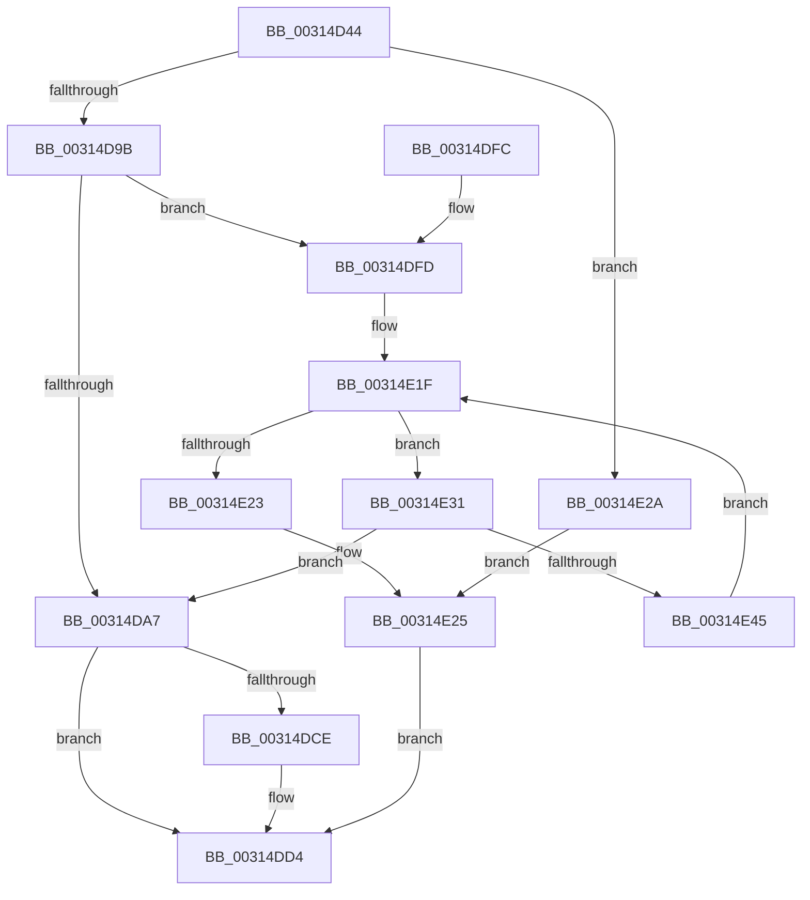

# VslSlowFlushSecureRangeList

- RVA: `0x00314D44`–`0x00314E49` (길이 `261` bytes)
- VA: `0x0000000140314D44`
- 실행 섹션: `.text`
- PDB 이름 있음: `예`; PDB Function 태그: `아니요`
- unwind 정보 RVA: `0x000748B0`
- 디코드: `66`개 명령, `261/261` bytes 표시
- 미해석 바이트: `0` (있으면 어셈블리에 `.byte`로 보존)

> 이 문서는 커널 이미지의 기계어와 PDB 기호를 분석해 생성했습니다. 4번과 5번은 함수 원형과 자료형을 바이너리 사용 방식에서 추정한 C 해석이며 원본 소스 복구 결과는 아닙니다.

## 1. Dependencies

- 직접 호출 지점: **3**; 고유 호출 대상: **3**
- 직접 호출자로 확인된 함수: **3**
- RIP 상대 이미지 참조: **1**

### Outgoing calls
- `0x00314D8A` → [memset](../6C/memset_function_006C6C40.md) (function, `0x006C6C40`)
- `0x00314DC5` → [VslpEnterIumSecureMode](../23/VslpEnterIumSecureMode_function_00235E50.md) (function, `0x00235E50`)
- `0x00314DDF` → [_security_check_cookie](../6A/_security_check_cookie_function_006AC640.md) (function, `0x006AC640`)

### Direct callers
- [sub_00312CF6](Unknown_function_00312CF6.md) at `0x00312E17`
- [HvlpSlowFlushListTbEx](../4A/HvlpSlowFlushListTbEx_function_004AFCF8.md) at `0x004AFE87`
- [HvlpSecureFlushLargeRangeList](../6A/HvlpSecureFlushLargeRangeList_function_006A7C38.md) at `0x006A7CF7`

### Static image references
- `0x00314D59` → RVA `0x00E0A740` (`.data`; read)

## 2. Other-region calls and transfers

- 다른 실행 섹션으로 향하는 call: **0**
- 별도 외부 분기/꼬리 이동을 확인하지 못했습니다.

## 3. Assembly (complete function range)

```asm
00314D44  48 89 5C 24 10                  mov qword ptr [rsp + 0x10], rbx
00314D49  48 89 6C 24 18                  mov qword ptr [rsp + 0x18], rbp
00314D4E  56                              push rsi
00314D4F  57                              push rdi
00314D50  41 56                           push r14
00314D52  48 81 EC A0 00 00 00            sub rsp, 0xa0
00314D59  48 8B 05 E0 59 AF 00            mov rax, qword ptr [rip + 0xaf59e0]
00314D60  48 33 C4                        xor rax, rsp
00314D63  48 89 84 24 90 00 00 00         mov qword ptr [rsp + 0x90], rax
00314D6B  48 8B BC 24 E8 00 00 00         mov rdi, qword ptr [rsp + 0xe8]
00314D73  4C 8B F2                        mov r14, rdx
00314D76  33 D2                           xor edx, edx
00314D78  41 8B F1                        mov esi, r9d
00314D7B  41 8B E8                        mov ebp, r8d
00314D7E  48 8B D9                        mov rbx, rcx
00314D81  48 8D 4C 24 20                  lea rcx, [rsp + 0x20]
00314D86  44 8D 42 68                     lea r8d, [rdx + 0x68]
00314D8A  E8 B1 1E 3B 00                  call 0x1406c6c40
00314D8F  44 0F 20 C0                     mov rax, cr8
00314D93  3C 02                           cmp al, 2
00314D95  0F 87 8F 00 00 00               ja 0x140314e2a
00314D9B  8B 94 24 E0 00 00 00            mov edx, dword ptr [rsp + 0xe0]
00314DA2  83 FD 01                        cmp ebp, 1
00314DA5  74 56                           je 0x140314dfd
00314DA7  48 89 54 24 40                  mov qword ptr [rsp + 0x40], rdx
00314DAC  4C 8D 4C 24 20                  lea r9, [rsp + 0x20]
00314DB1  BA F2 00 00 00                  mov edx, 0xf2
00314DB6  48 89 5C 24 30                  mov qword ptr [rsp + 0x30], rbx
00314DBB  45 33 C0                        xor r8d, r8d
00314DBE  48 89 74 24 38                  mov qword ptr [rsp + 0x38], rsi
00314DC3  B1 02                           mov cl, 2
00314DC5  E8 86 10 F2 FF                  call 0x140235e50
00314DCA  85 C0                           test eax, eax
00314DCC  78 06                           js 0x140314dd4
00314DCE  8A 4C 24 30                     mov cl, byte ptr [rsp + 0x30]
00314DD2  88 0F                           mov byte ptr [rdi], cl
00314DD4  48 8B 8C 24 90 00 00 00         mov rcx, qword ptr [rsp + 0x90]
00314DDC  48 33 CC                        xor rcx, rsp
00314DDF  E8 5C 78 39 00                  call 0x1406ac640
00314DE4  4C 8D 9C 24 A0 00 00 00         lea r11, [rsp + 0xa0]
00314DEC  49 8B 5B 28                     mov rbx, qword ptr [r11 + 0x28]
00314DF0  49 8B 6B 30                     mov rbp, qword ptr [r11 + 0x30]
00314DF4  49 8B E3                        mov rsp, r11
00314DF7  41 5E                           pop r14
00314DF9  5F                              pop rdi
00314DFA  5E                              pop rsi
00314DFB  C3                              ret
00314DFC  CC                              int3
00314DFD  65 48 8B 04 25 88 01 00 00      mov rax, qword ptr gs:[0x188]
00314E06  4E 8D 04 32                     lea r8, [rdx + r14]
00314E0A  48 8B 88 B8 00 00 00            mov rcx, qword ptr [rax + 0xb8]
00314E11  48 8B 81 70 01 00 00            mov rax, qword ptr [rcx + 0x170]
00314E18  33 C9                           xor ecx, ecx
00314E1A  48 89 44 24 28                  mov qword ptr [rsp + 0x28], rax
00314E1F  3B CE                           cmp ecx, esi
00314E21  72 0E                           jb 0x140314e31
00314E23  33 C0                           xor eax, eax
00314E25  C6 07 00                        mov byte ptr [rdi], 0
00314E28  EB AA                           jmp 0x140314dd4
00314E2A  B8 FF 00 00 00                  mov eax, 0xff
00314E2F  EB F4                           jmp 0x140314e25
00314E31  49 B9 FF FF FE FF FF 7F 00 00   movabs r9, 0x7ffffffeffff
00314E3B  4D 39 0C C8                     cmp qword ptr [r8 + rcx*8], r9
00314E3F  0F 86 62 FF FF FF               jbe 0x140314da7
00314E45  FF C1                           inc ecx
00314E47  EB D6                           jmp 0x140314e1f
```

## 4. C-style interpretation (structured pseudocode)

```c
__int64 __fastcall VslSlowFlushSecureRangeList(__int64 a1, __int64 a2, int a3, int a4, unsigned int a5, __int64 a6)
{
    __int64 result;
    __int64 v_rsp;
    unsigned __int64 v_stack_m18;
    unsigned __int64 v_stack_m28;
    unsigned __int64 v_stack_m78;
    unsigned __int64 v_stack_m80;
    unsigned __int64 v_stack_m88;
    unsigned __int64 v_stack_m98;
    unsigned __int64 v_stack_p10;
    unsigned __int64 v_stack_p18;

    v_stack_p10 = v_rbx;
    v_stack_p18 = v_rbp;
    v_rsp = (v_rsp) - (160);
    result = (*(unsigned __int64 *)(v_rip + 11491808)) ^ (v_rsp);
    v_stack_m28 = result;
    a2 = 0;
    result = memset(v_stack_m98, a2, a2 + 104, a4);
    if (((unsigned __int8)(v_cr8)) > 2) goto loc_00314E2A;
    if (((unsigned int)((unsigned int)(a3))) == 1) goto loc_00314DFD;
loc_00314DA7:
    v_stack_m78 = (unsigned int)(a5);
    v_stack_m88 = a1;
    a3 = 0;
    v_stack_m80 = (unsigned int)(a4);
    result = VslpEnterIumSecureMode(2, 242, a3, v_stack_m98);
    if (!(sign_flag)) {
        a1 = v_stack_m88;
        *(unsigned __int8 *)(a6) = (unsigned __int8)(a1);
    }
    a1 = (v_stack_m28) ^ (v_rsp);
    result = _security_check_cookie(a1, 242, a3, v_stack_m98);
    return result;
loc_00314DFD:
    a1 = 0;
    v_stack_m78 = *(unsigned __int64 *)(*(unsigned __int64 *)(*(unsigned __int64 *)(gs_base + (0 + 392)) + 184) + 368);
loc_00314E1F:
    if (0 < ((unsigned int)((unsigned int)(a4)))) goto loc_00314E31;
    result = 0;
loc_00314E25:
    *(unsigned __int8 *)(a6) = 0;
    goto loc_00314DD4;
loc_00314E2A:
    goto loc_00314E25;
loc_00314E31:
    if ((*(unsigned __int64 *)(242 + a2 * 1 + a1 * 8)) <= v_stack_m98) goto loc_00314DA7;
    a1 = (unsigned int)((a1) + 1);
    goto loc_00314E1F;
}
```

## 5. (Beta) C Style

```c
int64_t VslSlowFlushSecureRangeList(int64_t Arg1, int64_t Arg2, int32_t Arg3, int32_t Arg4, void *Arg5, void *Arg6)
{
    uint8_t *arg5 = (uint8_t *)Arg5;
    uint8_t *arg6 = (uint8_t *)Arg6;

    int64_t result;
    int64_t local_rsp;
    uint64_t v_stack_m18;
    uint64_t v_stack_m28;
    uint64_t v_stack_m78;
    uint64_t v_stack_m80;
    uint64_t v_stack_m88;
    uint64_t v_stack_m98;
    uint64_t v_stack_p10;
    uint64_t v_stack_p18;

    v_stack_p10 = local_rbx;
    v_stack_p18 = local_rbp;
    local_rsp = (local_rsp) - (160);
    result = (*(uint64_t *)(v_rip + 0xAF59E0)) ^ (local_rsp);
    v_stack_m28 = result;
    Arg2 = 0;
    result = memset(v_stack_m98, Arg2, Arg2 + 104, Arg4);
    if (((uint8_t)(v_cr8)) > 2) goto loc_00314E2A;
    if (((uint32_t)((uint32_t)(Arg3))) == 1) goto loc_00314DFD;
loc_00314DA7:
    v_stack_m78 = (uint32_t)(Arg5);
    v_stack_m88 = Arg1;
    Arg3 = 0;
    v_stack_m80 = (uint32_t)(Arg4);
    result = VslpEnterIumSecureMode(2, 242, Arg3, v_stack_m98);
    if (!(sign_flag)) {
        Arg1 = v_stack_m88;
        *(uint8_t *)(arg6) = (uint8_t)(Arg1);
    }
    Arg1 = (v_stack_m28) ^ (local_rsp);
    result = _security_check_cookie(Arg1, 242, Arg3, v_stack_m98);
    return result;
loc_00314DFD:
    Arg1 = 0;
    v_stack_m78 = *(uint64_t *)(*(uint64_t *)(*(uint64_t *)(gs_base + (0 + 0x188)) + 0xB8) + 0x170);
loc_00314E1F:
    if (0 < ((uint32_t)((uint32_t)(Arg4)))) goto loc_00314E31;
    result = 0;
loc_00314E25:
    *(uint8_t *)(arg6) = 0;
    goto loc_00314DD4;
loc_00314E2A:
    goto loc_00314E25;
loc_00314E31:
    if ((*(uint64_t *)(242 + Arg2 * 1 + Arg1 * 8)) <= v_stack_m98) goto loc_00314DA7;
    Arg1 = (uint32_t)((Arg1) + 1);
    goto loc_00314E1F;
}
```

### 관측된 메모리 오프셋

구조체 형식이 확인되지 않은 접근은 인자 기준의 오프셋으로만 기록했습니다.

| 기준 인자 | 오프셋 표현 | 폭 (bit) | 접근 |
|---|---:|---:|---|
| `Arg5` | `+ 0x0 + r14*1` | `64` | `R` |
| `Arg5` | `+ 0x0 + rcx*8` | `64` | `R` |
| `Arg6` | `+ 0x0` | `8` | `W` |

## 6. Execution-region graph

[열기: 2D/3D 그래프와 함수 탐색 컨트롤 패널](../../../control-panel.html?section=text&rva=0x00314D44&view=graph)

- 2D 그래프는 위에서 아래로 흐르고, 3D 그래프는 빈 공간을 드래그해 회전합니다. Shift+드래그는 이동, 휠은 확대·축소, 함수 노드 선택은 대상 보고서 이동입니다.

### Static fallback


