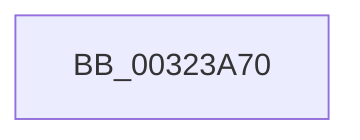

# ExpAcquireSpinLockExclusiveAtDpcLevelInstrumented

- RVA: `0x00323A70`–`0x00323A7E` (길이 `14` bytes)
- VA: `0x0000000140323A70`
- 실행 섹션: `.text`
- PDB 이름 있음: `예`; PDB Function 태그: `아니요`
- unwind 정보 RVA: `0x00075954`
- 디코드: `5`개 명령, `14/14` bytes 표시
- 미해석 바이트: `0` (있으면 어셈블리에 `.byte`로 보존)

> 이 문서는 커널 이미지의 기계어와 PDB 기호를 분석해 생성했습니다. 4번과 5번은 함수 원형과 자료형을 바이너리 사용 방식에서 추정한 C 해석이며 원본 소스 복구 결과는 아닙니다.

## 1. Dependencies

- 직접 호출 지점: **0**; 고유 호출 대상: **0**
- 직접 호출자로 확인된 함수: **32**
- RIP 상대 이미지 참조: **0**

### Outgoing calls
- 직접 디코드된 call 명령이 없습니다.

### Direct callers
- [sub_00238C4F](../23/Unknown_function_00238C4F.md) at `0x00238C68`
- [sub_00248728](../24/Unknown_function_00248728.md) at `0x0024873A`
- [sub_00248EEC](../24/Unknown_function_00248EEC.md) at `0x00248EF9`
- [sub_0024962C](../24/Unknown_function_0024962C.md) at `0x0024963F`
- [sub_00249B6A](../24/Unknown_function_00249B6A.md) at `0x00249BDB`
- [PopPepProcessEvent](../24/PopPepProcessEvent_function_0024B930.md) at `0x0024C434`
- [PopPepProcessEvent](../24/PopPepProcessEvent_function_0024B930.md) at `0x0024C453`
- [KiAbEntryRemoveFromTree](../26/KiAbEntryRemoveFromTree_function_00262410.md) at `0x00262A4B`
- [sub_002647A9](../26/Unknown_function_002647A9.md) at `0x002647D0`
- [sub_0026F895](../26/Unknown_function_0026F895.md) at `0x0026F8AB`
- [MiLockVadTree](../27/MiLockVadTree_function_0027C0F0.md) at `0x0027C28C`
- [sub_0027C341](../27/Unknown_function_0027C341.md) at `0x0027C352`
- [MiAcquirePageListLock](../27/MiAcquirePageListLock_function_0027C450.md) at `0x0027C9B7`
- [MiReleasePageFileInfo](../28/MiReleasePageFileInfo_function_00283FD0.md) at `0x00284233`
- [sub_00285E76](../28/Unknown_function_00285E76.md) at `0x00286094`
- [MiAddPageToFlushMdl](../28/MiAddPageToFlushMdl_function_00286930.md) at `0x00286B89`
- [sub_0028F521](../28/Unknown_function_0028F521.md) at `0x0028F539`
- [MiLockSectionControlArea](../2B/MiLockSectionControlArea_function_002BC930.md) at `0x002BCABC`
- [MiLockWorkingSetCoreExclusive](../2C/MiLockWorkingSetCoreExclusive_function_002C0CFC.md) at `0x002C0D8E`
- [MiComputeAgingAmount](../2C/MiComputeAgingAmount_function_002C2520.md) at `0x002C267C`
- [sub_002E0B15](../2E/Unknown_function_002E0B15.md) at `0x002E0F13`
- [MiGetUltraMapping](MiGetUltraMapping_function_00323270.md) at `0x0032349F`
- [MiGetUltraMapping](MiGetUltraMapping_function_00323270.md) at `0x00323554`
- [MiLockWorkingSetExclusive](MiLockWorkingSetExclusive_function_003238A0.md) at `0x0032396B`
- [sub_003247A5](Unknown_function_003247A5.md) at `0x003247BA`
- [sub_00324927](Unknown_function_00324927.md) at `0x0032493C`
- [MiAddViewsForSection](MiAddViewsForSection_function_00324990.md) at `0x00324CBC`
- [MiReferenceActiveSubsection](MiReferenceActiveSubsection_function_00325060.md) at `0x0032557E`
- [sub_003354FB](../33/Unknown_function_003354FB.md) at `0x00335A72`
- [MiUnlinkFreeOrZeroedPage](../33/MiUnlinkFreeOrZeroedPage_function_00336C40.md) at `0x00337143`
- [sub_0038BA93](../38/Unknown_function_0038BA93.md) at `0x0038BB65`
- [sub_0039535C](../39/Unknown_function_0039535C.md) at `0x00395375`
- [MiLockPageListAndLastPage](../41/MiLockPageListAndLastPage_function_00411BA0.md) at `0x00411DAC`
- [sub_004187EB](../41/Unknown_function_004187EB.md) at `0x00418800`

### Static image references
- 디코드된 RIP-relative 메모리 참조가 없습니다.

## 2. Other-region calls and transfers

- 다른 실행 섹션으로 향하는 call: **0**
- 별도 외부 분기/꼬리 이동을 확인하지 못했습니다.

## 3. Assembly (complete function range)

```asm
00323A70  48 89 5C 24 20                  mov qword ptr [rsp + 0x20], rbx
00323A75  57                              push rdi
00323A76  41 56                           push r14
00323A78  41 57                           push r15
00323A7A  48 83 EC 30                     sub rsp, 0x30
```

## 4. C-style interpretation (structured pseudocode)

```c
void __fastcall ExpAcquireSpinLockExclusiveAtDpcLevelInstrumented(void)
{
    __int64 v_rsp;
    unsigned __int64 v_stack_p20;

    v_stack_p20 = v_rbx;
    v_rsp = (v_rsp) - (48);
    return;
}
```

## 5. (Beta) C Style

```c
void ExpAcquireSpinLockExclusiveAtDpcLevelInstrumented(void)
{
    int64_t local_rsp;
    uint64_t v_stack_p20;

    v_stack_p20 = local_rbx;
    local_rsp = (local_rsp) - (48);
    return;
}
```

## 6. Execution-region graph

[열기: 2D/3D 그래프와 함수 탐색 컨트롤 패널](../../../control-panel.html?section=text&rva=0x00323A70&view=graph)

- 2D 그래프는 위에서 아래로 흐르고, 3D 그래프는 빈 공간을 드래그해 회전합니다. Shift+드래그는 이동, 휠은 확대·축소, 함수 노드 선택은 대상 보고서 이동입니다.

### Static fallback


