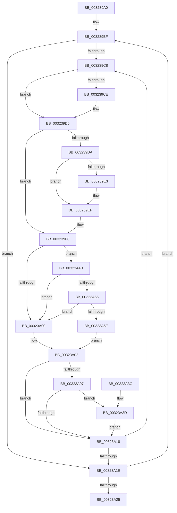

# ExpWaitForSpinLockExclusiveAndAcquire

- RVA: `0x003239A0`–`0x00323A67` (길이 `199` bytes)
- VA: `0x00000001403239A0`
- 실행 섹션: `.text`
- PDB 이름 있음: `예`; PDB Function 태그: `아니요`
- unwind 정보 RVA: `0x0007593C`
- 디코드: `61`개 명령, `199/199` bytes 표시
- 미해석 바이트: `0` (있으면 어셈블리에 `.byte`로 보존)

> 이 문서는 커널 이미지의 기계어와 PDB 기호를 분석해 생성했습니다. 4번과 5번은 함수 원형과 자료형을 바이너리 사용 방식에서 추정한 C 해석이며 원본 소스 복구 결과는 아닙니다.

## 1. Dependencies

- 직접 호출 지점: **4**; 고유 호출 대상: **4**
- 직접 호출자로 확인된 함수: **33**
- RIP 상대 이미지 참조: **3**

### Outgoing calls
- `0x003239EA` → [KiLowerIrqlProcessIrqlFlags](../4F/KiLowerIrqlProcessIrqlFlags_function_004F5698.md) (function, `0x004F5698`)
- `0x00323A44` → [KiRaiseIrqlProcessIrqlFlags](../4F/KiRaiseIrqlProcessIrqlFlags_function_004F56FC.md) (function, `0x004F56FC`)
- `0x00323A55` → [KiCheckVpBackingLongSpinWaitHypercall](../30/KiCheckVpBackingLongSpinWaitHypercall_function_0030F490.md) (function, `0x0030F490`)
- `0x00323A60` → [HvlNotifyLongSpinWait](../30/HvlNotifyLongSpinWait_function_0030F460.md) (function, `0x0030F460`)

### Direct callers
- [sub_002388C3](../23/Unknown_function_002388C3.md) at `0x002388E9`
- [sub_002486C0](../24/Unknown_function_002486C0.md) at `0x002486D5`
- [sub_00248E92](../24/Unknown_function_00248E92.md) at `0x00248EA2`
- [sub_002494B8](../24/Unknown_function_002494B8.md) at `0x002494CC`
- [sub_00249850](../24/Unknown_function_00249850.md) at `0x002499D2`
- [PopPepProcessEvent](../24/PopPepProcessEvent_function_0024B930.md) at `0x0024B9C5`
- [PopPepProcessEvent](../24/PopPepProcessEvent_function_0024B930.md) at `0x0024C137`
- [KiAbEntryRemoveFromTree](../26/KiAbEntryRemoveFromTree_function_00262410.md) at `0x00262924`
- [sub_00264587](../26/Unknown_function_00264587.md) at `0x00264602`
- [sub_0026F7CA](../26/Unknown_function_0026F7CA.md) at `0x0026F808`
- [MiLockVadTree](../27/MiLockVadTree_function_0027C0F0.md) at `0x0027C1E3`
- [sub_0027C2B0](../27/Unknown_function_0027C2B0.md) at `0x0027C2E8`
- [MiAcquirePageListLock](../27/MiAcquirePageListLock_function_0027C450.md) at `0x0027C908`
- [MiReleasePageFileInfo](../28/MiReleasePageFileInfo_function_00283FD0.md) at `0x0028406B`
- [sub_00285E76](../28/Unknown_function_00285E76.md) at `0x00285E97`
- [MiAddPageToFlushMdl](../28/MiAddPageToFlushMdl_function_00286930.md) at `0x0028698B`
- [sub_0028F415](../28/Unknown_function_0028F415.md) at `0x0028F431`
- [MiLockSectionControlArea](../2B/MiLockSectionControlArea_function_002BC930.md) at `0x002BC99C`
- [MiLockWorkingSetCoreExclusive](../2C/MiLockWorkingSetCoreExclusive_function_002C0CFC.md) at `0x002C0D34`
- [MiComputeAgingAmount](../2C/MiComputeAgingAmount_function_002C2520.md) at `0x002C257E`
- [sub_002E0B15](../2E/Unknown_function_002E0B15.md) at `0x002E0CC0`
- [MiGetUltraMapping](MiGetUltraMapping_function_00323270.md) at `0x00323368`
- [MiGetUltraMapping](MiGetUltraMapping_function_00323270.md) at `0x003234D0`
- [MiLockWorkingSetExclusive](MiLockWorkingSetExclusive_function_003238A0.md) at `0x003238F9`
- [sub_00323A7E](Unknown_function_00323A7E.md) at `0x00323AC1`
- [sub_003246C5](Unknown_function_003246C5.md) at `0x00324701`
- [sub_00324868](Unknown_function_00324868.md) at `0x0032487D`
- [MiAddViewsForSection](MiAddViewsForSection_function_00324990.md) at `0x00324A22`
- [MiReferenceActiveSubsection](MiReferenceActiveSubsection_function_00325060.md) at `0x0032546E`
- [sub_003354FB](../33/Unknown_function_003354FB.md) at `0x00335665`
- [MiUnlinkFreeOrZeroedPage](../33/MiUnlinkFreeOrZeroedPage_function_00336C40.md) at `0x00336E4A`
- [sub_0038BA93](../38/Unknown_function_0038BA93.md) at `0x0038BAE4`
- [sub_003950F3](../39/Unknown_function_003950F3.md) at `0x00395146`
- [MiLockPageListAndLastPage](../41/MiLockPageListAndLastPage_function_00411BA0.md) at `0x00411D35`
- [sub_00418706](../41/Unknown_function_00418706.md) at `0x0041871B`

### Static image references
- `0x003239DA` → RVA `0x00FC6D20` (`ALMOSTRO`; read)
- `0x003239F8` → RVA `0x00FC52AC` (`ALMOSTRO`; reference)
- `0x00323A4B` → RVA `0x00FC6AB8` (`ALMOSTRO`; read)

## 2. Other-region calls and transfers

- 다른 실행 섹션으로 향하는 call: **0**
- 별도 외부 분기/꼬리 이동을 확인하지 못했습니다.

## 3. Assembly (complete function range)

```asm
003239A0  48 89 5C 24 08                  mov qword ptr [rsp + 8], rbx
003239A5  48 89 6C 24 10                  mov qword ptr [rsp + 0x10], rbp
003239AA  48 89 74 24 18                  mov qword ptr [rsp + 0x18], rsi
003239AF  57                              push rdi
003239B0  48 83 EC 20                     sub rsp, 0x20
003239B4  33 F6                           xor esi, esi
003239B6  0F B6 DA                        movzx ebx, dl
003239B9  48 8B F9                        mov rdi, rcx
003239BC  8D 6E 02                        lea ebp, [rsi + 2]
003239BF  0F 0D 0F                        prefetchw byte ptr [rdi]
003239C2  8B 07                           mov eax, dword ptr [rdi]
003239C4  85 C0                           test eax, eax
003239C6  79 56                           jns 0x140323a1e
003239C8  0F BA E0 1E                     bt eax, 0x1e
003239CC  72 07                           jb 0x1403239d5
003239CE  F0 81 0F 00 00 00 40            lock or dword ptr [rdi], 0x40000000
003239D5  80 FB FF                        cmp bl, 0xff
003239D8  74 1C                           je 0x1403239f6
003239DA  83 3D 3F 33 CA 00 00            cmp dword ptr [rip + 0xca333f], 0
003239E1  74 0C                           je 0x1403239ef
003239E3  44 0F 20 C1                     mov rcx, cr8
003239E7  0F B6 D3                        movzx edx, bl
003239EA  E8 A9 1C 1D 00                  call 0x1404f5698
003239EF  0F B6 C3                        movzx eax, bl
003239F2  44 0F 22 C0                     mov cr8, rax
003239F6  FF C6                           inc esi
003239F8  85 35 AE 18 CA 00               test dword ptr [rip + 0xca18ae], esi
003239FE  74 4B                           je 0x140323a4b
00323A00  F3 90                           pause
00323A02  80 FB FF                        cmp bl, 0xff
00323A05  74 11                           je 0x140323a18
00323A07  44 0F 20 C3                     mov rbx, cr8
00323A0B  44 0F 22 C5                     mov cr8, rbp
00323A0F  83 3D 0A 33 CA 00 00            cmp dword ptr [rip + 0xca330a], 0
00323A16  75 25                           jne 0x140323a3d
00323A18  8B 07                           mov eax, dword ptr [rdi]
00323A1A  85 C0                           test eax, eax
00323A1C  78 AA                           js 0x1403239c8
00323A1E  F0 0F BA 2F 1F                  lock bts dword ptr [rdi], 0x1f
00323A23  72 9A                           jb 0x1403239bf
00323A25  48 8B 5C 24 30                  mov rbx, qword ptr [rsp + 0x30]
00323A2A  8B C6                           mov eax, esi
00323A2C  48 8B 74 24 40                  mov rsi, qword ptr [rsp + 0x40]
00323A31  48 8B 6C 24 38                  mov rbp, qword ptr [rsp + 0x38]
00323A36  48 83 C4 20                     add rsp, 0x20
00323A3A  5F                              pop rdi
00323A3B  C3                              ret
00323A3C  CC                              int3
00323A3D  40 0F B6 D5                     movzx edx, bpl
00323A41  0F B6 CB                        movzx ecx, bl
00323A44  E8 B3 1C 1D 00                  call 0x1404f56fc
00323A49  EB CD                           jmp 0x140323a18
00323A4B  8B 05 67 30 CA 00               mov eax, dword ptr [rip + 0xca3067]
00323A51  A8 40                           test al, 0x40
00323A53  74 AB                           je 0x140323a00
00323A55  E8 36 BA FE FF                  call 0x14030f490
00323A5A  84 C0                           test al, al
00323A5C  74 A2                           je 0x140323a00
00323A5E  8B CE                           mov ecx, esi
00323A60  E8 FB B9 FE FF                  call 0x14030f460
00323A65  EB 9B                           jmp 0x140323a02
```

## 4. C-style interpretation (structured pseudocode)

```c
__int64 __fastcall ExpWaitForSpinLockExclusiveAndAcquire(__int64 a1, unsigned __int8 a2)
{
    __int64 result;
    __int64 v_rsi;
    __int64 v_rsp;
    unsigned __int64 v_stack_p10;
    unsigned __int64 v_stack_p18;
    unsigned __int64 v_stack_p8;

    v_stack_p8 = v_rbx;
    v_stack_p10 = v_rbp;
    v_stack_p18 = v_rsi;
    v_rsp = (v_rsp) - (32);
    v_rsi = 0;
loc_003239BF:
    if (!sign_flag) goto loc_00323A1E;
loc_003239C8:
    if (!(condition_is_below)) {
    }
    if (a2 == 255) goto loc_003239F6;
    result = (unsigned int)(*(unsigned int *)(a1));
    if ((*(unsigned int *)(v_rip + 13251391)) != 0) {
        a1 = v_cr8;
        a2 = a2;
        result = KiLowerIrqlProcessIrqlFlags(a1, a2, a3, a4);
    }
loc_003239F6:
    v_rsi = (unsigned int)((v_rsi) + 1);
    if (((*(unsigned int *)(v_rip + 13244590)) & ((unsigned int)(v_rsi))) == 0) goto loc_00323A4B;
loc_00323A00:
loc_00323A02:
    if (a2 == 255) goto loc_00323A18;
    if ((*(unsigned int *)(v_rip + 13251338)) != 0) goto loc_00323A3D;
loc_00323A18:
    if (sign_flag) goto loc_003239C8;
loc_00323A1E:
    if (condition_is_below) goto loc_003239BF;
    v_rsp = (v_rsp) + (32);
    return (unsigned int)((unsigned int)(v_rsi));
loc_00323A3D:
    result = KiRaiseIrqlProcessIrqlFlags((unsigned __int8)(v_stack_p8), (unsigned __int8)(v_stack_p10), a3, a4);
    goto loc_00323A18;
loc_00323A4B:
    if ((((unsigned __int8)((unsigned int)(*(unsigned int *)(v_rip + 13250663)))) & (64)) == 0) goto loc_00323A00;
    result = KiCheckVpBackingLongSpinWaitHypercall((unsigned __int8)(v_stack_p8), (unsigned __int8)(v_stack_p10), a3, a4);
    if ((unsigned __int8)(result) == 0) goto loc_00323A00;
    result = HvlNotifyLongSpinWait((unsigned int)((unsigned int)(v_stack_p18)), (unsigned __int8)(v_stack_p10), a3, a4);
    goto loc_00323A02;
}
```

## 5. (Beta) C Style

```c
int64_t ExpWaitForSpinLockExclusiveAndAcquire(void *Arg1, uint8_t Arg2)
{
    uint8_t *arg1 = (uint8_t *)Arg1;

    int64_t result;
    int64_t local_rsi;
    int64_t local_rsp;
    uint64_t v_stack_p10;
    uint64_t v_stack_p18;
    uint64_t v_stack_p8;

    v_stack_p8 = local_rbx;
    v_stack_p10 = local_rbp;
    v_stack_p18 = local_rsi;
    local_rsp = (local_rsp) - (32);
    local_rsi = 0;
loc_003239BF:
    if (!sign_flag) goto loc_00323A1E;
loc_003239C8:
    if (!(condition_is_below)) {
    }
    if (Arg2 == 255) goto loc_003239F6;
    result = (uint32_t)(*(uint32_t *)(arg1));
    if ((*(uint32_t *)(v_rip + 0xCA333F)) != 0) {
        Arg1 = v_cr8;
        Arg2 = Arg2;
        result = KiLowerIrqlProcessIrqlFlags(Arg1, Arg2, a3, a4);
    }
loc_003239F6:
    local_rsi = (uint32_t)((local_rsi) + 1);
    if (((*(uint32_t *)(v_rip + 0xCA18AE)) & ((uint32_t)(local_rsi))) == 0) goto loc_00323A4B;
loc_00323A00:
loc_00323A02:
    if (Arg2 == 255) goto loc_00323A18;
    if ((*(uint32_t *)(v_rip + 0xCA330A)) != 0) goto loc_00323A3D;
loc_00323A18:
    if (sign_flag) goto loc_003239C8;
loc_00323A1E:
    if (condition_is_below) goto loc_003239BF;
    local_rsp = (local_rsp) + (32);
    return (uint32_t)((uint32_t)(local_rsi));
loc_00323A3D:
    result = KiRaiseIrqlProcessIrqlFlags((uint8_t)(v_stack_p8), (uint8_t)(v_stack_p10), a3, a4);
    goto loc_00323A18;
loc_00323A4B:
    if ((((uint8_t)((uint32_t)(*(uint32_t *)(v_rip + 0xCA3067)))) & (64)) == 0) goto loc_00323A00;
    result = KiCheckVpBackingLongSpinWaitHypercall((uint8_t)(v_stack_p8), (uint8_t)(v_stack_p10), a3, a4);
    if ((uint8_t)(result) == 0) goto loc_00323A00;
    result = HvlNotifyLongSpinWait((uint32_t)((uint32_t)(v_stack_p18)), (uint8_t)(v_stack_p10), a3, a4);
    goto loc_00323A02;
}
```

### 관측된 메모리 오프셋

구조체 형식이 확인되지 않은 접근은 인자 기준의 오프셋으로만 기록했습니다.

| 기준 인자 | 오프셋 표현 | 폭 (bit) | 접근 |
|---|---:|---:|---|
| `Arg1` | `+ 0x0` | `8` | `R` |
| `Arg1` | `+ 0x0` | `32` | `R` |
| `Arg1` | `+ 0x0` | `32` | `R/W` |

## 6. Execution-region graph

[열기: 2D/3D 그래프와 함수 탐색 컨트롤 패널](../../../control-panel.html?section=text&rva=0x003239A0&view=graph)

- 2D 그래프는 위에서 아래로 흐르고, 3D 그래프는 빈 공간을 드래그해 회전합니다. Shift+드래그는 이동, 휠은 확대·축소, 함수 노드 선택은 대상 보고서 이동입니다.

### Static fallback


