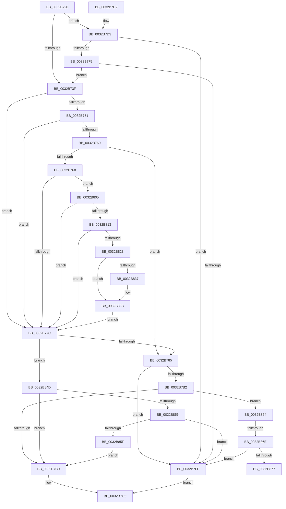

# MiAccessCheck

- RVA: `0x0032B720`–`0x0032B87A` (길이 `346` bytes)
- VA: `0x000000014032B720`
- 실행 섹션: `.text`
- PDB 이름 있음: `예`; PDB Function 태그: `아니요`
- unwind 정보 RVA: `0x000760D8`
- 디코드: `90`개 명령, `346/346` bytes 표시
- 미해석 바이트: `0` (있으면 어셈블리에 `.byte`로 보존)

> 이 문서는 커널 이미지의 기계어와 PDB 기호를 분석해 생성했습니다. 4번과 5번은 함수 원형과 자료형을 바이너리 사용 방식에서 추정한 C 해석이며 원본 소스 복구 결과는 아닙니다.

## 1. Dependencies

- 직접 호출 지점: **2**; 고유 호출 대상: **2**
- 직접 호출자로 확인된 함수: **1**
- RIP 상대 이미지 참조: **1**

### Outgoing calls
- `0x0032B805` → [MiPteHasShadow](MiPteHasShadow_function_0032B998.md) (function, `0x0032B998`)
- `0x0032B86E` → [MiAllowGuardFault](../34/MiAllowGuardFault_function_0034B5B0.md) (function, `0x0034B5B0`)

### Direct callers
- [sub_00320866](Unknown_function_00320866.md) at `0x00320A73`

### Static image references
- `0x0032B788` → RVA `0x00011060` (`.rdata`; read)

## 2. Other-region calls and transfers

- 다른 실행 섹션으로 향하는 call: **0**
- call이 아닌 외부 분기/꼬리 이동: **1**
  - `0x0032B86C` → [sub_0032B8BA + 0x1](Unknown_function_0032B8BA.md) (`tail-transfer`)

## 3. Assembly (complete function range)

```asm
0032B720  48 89 5C 24 10                  mov qword ptr [rsp + 0x10], rbx
0032B725  48 89 74 24 18                  mov qword ptr [rsp + 0x18], rsi
0032B72A  57                              push rdi
0032B72B  48 83 EC 30                     sub rsp, 0x30
0032B72F  4C 8B D2                        mov r10, rdx
0032B732  48 8B F1                        mov rsi, rcx
0032B735  41 80 F8 01                     cmp r8b, 1
0032B739  0F 84 94 00 00 00               je 0x14032b7d3
0032B73F  48 8B 1E                        mov rbx, qword ptr [rsi]
0032B742  48 B8 00 D0 BE 7D FB F6 FF FF   movabs rax, 0xfffff6fb7dbed000
0032B74C  48 3B F0                        cmp rsi, rax
0032B74F  72 2B                           jb 0x14032b77c
0032B751  48 B8 F8 D7 BE 7D FB F6 FF FF   movabs rax, 0xfffff6fb7dbed7f8
0032B75B  48 3B F0                        cmp rsi, rax
0032B75E  77 1C                           ja 0x14032b77c
0032B760  48 8B D3                        mov rdx, rbx
0032B763  F6 C3 01                        test bl, 1
0032B766  74 1D                           je 0x14032b785
0032B768  F6 C3 42                        test bl, 0x42
0032B76B  0F 95 C1                        setne cl
0032B76E  F6 C3 20                        test bl, 0x20
0032B771  0F 95 C0                        setne al
0032B774  84 C8                           test al, cl
0032B776  0F 84 89 00 00 00               je 0x14032b805
0032B77C  F6 C3 01                        test bl, 1
0032B77F  0F 85 C8 00 00 00               jne 0x14032b84d
0032B785  41 8B C1                        mov eax, r9d
0032B788  48 8D 0D D1 58 CE FF            lea rcx, [rip - 0x31a72f]
0032B78F  83 E0 07                        and eax, 7
0032B792  41 8B F9                        mov edi, r9d
0032B795  4D 85 D2                        test r10, r10
0032B798  0F BE 14 08                     movsx edx, byte ptr [rax + rcx]
0032B79C  B9 01 00 00 00                  mov ecx, 1
0032B7A1  41 0F B6 C2                     movzx eax, r10b
0032B7A5  0F 44 C8                        cmove ecx, eax
0032B7A8  0F BE C1                        movsx eax, cl
0032B7AB  2B D0                           sub edx, eax
0032B7AD  83 FA 0A                        cmp edx, 0xa
0032B7B0  7C 4C                           jl 0x14032b7fe
0032B7B2  41 83 E1 F8                     and r9d, 0xfffffff8
0032B7B6  41 83 F9 10                     cmp r9d, 0x10
0032B7BA  0F 84 A4 00 00 00               je 0x14032b864
0032B7C0  33 C0                           xor eax, eax
0032B7C2  48 8B 5C 24 48                  mov rbx, qword ptr [rsp + 0x48]
0032B7C7  48 8B 74 24 50                  mov rsi, qword ptr [rsp + 0x50]
0032B7CC  48 83 C4 30                     add rsp, 0x30
0032B7D0  5F                              pop rdi
0032B7D1  C3                              ret
0032B7D2  CC                              int3
0032B7D3  48 BA 00 00 00 00 80 F6 FF FF   movabs rdx, 0xfffff68000000000
0032B7DD  48 8B C2                        mov rax, rdx
0032B7E0  48 B9 78 FF FF FF 3F 00 00 00   movabs rcx, 0x3fffffff78
0032B7EA  48 03 C1                        add rax, rcx
0032B7ED  48 3B F0                        cmp rsi, rax
0032B7F0  77 0C                           ja 0x14032b7fe
0032B7F2  48 8B C2                        mov rax, rdx
0032B7F5  48 3B F0                        cmp rsi, rax
0032B7F8  0F 83 41 FF FF FF               jae 0x14032b73f
0032B7FE  B8 05 00 00 C0                  mov eax, 0xc0000005
0032B803  EB BD                           jmp 0x14032b7c2
0032B805  E8 8E 01 00 00                  call 0x14032b998
0032B80A  48 85 C0                        test rax, rax
0032B80D  0F 84 69 FF FF FF               je 0x14032b77c
0032B813  48 8B 88 08 05 00 00            mov rcx, qword ptr [rax + 0x508]
0032B81A  48 85 C9                        test rcx, rcx
0032B81D  0F 84 59 FF FF FF               je 0x14032b77c
0032B823  48 8B C6                        mov rax, rsi
0032B826  48 C1 E8 03                     shr rax, 3
0032B82A  25 FF 01 00 00                  and eax, 0x1ff
0032B82F  48 8B 04 C1                     mov rax, qword ptr [rcx + rax*8]
0032B833  A8 20                           test al, 0x20
0032B835  74 04                           je 0x14032b83b
0032B837  48 83 CA 20                     or rdx, 0x20
0032B83B  48 8B DA                        mov rbx, rdx
0032B83E  48 83 CB 42                     or rbx, 0x42
0032B842  A8 42                           test al, 0x42
0032B844  48 0F 44 DA                     cmove rbx, rdx
0032B848  E9 2F FF FF FF                  jmp 0x14032b77c
0032B84D  4D 85 D2                        test r10, r10
0032B850  0F 84 6A FF FF FF               je 0x14032b7c0
0032B856  48 F7 C3 00 0A 00 00            test rbx, 0xa00
0032B85D  74 9F                           je 0x14032b7fe
0032B85F  E9 5C FF FF FF                  jmp 0x14032b7c0
0032B864  48 8B 4C 24 60                  mov rcx, qword ptr [rsp + 0x60]
0032B869  F6 C1 01                        test cl, 1
0032B86C  75 4D                           jne 0x14032b8bb
0032B86E  E8 3D FD 01 00                  call 0x14034b5b0
0032B873  85 C0                           test eax, eax
0032B875  74 87                           je 0x14032b7fe
0032B877  48 8B C3                        mov rax, rbx
```

## 4. C-style interpretation (structured pseudocode)

```c
__int64 __fastcall MiAccessCheck(__int64 a1, __int64 a2, unsigned __int8 a3, int a4, __int64 a5)
{
    __int64 result;
    __int64 v_rbx;
    __int64 v_rsp;
    unsigned __int64 v_stack_p10;
    unsigned __int64 v_stack_p18;

    v_stack_p10 = v_rbx;
    v_stack_p18 = v_rsi;
    v_rsp = (v_rsp) - (48);
    if (a3 == 1) goto loc_0032B7D3;
loc_0032B73F:
    if (a1 < result) goto loc_0032B77C;
    if (a1 > result) goto loc_0032B77C;
    if ((((unsigned __int8)(*(unsigned __int64 *)(a1))) & (1)) == 0) goto loc_0032B785;
    a1 = ((((unsigned __int8)(*(unsigned __int64 *)(a1))) & (66)) != 0) ? 1 : 0;
    result = ((((unsigned __int8)(*(unsigned __int64 *)(a1))) & (32)) != 0) ? 1 : 0;
    if ((((unsigned __int8)(result)) & ((unsigned __int8)(a1))) == 0) goto loc_0032B805;
loc_0032B77C:
    if ((((unsigned __int8)(*(unsigned __int64 *)(a1))) & (1)) != 0) goto loc_0032B84D;
loc_0032B785:
    result = (unsigned int)(((unsigned int)(a4)) & (7));
    a1 = 1;
    if (a2 == 0) { a1 = (unsigned int)((unsigned __int8)(a2)); }
    a2 = (unsigned int)(((__int8)(*(unsigned __int8 *)(result + v_rip - 3254063 * 1))) - ((unsigned int)((__int8)((unsigned __int8)(a1)))));
    if (((unsigned int)(a2)) < 10) goto loc_0032B7FE;
    a4 = (unsigned int)((a4) & (0xFFFFFFF8ULL));
    if (a4 == 16) goto loc_0032B864;
loc_0032B7C0:
    result = 0;
loc_0032B7C2:
    v_rsp = (v_rsp) + (48);
    return result;
loc_0032B7D3:
    result = (a2) + (a1);
    if (v_stack_p18 > result) goto loc_0032B7FE;
    if (v_stack_p18 >= a2) goto loc_0032B73F;
loc_0032B7FE:
    goto loc_0032B7C2;
loc_0032B805:
    result = MiPteHasShadow(a1, a2, a3, a4);
    if (result == 0) goto loc_0032B77C;
    if (*(unsigned __int64 *)(result + 1288) == 0) goto loc_0032B77C;
    result = (v_stack_p18) >> (3);
    result = (unsigned int)((result) & (511));
    if ((((unsigned __int8)(*(unsigned __int64 *)(*(unsigned __int64 *)(result + 1288) + result * 8))) & (32)) != 0) {
        a2 = (a2) | (32);
    }
    v_rbx = (a2) | (66);
    if ((((unsigned __int8)(*(unsigned __int64 *)(*(unsigned __int64 *)(result + 1288) + result * 8))) & (66)) == 0) { v_rbx = a2; }
    goto loc_0032B77C;
loc_0032B84D:
    if (a2 == 0) goto loc_0032B7C0;
    if (((v_rbx) & (0xA00ULL)) == 0) goto loc_0032B7FE;
    goto loc_0032B7C0;
loc_0032B864:
    result = MiAllowGuardFault(a5, a2, a3, a4);
    if ((unsigned int)(result) == 0) goto loc_0032B7FE;
    return v_rbx;
}
```

## 5. (Beta) C Style

```c
int64_t MiAccessCheck(int64_t Arg1, int64_t Arg2, uint8_t Arg3, int32_t Arg4, int64_t Arg5)
{
    int64_t result;
    int64_t local_rbx;
    int64_t local_rsp;
    uint64_t v_stack_p10;
    uint64_t v_stack_p18;

    v_stack_p10 = local_rbx;
    v_stack_p18 = local_rsi;
    local_rsp = (local_rsp) - (48);
    if (Arg3 == 1) goto loc_0032B7D3;
loc_0032B73F:
    if (Arg1 < result) goto loc_0032B77C;
    if (Arg1 > result) goto loc_0032B77C;
    if ((((uint8_t)(*(uint64_t *)(Arg1))) & (1)) == 0) goto loc_0032B785;
    Arg1 = ((((uint8_t)(*(uint64_t *)(Arg1))) & (66)) != 0) ? 1 : 0;
    result = ((((uint8_t)(*(uint64_t *)(Arg1))) & (32)) != 0) ? 1 : 0;
    if ((((uint8_t)(result)) & ((uint8_t)(Arg1))) == 0) goto loc_0032B805;
loc_0032B77C:
    if ((((uint8_t)(*(uint64_t *)(Arg1))) & (1)) != 0) goto loc_0032B84D;
loc_0032B785:
    result = (uint32_t)(((uint32_t)(Arg4)) & (7));
    Arg1 = 1;
    if (Arg2 == 0) { Arg1 = (uint32_t)((uint8_t)(Arg2)); }
    Arg2 = (uint32_t)(((int8_t)(*(uint8_t *)(result + v_rip - 0x31A72F * 1))) - ((uint32_t)((int8_t)((uint8_t)(Arg1)))));
    if (((uint32_t)(Arg2)) < 10) goto loc_0032B7FE;
    Arg4 = (uint32_t)((Arg4) & (0xFFFFFFF8ULL));
    if (Arg4 == 16) goto loc_0032B864;
loc_0032B7C0:
    result = 0;
loc_0032B7C2:
    local_rsp = (local_rsp) + (48);
    return result;
loc_0032B7D3:
    result = (Arg2) + (Arg1);
    if (v_stack_p18 > result) goto loc_0032B7FE;
    if (v_stack_p18 >= Arg2) goto loc_0032B73F;
loc_0032B7FE:
    goto loc_0032B7C2;
loc_0032B805:
    result = MiPteHasShadow(Arg1, Arg2, Arg3, Arg4);
    if (result == 0) goto loc_0032B77C;
    if (*(uint64_t *)(result + 0x508) == 0) goto loc_0032B77C;
    result = (v_stack_p18) >> (3);
    result = (uint32_t)((result) & (511));
    if ((((uint8_t)(*(uint64_t *)(*(uint64_t *)(result + 0x508) + result * 8))) & (32)) != 0) {
        Arg2 = (Arg2) | (32);
    }
    local_rbx = (Arg2) | (66);
    if ((((uint8_t)(*(uint64_t *)(*(uint64_t *)(result + 0x508) + result * 8))) & (66)) == 0) { local_rbx = Arg2; }
    goto loc_0032B77C;
loc_0032B84D:
    if (Arg2 == 0) goto loc_0032B7C0;
    if (((local_rbx) & (0xA00ULL)) == 0) goto loc_0032B7FE;
    goto loc_0032B7C0;
loc_0032B864:
    result = MiAllowGuardFault(Arg5, Arg2, Arg3, Arg4);
    if ((uint32_t)(result) == 0) goto loc_0032B7FE;
    return local_rbx;
}
```

## 6. Execution-region graph

[열기: 2D/3D 그래프와 함수 탐색 컨트롤 패널](../../../control-panel.html?section=text&rva=0x0032B720&view=graph)

- 2D 그래프는 위에서 아래로 흐르고, 3D 그래프는 빈 공간을 드래그해 회전합니다. Shift+드래그는 이동, 휠은 확대·축소, 함수 노드 선택은 대상 보고서 이동입니다.

### Static fallback


