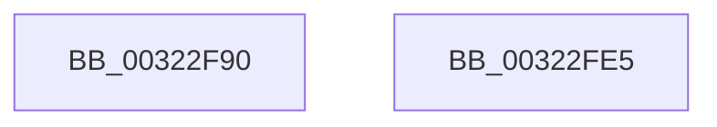

# MiAllocateHyperSpace

- RVA: `0x00322F90`–`0x00322FE6` (길이 `86` bytes)
- VA: `0x0000000140322F90`
- 실행 섹션: `.text`
- PDB 이름 있음: `예`; PDB Function 태그: `아니요`
- unwind 정보 RVA: `0x0005CF00`
- 디코드: `20`개 명령, `86/86` bytes 표시
- 미해석 바이트: `0` (있으면 어셈블리에 `.byte`로 보존)

> 이 문서는 커널 이미지의 기계어와 PDB 기호를 분석해 생성했습니다. 4번과 5번은 함수 원형과 자료형을 바이너리 사용 방식에서 추정한 C 해석이며 원본 소스 복구 결과는 아닙니다.

## 1. Dependencies

- 직접 호출 지점: **1**; 고유 호출 대상: **1**
- 직접 호출자로 확인된 함수: **1**
- RIP 상대 이미지 참조: **0**

### Outgoing calls
- `0x00322FB6` → [MiGetUltraMapping](MiGetUltraMapping_function_00323270.md) (function, `0x00323270`)

### Direct callers
- [MiCopyDataPageToImagePage](../2A/MiCopyDataPageToImagePage_function_002AE818.md) at `0x002AEA95`

### Static image references
- 디코드된 RIP-relative 메모리 참조가 없습니다.

## 2. Other-region calls and transfers

- 다른 실행 섹션으로 향하는 call: **0**
- 별도 외부 분기/꼬리 이동을 확인하지 못했습니다.

## 3. Assembly (complete function range)

```asm
00322F90  40 53                           push rbx
00322F92  48 83 EC 20                     sub rsp, 0x20
00322F96  65 48 8B 04 25 20 00 00 00      mov rax, qword ptr gs:[0x20]
00322F9F  BA 03 00 00 00                  mov edx, 3
00322FA4  4C 8B C1                        mov r8, rcx
00322FA7  48 8B 98 38 88 00 00            mov rbx, qword ptr [rax + 0x8838]
00322FAE  44 8D 4A 01                     lea r9d, [rdx + 1]
00322FB2  48 8D 4B 68                     lea rcx, [rbx + 0x68]
00322FB6  E8 B5 02 00 00                  call 0x140323270
00322FBB  48 8B C8                        mov rcx, rax
00322FBE  48 BA F8 FF FF FF 7F 00 00 00   movabs rdx, 0x7ffffffff8
00322FC8  48 C1 E9 09                     shr rcx, 9
00322FCC  48 23 CA                        and rcx, rdx
00322FCF  48 BA 00 00 00 00 80 F6 FF FF   movabs rdx, 0xfffff68000000000
00322FD9  48 03 CA                        add rcx, rdx
00322FDC  48 89 0B                        mov qword ptr [rbx], rcx
00322FDF  48 83 C4 20                     add rsp, 0x20
00322FE3  5B                              pop rbx
00322FE4  C3                              ret
00322FE5  CC                              int3
```

## 4. C-style interpretation (structured pseudocode)

```c
__int64 __fastcall MiAllocateHyperSpace(__int64 a1)
{
    __int64 result;
    __int64 v_rsp;

    v_rsp = (v_rsp) - (32);
    result = MiGetUltraMapping(*(unsigned __int64 *)(*(unsigned __int64 *)(gs_base + (0 + 32)) + 34872) + 104, 3, a1, 3 + 1);
    a1 = (result) >> (9);
    a1 = (a1) & (3);
    a1 = (a1) + (3);
    *(unsigned __int64 *)(*(unsigned __int64 *)(*(unsigned __int64 *)(gs_base + (0 + 32)) + 34872)) = a1;
    v_rsp = (v_rsp) + (32);
    return result;
}
```

## 5. (Beta) C Style

```c
int64_t MiAllocateHyperSpace(int64_t Arg1)
{
    int64_t result;
    int64_t local_rsp;

    local_rsp = (local_rsp) - (32);
    result = MiGetUltraMapping(*(uint64_t *)(*(uint64_t *)(gs_base + (0 + 0x20)) + 0x8838) + 104, 3, Arg1, 3 + 1);
    Arg1 = (result) >> (9);
    Arg1 = (Arg1) & (3);
    Arg1 = (Arg1) + (3);
    *(uint64_t *)(*(uint64_t *)(*(uint64_t *)(gs_base + (0 + 0x20)) + 0x8838)) = Arg1;
    local_rsp = (local_rsp) + (32);
    return result;
}
```

## 6. Execution-region graph

[열기: 2D/3D 그래프와 함수 탐색 컨트롤 패널](../../../control-panel.html?section=text&rva=0x00322F90&view=graph)

- 2D 그래프는 위에서 아래로 흐르고, 3D 그래프는 빈 공간을 드래그해 회전합니다. Shift+드래그는 이동, 휠은 확대·축소, 함수 노드 선택은 대상 보고서 이동입니다.

### Static fallback


