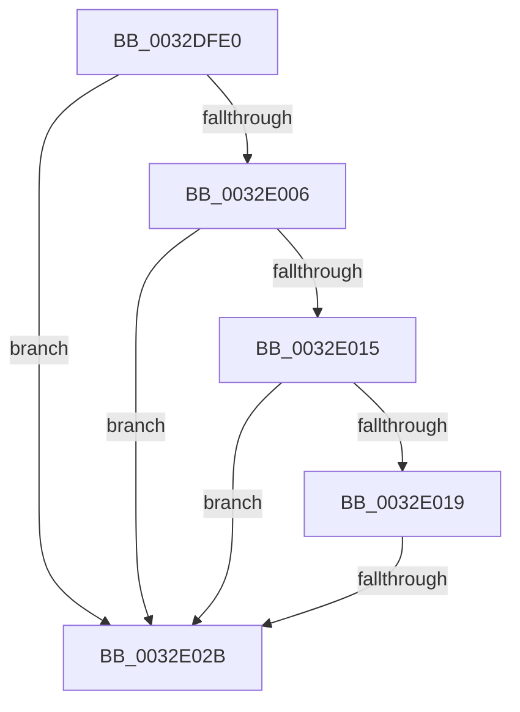

# MiCheckProtoAccess

- RVA: `0x0032DFE0`–`0x0032E02E` (길이 `78` bytes)
- VA: `0x000000014032DFE0`
- 실행 섹션: `.text`
- PDB 이름 있음: `예`; PDB Function 태그: `예`
- unwind 정보 RVA: `0x00076318`
- 디코드: `23`개 명령, `78/78` bytes 표시
- 미해석 바이트: `0` (있으면 어셈블리에 `.byte`로 보존)

> 이 문서는 커널 이미지의 기계어와 PDB 기호를 분석해 생성했습니다. 4번과 5번은 함수 원형과 자료형을 바이너리 사용 방식에서 추정한 C 해석이며 원본 소스 복구 결과는 아닙니다.

## 1. Dependencies

- 직접 호출 지점: **0**; 고유 호출 대상: **0**
- 직접 호출자로 확인된 함수: **2**
- RIP 상대 이미지 참조: **0**

### Outgoing calls
- 직접 디코드된 call 명령이 없습니다.

### Direct callers
- [sub_00320866](Unknown_function_00320866.md) at `0x00320B5D`
- [MiUserFault](MiUserFault_function_00329840.md) at `0x00329B5B`

### Static image references
- 디코드된 RIP-relative 메모리 참조가 없습니다.

## 2. Other-region calls and transfers

- 다른 실행 섹션으로 향하는 call: **0**
- call이 아닌 외부 분기/꼬리 이동: **1**
  - `0x0032E025` → [sub_0032E2BC](Unknown_function_0032E2BC.md) (`tail-transfer`)

## 3. Assembly (complete function range)

```asm
0032DFE0  48 89 6C 24 20                  mov qword ptr [rsp + 0x20], rbp
0032DFE5  57                              push rdi
0032DFE6  41 56                           push r14
0032DFE8  41 57                           push r15
0032DFEA  48 83 EC 20                     sub rsp, 0x20
0032DFEE  48 8B 01                        mov rax, qword ptr [rcx]
0032DFF1  4C 8B FA                        mov r15, rdx
0032DFF4  4C 8B F1                        mov r14, rcx
0032DFF7  48 B9 00 D0 BE 7D FB F6 FF FF   movabs rcx, 0xfffff6fb7dbed000
0032E001  4C 3B F1                        cmp r14, rcx
0032E004  72 25                           jb 0x14032e02b
0032E006  48 B9 F8 D7 BE 7D FB F6 FF FF   movabs rcx, 0xfffff6fb7dbed7f8
0032E010  4C 3B F1                        cmp r14, rcx
0032E013  77 16                           ja 0x14032e02b
0032E015  A8 01                           test al, 1
0032E017  74 12                           je 0x14032e02b
0032E019  A8 42                           test al, 0x42
0032E01B  0F 95 C2                        setne dl
0032E01E  A8 20                           test al, 0x20
0032E020  0F 95 C1                        setne cl
0032E023  84 D1                           test cl, dl
0032E025  0F 84 91 02 00 00               je 0x14032e2bc
0032E02B  48 8B E8                        mov rbp, rax
```

## 4. C-style interpretation (structured pseudocode)

```c
__int64 __fastcall MiCheckProtoAccess(__int64 a1, __int64 a2)
{
    __int64 v_rsp;
    unsigned __int64 v_stack_p20;

    v_stack_p20 = v_rbp;
    v_rsp = (v_rsp) - (32);
    if (a1 < a1) goto loc_0032E02B;
    if (a1 > a1) goto loc_0032E02B;
    if ((((unsigned __int8)(*(unsigned __int64 *)(a1))) & (1)) == 0) goto loc_0032E02B;
    a2 = ((((unsigned __int8)(*(unsigned __int64 *)(a1))) & (66)) != 0) ? 1 : 0;
    a1 = ((((unsigned __int8)(*(unsigned __int64 *)(a1))) & (32)) != 0) ? 1 : 0;
loc_0032E02B:
    return *(unsigned __int64 *)(a1);
}
```

## 5. (Beta) C Style

```c
int64_t MiCheckProtoAccess(void *Arg1, int64_t Arg2)
{
    uint8_t *arg1 = (uint8_t *)Arg1;

    int64_t local_rsp;
    uint64_t v_stack_p20;

    v_stack_p20 = local_rbp;
    local_rsp = (local_rsp) - (32);
    if (Arg1 < Arg1) goto loc_0032E02B;
    if (Arg1 > Arg1) goto loc_0032E02B;
    if ((((uint8_t)(*(uint64_t *)(arg1))) & (1)) == 0) goto loc_0032E02B;
    Arg2 = ((((uint8_t)(*(uint64_t *)(arg1))) & (66)) != 0) ? 1 : 0;
    Arg1 = ((((uint8_t)(*(uint64_t *)(arg1))) & (32)) != 0) ? 1 : 0;
loc_0032E02B:
    return *(uint64_t *)(arg1);
}
```

### 관측된 메모리 오프셋

구조체 형식이 확인되지 않은 접근은 인자 기준의 오프셋으로만 기록했습니다.

| 기준 인자 | 오프셋 표현 | 폭 (bit) | 접근 |
|---|---:|---:|---|
| `Arg1` | `+ 0x0` | `64` | `R` |

## 6. Execution-region graph

[열기: 2D/3D 그래프와 함수 탐색 컨트롤 패널](../../../control-panel.html?section=text&rva=0x0032DFE0&view=graph)

- 2D 그래프는 위에서 아래로 흐르고, 3D 그래프는 빈 공간을 드래그해 회전합니다. Shift+드래그는 이동, 휠은 확대·축소, 함수 노드 선택은 대상 보고서 이동입니다.

### Static fallback


