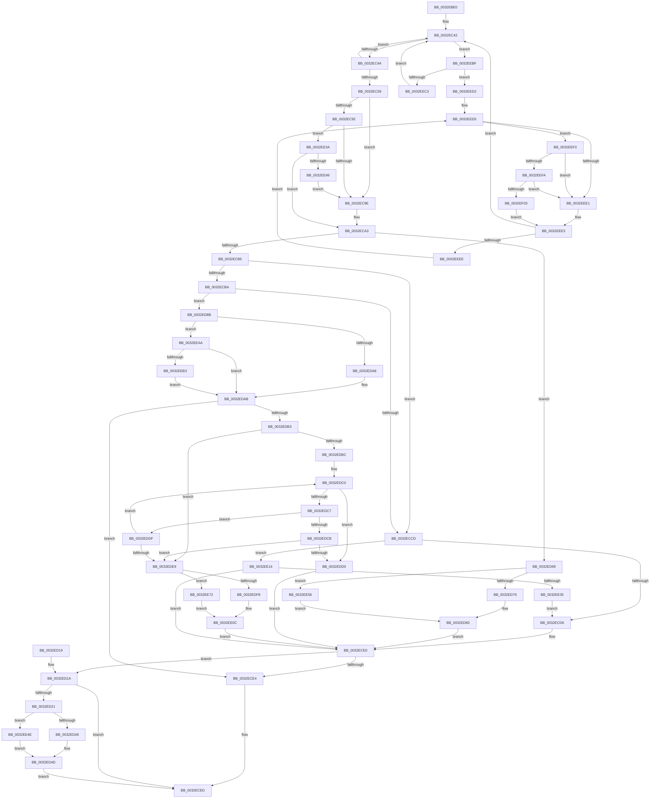

# MiCheckVadSequential

- RVA: `0x0032EBE0`–`0x0032EF0D` (길이 `813` bytes)
- VA: `0x000000014032EBE0`
- 실행 섹션: `.text`
- PDB 이름 있음: `예`; PDB Function 태그: `아니요`
- unwind 정보 RVA: `0x0007640C`
- 디코드: `218`개 명령, `813/813` bytes 표시
- 미해석 바이트: `0` (있으면 어셈블리에 `.byte`로 보존)

> 이 문서는 커널 이미지의 기계어와 PDB 기호를 분석해 생성했습니다. 4번과 5번은 함수 원형과 자료형을 바이너리 사용 방식에서 추정한 C 해석이며 원본 소스 복구 결과는 아닙니다.

## 1. Dependencies

- 직접 호출 지점: **2**; 고유 호출 대상: **2**
- 직접 호출자로 확인된 함수: **1**
- RIP 상대 이미지 참조: **2**

### Outgoing calls
- `0x0032EEFA` → [KiCheckVpBackingLongSpinWaitHypercall](../30/KiCheckVpBackingLongSpinWaitHypercall_function_0030F490.md) (function, `0x0030F490`)
- `0x0032EF06` → [HvlNotifyLongSpinWait](../30/HvlNotifyLongSpinWait_function_0030F460.md) (function, `0x0030F460`)

### Direct callers
- [sub_0032D782](Unknown_function_0032D782.md) at `0x0032DAC7`

### Static image references
- `0x0032EED8` → RVA `0x00FC52AC` (`ALMOSTRO`; reference)
- `0x0032EEF0` → RVA `0x00FC6AB8` (`ALMOSTRO`; read)

## 2. Other-region calls and transfers

- 다른 실행 섹션으로 향하는 call: **0**
- 별도 외부 분기/꼬리 이동을 확인하지 못했습니다.

## 3. Assembly (complete function range)

```asm
0032EBE0  48 89 5C 24 08                  mov qword ptr [rsp + 8], rbx
0032EBE5  48 89 6C 24 10                  mov qword ptr [rsp + 0x10], rbp
0032EBEA  48 89 74 24 18                  mov qword ptr [rsp + 0x18], rsi
0032EBEF  57                              push rdi
0032EBF0  41 54                           push r12
0032EBF2  41 55                           push r13
0032EBF4  41 56                           push r14
0032EBF6  41 57                           push r15
0032EBF8  48 83 EC 20                     sub rsp, 0x20
0032EBFC  48 8B 69 10                     mov rbp, qword ptr [rcx + 0x10]
0032EC00  48 B8 F8 FF FF FF 7F 00 00 00   movabs rax, 0x7ffffffff8
0032EC0A  48 8B F5                        mov rsi, rbp
0032EC0D  4C 8B F1                        mov r14, rcx
0032EC10  48 C1 EE 09                     shr rsi, 9
0032EC14  45 33 FF                        xor r15d, r15d
0032EC17  48 23 F0                        and rsi, rax
0032EC1A  48 B8 00 00 00 00 80 F6 FF FF   movabs rax, 0xfffff68000000000
0032EC24  48 8B 79 40                     mov rdi, qword ptr [rcx + 0x40]
0032EC28  48 03 F0                        add rsi, rax
0032EC2B  48 8B DD                        mov rbx, rbp
0032EC2E  49 BD 00 F0 FF FF FF FF FF 7F   movabs r13, 0x7ffffffffffff000
0032EC38  49 23 DD                        and rbx, r13
0032EC3B  48 83 CB 01                     or rbx, 1
0032EC3F  8B 47 30                        mov eax, dword ptr [rdi + 0x30]
0032EC42  A8 01                           test al, 1
0032EC44  0F 85 75 02 00 00               jne 0x14032eebf
0032EC4A  8B C8                           mov ecx, eax
0032EC4C  83 E1 FD                        and ecx, 0xfffffffd
0032EC4F  83 C9 01                        or ecx, 1
0032EC52  F0 0F B1 4F 30                  lock cmpxchg dword ptr [rdi + 0x30], ecx
0032EC57  75 E9                           jne 0x14032ec42
0032EC59  48 8B 4F 78                     mov rcx, qword ptr [rdi + 0x78]
0032EC5D  BA 80 00 00 00                  mov edx, 0x80
0032EC62  45 8B 0E                        mov r9d, dword ptr [r14]
0032EC65  4C 8B E1                        mov r12, rcx
0032EC68  44 0B CA                        or r9d, edx
0032EC6B  41 81 E4 FF 0F 00 00            and r12d, 0xfff
0032EC72  45 89 0E                        mov dword ptr [r14], r9d
0032EC75  4C 8B D9                        mov r11, rcx
0032EC78  48 8B 47 48                     mov rax, qword ptr [rdi + 0x48]
0032EC7C  4D 23 DD                        and r11, r13
0032EC7F  45 8B C4                        mov r8d, r12d
0032EC82  49 C1 E0 0C                     shl r8, 0xc
0032EC86  4D 03 C3                        add r8, r11
0032EC89  4C 8B 10                        mov r10, qword ptr [rax]
0032EC8C  4D 39 7A 40                     cmp qword ptr [r10 + 0x40], r15
0032EC90  74 0C                           je 0x14032ec9e
0032EC92  41 8B 42 38                     mov eax, dword ptr [r10 + 0x38]
0032EC96  A8 20                           test al, 0x20
0032EC98  0F 84 9C 01 00 00               je 0x14032ee3a
0032EC9E  BA 08 00 00 00                  mov edx, 8
0032ECA3  48 8B C5                        mov rax, rbp
0032ECA6  48 25 00 F0 FF FF               and rax, 0xfffffffffffff000
0032ECAC  49 3B C0                        cmp rax, r8
0032ECAF  0F 84 B4 00 00 00               je 0x14032ed69
0032ECB5  49 3B E8                        cmp rbp, r8
0032ECB8  76 13                           jbe 0x14032eccd
0032ECBA  4C 8B D5                        mov r10, rbp
0032ECBD  4D 2B D0                        sub r10, r8
0032ECC0  49 C1 EA 0C                     shr r10, 0xc
0032ECC4  4C 3B D2                        cmp r10, rdx
0032ECC7  0F 82 BE 00 00 00               jb 0x14032ed8b
0032ECCD  4D 85 C0                        test r8, r8
0032ECD0  0F 84 3E 01 00 00               je 0x14032ee14
0032ECD6  41 8B D1                        mov edx, r9d
0032ECD9  0F BA F2 07                     btr edx, 7
0032ECDD  41 89 16                        mov dword ptr [r14], edx
0032ECE0  84 D2                           test dl, dl
0032ECE2  78 36                           js 0x14032ed1a
0032ECE4  8B 47 40                        mov eax, dword ptr [rdi + 0x40]
0032ECE7  83 E0 FD                        and eax, 0xfffffffd
0032ECEA  89 47 40                        mov dword ptr [rdi + 0x40], eax
0032ECED  48 89 5F 78                     mov qword ptr [rdi + 0x78], rbx
0032ECF1  F0 81 67 30 FC FF FF 7F         lock and dword ptr [rdi + 0x30], 0x7ffffffc
0032ECF9  48 8B 5C 24 50                  mov rbx, qword ptr [rsp + 0x50]
0032ECFE  41 8B C7                        mov eax, r15d
0032ED01  48 8B 6C 24 58                  mov rbp, qword ptr [rsp + 0x58]
0032ED06  48 8B 74 24 60                  mov rsi, qword ptr [rsp + 0x60]
0032ED0B  48 83 C4 20                     add rsp, 0x20
0032ED0F  41 5F                           pop r15
0032ED11  41 5E                           pop r14
0032ED13  41 5D                           pop r13
0032ED15  41 5C                           pop r12
0032ED17  5F                              pop rdi
0032ED18  C3                              ret
0032ED19  CC                              int3
0032ED1A  8B 47 40                        mov eax, dword ptr [rdi + 0x40]
0032ED1D  A8 02                           test al, 2
0032ED1F  74 CC                           je 0x14032eced
0032ED21  8B 47 18                        mov eax, dword ptr [rdi + 0x18]
0032ED24  0F B6 4F 20                     movzx ecx, byte ptr [rdi + 0x20]
0032ED28  48 C1 E1 20                     shl rcx, 0x20
0032ED2C  48 0B C8                        or rcx, rax
0032ED2F  48 8B C5                        mov rax, rbp
0032ED32  48 C1 E8 0C                     shr rax, 0xc
0032ED36  48 2B C1                        sub rax, rcx
0032ED39  48 C1 E8 08                     shr rax, 8
0032ED3D  4D 85 C0                        test r8, r8
0032ED40  0F 84 08 01 00 00               je 0x14032ee4e
0032ED46  49 81 E8 00 10 00 00            sub r8, 0x1000
0032ED4D  49 C1 E8 0C                     shr r8, 0xc
0032ED51  4C 2B C1                        sub r8, rcx
0032ED54  B9 20 02 00 C0                  mov ecx, 0xc0000220
0032ED59  49 C1 E8 08                     shr r8, 8
0032ED5D  49 FF C0                        inc r8
0032ED60  4C 3B C0                        cmp r8, rax
0032ED63  44 0F 44 F9                     cmove r15d, ecx
0032ED67  EB 84                           jmp 0x14032eced
0032ED69  49 81 FC FF 0F 00 00            cmp r12, 0xfff
0032ED70  0F 84 E0 00 00 00               je 0x14032ee56
0032ED76  48 8D 59 01                     lea rbx, [rcx + 1]
0032ED7A  81 E3 FF 0F 00 00               and ebx, 0xfff
0032ED80  49 0B DB                        or rbx, r11
0032ED83  41 8B D1                        mov edx, r9d
0032ED86  E9 55 FF FF FF                  jmp 0x14032ece0
0032ED8B  44 8B DE                        mov r11d, esi
0032ED8E  41 8B D1                        mov edx, r9d
0032ED91  41 C1 EB 03                     shr r11d, 3
0032ED95  41 81 E3 FF 01 00 00            and r11d, 0x1ff
0032ED9C  41 8B C3                        mov eax, r11d
0032ED9F  49 3B C2                        cmp rax, r10
0032EDA2  0F 86 02 01 00 00               jbe 0x14032eeaa
0032EDA8  45 8B DA                        mov r11d, r10d
0032EDAB  84 D2                           test dl, dl
0032EDAD  0F 89 31 FF FF FF               jns 0x14032ece4
0032EDB3  48 83 C6 F8                     add rsi, -8
0032EDB7  45 85 DB                        test r11d, r11d
0032EDBA  74 2D                           je 0x14032ede9
0032EDBC  0F 1F 40 00                     nop dword ptr [rax]
0032EDC0  48 8B 06                        mov rax, qword ptr [rsi]
0032EDC3  A8 01                           test al, 1
0032EDC5  74 09                           je 0x14032edd0
0032EDC7  A8 20                           test al, 0x20
0032EDC9  75 14                           jne 0x14032eddf
0032EDCB  45 85 DB                        test r11d, r11d
0032EDCE  74 19                           je 0x14032ede9
0032EDD0  41 81 26 7F FF FF FF            and dword ptr [r14], 0xffffff7f
0032EDD7  41 8B 16                        mov edx, dword ptr [r14]
0032EDDA  E9 01 FF FF FF                  jmp 0x14032ece0
0032EDDF  48 83 EE 08                     sub rsi, 8
0032EDE3  41 83 C3 FF                     add r11d, -1
0032EDE7  75 D7                           jne 0x14032edc0
0032EDE9  41 FF C2                        inc r10d
0032EDEC  4B 8D 04 22                     lea rax, [r10 + r12]
0032EDF0  48 3D FF 0F 00 00               cmp rax, 0xfff
0032EDF6  77 7A                           ja 0x14032ee72
0032EDF8  49 8D 04 0A                     lea rax, [r10 + rcx]
0032EDFC  48 8B D9                        mov rbx, rcx
0032EDFF  48 33 D8                        xor rbx, rax
0032EE02  48 81 E3 00 F0 FF FF            and rbx, 0xfffffffffffff000
0032EE09  48 33 D8                        xor rbx, rax
0032EE0C  41 8B 16                        mov edx, dword ptr [r14]
0032EE0F  E9 CC FE FF FF                  jmp 0x14032ece0
0032EE14  8B 47 18                        mov eax, dword ptr [rdi + 0x18]
0032EE17  41 8B D1                        mov edx, r9d
0032EE1A  0F B6 4F 20                     movzx ecx, byte ptr [rdi + 0x20]
0032EE1E  48 C1 E1 20                     shl rcx, 0x20
0032EE22  48 0B C8                        or rcx, rax
0032EE25  48 8B C5                        mov rax, rbp
0032EE28  48 C1 E8 0C                     shr rax, 0xc
0032EE2C  48 3B C1                        cmp rax, rcx
0032EE2F  0F 84 AB FE FF FF               je 0x14032ece0
0032EE35  E9 9C FE FF FF                  jmp 0x14032ecd6
0032EE3A  41 0F B6 42 3E                  movzx eax, byte ptr [r10 + 0x3e]
0032EE3F  24 0C                           and al, 0xc
0032EE41  3C 04                           cmp al, 4
0032EE43  0F 84 5A FE FF FF               je 0x14032eca3
0032EE49  E9 50 FE FF FF                  jmp 0x14032ec9e
0032EE4E  4C 8B C5                        mov r8, rbp
0032EE51  E9 F7 FE FF FF                  jmp 0x14032ed4d
0032EE56  48 8B D9                        mov rbx, rcx
0032EE59  48 81 E3 00 F0 FF FF            and rbx, 0xfffffffffffff000
0032EE60  48 81 C3 00 10 00 00            add rbx, 0x1000
0032EE67  49 23 DD                        and rbx, r13
0032EE6A  49 0B DC                        or rbx, r12
0032EE6D  E9 11 FF FF FF                  jmp 0x14032ed83
0032EE72  8B C1                           mov eax, ecx
0032EE74  25 FF 0F 00 00                  and eax, 0xfff
0032EE79  05 01 F0 FF FF                  add eax, 0xfffff001
0032EE7E  41 03 C2                        add eax, r10d
0032EE81  48 C1 E0 0C                     shl rax, 0xc
0032EE85  48 03 C1                        add rax, rcx
0032EE88  48 8B D8                        mov rbx, rax
0032EE8B  48 33 D9                        xor rbx, rcx
0032EE8E  48 B9 FF 0F 00 00 00 00 00 80   movabs rcx, 0x8000000000000fff
0032EE98  48 23 D9                        and rbx, rcx
0032EE9B  48 33 D8                        xor rbx, rax
0032EE9E  48 81 CB FF 0F 00 00            or rbx, 0xfff
0032EEA5  E9 62 FF FF FF                  jmp 0x14032ee0c
0032EEAA  45 85 DB                        test r11d, r11d
0032EEAD  0F 84 F8 FE FF FF               je 0x14032edab
0032EEB3  0F BA F2 07                     btr edx, 7
0032EEB7  41 89 16                        mov dword ptr [r14], edx
0032EEBA  E9 EC FE FF FF                  jmp 0x14032edab
0032EEBF  A8 02                           test al, 2
0032EEC1  75 0F                           jne 0x14032eed2
0032EEC3  8B C8                           mov ecx, eax
0032EEC5  83 C9 02                        or ecx, 2
0032EEC8  F0 0F B1 4F 30                  lock cmpxchg dword ptr [rdi + 0x30], ecx
0032EECD  E9 70 FD FF FF                  jmp 0x14032ec42
0032EED2  45 8B E7                        mov r12d, r15d
0032EED5  41 FF C4                        inc r12d
0032EED8  44 85 25 CD 63 C9 00            test dword ptr [rip + 0xc963cd], r12d
0032EEDF  74 0F                           je 0x14032eef0
0032EEE1  F3 90                           pause
0032EEE3  8B 47 30                        mov eax, dword ptr [rdi + 0x30]
0032EEE6  A8 01                           test al, 1
0032EEE8  0F 84 54 FD FF FF               je 0x14032ec42
0032EEEE  EB E5                           jmp 0x14032eed5
0032EEF0  8B 05 C2 7B C9 00               mov eax, dword ptr [rip + 0xc97bc2]
0032EEF6  A8 40                           test al, 0x40
0032EEF8  74 E7                           je 0x14032eee1
0032EEFA  E8 91 05 FE FF                  call 0x14030f490
0032EEFF  84 C0                           test al, al
0032EF01  74 DE                           je 0x14032eee1
0032EF03  41 8B CC                        mov ecx, r12d
0032EF06  E8 55 05 FE FF                  call 0x14030f460
0032EF0B  EB D6                           jmp 0x14032eee3
```

## 4. C-style interpretation (structured pseudocode)

```c
__int64 __fastcall MiCheckVadSequential(__int64 a1)
{
    __int64 result;
    __int64 v_r10;
    __int64 v_r11;
    __int64 v_r12;
    __int64 v_r15;
    __int64 v_rbx;
    __int64 v_rsi;
    __int64 v_rsp;
    unsigned __int64 v_stack_p10;
    unsigned __int64 v_stack_p18;
    unsigned __int64 v_stack_p8;

    v_stack_p8 = v_rbx;
    v_stack_p10 = v_rbp;
    v_stack_p18 = v_rsi;
    v_rsp = (v_rsp) - (32);
    v_rsi = (*(unsigned __int64 *)(a1 + 16)) >> (9);
    v_r15 = 0;
    v_rsi = (v_rsi) & (result);
    v_rsi = (v_rsi) + (result);
    v_rbx = (*(unsigned __int64 *)(a1 + 16)) & (v_r13);
    v_rbx = (v_rbx) | (1);
loc_0032EC42:
    if ((((unsigned __int8)((unsigned int)(*(unsigned int *)(*(unsigned __int64 *)(a1 + 64) + 48)))) & (1)) != 0) goto loc_0032EEBF;
    a1 = (unsigned int)(((unsigned int)((unsigned int)((unsigned int)(*(unsigned int *)(*(unsigned __int64 *)(a1 + 64) + 48))))) & (0xFFFFFFFDULL));
    a1 = (unsigned int)((a1) | (1));
    if (condition_is_not_equal) goto loc_0032EC42;
    a4 = (unsigned int)(((unsigned int)(*(unsigned int *)(a1))) | (128));
    v_r12 = (unsigned int)((*(unsigned __int64 *)(*(unsigned __int64 *)(a1 + 64) + 120)) & (0xFFFULL));
    *(unsigned int *)(a1) = (unsigned int)(a4);
    v_r11 = (*(unsigned __int64 *)(*(unsigned __int64 *)(a1 + 64) + 120)) & (v_r13);
    a3 = ((unsigned int)((unsigned int)(v_r12))) << (12);
    a3 = (a3) + (v_r11);
    if ((*(unsigned __int64 *)(*(unsigned __int64 *)(*(unsigned __int64 *)(*(unsigned __int64 *)(a1 + 64) + 72)) + 64)) == 0) goto loc_0032EC9E;
    if ((((unsigned __int8)((unsigned int)(*(unsigned int *)(*(unsigned __int64 *)(*(unsigned __int64 *)(*(unsigned __int64 *)(a1 + 64) + 72)) + 56)))) & (32)) == 0) goto loc_0032EE3A;
loc_0032EC9E:
loc_0032ECA3:
    result = (*(unsigned __int64 *)(a1 + 16)) & (0xFFFFFFFFFFFFF000ULL);
    if (result == a3) goto loc_0032ED69;
    if ((*(unsigned __int64 *)(a1 + 16)) <= a3) goto loc_0032ECCD;
    v_r10 = (*(unsigned __int64 *)(a1 + 16)) - (a3);
    v_r10 = (v_r10) >> (12);
    if (v_r10 < 8) goto loc_0032ED8B;
loc_0032ECCD:
    if (a3 == 0) goto loc_0032EE14;
loc_0032ECD6:
    *(unsigned int *)(a1) = (unsigned int)((unsigned int)((unsigned int)(a4)));
loc_0032ECE0:
    if (sign_flag) goto loc_0032ED1A;
loc_0032ECE4:
    result = (unsigned int)(((unsigned int)(*(unsigned int *)(*(unsigned __int64 *)(a1 + 64) + 64))) & (0xFFFFFFFDULL));
    *(unsigned int *)(*(unsigned __int64 *)(a1 + 64) + 64) = (unsigned int)(result);
loc_0032ECED:
    *(unsigned __int64 *)(*(unsigned __int64 *)(a1 + 64) + 120) = v_rbx;
    v_rsp = (v_rsp) + (32);
    return 0;
loc_0032ED1A:
    if ((((unsigned __int8)((unsigned int)(*(unsigned int *)(*(unsigned __int64 *)(a1 + 64) + 64)))) & (2)) == 0) goto loc_0032ECED;
    a1 = (*(unsigned __int8 *)(*(unsigned __int64 *)(a1 + 64) + 32)) << (32);
    a1 = (a1) | ((unsigned int)(*(unsigned int *)(*(unsigned __int64 *)(a1 + 64) + 24)));
    result = (v_stack_p10) >> (12);
    result = (result) - (a1);
    result = (result) >> (8);
    if (a3 == 0) goto loc_0032EE4E;
    a3 = (a3) - (0x1000ULL);
loc_0032ED4D:
    a3 = (a3) >> (12);
    a3 = (a3) - (a1);
    a3 = (a3) >> (8);
    a3 = (a3) + 1;
    if (a3 == result) { v_r15 = (unsigned int)((unsigned int)(0xC0000220ULL)); }
    goto loc_0032ECED;
loc_0032ED69:
    if (v_r12 == 0xFFFULL) goto loc_0032EE56;
    v_rbx = (unsigned int)(((unsigned int)(0xC0000220ULL) + 1) & (0xFFFULL));
    v_rbx = (v_rbx) | (v_r11);
loc_0032ED83:
    goto loc_0032ECE0;
loc_0032ED8B:
    v_r11 = (unsigned int)(((unsigned int)((unsigned int)(v_stack_p18))) >> (3));
    v_r11 = (unsigned int)((v_r11) & (511));
    if (((unsigned int)((unsigned int)(v_r11))) <= v_r10) goto loc_0032EEAA;
loc_0032EDAB:
    if (!sign_flag) goto loc_0032ECE4;
    v_rsi = (v_stack_p18) + (-8);
    if ((unsigned int)((unsigned int)((unsigned int)(v_r10))) == 0) goto loc_0032EDE9;
loc_0032EDC0:
    if ((((unsigned __int8)(*(unsigned __int64 *)(v_rsi))) & (1)) == 0) goto loc_0032EDD0;
    if ((((unsigned __int8)(*(unsigned __int64 *)(v_rsi))) & (32)) != 0) goto loc_0032EDDF;
    if ((unsigned int)((unsigned int)((unsigned int)(v_r10))) == 0) goto loc_0032EDE9;
loc_0032EDD0:
    goto loc_0032ECE0;
loc_0032EDDF:
    v_rsi = (v_rsi) - (8);
    v_r11 = (unsigned int)(((unsigned int)((unsigned int)(v_r10))) + (-1));
    if (condition_is_not_equal) goto loc_0032EDC0;
loc_0032EDE9:
    v_r10 = (unsigned int)((v_r10) + 1);
    if ((v_r10 + v_r12 * 1) > 0xFFFULL) goto loc_0032EE72;
    v_rbx = ((unsigned int)(0xC0000220ULL)) ^ (v_r10 + (unsigned int)(0xC0000220ULL) * 1);
    v_rbx = (v_rbx) & (0xFFFFFFFFFFFFF000ULL);
    v_rbx = (v_rbx) ^ (v_r10 + (unsigned int)(0xC0000220ULL) * 1);
loc_0032EE0C:
    goto loc_0032ECE0;
loc_0032EE14:
    a1 = (*(unsigned __int8 *)(*(unsigned __int64 *)(a1 + 64) + 32)) << (32);
    a1 = (a1) | ((unsigned int)(*(unsigned int *)(*(unsigned __int64 *)(a1 + 64) + 24)));
    result = (v_stack_p10) >> (12);
    if (result == a1) goto loc_0032ECE0;
    goto loc_0032ECD6;
loc_0032EE3A:
    result = (unsigned __int8)((*(unsigned __int8 *)(v_r10 + 62)) & (12));
    if (((unsigned __int8)(result)) == 4) goto loc_0032ECA3;
    goto loc_0032EC9E;
loc_0032EE4E:
    goto loc_0032ED4D;
loc_0032EE56:
    v_rbx = (a1) & (0xFFFFFFFFFFFFF000ULL);
    v_rbx = (v_rbx) + (0x1000ULL);
    v_rbx = (v_rbx) & (v_r13);
    v_rbx = (v_rbx) | (v_r12);
    goto loc_0032ED83;
loc_0032EE72:
    result = (unsigned int)(((unsigned int)((unsigned int)(a1))) & (0xFFFULL));
    result = (unsigned int)((result) + (0xFFFFF001ULL));
    result = (unsigned int)((result) + ((unsigned int)(v_r10)));
    result = (result) << (12);
    result = (result) + (a1);
    v_rbx = (result) ^ (a1);
    v_rbx = (v_rbx) & (a1);
    v_rbx = (v_rbx) ^ (result);
    v_rbx = (v_rbx) | (0xFFFULL);
    goto loc_0032EE0C;
loc_0032EEAA:
    if ((unsigned int)(v_r11) == 0) goto loc_0032EDAB;
    *(unsigned int *)(a1) = (unsigned int)((unsigned int)((unsigned int)(a4)));
    goto loc_0032EDAB;
loc_0032EEBF:
    if ((((unsigned __int8)(result)) & (2)) != 0) goto loc_0032EED2;
    a1 = (unsigned int)(((unsigned int)((unsigned int)(result))) | (2));
    goto loc_0032EC42;
loc_0032EED2:
loc_0032EED5:
    v_r12 = (unsigned int)(((unsigned int)((unsigned int)(v_r15))) + 1);
    if (((*(unsigned int *)(v_rip + 13198285)) & ((unsigned int)(v_r12))) == 0) goto loc_0032EEF0;
loc_0032EEE1:
loc_0032EEE3:
    if ((((unsigned __int8)((unsigned int)(*(unsigned int *)(*(unsigned __int64 *)(a1 + 64) + 48)))) & (1)) == 0) goto loc_0032EC42;
    goto loc_0032EED5;
loc_0032EEF0:
    if ((((unsigned __int8)((unsigned int)(*(unsigned int *)(v_rip + 13204418)))) & (64)) == 0) goto loc_0032EEE1;
    result = KiCheckVpBackingLongSpinWaitHypercall(a1, (unsigned int)((unsigned int)(a4)), v_stack_p10, a4);
    if ((unsigned __int8)(result) == 0) goto loc_0032EEE1;
    result = HvlNotifyLongSpinWait((unsigned int)((unsigned int)(v_r12)), (unsigned int)((unsigned int)(a4)), v_stack_p10, a4);
    goto loc_0032EEE3;
}
```

## 5. (Beta) C Style

```c
int64_t MiCheckVadSequential(void *Arg1)
{
    uint8_t *arg1 = (uint8_t *)Arg1;

    int64_t result;
    int64_t local_r10;
    int64_t local_r11;
    int64_t local_r12;
    int64_t local_r15;
    int64_t local_rbx;
    int64_t local_rsi;
    int64_t local_rsp;
    uint64_t v_stack_p10;
    uint64_t v_stack_p18;
    uint64_t v_stack_p8;

    v_stack_p8 = local_rbx;
    v_stack_p10 = local_rbp;
    v_stack_p18 = local_rsi;
    local_rsp = (local_rsp) - (32);
    local_rsi = (*(uint64_t *)(arg1 + 0x10)) >> (9);
    local_r15 = 0;
    local_rsi = (local_rsi) & (result);
    local_rsi = (local_rsi) + (result);
    local_rbx = (*(uint64_t *)(arg1 + 0x10)) & (local_r13);
    local_rbx = (local_rbx) | (1);
loc_0032EC42:
    if ((((uint8_t)((uint32_t)(*(uint32_t *)(*(uint64_t *)(arg1 + 0x40) + 0x30)))) & (1)) != 0) goto loc_0032EEBF;
    Arg1 = (uint32_t)(((uint32_t)((uint32_t)((uint32_t)(*(uint32_t *)(*(uint64_t *)(arg1 + 0x40) + 0x30))))) & (0xFFFFFFFDULL));
    Arg1 = (uint32_t)((Arg1) | (1));
    if (condition_is_not_equal) goto loc_0032EC42;
    a4 = (uint32_t)(((uint32_t)(*(uint32_t *)(arg1))) | (128));
    local_r12 = (uint32_t)((*(uint64_t *)(*(uint64_t *)(arg1 + 0x40) + 0x78)) & (0xFFFULL));
    *(uint32_t *)(arg1) = (uint32_t)(a4);
    local_r11 = (*(uint64_t *)(*(uint64_t *)(arg1 + 0x40) + 0x78)) & (local_r13);
    a3 = ((uint32_t)((uint32_t)(local_r12))) << (12);
    a3 = (a3) + (local_r11);
    if ((*(uint64_t *)(*(uint64_t *)(*(uint64_t *)(*(uint64_t *)(arg1 + 0x40) + 0x48)) + 0x40)) == 0) goto loc_0032EC9E;
    if ((((uint8_t)((uint32_t)(*(uint32_t *)(*(uint64_t *)(*(uint64_t *)(*(uint64_t *)(arg1 + 0x40) + 0x48)) + 0x38)))) & (32)) == 0) goto loc_0032EE3A;
loc_0032EC9E:
loc_0032ECA3:
    result = (*(uint64_t *)(arg1 + 0x10)) & (0xFFFFFFFFFFFFF000ULL);
    if (result == a3) goto loc_0032ED69;
    if ((*(uint64_t *)(arg1 + 0x10)) <= a3) goto loc_0032ECCD;
    local_r10 = (*(uint64_t *)(arg1 + 0x10)) - (a3);
    local_r10 = (local_r10) >> (12);
    if (local_r10 < 8) goto loc_0032ED8B;
loc_0032ECCD:
    if (a3 == 0) goto loc_0032EE14;
loc_0032ECD6:
    *(uint32_t *)(arg1) = (uint32_t)((uint32_t)((uint32_t)(a4)));
loc_0032ECE0:
    if (sign_flag) goto loc_0032ED1A;
loc_0032ECE4:
    result = (uint32_t)(((uint32_t)(*(uint32_t *)(*(uint64_t *)(arg1 + 0x40) + 0x40))) & (0xFFFFFFFDULL));
    *(uint32_t *)(*(uint64_t *)(arg1 + 0x40) + 0x40) = (uint32_t)(result);
loc_0032ECED:
    *(uint64_t *)(*(uint64_t *)(arg1 + 0x40) + 0x78) = local_rbx;
    local_rsp = (local_rsp) + (32);
    return 0;
loc_0032ED1A:
    if ((((uint8_t)((uint32_t)(*(uint32_t *)(*(uint64_t *)(arg1 + 0x40) + 0x40)))) & (2)) == 0) goto loc_0032ECED;
    Arg1 = (*(uint8_t *)(*(uint64_t *)(arg1 + 0x40) + 0x20)) << (32);
    Arg1 = (Arg1) | ((uint32_t)(*(uint32_t *)(*(uint64_t *)(arg1 + 0x40) + 0x18)));
    result = (v_stack_p10) >> (12);
    result = (result) - (Arg1);
    result = (result) >> (8);
    if (a3 == 0) goto loc_0032EE4E;
    a3 = (a3) - (0x1000ULL);
loc_0032ED4D:
    a3 = (a3) >> (12);
    a3 = (a3) - (Arg1);
    a3 = (a3) >> (8);
    a3 = (a3) + 1;
    if (a3 == result) { local_r15 = (uint32_t)((uint32_t)(0xC0000220ULL)); }
    goto loc_0032ECED;
loc_0032ED69:
    if (local_r12 == 0xFFFULL) goto loc_0032EE56;
    local_rbx = (uint32_t)(((uint32_t)(0xC0000220ULL) + 1) & (0xFFFULL));
    local_rbx = (local_rbx) | (local_r11);
loc_0032ED83:
    goto loc_0032ECE0;
loc_0032ED8B:
    local_r11 = (uint32_t)(((uint32_t)((uint32_t)(v_stack_p18))) >> (3));
    local_r11 = (uint32_t)((local_r11) & (511));
    if (((uint32_t)((uint32_t)(local_r11))) <= local_r10) goto loc_0032EEAA;
loc_0032EDAB:
    if (!sign_flag) goto loc_0032ECE4;
    local_rsi = (v_stack_p18) + (-8);
    if ((uint32_t)((uint32_t)((uint32_t)(local_r10))) == 0) goto loc_0032EDE9;
loc_0032EDC0:
    if ((((uint8_t)(*(uint64_t *)(local_rsi))) & (1)) == 0) goto loc_0032EDD0;
    if ((((uint8_t)(*(uint64_t *)(local_rsi))) & (32)) != 0) goto loc_0032EDDF;
    if ((uint32_t)((uint32_t)((uint32_t)(local_r10))) == 0) goto loc_0032EDE9;
loc_0032EDD0:
    goto loc_0032ECE0;
loc_0032EDDF:
    local_rsi = (local_rsi) - (8);
    local_r11 = (uint32_t)(((uint32_t)((uint32_t)(local_r10))) + (-1));
    if (condition_is_not_equal) goto loc_0032EDC0;
loc_0032EDE9:
    local_r10 = (uint32_t)((local_r10) + 1);
    if ((local_r10 + local_r12 * 1) > 0xFFFULL) goto loc_0032EE72;
    local_rbx = ((uint32_t)(0xC0000220ULL)) ^ (local_r10 + (uint32_t)(0xC0000220ULL) * 1);
    local_rbx = (local_rbx) & (0xFFFFFFFFFFFFF000ULL);
    local_rbx = (local_rbx) ^ (local_r10 + (uint32_t)(0xC0000220ULL) * 1);
loc_0032EE0C:
    goto loc_0032ECE0;
loc_0032EE14:
    Arg1 = (*(uint8_t *)(*(uint64_t *)(arg1 + 0x40) + 0x20)) << (32);
    Arg1 = (Arg1) | ((uint32_t)(*(uint32_t *)(*(uint64_t *)(arg1 + 0x40) + 0x18)));
    result = (v_stack_p10) >> (12);
    if (result == Arg1) goto loc_0032ECE0;
    goto loc_0032ECD6;
loc_0032EE3A:
    result = (uint8_t)((*(uint8_t *)(local_r10 + 0x3E)) & (12));
    if (((uint8_t)(result)) == 4) goto loc_0032ECA3;
    goto loc_0032EC9E;
loc_0032EE4E:
    goto loc_0032ED4D;
loc_0032EE56:
    local_rbx = (Arg1) & (0xFFFFFFFFFFFFF000ULL);
    local_rbx = (local_rbx) + (0x1000ULL);
    local_rbx = (local_rbx) & (local_r13);
    local_rbx = (local_rbx) | (local_r12);
    goto loc_0032ED83;
loc_0032EE72:
    result = (uint32_t)(((uint32_t)((uint32_t)(Arg1))) & (0xFFFULL));
    result = (uint32_t)((result) + (0xFFFFF001ULL));
    result = (uint32_t)((result) + ((uint32_t)(local_r10)));
    result = (result) << (12);
    result = (result) + (Arg1);
    local_rbx = (result) ^ (Arg1);
    local_rbx = (local_rbx) & (Arg1);
    local_rbx = (local_rbx) ^ (result);
    local_rbx = (local_rbx) | (0xFFFULL);
    goto loc_0032EE0C;
loc_0032EEAA:
    if ((uint32_t)(local_r11) == 0) goto loc_0032EDAB;
    *(uint32_t *)(arg1) = (uint32_t)((uint32_t)((uint32_t)(a4)));
    goto loc_0032EDAB;
loc_0032EEBF:
    if ((((uint8_t)(result)) & (2)) != 0) goto loc_0032EED2;
    Arg1 = (uint32_t)(((uint32_t)((uint32_t)(result))) | (2));
    goto loc_0032EC42;
loc_0032EED2:
loc_0032EED5:
    local_r12 = (uint32_t)(((uint32_t)((uint32_t)(local_r15))) + 1);
    if (((*(uint32_t *)(v_rip + 0xC963CD)) & ((uint32_t)(local_r12))) == 0) goto loc_0032EEF0;
loc_0032EEE1:
loc_0032EEE3:
    if ((((uint8_t)((uint32_t)(*(uint32_t *)(*(uint64_t *)(arg1 + 0x40) + 0x30)))) & (1)) == 0) goto loc_0032EC42;
    goto loc_0032EED5;
loc_0032EEF0:
    if ((((uint8_t)((uint32_t)(*(uint32_t *)(v_rip + 0xC97BC2)))) & (64)) == 0) goto loc_0032EEE1;
    result = KiCheckVpBackingLongSpinWaitHypercall(Arg1, (uint32_t)((uint32_t)(a4)), v_stack_p10, a4);
    if ((uint8_t)(result) == 0) goto loc_0032EEE1;
    result = HvlNotifyLongSpinWait((uint32_t)((uint32_t)(local_r12)), (uint32_t)((uint32_t)(a4)), v_stack_p10, a4);
    goto loc_0032EEE3;
}
```

### 관측된 메모리 오프셋

구조체 형식이 확인되지 않은 접근은 인자 기준의 오프셋으로만 기록했습니다.

| 기준 인자 | 오프셋 표현 | 폭 (bit) | 접근 |
|---|---:|---:|---|
| `Arg1` | `+ 0x0` | `32` | `R` |
| `Arg1` | `+ 0x0` | `32` | `R/W` |
| `Arg1` | `+ 0x0` | `32` | `W` |
| `Arg1` | `+ 0x10` | `64` | `R` |
| `Arg1` | `+ 0x40` | `64` | `R` |

## 6. Execution-region graph

[열기: 2D/3D 그래프와 함수 탐색 컨트롤 패널](../../../control-panel.html?section=text&rva=0x0032EBE0&view=graph)

- 2D 그래프는 위에서 아래로 흐르고, 3D 그래프는 빈 공간을 드래그해 회전합니다. Shift+드래그는 이동, 휠은 확대·축소, 함수 노드 선택은 대상 보고서 이동입니다.

### Static fallback


