# MiCleanupLazyStampedPageTable

- RVA: `0x0032A43C`–`0x0032A63C` (길이 `512` bytes)
- VA: `0x000000014032A43C`
- 실행 섹션: `.text`
- PDB 이름 있음: `예`; PDB Function 태그: `아니요`
- unwind 정보 RVA: `0x00076078`
- 디코드: `141`개 명령, `512/512` bytes 표시
- 미해석 바이트: `0` (있으면 어셈블리에 `.byte`로 보존)

> 이 문서는 커널 이미지의 기계어와 PDB 기호를 분석해 생성했습니다. 4번과 5번은 함수 원형과 자료형을 바이너리 사용 방식에서 추정한 C 해석이며 원본 소스 복구 결과는 아닙니다.

## 1. Dependencies

- 직접 호출 지점: **5**; 고유 호출 대상: **5**
- 직접 호출자로 확인된 함수: **2**
- RIP 상대 이미지 참조: **3**

### Outgoing calls
- `0x0032A50E` → [MiFlushTbList](../31/MiFlushTbList_function_00311FC0.md) (function, `0x00311FC0`)
- `0x0032A513` → [MiReleaseProcessorFlushList](../31/MiReleaseProcessorFlushList_function_00313C70.md) (function, `0x00313C70`)
- `0x0032A536` → [MiPteHasShadow](MiPteHasShadow_function_0032B998.md) (function, `0x0032B998`)
- `0x0032A5A8` → [MiGetProcessorFlushList](../24/MiGetProcessorFlushList_function_00242C90.md) (function, `0x00242C90`)
- `0x0032A62A` → [MiInsertTbFlushEntry](../29/MiInsertTbFlushEntry_function_00293670.md) (function, `0x00293670`)

### Direct callers
- [sub_0023F124](../23/Unknown_function_0023F124.md) at `0x0023F2E2`
- [MiEvictPageTableLock](../2C/MiEvictPageTableLock_function_002C1FBC.md) at `0x002C20B1`

### Static image references
- `0x0032A464` → RVA `0x00FCF080` (`CACHEALI`; read)
- `0x0032A4C3` → RVA `0x00E2DC80` (`.data`; read)
- `0x0032A4F2` → RVA `0x00010880` (`.rdata`; read)

## 2. Other-region calls and transfers

- 다른 실행 섹션으로 향하는 call: **0**
- 별도 외부 분기/꼬리 이동을 확인하지 못했습니다.

## 3. Assembly (complete function range)

```asm
0032A43C  48 89 5C 24 08                  mov qword ptr [rsp + 8], rbx
0032A441  48 89 6C 24 18                  mov qword ptr [rsp + 0x18], rbp
0032A446  48 89 74 24 20                  mov qword ptr [rsp + 0x20], rsi
0032A44B  57                              push rdi
0032A44C  41 54                           push r12
0032A44E  41 55                           push r13
0032A450  41 56                           push r14
0032A452  41 57                           push r15
0032A454  48 83 EC 20                     sub rsp, 0x20
0032A458  48 8B F2                        mov rsi, rdx
0032A45B  4C 8B F9                        mov r15, rcx
0032A45E  33 FF                           xor edi, edi
0032A460  F0 09 3C 24                     lock or dword ptr [rsp], edi
0032A464  44 8B 2D 15 4C CA 00            mov r13d, dword ptr [rip + 0xca4c15]
0032A46B  49 BE 00 00 00 00 80 F6 FF FF   movabs r14, 0xfffff68000000000
0032A475  49 C1 E6 19                     shl r14, 0x19
0032A479  41 BC 00 02 00 00               mov r12d, 0x200
0032A47F  48 C1 E6 19                     shl rsi, 0x19
0032A483  49 2B F6                        sub rsi, r14
0032A486  48 C1 FE 10                     sar rsi, 0x10
0032A48A  48 8B 1E                        mov rbx, qword ptr [rsi]
0032A48D  48 B8 00 D0 BE 7D FB F6 FF FF   movabs rax, 0xfffff6fb7dbed000
0032A497  48 3B F0                        cmp rsi, rax
0032A49A  72 27                           jb 0x14032a4c3
0032A49C  48 B8 F8 D7 BE 7D FB F6 FF FF   movabs rax, 0xfffff6fb7dbed7f8
0032A4A6  48 3B F0                        cmp rsi, rax
0032A4A9  77 18                           ja 0x14032a4c3
0032A4AB  48 8B D3                        mov rdx, rbx
0032A4AE  F6 C3 01                        test bl, 1
0032A4B1  74 10                           je 0x14032a4c3
0032A4B3  F6 C3 42                        test bl, 0x42
0032A4B6  0F 95 C1                        setne cl
0032A4B9  F6 C3 20                        test bl, 0x20
0032A4BC  0F 95 C0                        setne al
0032A4BF  84 C8                           test al, cl
0032A4C1  74 73                           je 0x14032a536
0032A4C3  48 8B 0D B6 37 B0 00            mov rcx, qword ptr [rip + 0xb037b6]
0032A4CA  48 8B C3                        mov rax, rbx
0032A4CD  48 85 C9                        test rcx, rcx
0032A4D0  74 0E                           je 0x14032a4e0
0032A4D2  F6 C3 10                        test bl, 0x10
0032A4D5  75 09                           jne 0x14032a4e0
0032A4D7  48 8B C1                        mov rax, rcx
0032A4DA  48 F7 D0                        not rax
0032A4DD  48 23 C3                        and rax, rbx
0032A4E0  48 C1 E8 20                     shr rax, 0x20
0032A4E4  48 85 C0                        test rax, rax
0032A4E7  0F 85 8D 00 00 00               jne 0x14032a57a
0032A4ED  48 85 DB                        test rbx, rbx
0032A4F0  74 0A                           je 0x14032a4fc
0032A4F2  48 8B 05 87 63 CE FF            mov rax, qword ptr [rip - 0x319c79]
0032A4F9  48 89 06                        mov qword ptr [rsi], rax
0032A4FC  48 83 C6 08                     add rsi, 8
0032A500  49 83 EC 01                     sub r12, 1
0032A504  75 84                           jne 0x14032a48a
0032A506  48 85 FF                        test rdi, rdi
0032A509  74 0D                           je 0x14032a518
0032A50B  48 8B CF                        mov rcx, rdi
0032A50E  E8 AD 7A FE FF                  call 0x140311fc0
0032A513  E8 58 97 FE FF                  call 0x140313c70
0032A518  48 8B 5C 24 50                  mov rbx, qword ptr [rsp + 0x50]
0032A51D  48 8B 6C 24 60                  mov rbp, qword ptr [rsp + 0x60]
0032A522  48 8B 74 24 68                  mov rsi, qword ptr [rsp + 0x68]
0032A527  48 83 C4 20                     add rsp, 0x20
0032A52B  41 5F                           pop r15
0032A52D  41 5E                           pop r14
0032A52F  41 5D                           pop r13
0032A531  41 5C                           pop r12
0032A533  5F                              pop rdi
0032A534  C3                              ret
0032A535  CC                              int3
0032A536  E8 5D 14 00 00                  call 0x14032b998
0032A53B  48 85 C0                        test rax, rax
0032A53E  74 83                           je 0x14032a4c3
0032A540  48 8B 88 08 05 00 00            mov rcx, qword ptr [rax + 0x508]
0032A547  48 85 C9                        test rcx, rcx
0032A54A  0F 84 73 FF FF FF               je 0x14032a4c3
0032A550  48 8B C6                        mov rax, rsi
0032A553  48 C1 E8 03                     shr rax, 3
0032A557  25 FF 01 00 00                  and eax, 0x1ff
0032A55C  48 8B 04 C1                     mov rax, qword ptr [rcx + rax*8]
0032A560  A8 20                           test al, 0x20
0032A562  74 04                           je 0x14032a568
0032A564  48 83 CA 20                     or rdx, 0x20
0032A568  48 8B DA                        mov rbx, rdx
0032A56B  48 83 CB 42                     or rbx, 0x42
0032A56F  A8 42                           test al, 0x42
0032A571  48 0F 44 DA                     cmove rbx, rdx
0032A575  E9 49 FF FF FF                  jmp 0x14032a4c3
0032A57A  41 8B CD                        mov ecx, r13d
0032A57D  2B C8                           sub ecx, eax
0032A57F  83 F9 02                        cmp ecx, 2
0032A582  0F 87 65 FF FF FF               ja 0x14032a4ed
0032A588  A8 01                           test al, 1
0032A58A  75 09                           jne 0x14032a595
0032A58C  83 F9 02                        cmp ecx, 2
0032A58F  0F 83 58 FF FF FF               jae 0x14032a4ed
0032A595  48 8B EE                        mov rbp, rsi
0032A598  48 C1 E5 19                     shl rbp, 0x19
0032A59C  49 2B EE                        sub rbp, r14
0032A59F  48 C1 FD 10                     sar rbp, 0x10
0032A5A3  48 85 FF                        test rdi, rdi
0032A5A6  75 75                           jne 0x14032a61d
0032A5A8  E8 E3 86 F1 FF                  call 0x140242c90
0032A5AD  33 D2                           xor edx, edx
0032A5AF  48 8B F8                        mov rdi, rax
0032A5B2  89 50 10                        mov dword ptr [rax + 0x10], edx
0032A5B5  C7 40 14 01 00 00 00            mov dword ptr [rax + 0x14], 1
0032A5BC  4C 89 38                        mov qword ptr [rax], r15
0032A5BF  41 8B 8F B8 00 00 00            mov ecx, dword ptr [r15 + 0xb8]
0032A5C6  C1 E9 08                        shr ecx, 8
0032A5C9  C0 E9 03                        shr cl, 3
0032A5CC  80 E1 01                        and cl, 1
0032A5CF  88 48 18                        mov byte ptr [rax + 0x18], cl
0032A5D2  41 8B 87 B8 00 00 00            mov eax, dword ptr [r15 + 0xb8]
0032A5D9  A8 0F                           test al, 0xf
0032A5DB  75 1C                           jne 0x14032a5f9
0032A5DD  65 48 8B 04 25 88 01 00 00      mov rax, qword ptr gs:[0x188]
0032A5E6  48 8B 88 B8 00 00 00            mov rcx, qword ptr [rax + 0xb8]
0032A5ED  48 81 C1 00 04 00 00            add rcx, 0x400
0032A5F4  4C 3B F9                        cmp r15, rcx
0032A5F7  75 3B                           jne 0x14032a634
0032A5F9  41 8B 87 B8 00 00 00            mov eax, dword ptr [r15 + 0xb8]
0032A600  A8 0F                           test al, 0xf
0032A602  8B C2                           mov eax, edx
0032A604  0F 94 C0                        sete al
0032A607  83 67 10 DB                     and dword ptr [rdi + 0x10], 0xffffffdb
0032A60B  89 47 08                        mov dword ptr [rdi + 8], eax
0032A60E  66 89 57 19                     mov word ptr [rdi + 0x19], dx
0032A612  89 57 1C                        mov dword ptr [rdi + 0x1c], edx
0032A615  48 89 57 20                     mov qword ptr [rdi + 0x20], rdx
0032A619  48 89 57 28                     mov qword ptr [rdi + 0x28], rdx
0032A61D  45 33 C9                        xor r9d, r9d
0032A620  48 8B D5                        mov rdx, rbp
0032A623  48 8B CF                        mov rcx, rdi
0032A626  45 8D 41 01                     lea r8d, [r9 + 1]
0032A62A  E8 41 90 F6 FF                  call 0x140293670
0032A62F  E9 B9 FE FF FF                  jmp 0x14032a4ed
0032A634  83 4F 10 09                     or dword ptr [rdi + 0x10], 9
0032A638  8B C2                           mov eax, edx
0032A63A  EB CB                           jmp 0x14032a607
```

## 4. C-style interpretation (structured pseudocode)

```c
__int64 __fastcall MiCleanupLazyStampedPageTable(__int64 a1, __int64 a2, __int64 a3, int a4)
{
    __int64 result;
    __int64 v_r12;
    __int64 v_r14;
    __int64 v_rbp;
    __int64 v_rbx;
    __int64 v_rdi;
    __int64 v_rsi;
    __int64 v_rsp;
    unsigned int v_stack_m48;
    unsigned __int64 v_stack_p18;
    unsigned __int64 v_stack_p20;
    unsigned __int64 v_stack_p8;

    v_stack_p8 = v_rbx;
    v_stack_p18 = v_rbp;
    v_stack_p20 = v_rsi;
    v_rsp = (v_rsp) - (32);
    v_rdi = 0;
    v_r14 = (v_r14) << (25);
    v_rsi = (a2) << (25);
    v_rsi = (v_rsi) - (v_r14);
    v_rsi = (v_rsi) >> (16);
loc_0032A48A:
    if (v_rsi < result) goto loc_0032A4C3;
    if (v_rsi > result) goto loc_0032A4C3;
    if ((((unsigned __int8)(*(unsigned __int64 *)(v_rsi))) & (1)) == 0) goto loc_0032A4C3;
    a1 = ((((unsigned __int8)(*(unsigned __int64 *)(v_rsi))) & (66)) != 0) ? 1 : 0;
    result = ((((unsigned __int8)(*(unsigned __int64 *)(v_rsi))) & (32)) != 0) ? 1 : 0;
    if ((((unsigned __int8)(result)) & ((unsigned __int8)(a1))) == 0) goto loc_0032A536;
loc_0032A4C3:
    if (*(unsigned __int64 *)(v_rip + 11548598) == 0) goto loc_0032A4E0;
    result = *(unsigned __int64 *)(v_rsi);
    if ((((unsigned __int8)(*(unsigned __int64 *)(v_rsi))) & (16)) == 0) {
        result = *(unsigned __int64 *)(v_rip + 11548598);
        result = ~(result);
        result = (result) & (*(unsigned __int64 *)(v_rsi));
    }
    result = (result) >> (32);
    if (result != 0) goto loc_0032A57A;
loc_0032A4ED:
    if (*(unsigned __int64 *)(v_rsi) != 0) {
        result = *(unsigned __int64 *)(v_rip - 3251321);
        *(unsigned __int64 *)(v_rsi) = result;
    }
    v_rsi = (v_rsi) + (8);
    v_r12 = (512) - (1);
    if (condition_is_not_equal) goto loc_0032A48A;
    if (0 != 0) {
        a1 = 0;
        result = MiFlushTbList(a1, *(unsigned __int64 *)(v_rsi), a3, a4);
        result = MiReleaseProcessorFlushList(a1, *(unsigned __int64 *)(v_rsi), a3, a4);
    }
    v_rsp = (v_rsp) + (32);
    return result;
loc_0032A536:
    result = MiPteHasShadow(a1, *(unsigned __int64 *)(v_rsi), a3, a4);
    if (result == 0) goto loc_0032A4C3;
    if (*(unsigned __int64 *)(result + 1288) == 0) goto loc_0032A4C3;
    result = (v_stack_p20) >> (3);
    result = (unsigned int)((result) & (511));
    if ((((unsigned __int8)(*(unsigned __int64 *)(*(unsigned __int64 *)(result + 1288) + result * 8))) & (32)) != 0) {
        a2 = (*(unsigned __int64 *)(v_rsi)) | (32);
    }
    v_rbx = (a2) | (66);
    if ((((unsigned __int8)(*(unsigned __int64 *)(*(unsigned __int64 *)(result + 1288) + result * 8))) & (66)) == 0) { v_rbx = a2; }
    goto loc_0032A4C3;
loc_0032A57A:
    a1 = (unsigned int)(((unsigned int)((unsigned int)((unsigned int)(*(unsigned int *)(v_rip + 13257749))))) - ((unsigned int)(*(unsigned __int64 *)(*(unsigned __int64 *)(result + 1288) + result * 8))));
    if (((unsigned int)(a1)) > 2) goto loc_0032A4ED;
    if ((((unsigned __int8)(*(unsigned __int64 *)(*(unsigned __int64 *)(result + 1288) + result * 8))) & (1)) != 0) goto loc_0032A595;
    if (((unsigned int)(a1)) >= 2) goto loc_0032A4ED;
loc_0032A595:
    v_rbp = (v_stack_p20) << (25);
    v_rbp = (v_rbp) - (v_r14);
    v_rbp = (v_rbp) >> (16);
    if (0 != 0) goto loc_0032A61D;
    result = MiGetProcessorFlushList(a1, a2, a3, a4);
    a2 = 0;
    *(unsigned int *)(result + 16) = 0;
    *(unsigned int *)(result + 20) = 1;
    *(unsigned __int64 *)(result) = a1;
    a1 = (unsigned int)(((unsigned int)(*(unsigned int *)(a1 + 184))) >> (8));
    a1 = (unsigned __int8)((a1) >> (3));
    a1 = (unsigned __int8)((a1) & (1));
    *(unsigned __int8 *)(result + 24) = (unsigned __int8)(a1);
    if ((((unsigned __int8)((unsigned int)(*(unsigned int *)(a1 + 184)))) & (15)) != 0) goto loc_0032A5F9;
    a1 = (*(unsigned __int64 *)(*(unsigned __int64 *)(gs_base + (0 + 392)) + 184)) + (0x400ULL);
    if (a1 != a1) goto loc_0032A634;
loc_0032A5F9:
    result = ((((unsigned __int8)((unsigned int)(*(unsigned int *)(a1 + 184)))) & (15)) == 0) ? 1 : 0;
loc_0032A607:
    *(unsigned int *)(result + 8) = (unsigned int)(result);
    *(unsigned __int16 *)(result + 25) = 0;
    *(unsigned int *)(result + 28) = 0;
    *(unsigned __int64 *)(result + 32) = 0;
    *(unsigned __int64 *)(result + 40) = 0;
loc_0032A61D:
    a4 = 0;
    result = MiInsertTbFlushEntry(result, v_rbp, a4 + 1, a4);
    goto loc_0032A4ED;
loc_0032A634:
    goto loc_0032A607;
}
```

## 5. (Beta) C Style

```c
int64_t MiCleanupLazyStampedPageTable(int64_t Arg1, int64_t Arg2, int64_t Arg3, int32_t Arg4)
{
    int64_t result;
    int64_t local_r12;
    int64_t local_r14;
    int64_t local_rbp;
    int64_t local_rbx;
    int64_t local_rdi;
    int64_t local_rsi;
    int64_t local_rsp;
    uint32_t v_stack_m48;
    uint64_t v_stack_p18;
    uint64_t v_stack_p20;
    uint64_t v_stack_p8;

    v_stack_p8 = local_rbx;
    v_stack_p18 = local_rbp;
    v_stack_p20 = local_rsi;
    local_rsp = (local_rsp) - (32);
    local_rdi = 0;
    local_r14 = (local_r14) << (25);
    local_rsi = (Arg2) << (25);
    local_rsi = (local_rsi) - (local_r14);
    local_rsi = (local_rsi) >> (16);
loc_0032A48A:
    if (local_rsi < result) goto loc_0032A4C3;
    if (local_rsi > result) goto loc_0032A4C3;
    if ((((uint8_t)(*(uint64_t *)(local_rsi))) & (1)) == 0) goto loc_0032A4C3;
    Arg1 = ((((uint8_t)(*(uint64_t *)(local_rsi))) & (66)) != 0) ? 1 : 0;
    result = ((((uint8_t)(*(uint64_t *)(local_rsi))) & (32)) != 0) ? 1 : 0;
    if ((((uint8_t)(result)) & ((uint8_t)(Arg1))) == 0) goto loc_0032A536;
loc_0032A4C3:
    if (*(uint64_t *)(v_rip + 0xB037B6) == 0) goto loc_0032A4E0;
    result = *(uint64_t *)(local_rsi);
    if ((((uint8_t)(*(uint64_t *)(local_rsi))) & (16)) == 0) {
        result = *(uint64_t *)(v_rip + 0xB037B6);
        result = ~(result);
        result = (result) & (*(uint64_t *)(local_rsi));
    }
    result = (result) >> (32);
    if (result != 0) goto loc_0032A57A;
loc_0032A4ED:
    if (*(uint64_t *)(local_rsi) != 0) {
        result = *(uint64_t *)(v_rip - 0x319C79);
        *(uint64_t *)(local_rsi) = result;
    }
    local_rsi = (local_rsi) + (8);
    local_r12 = (512) - (1);
    if (condition_is_not_equal) goto loc_0032A48A;
    if (0 != 0) {
        Arg1 = 0;
        result = MiFlushTbList(Arg1, *(uint64_t *)(local_rsi), Arg3, Arg4);
        result = MiReleaseProcessorFlushList(Arg1, *(uint64_t *)(local_rsi), Arg3, Arg4);
    }
    local_rsp = (local_rsp) + (32);
    return result;
loc_0032A536:
    result = MiPteHasShadow(Arg1, *(uint64_t *)(local_rsi), Arg3, Arg4);
    if (result == 0) goto loc_0032A4C3;
    if (*(uint64_t *)(result + 0x508) == 0) goto loc_0032A4C3;
    result = (v_stack_p20) >> (3);
    result = (uint32_t)((result) & (511));
    if ((((uint8_t)(*(uint64_t *)(*(uint64_t *)(result + 0x508) + result * 8))) & (32)) != 0) {
        Arg2 = (*(uint64_t *)(local_rsi)) | (32);
    }
    local_rbx = (Arg2) | (66);
    if ((((uint8_t)(*(uint64_t *)(*(uint64_t *)(result + 0x508) + result * 8))) & (66)) == 0) { local_rbx = Arg2; }
    goto loc_0032A4C3;
loc_0032A57A:
    Arg1 = (uint32_t)(((uint32_t)((uint32_t)((uint32_t)(*(uint32_t *)(v_rip + 0xCA4C15))))) - ((uint32_t)(*(uint64_t *)(*(uint64_t *)(result + 0x508) + result * 8))));
    if (((uint32_t)(Arg1)) > 2) goto loc_0032A4ED;
    if ((((uint8_t)(*(uint64_t *)(*(uint64_t *)(result + 0x508) + result * 8))) & (1)) != 0) goto loc_0032A595;
    if (((uint32_t)(Arg1)) >= 2) goto loc_0032A4ED;
loc_0032A595:
    local_rbp = (v_stack_p20) << (25);
    local_rbp = (local_rbp) - (local_r14);
    local_rbp = (local_rbp) >> (16);
    if (0 != 0) goto loc_0032A61D;
    result = MiGetProcessorFlushList(Arg1, Arg2, Arg3, Arg4);
    Arg2 = 0;
    *(uint32_t *)(result + 0x10) = 0;
    *(uint32_t *)(result + 0x14) = 1;
    *(uint64_t *)(result) = Arg1;
    Arg1 = (uint32_t)(((uint32_t)(*(uint32_t *)(Arg1 + 0xB8))) >> (8));
    Arg1 = (uint8_t)((Arg1) >> (3));
    Arg1 = (uint8_t)((Arg1) & (1));
    *(uint8_t *)(result + 0x18) = (uint8_t)(Arg1);
    if ((((uint8_t)((uint32_t)(*(uint32_t *)(Arg1 + 0xB8)))) & (15)) != 0) goto loc_0032A5F9;
    Arg1 = (*(uint64_t *)(*(uint64_t *)(gs_base + (0 + 0x188)) + 0xB8)) + (0x400ULL);
    if (Arg1 != Arg1) goto loc_0032A634;
loc_0032A5F9:
    result = ((((uint8_t)((uint32_t)(*(uint32_t *)(Arg1 + 0xB8)))) & (15)) == 0) ? 1 : 0;
loc_0032A607:
    *(uint32_t *)(result + 0x8) = (uint32_t)(result);
    *(uint16_t *)(result + 0x19) = 0;
    *(uint32_t *)(result + 0x1C) = 0;
    *(uint64_t *)(result + 0x20) = 0;
    *(uint64_t *)(result + 0x28) = 0;
loc_0032A61D:
    Arg4 = 0;
    result = MiInsertTbFlushEntry(result, local_rbp, Arg4 + 1, Arg4);
    goto loc_0032A4ED;
loc_0032A634:
    goto loc_0032A607;
}
```

## 6. Execution-region graph

[열기: 2D/3D 그래프와 함수 탐색 컨트롤 패널](../../../control-panel.html?section=text&rva=0x0032A43C&view=graph)

- 2D 그래프는 위에서 아래로 흐르고, 3D 그래프는 빈 공간을 드래그해 회전합니다. Shift+드래그는 이동, 휠은 확대·축소, 함수 노드 선택은 대상 보고서 이동입니다.

### Static fallback

```mermaid
flowchart TD
  bb_0032A43C[BB_0032A43C]
  bb_0032A48A[BB_0032A48A]
  bb_0032A49C[BB_0032A49C]
  bb_0032A4AB[BB_0032A4AB]
  bb_0032A4B3[BB_0032A4B3]
  bb_0032A4C3[BB_0032A4C3]
  bb_0032A4D2[BB_0032A4D2]
  bb_0032A4D7[BB_0032A4D7]
  bb_0032A4E0[BB_0032A4E0]
  bb_0032A4ED[BB_0032A4ED]
  bb_0032A4F2[BB_0032A4F2]
  bb_0032A4FC[BB_0032A4FC]
  bb_0032A506[BB_0032A506]
  bb_0032A50B[BB_0032A50B]
  bb_0032A518[BB_0032A518]
  bb_0032A535[BB_0032A535]
  bb_0032A536[BB_0032A536]
  bb_0032A540[BB_0032A540]
  bb_0032A550[BB_0032A550]
  bb_0032A564[BB_0032A564]
  bb_0032A568[BB_0032A568]
  bb_0032A57A[BB_0032A57A]
  bb_0032A588[BB_0032A588]
  bb_0032A58C[BB_0032A58C]
  bb_0032A595[BB_0032A595]
  bb_0032A5A8[BB_0032A5A8]
  bb_0032A5DD[BB_0032A5DD]
  bb_0032A5F9[BB_0032A5F9]
  bb_0032A607[BB_0032A607]
  bb_0032A61D[BB_0032A61D]
  bb_0032A634[BB_0032A634]
  bb_0032A43C -->|flow| bb_0032A48A
  bb_0032A48A -->|branch| bb_0032A4C3
  bb_0032A48A -->|fallthrough| bb_0032A49C
  bb_0032A49C -->|branch| bb_0032A4C3
  bb_0032A49C -->|fallthrough| bb_0032A4AB
  bb_0032A4AB -->|branch| bb_0032A4C3
  bb_0032A4AB -->|fallthrough| bb_0032A4B3
  bb_0032A4B3 -->|branch| bb_0032A536
  bb_0032A4B3 -->|fallthrough| bb_0032A4C3
  bb_0032A4C3 -->|branch| bb_0032A4E0
  bb_0032A4C3 -->|fallthrough| bb_0032A4D2
  bb_0032A4D2 -->|branch| bb_0032A4E0
  bb_0032A4D2 -->|fallthrough| bb_0032A4D7
  bb_0032A4D7 -->|flow| bb_0032A4E0
  bb_0032A4E0 -->|branch| bb_0032A57A
  bb_0032A4E0 -->|fallthrough| bb_0032A4ED
  bb_0032A4ED -->|branch| bb_0032A4FC
  bb_0032A4ED -->|fallthrough| bb_0032A4F2
  bb_0032A4F2 -->|flow| bb_0032A4FC
  bb_0032A4FC -->|branch| bb_0032A48A
  bb_0032A4FC -->|fallthrough| bb_0032A506
  bb_0032A506 -->|branch| bb_0032A518
  bb_0032A506 -->|fallthrough| bb_0032A50B
  bb_0032A50B -->|flow| bb_0032A518
  bb_0032A535 -->|flow| bb_0032A536
  bb_0032A536 -->|branch| bb_0032A4C3
  bb_0032A536 -->|fallthrough| bb_0032A540
  bb_0032A540 -->|branch| bb_0032A4C3
  bb_0032A540 -->|fallthrough| bb_0032A550
  bb_0032A550 -->|branch| bb_0032A568
  bb_0032A550 -->|fallthrough| bb_0032A564
  bb_0032A564 -->|flow| bb_0032A568
  bb_0032A568 -->|branch| bb_0032A4C3
  bb_0032A57A -->|branch| bb_0032A4ED
  bb_0032A57A -->|fallthrough| bb_0032A588
  bb_0032A588 -->|branch| bb_0032A595
  bb_0032A588 -->|fallthrough| bb_0032A58C
  bb_0032A58C -->|branch| bb_0032A4ED
  bb_0032A58C -->|fallthrough| bb_0032A595
  bb_0032A595 -->|branch| bb_0032A61D
  bb_0032A595 -->|fallthrough| bb_0032A5A8
  bb_0032A5A8 -->|branch| bb_0032A5F9
  bb_0032A5A8 -->|fallthrough| bb_0032A5DD
  bb_0032A5DD -->|branch| bb_0032A634
  bb_0032A5DD -->|fallthrough| bb_0032A5F9
  bb_0032A5F9 -->|flow| bb_0032A607
  bb_0032A607 -->|flow| bb_0032A61D
  bb_0032A61D -->|branch| bb_0032A4ED
  bb_0032A634 -->|branch| bb_0032A607
```


