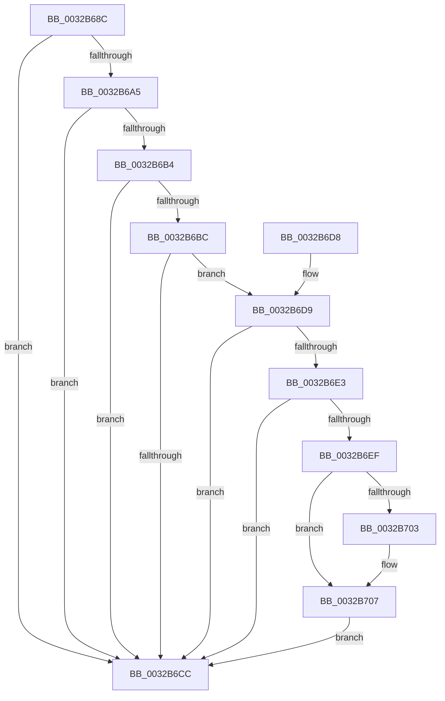

# MiClearPageFileReservation

- RVA: `0x0032B68C`–`0x0032B716` (길이 `138` bytes)
- VA: `0x000000014032B68C`
- 실행 섹션: `.text`
- PDB 이름 있음: `예`; PDB Function 태그: `아니요`
- unwind 정보 RVA: `0x000760CC`
- 디코드: `41`개 명령, `138/138` bytes 표시
- 미해석 바이트: `0` (있으면 어셈블리에 `.byte`로 보존)

> 이 문서는 커널 이미지의 기계어와 PDB 기호를 분석해 생성했습니다. 4번과 5번은 함수 원형과 자료형을 바이너리 사용 방식에서 추정한 C 해석이며 원본 소스 복구 결과는 아닙니다.

## 1. Dependencies

- 직접 호출 지점: **1**; 고유 호출 대상: **1**
- 직접 호출자로 확인된 함수: **19**
- RIP 상대 이미지 참조: **0**

### Outgoing calls
- `0x0032B6D9` → [MiPteHasShadow](MiPteHasShadow_function_0032B998.md) (function, `0x0032B998`)

### Direct callers
- [MiDemoteCombinedPte](../22/MiDemoteCombinedPte_function_0022ABAC.md) at `0x0022AF4C`
- [MiBuildForkPte](../22/MiBuildForkPte_function_0022E32C.md) at `0x0022F2B0`
- [MiBuildForkPte](../22/MiBuildForkPte_function_0022E32C.md) at `0x0022F2C8`
- [MiCapturePfnPageFileInfoInline](../22/MiCapturePfnPageFileInfoInline_function_0022F650.md) at `0x0022F6A3`
- [MiProbeUnlockPage](../24/MiProbeUnlockPage_function_00243860.md) at `0x00243B11`
- [MiActOnPte](../24/MiActOnPte_function_00244C90.md) at `0x00245212`
- [MiActOnPte](../24/MiActOnPte_function_00244C90.md) at `0x002456FA`
- [MiActOnPte](../24/MiActOnPte_function_00244C90.md) at `0x002457E9`
- [MiResolveTransitionFault](../28/MiResolveTransitionFault_function_00282940.md) at `0x00283646`
- [MiWsleFree](../28/MiWsleFree_function_00284600.md) at `0x002852C5`
- [MiLockPageAndSetDirty](../28/MiLockPageAndSetDirty_function_002857A0.md) at `0x00285909`
- [MiStoreWriteModifiedPages](../2B/MiStoreWriteModifiedPages_function_002B46C4.md) at `0x002B4D63`
- [MiStoreWriteModifiedPages](../2B/MiStoreWriteModifiedPages_function_002B46C4.md) at `0x002B4D96`
- [MiCompletePrivateZeroFault](../33/MiCompletePrivateZeroFault_function_00330CC0.md) at `0x00331B05`
- [MiCompleteProtoPteFault](../34/MiCompleteProtoPteFault_function_00345710.md) at `0x0034675A`
- [MiZeroCfgSystemWideBitmapWorker](../36/MiZeroCfgSystemWideBitmapWorker_function_00367060.md) at `0x00367642`
- [sub_00370E3F](../37/Unknown_function_00370E3F.md) at `0x00370E50`
- [MiOutSwapWorkingSetPte](../37/MiOutSwapWorkingSetPte_function_00372190.md) at `0x0037229F`
- [MiWriteCompletePfn](../37/MiWriteCompletePfn_function_003737C4.md) at `0x003739C6`
- [MiReservePageFileSpaceForPage](../38/MiReservePageFileSpaceForPage_function_0038377C.md) at `0x00383E31`
- [sub_003FE849](../3F/Unknown_function_003FE849.md) at `0x003FE8DE`
- [MiWriteComplete](../40/MiWriteComplete_function_004069B0.md) at `0x00406ADA`
- [sub_004390B1](../43/Unknown_function_004390B1.md) at `0x004390EB`

### Static image references
- 디코드된 RIP-relative 메모리 참조가 없습니다.

## 2. Other-region calls and transfers

- 다른 실행 섹션으로 향하는 call: **0**
- 별도 외부 분기/꼬리 이동을 확인하지 못했습니다.

## 3. Assembly (complete function range)

```asm
0032B68C  48 83 EC 28                     sub rsp, 0x28
0032B690  48 8B 11                        mov rdx, qword ptr [rcx]
0032B693  4C 8B C9                        mov r9, rcx
0032B696  48 B8 00 D0 BE 7D FB F6 FF FF   movabs rax, 0xfffff6fb7dbed000
0032B6A0  48 3B C8                        cmp rcx, rax
0032B6A3  72 27                           jb 0x14032b6cc
0032B6A5  48 B8 F8 D7 BE 7D FB F6 FF FF   movabs rax, 0xfffff6fb7dbed7f8
0032B6AF  48 3B C8                        cmp rcx, rax
0032B6B2  77 18                           ja 0x14032b6cc
0032B6B4  4C 8B C2                        mov r8, rdx
0032B6B7  F6 C2 01                        test dl, 1
0032B6BA  74 10                           je 0x14032b6cc
0032B6BC  F6 C2 42                        test dl, 0x42
0032B6BF  0F 95 C1                        setne cl
0032B6C2  F6 C2 20                        test dl, 0x20
0032B6C5  0F 95 C0                        setne al
0032B6C8  84 C8                           test al, cl
0032B6CA  74 0D                           je 0x14032b6d9
0032B6CC  48 83 E2 FD                     and rdx, 0xfffffffffffffffd
0032B6D0  49 89 11                        mov qword ptr [r9], rdx
0032B6D3  48 83 C4 28                     add rsp, 0x28
0032B6D7  C3                              ret
0032B6D8  CC                              int3
0032B6D9  E8 BA 02 00 00                  call 0x14032b998
0032B6DE  48 85 C0                        test rax, rax
0032B6E1  74 E9                           je 0x14032b6cc
0032B6E3  48 8B 88 08 05 00 00            mov rcx, qword ptr [rax + 0x508]
0032B6EA  48 85 C9                        test rcx, rcx
0032B6ED  74 DD                           je 0x14032b6cc
0032B6EF  49 8B C1                        mov rax, r9
0032B6F2  48 C1 E8 03                     shr rax, 3
0032B6F6  25 FF 01 00 00                  and eax, 0x1ff
0032B6FB  48 8B 04 C1                     mov rax, qword ptr [rcx + rax*8]
0032B6FF  A8 20                           test al, 0x20
0032B701  74 04                           je 0x14032b707
0032B703  49 83 C8 20                     or r8, 0x20
0032B707  49 8B D0                        mov rdx, r8
0032B70A  48 83 CA 42                     or rdx, 0x42
0032B70E  A8 42                           test al, 0x42
0032B710  49 0F 44 D0                     cmove rdx, r8
0032B714  EB B6                           jmp 0x14032b6cc
```

## 4. C-style interpretation (structured pseudocode)

```c
__int64 __fastcall MiClearPageFileReservation(__int64 a1)
{
    __int64 result;
    __int64 v_rsp;

    v_rsp = (v_rsp) - (40);
    if (a1 < result) goto loc_0032B6CC;
    if (a1 > result) goto loc_0032B6CC;
    if ((((unsigned __int8)(*(unsigned __int64 *)(a1))) & (1)) == 0) goto loc_0032B6CC;
    a1 = ((((unsigned __int8)(*(unsigned __int64 *)(a1))) & (66)) != 0) ? 1 : 0;
    result = ((((unsigned __int8)(*(unsigned __int64 *)(a1))) & (32)) != 0) ? 1 : 0;
    if ((((unsigned __int8)(result)) & ((unsigned __int8)(a1))) == 0) goto loc_0032B6D9;
loc_0032B6CC:
    a2 = (*(unsigned __int64 *)(a1)) & (-3);
    *(unsigned __int64 *)(a1) = a2;
    v_rsp = (v_rsp) + (40);
    return result;
loc_0032B6D9:
    result = MiPteHasShadow(a1, a2, *(unsigned __int64 *)(a1), a1);
    if (result == 0) goto loc_0032B6CC;
    if (*(unsigned __int64 *)(result + 1288) == 0) goto loc_0032B6CC;
    result = (a1) >> (3);
    result = (unsigned int)((result) & (511));
    if ((((unsigned __int8)(*(unsigned __int64 *)(*(unsigned __int64 *)(result + 1288) + result * 8))) & (32)) != 0) {
        a3 = (*(unsigned __int64 *)(a1)) | (32);
    }
    a2 = (a3) | (66);
    if ((((unsigned __int8)(*(unsigned __int64 *)(*(unsigned __int64 *)(result + 1288) + result * 8))) & (66)) == 0) { a2 = a3; }
    goto loc_0032B6CC;
}
```

## 5. (Beta) C Style

```c
int64_t MiClearPageFileReservation(void *Arg1)
{
    uint8_t *arg1 = (uint8_t *)Arg1;

    int64_t result;
    int64_t local_rsp;

    local_rsp = (local_rsp) - (40);
    if (Arg1 < result) goto loc_0032B6CC;
    if (Arg1 > result) goto loc_0032B6CC;
    if ((((uint8_t)(*(uint64_t *)(arg1))) & (1)) == 0) goto loc_0032B6CC;
    Arg1 = ((((uint8_t)(*(uint64_t *)(arg1))) & (66)) != 0) ? 1 : 0;
    result = ((((uint8_t)(*(uint64_t *)(arg1))) & (32)) != 0) ? 1 : 0;
    if ((((uint8_t)(result)) & ((uint8_t)(Arg1))) == 0) goto loc_0032B6D9;
loc_0032B6CC:
    a2 = (*(uint64_t *)(arg1)) & (-3);
    *(uint64_t *)(arg1) = a2;
    local_rsp = (local_rsp) + (40);
    return result;
loc_0032B6D9:
    result = MiPteHasShadow(Arg1, a2, *(uint64_t *)(arg1), Arg1);
    if (result == 0) goto loc_0032B6CC;
    if (*(uint64_t *)(result + 0x508) == 0) goto loc_0032B6CC;
    result = (Arg1) >> (3);
    result = (uint32_t)((result) & (511));
    if ((((uint8_t)(*(uint64_t *)(*(uint64_t *)(result + 0x508) + result * 8))) & (32)) != 0) {
        a3 = (*(uint64_t *)(arg1)) | (32);
    }
    a2 = (a3) | (66);
    if ((((uint8_t)(*(uint64_t *)(*(uint64_t *)(result + 0x508) + result * 8))) & (66)) == 0) { a2 = a3; }
    goto loc_0032B6CC;
}
```

### 관측된 메모리 오프셋

구조체 형식이 확인되지 않은 접근은 인자 기준의 오프셋으로만 기록했습니다.

| 기준 인자 | 오프셋 표현 | 폭 (bit) | 접근 |
|---|---:|---:|---|
| `Arg1` | `+ 0x0` | `64` | `R` |

## 6. Execution-region graph

[열기: 2D/3D 그래프와 함수 탐색 컨트롤 패널](../../../control-panel.html?section=text&rva=0x0032B68C&view=graph)

- 2D 그래프는 위에서 아래로 흐르고, 3D 그래프는 빈 공간을 드래그해 회전합니다. Shift+드래그는 이동, 휠은 확대·축소, 함수 노드 선택은 대상 보고서 이동입니다.

### Static fallback


