# MiCommitPoolMemory

- RVA: `0x00329520`–`0x003297D3` (길이 `691` bytes)
- VA: `0x0000000140329520`
- 실행 섹션: `.text`
- PDB 이름 있음: `예`; PDB Function 태그: `아니요`
- unwind 정보 RVA: `0x00076008`
- 디코드: `175`개 명령, `691/691` bytes 표시
- 미해석 바이트: `0` (있으면 어셈블리에 `.byte`로 보존)

> 이 문서는 커널 이미지의 기계어와 PDB 기호를 분석해 생성했습니다. 4번과 5번은 함수 원형과 자료형을 바이너리 사용 방식에서 추정한 C 해석이며 원본 소스 복구 결과는 아닙니다.

## 1. Dependencies

- 직접 호출 지점: **16**; 고유 호출 대상: **12**
- 직접 호출자로 확인된 함수: **2**
- RIP 상대 이미지 참조: **6**

### Outgoing calls
- `0x00329567` → [MiLockPoolCommitWs](../46/MiLockPoolCommitWs_function_00469EC0.md) (function, `0x00469EC0`)
- `0x0032957F` → [MiFillPoolCommitPageTable](../34/MiFillPoolCommitPageTable_function_00344F00.md) (function, `0x00344F00`)
- `0x00329587` → [MiUnlockPoolCommitWs](MiUnlockPoolCommitWs_function_003297DC.md) (function, `0x003297DC`)
- `0x003295F1` → [MiFreeExcessSegments](MiFreeExcessSegments_function_00327F50.md) (function, `0x00327F50`)
- `0x003295F9` → [MiReturnExcessPoolCommit](MiReturnExcessPoolCommit_function_00328D3C.md) (function, `0x00328D3C`)
- `0x0032962A` → [MiUnlockPageTable](../21/MiUnlockPageTable_function_00216EC0.md) (function, `0x00216EC0`)
- `0x00329691` → [MiUnlockPoolCommitWs](MiUnlockPoolCommitWs_function_003297DC.md) (function, `0x003297DC`)
- `0x00329699` → [MiLockPoolCommitWs](../46/MiLockPoolCommitWs_function_00469EC0.md) (function, `0x00469EC0`)
- `0x003296A0` → [KeShouldYieldProcessor](../27/KeShouldYieldProcessor_function_002773E0.md) (function, `0x002773E0`)
- `0x003296AF` → [MiLockPoolCommitPageTable](MiLockPoolCommitPageTable_function_00328BAC.md) (function, `0x00328BAC`)
- `0x003296BE` → [MiLinkPoolCommitChain](../31/MiLinkPoolCommitChain_function_00313D20.md) (function, `0x00313D20`)
- `0x003296EF` → [MiUnlockPoolCommitWs](MiUnlockPoolCommitWs_function_003297DC.md) (function, `0x003297DC`)
- `0x003296FA` → [MiCreatePoolPageTables](../3B/MiCreatePoolPageTables_function_003B5994.md) (function, `0x003B5994`)
- `0x00329704` → [MiLockPoolCommitWs](../46/MiLockPoolCommitWs_function_00469EC0.md) (function, `0x00469EC0`)
- `0x00329786` → [MiClearNonPagedPtes](../2C/MiClearNonPagedPtes_function_002C17A0.md) (function, `0x002C17A0`)
- `0x003297B6` → [MiLogPerfMemoryRangeEvent](../4D/MiLogPerfMemoryRangeEvent_function_004D9D7C.md) (function, `0x004D9D7C`)

### Direct callers
- [sub_00328FA3](Unknown_function_00328FA3.md) at `0x00329176`
- [MmAllocateSecurePoolMemory](../68/MmAllocateSecurePoolMemory_function_00682CC8.md) at `0x00682DCA`

### Static image references
- `0x003295A8` → RVA `0x00FC6B04` (`ALMOSTRO`; read)
- `0x003295C7` → RVA `0x00E2CB48` (`.data`; read)
- `0x003295DF` → RVA `0x00E2CB40` (`.data`; read)
- `0x00329656` → RVA `0x00E38840` (`.data`; read)
- `0x003296DF` → RVA `0x00E37650` (`.data`; read)
- `0x003297C3` → RVA `0x00E2CB50` (`.data`; read)

## 2. Other-region calls and transfers

- 다른 실행 섹션으로 향하는 call: **0**
- 별도 외부 분기/꼬리 이동을 확인하지 못했습니다.

## 3. Assembly (complete function range)

```asm
00329520  48 89 5C 24 08                  mov qword ptr [rsp + 8], rbx
00329525  48 89 6C 24 10                  mov qword ptr [rsp + 0x10], rbp
0032952A  48 89 74 24 18                  mov qword ptr [rsp + 0x18], rsi
0032952F  57                              push rdi
00329530  41 54                           push r12
00329532  41 55                           push r13
00329534  41 56                           push r14
00329536  41 57                           push r15
00329538  48 83 EC 20                     sub rsp, 0x20
0032953C  48 8B 31                        mov rsi, qword ptr [rcx]
0032953F  49 BD F8 FF FF FF 7F 00 00 00   movabs r13, 0x7ffffffff8
00329549  4C 8B 71 48                     mov r14, qword ptr [rcx + 0x48]
0032954D  48 8B F9                        mov rdi, rcx
00329550  48 C1 EE 09                     shr rsi, 9
00329554  49 23 F5                        and rsi, r13
00329557  49 BC 00 00 00 00 80 F6 FF FF   movabs r12, 0xfffff68000000000
00329561  49 8B C4                        mov rax, r12
00329564  48 03 F0                        add rsi, rax
00329567  E8 54 09 14 00                  call 0x140469ec0
0032956C  33 ED                           xor ebp, ebp
0032956E  44 8D 7D 01                     lea r15d, [rbp + 1]
00329572  48 3B 77 50                     cmp rsi, qword ptr [rdi + 0x50]
00329576  0F 86 A2 00 00 00               jbe 0x14032961e
0032957C  48 8B CF                        mov rcx, rdi
0032957F  E8 7C B9 01 00                  call 0x140344f00
00329584  48 8B CF                        mov rcx, rdi
00329587  E8 50 02 00 00                  call 0x1403297dc
0032958C  0F B7 47 64                     movzx eax, word ptr [rdi + 0x64]
00329590  44 0F B7 C0                     movzx r8d, ax
00329594  41 84 C7                        test r15b, al
00329597  0F 85 97 01 00 00               jne 0x140329734
0032959D  B8 04 01 00 00                  mov eax, 0x104
003295A2  66 44 85 C0                     test ax, r8w
003295A6  75 0F                           jne 0x1403295b7
003295A8  8B 05 56 D5 C9 00               mov eax, dword ptr [rip + 0xc9d556]
003295AE  41 84 C7                        test r15b, al
003295B1  0F 85 F2 01 00 00               jne 0x1403297a9
003295B7  8B 57 40                        mov edx, dword ptr [rdi + 0x40]
003295BA  4C 8B 47 30                     mov r8, qword ptr [rdi + 0x30]
003295BE  83 FA 04                        cmp edx, 4
003295C1  0F 85 0F 01 00 00               jne 0x1403296d6
003295C7  48 8D 0D 7A 35 B0 00            lea rcx, [rip + 0xb0357a]
003295CE  49 8B C0                        mov rax, r8
003295D1  F0 48 0F C1 01                  lock xadd qword ptr [rcx], rax
003295D6  4A 8D 0C 00                     lea rcx, [rax + r8]
003295DA  83 FA 04                        cmp edx, 4
003295DD  75 17                           jne 0x1403295f6
003295DF  48 8B 05 5A 35 B0 00            mov rax, qword ptr [rip + 0xb0355a]
003295E6  48 3B C8                        cmp rcx, rax
003295E9  0F 82 A6 01 00 00               jb 0x140329795
003295EF  33 C9                           xor ecx, ecx
003295F1  E8 5A E9 FF FF                  call 0x140327f50
003295F6  48 8B CF                        mov rcx, rdi
003295F9  E8 3E F7 FF FF                  call 0x140328d3c
003295FE  48 8B 5C 24 50                  mov rbx, qword ptr [rsp + 0x50]
00329603  8B C5                           mov eax, ebp
00329605  48 8B 6C 24 58                  mov rbp, qword ptr [rsp + 0x58]
0032960A  48 8B 74 24 60                  mov rsi, qword ptr [rsp + 0x60]
0032960F  48 83 C4 20                     add rsp, 0x20
00329613  41 5F                           pop r15
00329615  41 5E                           pop r14
00329617  41 5D                           pop r13
00329619  41 5C                           pop r12
0032961B  5F                              pop rdi
0032961C  C3                              ret
0032961D  CC                              int3
0032961E  48 8B 57 58                     mov rdx, qword ptr [rdi + 0x58]
00329622  48 85 D2                        test rdx, rdx
00329625  74 0C                           je 0x140329633
00329627  49 8B CE                        mov rcx, r14
0032962A  E8 91 D8 EE FF                  call 0x140216ec0
0032962F  48 89 6F 58                     mov qword ptr [rdi + 0x58], rbp
00329633  80 7F 67 02                     cmp byte ptr [rdi + 0x67], 2
00329637  73 70                           jae 0x1403296a9
00329639  41 8B 86 B8 00 00 00            mov eax, dword ptr [r14 + 0xb8]
00329640  24 0F                           and al, 0xf
00329642  3C 05                           cmp al, 5
00329644  0F 85 D1 00 00 00               jne 0x14032971b
0032964A  41 8B 86 B8 00 00 00            mov eax, dword ptr [r14 + 0xb8]
00329651  24 0F                           and al, 0xf
00329653  41 3A C7                        cmp al, r15b
00329656  48 8D 05 E3 F1 B0 00            lea rax, [rip + 0xb0f1e3]
0032965D  0F 85 C5 00 00 00               jne 0x140329728
00329663  48 8B 08                        mov rcx, qword ptr [rax]
00329666  65 48 8B 04 25 20 00 00 00      mov rax, qword ptr gs:[0x20]
0032966F  48 8B 80 38 88 00 00            mov rax, qword ptr [rax + 0x8838]
00329676  48 85 C0                        test rax, rax
00329679  74 70                           je 0x1403296eb
0032967B  8B 80 44 01 00 00               mov eax, dword ptr [rax + 0x144]
00329681  48 C1 E0 06                     shl rax, 6
00329685  8B 0C 08                        mov ecx, dword ptr [rax + rcx]
00329688  0F BA E1 1E                     bt ecx, 0x1e
0032968C  73 12                           jae 0x1403296a0
0032968E  48 8B CF                        mov rcx, rdi
00329691  E8 46 01 00 00                  call 0x1403297dc
00329696  48 8B CF                        mov rcx, rdi
00329699  E8 22 08 14 00                  call 0x140469ec0
0032969E  EB 09                           jmp 0x1403296a9
003296A0  E8 3B DD F4 FF                  call 0x1402773e0
003296A5  85 C0                           test eax, eax
003296A7  75 E5                           jne 0x14032968e
003296A9  48 8B D6                        mov rdx, rsi
003296AC  48 8B CF                        mov rcx, rdi
003296AF  E8 F8 F4 FF FF                  call 0x140328bac
003296B4  48 8B CF                        mov rcx, rdi
003296B7  85 C0                           test eax, eax
003296B9  74 34                           je 0x1403296ef
003296BB  48 8B D6                        mov rdx, rsi
003296BE  E8 5D A6 FE FF                  call 0x140313d20
003296C3  48 81 E6 00 F0 FF FF            and rsi, 0xfffffffffffff000
003296CA  48 81 C6 00 10 00 00            add rsi, 0x1000
003296D1  E9 9C FE FF FF                  jmp 0x140329572
003296D6  83 FA 05                        cmp edx, 5
003296D9  0F 85 E1 00 00 00               jne 0x1403297c0
003296DF  48 8D 0D 6A DF B0 00            lea rcx, [rip + 0xb0df6a]
003296E6  E9 E3 FE FF FF                  jmp 0x1403295ce
003296EB  8B C5                           mov eax, ebp
003296ED  EB 92                           jmp 0x140329681
003296EF  E8 E8 00 00 00                  call 0x1403297dc
003296F4  48 8B D6                        mov rdx, rsi
003296F7  48 8B CF                        mov rcx, rdi
003296FA  E8 95 C2 08 00                  call 0x1403b5994
003296FF  48 8B CF                        mov rcx, rdi
00329702  8B D8                           mov ebx, eax
00329704  E8 B7 07 14 00                  call 0x140469ec0
00329709  85 DB                           test ebx, ebx
0032970B  0F 85 61 FE FF FF               jne 0x140329572
00329711  66 44 09 7F 64                  or word ptr [rdi + 0x64], r15w
00329716  E9 61 FE FF FF                  jmp 0x14032957c
0032971B  3C 04                           cmp al, 4
0032971D  0F 86 27 FF FF FF               jbe 0x14032964a
00329723  E9 78 FF FF FF                  jmp 0x1403296a0
00329728  49 8D 86 C0 00 00 00            lea rax, [r14 + 0xc0]
0032972F  E9 2F FF FF FF                  jmp 0x140329663
00329734  41 F6 C0 02                     test r8b, 2
00329738  75 51                           jne 0x14032978b
0032973A  4C 8B 17                        mov r10, qword ptr [rdi]
0032973D  49 8B D2                        mov rdx, r10
00329740  48 C1 EA 09                     shr rdx, 9
00329744  49 23 D5                        and rdx, r13
00329747  49 8B C4                        mov rax, r12
0032974A  48 8D 0C 02                     lea rcx, [rdx + rax]
0032974E  48 3B F1                        cmp rsi, rcx
00329751  74 38                           je 0x14032978b
00329753  48 2B F2                        sub rsi, rdx
00329756  49 8B C4                        mov rax, r12
00329759  48 2B F0                        sub rsi, rax
0032975C  49 8B CA                        mov rcx, r10
0032975F  41 8B C0                        mov eax, r8d
00329762  48 C1 FE 03                     sar rsi, 3
00329766  C1 E8 02                        shr eax, 2
00329769  48 8B D6                        mov rdx, rsi
0032976C  41 23 C7                        and eax, r15d
0032976F  44 8B C8                        mov r9d, eax
00329772  41 83 C9 02                     or r9d, 2
00329776  66 41 0F BA E0 08               bt r8w, 8
0032977C  41 B8 00 40 00 00               mov r8d, 0x4000
00329782  44 0F 43 C8                     cmovae r9d, eax
00329786  E8 15 80 F9 FF                  call 0x1402c17a0
0032978B  BD 9A 00 00 C0                  mov ebp, 0xc000009a
00329790  E9 61 FE FF FF                  jmp 0x1403295f6
00329795  48 2B C1                        sub rax, rcx
00329798  48 3D 00 03 00 00               cmp rax, 0x300
0032979E  0F 83 52 FE FF FF               jae 0x1403295f6
003297A4  E9 46 FE FF FF                  jmp 0x1403295ef
003297A9  4C 8B 4F 08                     mov r9, qword ptr [rdi + 8]
003297AD  33 D2                           xor edx, edx
003297AF  48 8B 0F                        mov rcx, qword ptr [rdi]
003297B2  44 8D 42 0B                     lea r8d, [rdx + 0xb]
003297B6  E8 C1 05 1B 00                  call 0x1404d9d7c
003297BB  E9 F7 FD FF FF                  jmp 0x1403295b7
003297C0  83 FA 0E                        cmp edx, 0xe
003297C3  48 8D 0D 86 33 B0 00            lea rcx, [rip + 0xb03386]
003297CA  48 0F 45 CD                     cmovne rcx, rbp
003297CE  E9 FB FD FF FF                  jmp 0x1403295ce
```

## 4. C-style interpretation (structured pseudocode)

```c
__int64 __fastcall MiCommitPoolMemory(__int64 a1)
{
    __int64 result;
    __int64 v_rbp;
    __int64 v_rsi;
    __int64 v_rsp;
    unsigned __int64 v_stack_p10;
    unsigned __int64 v_stack_p18;
    unsigned __int64 v_stack_p8;

    v_stack_p8 = v_rbx;
    v_stack_p10 = v_rbp;
    v_stack_p18 = v_rsi;
    v_rsp = (v_rsp) - (32);
    v_rsi = (*(unsigned __int64 *)(a1)) >> (9);
    v_rsi = (v_rsi) & (v_r13);
    v_rsi = (v_rsi) + (v_r12);
    result = MiLockPoolCommitWs(a1, a2, a3, a4);
    v_rbp = 0;
loc_00329572:
    if (v_rsi <= (*(unsigned __int64 *)(a1 + 80))) goto loc_0032961E;
loc_0032957C:
    result = MiFillPoolCommitPageTable(a1, a2, a3, a4);
    result = MiUnlockPoolCommitWs(a1, a2, a3, a4);
    if ((((unsigned __int8)(v_rbp + 1)) & ((unsigned __int8)(*(unsigned __int16 *)(a1 + 100)))) != 0) goto loc_00329734;
    if (((260) & ((unsigned __int16)((unsigned __int16)(*(unsigned __int16 *)(a1 + 100))))) != 0) goto loc_003295B7;
    if ((((unsigned __int8)(v_rbp + 1)) & ((unsigned __int8)((unsigned int)(*(unsigned int *)(v_rip + 13227350))))) != 0) goto loc_003297A9;
loc_003295B7:
    if (((unsigned int)((unsigned int)(*(unsigned int *)(a1 + 64)))) != 4) goto loc_003296D6;
loc_003295CE:
    if (((unsigned int)((unsigned int)(*(unsigned int *)(a1 + 64)))) != 4) goto loc_003295F6;
    if ((*(unsigned __int64 *)(a1 + 48) + *(unsigned __int64 *)(a1 + 48) * 1) < (*(unsigned __int64 *)(v_rip + 11547994))) goto loc_00329795;
loc_003295EF:
    a1 = 0;
    result = MiFreeExcessSegments(a1, (unsigned int)(*(unsigned int *)(a1 + 64)), *(unsigned __int64 *)(a1 + 48), a4);
loc_003295F6:
    result = MiReturnExcessPoolCommit(0, (unsigned int)(*(unsigned int *)(a1 + 64)), *(unsigned __int64 *)(a1 + 48), a4);
    v_rsp = (v_rsp) + (32);
    return 0;
loc_0032961E:
    result = 0;
    if (*(unsigned __int64 *)(a1 + 88) != 0) {
        a1 = *(unsigned __int64 *)(a1 + 72);
        result = MiUnlockPageTable(a1, *(unsigned __int64 *)(a1 + 88), *(unsigned __int64 *)(a1 + 48), a4);
        *(unsigned __int64 *)(a1 + 88) = v_stack_p10;
    }
    if ((*(unsigned __int8 *)(a1 + 103)) >= 2) goto loc_003296A9;
    result = (unsigned __int8)(((unsigned int)(*(unsigned int *)(*(unsigned __int64 *)(a1 + 72) + 184))) & (15));
    if (((unsigned __int8)(result)) != 5) goto loc_0032971B;
loc_0032964A:
    result = (unsigned __int8)(((unsigned int)(*(unsigned int *)(*(unsigned __int64 *)(a1 + 72) + 184))) & (15));
    if (((unsigned __int8)(result)) != ((unsigned __int8)(v_rbp + 1))) goto loc_00329728;
loc_00329663:
    if (*(unsigned __int64 *)(*(unsigned __int64 *)(gs_base + (0 + 32)) + 34872) == 0) goto loc_003296EB;
loc_00329681:
    result = ((unsigned int)(*(unsigned int *)(*(unsigned __int64 *)(*(unsigned __int64 *)(gs_base + (0 + 32)) + 34872) + 324))) << (6);
    if (condition_is_above_or_equal) goto loc_003296A0;
loc_0032968E:
    result = MiUnlockPoolCommitWs(a1, *(unsigned __int64 *)(a1 + 88), *(unsigned __int64 *)(a1 + 48), a4);
    result = MiLockPoolCommitWs(a1, *(unsigned __int64 *)(a1 + 88), *(unsigned __int64 *)(a1 + 48), a4);
    goto loc_003296A9;
loc_003296A0:
    result = KeShouldYieldProcessor(a1, *(unsigned __int64 *)(a1 + 88), *(unsigned __int64 *)(a1 + 48), a4);
    if ((unsigned int)(result) != 0) goto loc_0032968E;
loc_003296A9:
    result = MiLockPoolCommitPageTable(a1, v_stack_p18, *(unsigned __int64 *)(a1 + 48), a4);
    if ((unsigned int)(result) == 0) goto loc_003296EF;
    result = MiLinkPoolCommitChain(a1, v_stack_p18, *(unsigned __int64 *)(a1 + 48), a4);
    v_rsi = (v_stack_p18) & (0xFFFFFFFFFFFFF000ULL);
    v_rsi = (v_rsi) + (0x1000ULL);
    goto loc_00329572;
loc_003296D6:
    if (((unsigned int)(v_stack_p18)) != 5) goto loc_003297C0;
    goto loc_003295CE;
loc_003296EB:
    goto loc_00329681;
loc_003296EF:
    result = MiUnlockPoolCommitWs(v_rip + 11591530, v_stack_p18, *(unsigned __int64 *)(a1 + 48), a4);
    result = MiCreatePoolPageTables(a1, v_rsi, *(unsigned __int64 *)(a1 + 48), a4);
    result = MiLockPoolCommitWs(a1, v_rsi, *(unsigned __int64 *)(a1 + 48), a4);
    if ((unsigned int)((unsigned int)((unsigned int)(result))) != 0) goto loc_00329572;
    goto loc_0032957C;
loc_0032971B:
    if (((unsigned __int8)(result)) <= 4) goto loc_0032964A;
    goto loc_003296A0;
loc_00329728:
    goto loc_00329663;
loc_00329734:
    if ((((unsigned __int8)(*(unsigned __int64 *)(a1 + 48))) & (2)) != 0) goto loc_0032978B;
    a2 = (*(unsigned __int64 *)(a1)) >> (9);
    a2 = (a2) & (v_r13);
    result = v_r12;
    if (v_rsi != (a2 + v_r12 * 1)) {
        v_rsi = (v_rsi) - (a2);
        result = v_r12;
        v_rsi = (v_rsi) - (result);
        a1 = *(unsigned __int64 *)(a1);
        result = (unsigned int)(*(unsigned __int64 *)(a1 + 48));
        v_rsi = (v_rsi) >> (3);
        result = (unsigned int)((result) >> (2));
        a2 = v_rsi;
        result = (unsigned int)((result) & ((unsigned int)(v_rbp + 1)));
        a4 = (unsigned int)(result);
        a4 = (unsigned int)((a4) | (2));
        a3 = 0x4000ULL;
        if (condition_is_above_or_equal) { a4 = (unsigned int)(result); }
        result = MiClearNonPagedPtes(a1, a2, a3, a4);
    }
    goto loc_003295F6;
loc_00329795:
    result = (result) - (a1);
    if (result >= 768) goto loc_003295F6;
    goto loc_003295EF;
loc_003297A9:
    a2 = 0;
    result = MiLogPerfMemoryRangeEvent(*(unsigned __int64 *)(a1), a2, a2 + 11, *(unsigned __int64 *)(a1 + 8));
    goto loc_003295B7;
loc_003297C0:
    a1 = v_rip + 11547526;
    if (0 != 14) { a1 = (unsigned int)(0xC000009AULL); }
    goto loc_003295CE;
}
```

## 5. (Beta) C Style

```c
int64_t MiCommitPoolMemory(void *Arg1)
{
    uint8_t *arg1 = (uint8_t *)Arg1;

    int64_t result;
    int64_t local_rbp;
    int64_t local_rsi;
    int64_t local_rsp;
    uint64_t v_stack_p10;
    uint64_t v_stack_p18;
    uint64_t v_stack_p8;

    v_stack_p8 = local_rbx;
    v_stack_p10 = local_rbp;
    v_stack_p18 = local_rsi;
    local_rsp = (local_rsp) - (32);
    local_rsi = (*(uint64_t *)(arg1)) >> (9);
    local_rsi = (local_rsi) & (local_r13);
    local_rsi = (local_rsi) + (local_r12);
    result = MiLockPoolCommitWs(Arg1, a2, a3, a4);
    local_rbp = 0;
loc_00329572:
    if (local_rsi <= (*(uint64_t *)(arg1 + 0x50))) goto loc_0032961E;
loc_0032957C:
    result = MiFillPoolCommitPageTable(Arg1, a2, a3, a4);
    result = MiUnlockPoolCommitWs(Arg1, a2, a3, a4);
    if ((((uint8_t)(local_rbp + 1)) & ((uint8_t)(*(uint16_t *)(arg1 + 0x64)))) != 0) goto loc_00329734;
    if (((260) & ((uint16_t)((uint16_t)(*(uint16_t *)(arg1 + 0x64))))) != 0) goto loc_003295B7;
    if ((((uint8_t)(local_rbp + 1)) & ((uint8_t)((uint32_t)(*(uint32_t *)(v_rip + 0xC9D556))))) != 0) goto loc_003297A9;
loc_003295B7:
    if (((uint32_t)((uint32_t)(*(uint32_t *)(arg1 + 0x40)))) != 4) goto loc_003296D6;
loc_003295CE:
    if (((uint32_t)((uint32_t)(*(uint32_t *)(arg1 + 0x40)))) != 4) goto loc_003295F6;
    if ((*(uint64_t *)(arg1 + 0x30) + *(uint64_t *)(arg1 + 0x30) * 1) < (*(uint64_t *)(v_rip + 0xB0355A))) goto loc_00329795;
loc_003295EF:
    Arg1 = 0;
    result = MiFreeExcessSegments(Arg1, (uint32_t)(*(uint32_t *)(arg1 + 0x40)), *(uint64_t *)(arg1 + 0x30), a4);
loc_003295F6:
    result = MiReturnExcessPoolCommit(0, (uint32_t)(*(uint32_t *)(arg1 + 0x40)), *(uint64_t *)(arg1 + 0x30), a4);
    local_rsp = (local_rsp) + (32);
    return 0;
loc_0032961E:
    result = 0;
    if (*(uint64_t *)(arg1 + 0x58) != 0) {
        Arg1 = *(uint64_t *)(arg1 + 0x48);
        result = MiUnlockPageTable(Arg1, *(uint64_t *)(arg1 + 0x58), *(uint64_t *)(arg1 + 0x30), a4);
        *(uint64_t *)(arg1 + 0x58) = v_stack_p10;
    }
    if ((*(uint8_t *)(arg1 + 0x67)) >= 2) goto loc_003296A9;
    result = (uint8_t)(((uint32_t)(*(uint32_t *)(*(uint64_t *)(arg1 + 0x48) + 0xB8))) & (15));
    if (((uint8_t)(result)) != 5) goto loc_0032971B;
loc_0032964A:
    result = (uint8_t)(((uint32_t)(*(uint32_t *)(*(uint64_t *)(arg1 + 0x48) + 0xB8))) & (15));
    if (((uint8_t)(result)) != ((uint8_t)(local_rbp + 1))) goto loc_00329728;
loc_00329663:
    if (*(uint64_t *)(*(uint64_t *)(gs_base + (0 + 0x20)) + 0x8838) == 0) goto loc_003296EB;
loc_00329681:
    result = ((uint32_t)(*(uint32_t *)(*(uint64_t *)(*(uint64_t *)(gs_base + (0 + 0x20)) + 0x8838) + 0x144))) << (6);
    if (condition_is_above_or_equal) goto loc_003296A0;
loc_0032968E:
    result = MiUnlockPoolCommitWs(Arg1, *(uint64_t *)(arg1 + 0x58), *(uint64_t *)(arg1 + 0x30), a4);
    result = MiLockPoolCommitWs(Arg1, *(uint64_t *)(arg1 + 0x58), *(uint64_t *)(arg1 + 0x30), a4);
    goto loc_003296A9;
loc_003296A0:
    result = KeShouldYieldProcessor(Arg1, *(uint64_t *)(arg1 + 0x58), *(uint64_t *)(arg1 + 0x30), a4);
    if ((uint32_t)(result) != 0) goto loc_0032968E;
loc_003296A9:
    result = MiLockPoolCommitPageTable(Arg1, v_stack_p18, *(uint64_t *)(arg1 + 0x30), a4);
    if ((uint32_t)(result) == 0) goto loc_003296EF;
    result = MiLinkPoolCommitChain(Arg1, v_stack_p18, *(uint64_t *)(arg1 + 0x30), a4);
    local_rsi = (v_stack_p18) & (0xFFFFFFFFFFFFF000ULL);
    local_rsi = (local_rsi) + (0x1000ULL);
    goto loc_00329572;
loc_003296D6:
    if (((uint32_t)(v_stack_p18)) != 5) goto loc_003297C0;
    goto loc_003295CE;
loc_003296EB:
    goto loc_00329681;
loc_003296EF:
    result = MiUnlockPoolCommitWs(v_rip + 11591530, v_stack_p18, *(uint64_t *)(arg1 + 0x30), a4);
    result = MiCreatePoolPageTables(Arg1, local_rsi, *(uint64_t *)(arg1 + 0x30), a4);
    result = MiLockPoolCommitWs(Arg1, local_rsi, *(uint64_t *)(arg1 + 0x30), a4);
    if ((uint32_t)((uint32_t)((uint32_t)(result))) != 0) goto loc_00329572;
    goto loc_0032957C;
loc_0032971B:
    if (((uint8_t)(result)) <= 4) goto loc_0032964A;
    goto loc_003296A0;
loc_00329728:
    goto loc_00329663;
loc_00329734:
    if ((((uint8_t)(*(uint64_t *)(arg1 + 0x30))) & (2)) != 0) goto loc_0032978B;
    a2 = (*(uint64_t *)(arg1)) >> (9);
    a2 = (a2) & (local_r13);
    result = local_r12;
    if (local_rsi != (a2 + local_r12 * 1)) {
        local_rsi = (local_rsi) - (a2);
        result = local_r12;
        local_rsi = (local_rsi) - (result);
        Arg1 = *(uint64_t *)(arg1);
        result = (uint32_t)(*(uint64_t *)(arg1 + 0x30));
        local_rsi = (local_rsi) >> (3);
        result = (uint32_t)((result) >> (2));
        a2 = local_rsi;
        result = (uint32_t)((result) & ((uint32_t)(local_rbp + 1)));
        a4 = (uint32_t)(result);
        a4 = (uint32_t)((a4) | (2));
        a3 = 0x4000ULL;
        if (condition_is_above_or_equal) { a4 = (uint32_t)(result); }
        result = MiClearNonPagedPtes(Arg1, a2, a3, a4);
    }
    goto loc_003295F6;
loc_00329795:
    result = (result) - (Arg1);
    if (result >= 768) goto loc_003295F6;
    goto loc_003295EF;
loc_003297A9:
    a2 = 0;
    result = MiLogPerfMemoryRangeEvent(*(uint64_t *)(arg1), a2, a2 + 11, *(uint64_t *)(arg1 + 0x8));
    goto loc_003295B7;
loc_003297C0:
    Arg1 = v_rip + 11547526;
    if (0 != 14) { Arg1 = (uint32_t)(0xC000009AULL); }
    goto loc_003295CE;
}
```

### 관측된 메모리 오프셋

구조체 형식이 확인되지 않은 접근은 인자 기준의 오프셋으로만 기록했습니다.

| 기준 인자 | 오프셋 표현 | 폭 (bit) | 접근 |
|---|---:|---:|---|
| `Arg1` | `+ 0x0` | `64` | `R` |
| `Arg1` | `+ 0x8` | `64` | `R` |
| `Arg1` | `+ 0x30` | `64` | `R` |
| `Arg1` | `+ 0x40` | `32` | `R` |
| `Arg1` | `+ 0x48` | `64` | `R` |
| `Arg1` | `+ 0x50` | `64` | `R` |
| `Arg1` | `+ 0x58` | `64` | `R` |
| `Arg1` | `+ 0x58` | `64` | `W` |
| `Arg1` | `+ 0x64` | `16` | `R` |
| `Arg1` | `+ 0x64` | `16` | `R/W` |
| `Arg1` | `+ 0x67` | `8` | `R` |

## 6. Execution-region graph

[열기: 2D/3D 그래프와 함수 탐색 컨트롤 패널](../../../control-panel.html?section=text&rva=0x00329520&view=graph)

- 2D 그래프는 위에서 아래로 흐르고, 3D 그래프는 빈 공간을 드래그해 회전합니다. Shift+드래그는 이동, 휠은 확대·축소, 함수 노드 선택은 대상 보고서 이동입니다.

### Static fallback

```mermaid
flowchart TD
  bb_00329520[BB_00329520]
  bb_00329572[BB_00329572]
  bb_0032957C[BB_0032957C]
  bb_0032959D[BB_0032959D]
  bb_003295A8[BB_003295A8]
  bb_003295B7[BB_003295B7]
  bb_003295C7[BB_003295C7]
  bb_003295CE[BB_003295CE]
  bb_003295DF[BB_003295DF]
  bb_003295EF[BB_003295EF]
  bb_003295F6[BB_003295F6]
  bb_0032961D[BB_0032961D]
  bb_0032961E[BB_0032961E]
  bb_00329627[BB_00329627]
  bb_00329633[BB_00329633]
  bb_00329639[BB_00329639]
  bb_0032964A[BB_0032964A]
  bb_00329663[BB_00329663]
  bb_0032967B[BB_0032967B]
  bb_00329681[BB_00329681]
  bb_0032968E[BB_0032968E]
  bb_003296A0[BB_003296A0]
  bb_003296A9[BB_003296A9]
  bb_003296BB[BB_003296BB]
  bb_003296D6[BB_003296D6]
  bb_003296DF[BB_003296DF]
  bb_003296EB[BB_003296EB]
  bb_003296EF[BB_003296EF]
  bb_00329711[BB_00329711]
  bb_0032971B[BB_0032971B]
  bb_00329723[BB_00329723]
  bb_00329728[BB_00329728]
  bb_00329734[BB_00329734]
  bb_0032973A[BB_0032973A]
  bb_00329753[BB_00329753]
  bb_0032978B[BB_0032978B]
  bb_00329795[BB_00329795]
  bb_003297A4[BB_003297A4]
  bb_003297A9[BB_003297A9]
  bb_003297C0[BB_003297C0]
  bb_00329520 -->|flow| bb_00329572
  bb_00329572 -->|branch| bb_0032961E
  bb_00329572 -->|fallthrough| bb_0032957C
  bb_0032957C -->|branch| bb_00329734
  bb_0032957C -->|fallthrough| bb_0032959D
  bb_0032959D -->|branch| bb_003295B7
  bb_0032959D -->|fallthrough| bb_003295A8
  bb_003295A8 -->|branch| bb_003297A9
  bb_003295A8 -->|fallthrough| bb_003295B7
  bb_003295B7 -->|branch| bb_003296D6
  bb_003295B7 -->|fallthrough| bb_003295C7
  bb_003295C7 -->|flow| bb_003295CE
  bb_003295CE -->|branch| bb_003295F6
  bb_003295CE -->|fallthrough| bb_003295DF
  bb_003295DF -->|branch| bb_00329795
  bb_003295DF -->|fallthrough| bb_003295EF
  bb_003295EF -->|flow| bb_003295F6
  bb_0032961D -->|flow| bb_0032961E
  bb_0032961E -->|branch| bb_00329633
  bb_0032961E -->|fallthrough| bb_00329627
  bb_00329627 -->|flow| bb_00329633
  bb_00329633 -->|branch| bb_003296A9
  bb_00329633 -->|fallthrough| bb_00329639
  bb_00329639 -->|branch| bb_0032971B
  bb_00329639 -->|fallthrough| bb_0032964A
  bb_0032964A -->|branch| bb_00329728
  bb_0032964A -->|fallthrough| bb_00329663
  bb_00329663 -->|branch| bb_003296EB
  bb_00329663 -->|fallthrough| bb_0032967B
  bb_0032967B -->|flow| bb_00329681
  bb_00329681 -->|branch| bb_003296A0
  bb_00329681 -->|fallthrough| bb_0032968E
  bb_0032968E -->|branch| bb_003296A9
  bb_003296A0 -->|branch| bb_0032968E
  bb_003296A0 -->|fallthrough| bb_003296A9
  bb_003296A9 -->|branch| bb_003296EF
  bb_003296A9 -->|fallthrough| bb_003296BB
  bb_003296BB -->|branch| bb_00329572
  bb_003296D6 -->|branch| bb_003297C0
  bb_003296D6 -->|fallthrough| bb_003296DF
  bb_003296DF -->|branch| bb_003295CE
  bb_003296EB -->|branch| bb_00329681
  bb_003296EF -->|branch| bb_00329572
  bb_003296EF -->|fallthrough| bb_00329711
  bb_00329711 -->|branch| bb_0032957C
  bb_0032971B -->|branch| bb_0032964A
  bb_0032971B -->|fallthrough| bb_00329723
  bb_00329723 -->|branch| bb_003296A0
  bb_00329728 -->|branch| bb_00329663
  bb_00329734 -->|branch| bb_0032978B
  bb_00329734 -->|fallthrough| bb_0032973A
  bb_0032973A -->|branch| bb_0032978B
  bb_0032973A -->|fallthrough| bb_00329753
  bb_00329753 -->|flow| bb_0032978B
  bb_0032978B -->|branch| bb_003295F6
  bb_00329795 -->|branch| bb_003295F6
  bb_00329795 -->|fallthrough| bb_003297A4
  bb_003297A4 -->|branch| bb_003295EF
  bb_003297A9 -->|branch| bb_003295B7
  bb_003297C0 -->|branch| bb_003295CE
```


