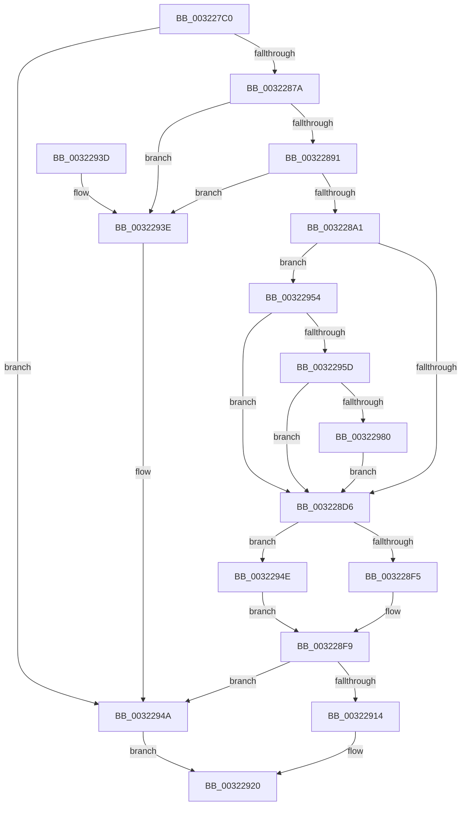

# MiComputeCombineHash

- RVA: `0x003227C0`–`0x00322996` (길이 `470` bytes)
- VA: `0x00000001403227C0`
- 실행 섹션: `.text`
- PDB 이름 있음: `예`; PDB Function 태그: `아니요`
- unwind 정보 RVA: `0x000757D8`
- 디코드: `118`개 명령, `470/470` bytes 표시
- 미해석 바이트: `0` (있으면 어셈블리에 `.byte`로 보존)

> 이 문서는 커널 이미지의 기계어와 PDB 기호를 분석해 생성했습니다. 4번과 5번은 함수 원형과 자료형을 바이너리 사용 방식에서 추정한 C 해석이며 원본 소스 복구 결과는 아닙니다.

## 1. Dependencies

- 직접 호출 지점: **10**; 고유 호출 대상: **9**
- 직접 호출자로 확인된 함수: **2**
- RIP 상대 이미지 참조: **1**

### Outgoing calls
- `0x003227FF` → [MiGetUltraMapping](MiGetUltraMapping_function_00323270.md) (function, `0x00323270`)
- `0x00322869` → [MiSafeLockPage](MiSafeLockPage_function_00321620.md) (function, `0x00321620`)
- `0x00322884` → [MiCombineCandidate](../31/MiCombineCandidate_function_00316290.md) (function, `0x00316290`)
- `0x003228A9` → [MiMakeProtectionPfnCompatible](../22/MiMakeProtectionPfnCompatible_function_00229CD0.md) (function, `0x00229CD0`)
- `0x003228BB` → [MiMakeValidPte](../2C/MiMakeValidPte_function_002C5590.md) (function, `0x002C5590`)
- `0x003228E0` → [MiUnlockPage](../31/MiUnlockPage_function_0031A3E0.md) (function, `0x0031A3E0`)
- `0x00322900` → [MiPerformCombineScan](../3D/MiPerformCombineScan_function_003D4AA0.md) (function, `0x003D4AA0`)
- `0x0032290B` → [MiReleaseArbitraryPage](../22/MiReleaseArbitraryPage_function_0022A28C.md) (function, `0x0022A28C`)
- `0x00322945` → [MiUnlockPage](../31/MiUnlockPage_function_0031A3E0.md) (function, `0x0031A3E0`)
- `0x0032298C` → [MiCheckLinearProtectedPteAccessedBit](../29/MiCheckLinearProtectedPteAccessedBit_function_00292D80.md) (function, `0x00292D80`)

### Direct callers
- [MiCombinePte](../68/MiCombinePte_function_0068B9A0.md) at `0x0068BACE`
- [MiCombineAllPhysicalMemory](../../page/9F/MiCombineAllPhysicalMemory_function_009F6B6C.md) at `0x009F6EBA`

### Static image references
- `0x003228CB` → RVA `0x00FC6A88` (`ALMOSTRO`; read)

## 2. Other-region calls and transfers

- 다른 실행 섹션으로 향하는 call: **0**
- 별도 외부 분기/꼬리 이동을 확인하지 못했습니다.

## 3. Assembly (complete function range)

```asm
003227C0  48 89 5C 24 08                  mov qword ptr [rsp + 8], rbx
003227C5  48 89 6C 24 10                  mov qword ptr [rsp + 0x10], rbp
003227CA  48 89 74 24 20                  mov qword ptr [rsp + 0x20], rsi
003227CF  57                              push rdi
003227D0  41 54                           push r12
003227D2  41 55                           push r13
003227D4  41 56                           push r14
003227D6  41 57                           push r15
003227D8  48 83 EC 20                     sub rsp, 0x20
003227DC  4C 8B 29                        mov r13, qword ptr [rcx]
003227DF  41 F7 D8                        neg r8d
003227E2  4C 8B F2                        mov r14, rdx
003227E5  48 8B E9                        mov rbp, rcx
003227E8  45 1B C9                        sbb r9d, r9d
003227EB  BA 03 00 00 00                  mov edx, 3
003227F0  41 83 E1 04                     and r9d, 4
003227F4  48 81 C1 00 01 00 00            add rcx, 0x100
003227FB  44 8D 42 FE                     lea r8d, [rdx - 2]
003227FF  E8 6C 0A 00 00                  call 0x140323270
00322804  4C 8B F8                        mov r15, rax
00322807  48 B8 F8 FF FF FF 7F 00 00 00   movabs rax, 0x7ffffffff8
00322811  49 C1 EF 09                     shr r15, 9
00322815  4C 23 F8                        and r15, rax
00322818  48 B8 00 00 00 00 80 F6 FF FF   movabs rax, 0xfffff68000000000
00322822  48 8B C0                        mov rax, rax
00322825  4C 03 F8                        add r15, rax
00322828  8B 85 8C 00 00 00               mov eax, dword ptr [rbp + 0x8c]
0032282E  89 44 24 60                     mov dword ptr [rsp + 0x60], eax
00322832  49 8B 46 10                     mov rax, qword ptr [r14 + 0x10]
00322836  48 8D 1C 40                     lea rbx, [rax + rax*2]
0032283A  48 C1 E3 04                     shl rbx, 4
0032283E  48 B8 00 00 00 00 00 DE FF FF   movabs rax, 0xffffde0000000000
00322848  48 8D 3C 03                     lea rdi, [rbx + rax]
0032284C  4C 89 7D 58                     mov qword ptr [rbp + 0x58], r15
00322850  48 B8 AB AA AA AA AA AA AA AA   movabs rax, 0xaaaaaaaaaaaaaaab
0032285A  48 C1 FB 04                     sar rbx, 4
0032285E  48 0F AF D8                     imul rbx, rax
00322862  48 89 7D 50                     mov qword ptr [rbp + 0x50], rdi
00322866  48 8B CB                        mov rcx, rbx
00322869  E8 B2 ED FF FF                  call 0x140321620
0032286E  44 0F B6 E0                     movzx r12d, al
00322872  3C 11                           cmp al, 0x11
00322874  0F 84 D0 00 00 00               je 0x14032294a
0032287A  8B 54 24 60                     mov edx, dword ptr [rsp + 0x60]
0032287E  4C 8B C7                        mov r8, rdi
00322881  49 8B CD                        mov rcx, r13
00322884  E8 07 3A FF FF                  call 0x140316290
00322889  85 C0                           test eax, eax
0032288B  0F 84 AD 00 00 00               je 0x14032293e
00322891  8B 47 20                        mov eax, dword ptr [rdi + 0x20]
00322894  C1 E8 10                        shr eax, 0x10
00322897  24 C0                           and al, 0xc0
00322899  3C C0                           cmp al, 0xc0
0032289B  0F 84 9D 00 00 00               je 0x14032293e
003228A1  48 8B D7                        mov rdx, rdi
003228A4  B9 01 00 00 00                  mov ecx, 1
003228A9  E8 22 74 F0 FF                  call 0x140229cd0
003228AE  0F BA E8 1D                     bts eax, 0x1d
003228B2  48 8B D3                        mov rdx, rbx
003228B5  44 8B C0                        mov r8d, eax
003228B8  49 8B CF                        mov rcx, r15
003228BB  E8 D0 2C FA FF                  call 0x1402c5590
003228C0  4C 89 7D 48                     mov qword ptr [rbp + 0x48], r15
003228C4  48 8B D8                        mov rbx, rax
003228C7  48 89 7D 40                     mov qword ptr [rbp + 0x40], rdi
003228CB  48 0F BA 25 B4 41 CA 00 24      bt qword ptr [rip + 0xca41b4], 0x24
003228D4  72 7E                           jb 0x140322954
003228D6  41 0F B6 D4                     movzx edx, r12b
003228DA  49 89 1F                        mov qword ptr [r15], rbx
003228DD  48 8B CF                        mov rcx, rdi
003228E0  E8 FB 7A FF FF                  call 0x14031a3e0
003228E5  0F B6 4F 22                     movzx ecx, byte ptr [rdi + 0x22]
003228E9  48 8B 45 68                     mov rax, qword ptr [rbp + 0x68]
003228ED  80 E1 07                        and cl, 7
003228F0  80 F9 06                        cmp cl, 6
003228F3  75 59                           jne 0x14032294e
003228F5  48 FF 40 10                     inc qword ptr [rax + 0x10]
003228F9  4D 8B CE                        mov r9, r14
003228FC  48 8D 55 10                     lea rdx, [rbp + 0x10]
00322900  E8 9B 21 0B 00                  call 0x1403d4aa0
00322905  48 8D 4D 10                     lea rcx, [rbp + 0x10]
00322909  8B D8                           mov ebx, eax
0032290B  E8 7C 79 F0 FF                  call 0x14022a28c
00322910  85 DB                           test ebx, ebx
00322912  74 36                           je 0x14032294a
00322914  49 C7 06 00 00 00 00            mov qword ptr [r14], 0
0032291B  B8 01 00 00 00                  mov eax, 1
00322920  48 8B 5C 24 50                  mov rbx, qword ptr [rsp + 0x50]
00322925  48 8B 6C 24 58                  mov rbp, qword ptr [rsp + 0x58]
0032292A  48 8B 74 24 68                  mov rsi, qword ptr [rsp + 0x68]
0032292F  48 83 C4 20                     add rsp, 0x20
00322933  41 5F                           pop r15
00322935  41 5E                           pop r14
00322937  41 5D                           pop r13
00322939  41 5C                           pop r12
0032293B  5F                              pop rdi
0032293C  C3                              ret
0032293D  CC                              int3
0032293E  41 0F B6 D4                     movzx edx, r12b
00322942  48 8B CF                        mov rcx, rdi
00322945  E8 96 7A FF FF                  call 0x14031a3e0
0032294A  33 C0                           xor eax, eax
0032294C  EB D2                           jmp 0x140322920
0032294E  48 FF 40 18                     inc qword ptr [rax + 0x18]
00322952  EB A5                           jmp 0x1403228f9
00322954  F6 C3 20                        test bl, 0x20
00322957  0F 85 79 FF FF FF               jne 0x1403228d6
0032295D  48 B8 00 00 00 00 80 F6 FF FF   movabs rax, 0xfffff68000000000
00322967  48 8B C0                        mov rax, rax
0032296A  48 B9 00 00 00 00 40 00 00 00   movabs rcx, 0x4000000000
00322974  48 03 C1                        add rax, rcx
00322977  4C 3B F8                        cmp r15, rax
0032297A  0F 82 56 FF FF FF               jb 0x1403228d6
00322980  41 B8 80 00 00 00               mov r8d, 0x80
00322986  48 8B D3                        mov rdx, rbx
00322989  49 8B CF                        mov rcx, r15
0032298C  E8 EF 03 F7 FF                  call 0x140292d80
00322991  E9 40 FF FF FF                  jmp 0x1403228d6
```

## 4. C-style interpretation (structured pseudocode)

```c
__int64 __fastcall MiComputeCombineHash(__int64 a1, __int64 a2, int a3, int a4)
{
    __int64 result;
    __int64 v_r15;
    __int64 v_rbx;
    __int64 v_rsp;
    unsigned __int64 v_stack_p10;
    unsigned int v_stack_p18;
    unsigned __int64 v_stack_p20;
    unsigned __int64 v_stack_p8;

    v_stack_p8 = v_rbx;
    v_stack_p10 = v_rbp;
    v_stack_p20 = v_rsi;
    v_rsp = (v_rsp) - (32);
    a3 = (unsigned int)(-(a3));
    a4 = (unsigned int)((a4) & (4));
    a1 = (a1) + (256);
    result = MiGetUltraMapping(a1, 3, 3 - 2, a4);
    v_r15 = (result) >> (9);
    v_r15 = (v_r15) & (result);
    v_r15 = (v_r15) + (result);
    v_stack_p18 = (unsigned int)((unsigned int)(*(unsigned int *)(a1 + 140)));
    v_rbx = (*(unsigned __int64 *)(a2 + 16) + *(unsigned __int64 *)(a2 + 16) * 2) << (4);
    *(unsigned __int64 *)(a1 + 88) = v_r15;
    v_rbx = (v_rbx) >> (4);
    v_rbx = (v_rbx) * (*(unsigned __int64 *)(a2 + 16));
    *(unsigned __int64 *)(a1 + 80) = v_rbx + *(unsigned __int64 *)(a2 + 16) * 1;
    result = MiSafeLockPage(v_rbx, 3, 3 - 2, a4);
    if (((unsigned __int8)(result)) == 17) goto loc_0032294A;
    result = MiCombineCandidate(*(unsigned __int64 *)(a1), (unsigned int)(v_stack_p18), v_rbx + *(unsigned __int64 *)(a2 + 16) * 1, a4);
    if ((unsigned int)(result) == 0) goto loc_0032293E;
    result = (unsigned int)(((unsigned int)(*(unsigned int *)(v_rbx + *(unsigned __int64 *)(a2 + 16) * 1 + 32))) >> (16));
    result = (unsigned __int8)((result) & (192));
    if (((unsigned __int8)(result)) == 192) goto loc_0032293E;
    result = MiMakeProtectionPfnCompatible(1, v_rbx + *(unsigned __int64 *)(a2 + 16) * 1, v_rbx + *(unsigned __int64 *)(a2 + 16) * 1, a4);
    result = MiMakeValidPte(v_r15, v_rbx, (unsigned int)((unsigned int)(result)), a4);
    *(unsigned __int64 *)(a1 + 72) = v_r15;
    *(unsigned __int64 *)(a1 + 64) = v_rbx + *(unsigned __int64 *)(a2 + 16) * 1;
    if (((unsigned __int8)(result)) < 192) goto loc_00322954;
loc_003228D6:
    *(unsigned __int64 *)(v_r15) = result;
    result = MiUnlockPage(v_rbx + *(unsigned __int64 *)(a2 + 16) * 1, (unsigned __int8)((unsigned __int8)(result)), (unsigned int)((unsigned int)(result)), a4);
    a1 = (unsigned __int8)((*(unsigned __int8 *)(v_rbx + *(unsigned __int64 *)(a2 + 16) * 1 + 34)) & (7));
    if (((unsigned __int8)(a1)) != 6) goto loc_0032294E;
loc_003228F9:
    result = MiPerformCombineScan(a1, a1 + 16, (unsigned int)((unsigned int)(result)), a2);
    result = MiReleaseArbitraryPage(a1 + 16, a1 + 16, (unsigned int)((unsigned int)(result)), a2);
    if ((unsigned int)((unsigned int)((unsigned int)(result))) == 0) goto loc_0032294A;
    *(unsigned __int64 *)(a2) = 0;
loc_00322920:
    v_rsp = (v_rsp) + (32);
    return 1;
loc_0032293E:
    result = MiUnlockPage(v_rbx + *(unsigned __int64 *)(a2 + 16) * 1, (unsigned __int8)((unsigned __int8)(result)), (unsigned int)((unsigned int)(result)), a2);
loc_0032294A:
    result = 0;
    goto loc_00322920;
loc_0032294E:
    goto loc_003228F9;
loc_00322954:
    if ((((unsigned __int8)(v_stack_p8)) & (32)) != 0) goto loc_003228D6;
    result = (0) + (v_rbx + *(unsigned __int64 *)(a2 + 16) * 1);
    if (v_r15 < result) goto loc_003228D6;
    result = MiCheckLinearProtectedPteAccessedBit(v_r15, v_stack_p8, 128, a2);
    goto loc_003228D6;
}
```

## 5. (Beta) C Style

```c
int64_t MiComputeCombineHash(void *Arg1, void *Arg2, int32_t Arg3, int32_t Arg4)
{
    uint8_t *arg1 = (uint8_t *)Arg1;
    uint8_t *arg2 = (uint8_t *)Arg2;

    int64_t result;
    int64_t local_r15;
    int64_t local_rbx;
    int64_t local_rsp;
    uint64_t v_stack_p10;
    uint32_t v_stack_p18;
    uint64_t v_stack_p20;
    uint64_t v_stack_p8;

    v_stack_p8 = local_rbx;
    v_stack_p10 = local_rbp;
    v_stack_p20 = local_rsi;
    local_rsp = (local_rsp) - (32);
    Arg3 = (uint32_t)(-(Arg3));
    Arg4 = (uint32_t)((Arg4) & (4));
    Arg1 = (Arg1) + (256);
    result = MiGetUltraMapping(Arg1, 3, 3 - 2, Arg4);
    local_r15 = (result) >> (9);
    local_r15 = (local_r15) & (result);
    local_r15 = (local_r15) + (result);
    v_stack_p18 = (uint32_t)((uint32_t)(*(uint32_t *)(arg1 + 0x8C)));
    local_rbx = (*(uint64_t *)(arg2 + 0x10) + *(uint64_t *)(arg2 + 0x10) * 2) << (4);
    *(uint64_t *)(arg1 + 0x58) = local_r15;
    local_rbx = (local_rbx) >> (4);
    local_rbx = (local_rbx) * (*(uint64_t *)(arg2 + 0x10));
    *(uint64_t *)(arg1 + 0x50) = local_rbx + *(uint64_t *)(arg2 + 0x10) * 1;
    result = MiSafeLockPage(local_rbx, 3, 3 - 2, Arg4);
    if (((uint8_t)(result)) == 17) goto loc_0032294A;
    result = MiCombineCandidate(*(uint64_t *)(arg1), (uint32_t)(v_stack_p18), local_rbx + *(uint64_t *)(arg2 + 0x10) * 1, Arg4);
    if ((uint32_t)(result) == 0) goto loc_0032293E;
    result = (uint32_t)(((uint32_t)(*(uint32_t *)(local_rbx + *(uint64_t *)(arg2 + 0x10) * 1 + 0x20))) >> (16));
    result = (uint8_t)((result) & (192));
    if (((uint8_t)(result)) == 192) goto loc_0032293E;
    result = MiMakeProtectionPfnCompatible(1, local_rbx + *(uint64_t *)(arg2 + 0x10) * 1, local_rbx + *(uint64_t *)(arg2 + 0x10) * 1, Arg4);
    result = MiMakeValidPte(local_r15, local_rbx, (uint32_t)((uint32_t)(result)), Arg4);
    *(uint64_t *)(arg1 + 0x48) = local_r15;
    *(uint64_t *)(arg1 + 0x40) = local_rbx + *(uint64_t *)(arg2 + 0x10) * 1;
    if (((uint8_t)(result)) < 192) goto loc_00322954;
loc_003228D6:
    *(uint64_t *)(local_r15) = result;
    result = MiUnlockPage(local_rbx + *(uint64_t *)(arg2 + 0x10) * 1, (uint8_t)((uint8_t)(result)), (uint32_t)((uint32_t)(result)), Arg4);
    Arg1 = (uint8_t)((*(uint8_t *)(local_rbx + *(uint64_t *)(arg2 + 0x10) * 1 + 0x22)) & (7));
    if (((uint8_t)(Arg1)) != 6) goto loc_0032294E;
loc_003228F9:
    result = MiPerformCombineScan(Arg1, Arg1 + 16, (uint32_t)((uint32_t)(result)), Arg2);
    result = MiReleaseArbitraryPage(Arg1 + 16, Arg1 + 16, (uint32_t)((uint32_t)(result)), Arg2);
    if ((uint32_t)((uint32_t)((uint32_t)(result))) == 0) goto loc_0032294A;
    *(uint64_t *)(arg2) = 0;
loc_00322920:
    local_rsp = (local_rsp) + (32);
    return 1;
loc_0032293E:
    result = MiUnlockPage(local_rbx + *(uint64_t *)(arg2 + 0x10) * 1, (uint8_t)((uint8_t)(result)), (uint32_t)((uint32_t)(result)), Arg2);
loc_0032294A:
    result = 0;
    goto loc_00322920;
loc_0032294E:
    goto loc_003228F9;
loc_00322954:
    if ((((uint8_t)(v_stack_p8)) & (32)) != 0) goto loc_003228D6;
    result = (0) + (local_rbx + *(uint64_t *)(arg2 + 0x10) * 1);
    if (local_r15 < result) goto loc_003228D6;
    result = MiCheckLinearProtectedPteAccessedBit(local_r15, v_stack_p8, 128, Arg2);
    goto loc_003228D6;
}
```

### 관측된 메모리 오프셋

구조체 형식이 확인되지 않은 접근은 인자 기준의 오프셋으로만 기록했습니다.

| 기준 인자 | 오프셋 표현 | 폭 (bit) | 접근 |
|---|---:|---:|---|
| `Arg1` | `+ 0x0` | `64` | `R` |
| `Arg1` | `+ 0x10` | `64` | `R` |
| `Arg1` | `+ 0x40` | `64` | `W` |
| `Arg1` | `+ 0x48` | `64` | `W` |
| `Arg1` | `+ 0x50` | `64` | `W` |
| `Arg1` | `+ 0x58` | `64` | `W` |
| `Arg1` | `+ 0x68` | `64` | `R` |
| `Arg1` | `+ 0x8C` | `32` | `R` |
| `Arg2` | `+ 0x0` | `64` | `W` |
| `Arg2` | `+ 0x10` | `64` | `R` |

## 6. Execution-region graph

[열기: 2D/3D 그래프와 함수 탐색 컨트롤 패널](../../../control-panel.html?section=text&rva=0x003227C0&view=graph)

- 2D 그래프는 위에서 아래로 흐르고, 3D 그래프는 빈 공간을 드래그해 회전합니다. Shift+드래그는 이동, 휠은 확대·축소, 함수 노드 선택은 대상 보고서 이동입니다.

### Static fallback


