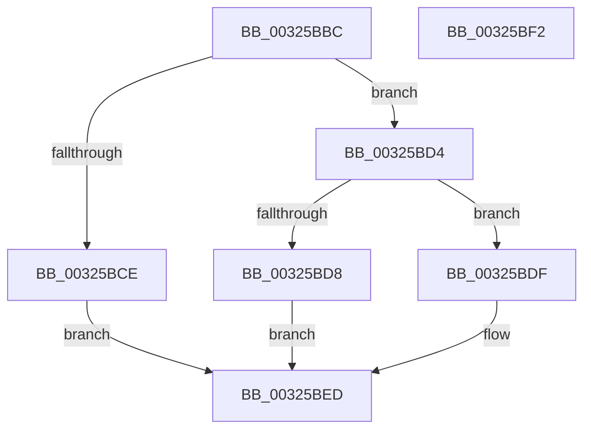

# MiComputeCrossPartitionSectionCharges

- RVA: `0x00325BBC`–`0x00325BF3` (길이 `55` bytes)
- VA: `0x0000000140325BBC`
- 실행 섹션: `.text`
- PDB 이름 있음: `예`; PDB Function 태그: `아니요`
- unwind 정보 RVA: `0x0005C788`
- 디코드: `19`개 명령, `55/55` bytes 표시
- 미해석 바이트: `0` (있으면 어셈블리에 `.byte`로 보존)

> 이 문서는 커널 이미지의 기계어와 PDB 기호를 분석해 생성했습니다. 4번과 5번은 함수 원형과 자료형을 바이너리 사용 방식에서 추정한 C 해석이며 원본 소스 복구 결과는 아닙니다.

## 1. Dependencies

- 직접 호출 지점: **1**; 고유 호출 대상: **1**
- 직접 호출자로 확인된 함수: **9**
- RIP 상대 이미지 참조: **0**

### Outgoing calls
- `0x00325BD8` → [MiGetCommittedPages](MiGetCommittedPages_function_00325CE0.md) (function, `0x00325CE0`)

### Direct callers
- [sub_002860AF](../28/Unknown_function_002860AF.md) at `0x00286137`
- [MiFlushRelease](../29/MiFlushRelease_function_002982C0.md) at `0x00298650`
- [MiFlushRelease](../29/MiFlushRelease_function_002982C0.md) at `0x002986AA`
- [MiRemoveViewsFromSectionWithPfn](../29/MiRemoveViewsFromSectionWithPfn_function_002986D4.md) at `0x002988F0`
- [MiRemoveViewsFromSection](../29/MiRemoveViewsFromSection_function_00298960.md) at `0x00298B34`
- [MiDecrementSubsections](../29/MiDecrementSubsections_function_00298B50.md) at `0x00298D3A`
- [MiDecrementSubsectionViewCount](../29/MiDecrementSubsectionViewCount_function_00298E90.md) at `0x00298FD2`
- [sub_002E10F7](../2E/Unknown_function_002E10F7.md) at `0x002E1144`
- [MiReferenceActiveSubsection](MiReferenceActiveSubsection_function_00325060.md) at `0x0032526E`
- [sub_006EFCBC](../6E/Unknown_function_006EFCBC.md) at `0x006EFCEF`

### Static image references
- 디코드된 RIP-relative 메모리 참조가 없습니다.

## 2. Other-region calls and transfers

- 다른 실행 섹션으로 향하는 call: **0**
- 별도 외부 분기/꼬리 이동을 확인하지 못했습니다.

## 3. Assembly (complete function range)

```asm
00325BBC  48 83 EC 28                     sub rsp, 0x28
00325BC0  48 8B C1                        mov rax, rcx
00325BC3  48 8B 09                        mov rcx, qword ptr [rcx]
00325BC6  8B 51 38                        mov edx, dword ptr [rcx + 0x38]
00325BC9  F6 C2 20                        test dl, 0x20
00325BCC  74 06                           je 0x140325bd4
00325BCE  48 8B 41 78                     mov rax, qword ptr [rcx + 0x78]
00325BD2  EB 19                           jmp 0x140325bed
00325BD4  84 D2                           test dl, dl
00325BD6  78 07                           js 0x140325bdf
00325BD8  E8 03 01 00 00                  call 0x140325ce0
00325BDD  EB 0E                           jmp 0x140325bed
00325BDF  8B 48 34                        mov ecx, dword ptr [rax + 0x34]
00325BE2  8B 40 2C                        mov eax, dword ptr [rax + 0x2c]
00325BE5  81 E1 FF FF FF 3F               and ecx, 0x3fffffff
00325BEB  2B C1                           sub eax, ecx
00325BED  48 83 C4 28                     add rsp, 0x28
00325BF1  C3                              ret
00325BF2  CC                              int3
```

## 4. C-style interpretation (structured pseudocode)

```c
__int64 __fastcall MiComputeCrossPartitionSectionCharges(__int64 a1)
{
    __int64 result;
    __int64 v_rsp;

    v_rsp = (v_rsp) - (40);
    if ((((unsigned __int8)((unsigned int)(*(unsigned int *)(*(unsigned __int64 *)(a1) + 56)))) & (32)) == 0) goto loc_00325BD4;
    goto loc_00325BED;
loc_00325BD4:
    if (sign_flag) goto loc_00325BDF;
    result = MiGetCommittedPages(*(unsigned __int64 *)(a1), (unsigned int)(*(unsigned int *)(*(unsigned __int64 *)(a1) + 56)), a3, a4);
    goto loc_00325BED;
loc_00325BDF:
    a1 = (unsigned int)(((unsigned int)(*(unsigned int *)(result + 52))) & (0x3FFFFFFFULL));
    result = (unsigned int)(((unsigned int)(*(unsigned int *)(result + 44))) - ((unsigned int)(a1)));
loc_00325BED:
    v_rsp = (v_rsp) + (40);
    return result;
}
```

## 5. (Beta) C Style

```c
int64_t MiComputeCrossPartitionSectionCharges(void *Arg1)
{
    uint8_t *arg1 = (uint8_t *)Arg1;

    int64_t result;
    int64_t local_rsp;

    local_rsp = (local_rsp) - (40);
    if ((((uint8_t)((uint32_t)(*(uint32_t *)(*(uint64_t *)(arg1) + 0x38)))) & (32)) == 0) goto loc_00325BD4;
    goto loc_00325BED;
loc_00325BD4:
    if (sign_flag) goto loc_00325BDF;
    result = MiGetCommittedPages(*(uint64_t *)(arg1), (uint32_t)(*(uint32_t *)(*(uint64_t *)(arg1) + 0x38)), a3, a4);
    goto loc_00325BED;
loc_00325BDF:
    Arg1 = (uint32_t)(((uint32_t)(*(uint32_t *)(result + 0x34))) & (0x3FFFFFFFULL));
    result = (uint32_t)(((uint32_t)(*(uint32_t *)(result + 0x2C))) - ((uint32_t)(Arg1)));
loc_00325BED:
    local_rsp = (local_rsp) + (40);
    return result;
}
```

### 관측된 메모리 오프셋

구조체 형식이 확인되지 않은 접근은 인자 기준의 오프셋으로만 기록했습니다.

| 기준 인자 | 오프셋 표현 | 폭 (bit) | 접근 |
|---|---:|---:|---|
| `Arg1` | `+ 0x0` | `64` | `R` |
| `Arg1` | `+ 0x2C` | `32` | `R` |
| `Arg1` | `+ 0x34` | `32` | `R` |

## 6. Execution-region graph

[열기: 2D/3D 그래프와 함수 탐색 컨트롤 패널](../../../control-panel.html?section=text&rva=0x00325BBC&view=graph)

- 2D 그래프는 위에서 아래로 흐르고, 3D 그래프는 빈 공간을 드래그해 회전합니다. Shift+드래그는 이동, 휠은 확대·축소, 함수 노드 선택은 대상 보고서 이동입니다.

### Static fallback


