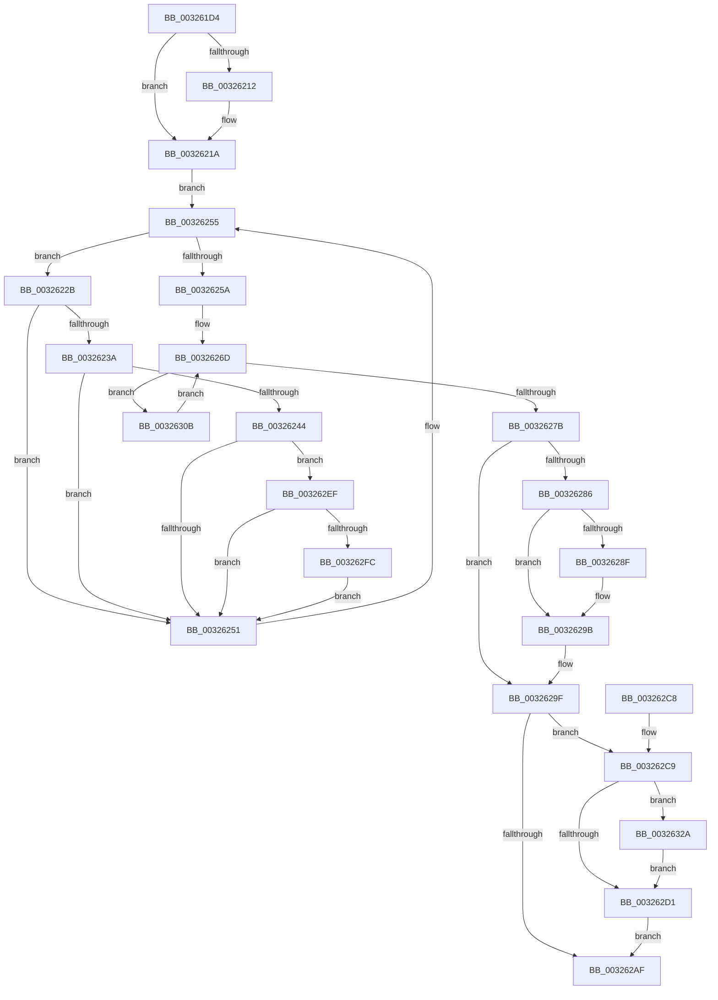

# MiDeleteSegmentPages

- RVA: `0x003261D4`–`0x0032633A` (길이 `358` bytes)
- VA: `0x00000001403261D4`
- 실행 섹션: `.text`
- PDB 이름 있음: `예`; PDB Function 태그: `아니요`
- unwind 정보 RVA: `0x00075C54`
- 디코드: `98`개 명령, `358/358` bytes 표시
- 미해석 바이트: `0` (있으면 어셈블리에 `.byte`로 보존)

> 이 문서는 커널 이미지의 기계어와 PDB 기호를 분석해 생성했습니다. 4번과 5번은 함수 원형과 자료형을 바이너리 사용 방식에서 추정한 C 해석이며 원본 소스 복구 결과는 아닙니다.

## 1. Dependencies

- 직접 호출 지점: **11**; 고유 호출 대상: **10**
- 직접 호출자로 확인된 함수: **2**
- RIP 상대 이미지 참조: **2**

### Outgoing calls
- `0x0032622E` → [MiDeleteSubsectionPages](MiDeleteSubsectionPages_function_00326340.md) (function, `0x00326340`)
- `0x00326265` → [ExAcquireSpinLockExclusive](../24/ExAcquireSpinLockExclusive_function_00248690.md) (function, `0x00248690`)
- `0x0032627B` → [ExReleaseSpinLockExclusiveFromDpcLevel](../24/ExReleaseSpinLockExclusiveFromDpcLevel_function_002497E0.md) (function, `0x002497E0`)
- `0x00326296` → [KiLowerIrqlProcessIrqlFlags](../4F/KiLowerIrqlProcessIrqlFlags_function_004F5698.md) (function, `0x004F5698`)
- `0x003262A2` → [MiGetCommittedPages](MiGetCommittedPages_function_00325CE0.md) (function, `0x00325CE0`)
- `0x003262DD` → [MiReturnCommit](../24/MiReturnCommit_function_00248410.md) (function, `0x00248410`)
- `0x003262FC` → [MiDeleteFileExtentList](../../page/80/MiDeleteFileExtentList_function_00800F6C.md) (function, `0x00800F6C`)
- `0x0032630E` → [MiReleaseSpinLockExclusive](../24/MiReleaseSpinLockExclusive_function_002482C0.md) (function, `0x002482C0`)
- `0x00326318` → [KeYieldProcessorEx](../3F/KeYieldProcessorEx_function_003FBD00.md) (function, `0x003FBD00`)
- `0x00326320` → [ExAcquireSpinLockExclusive](../24/ExAcquireSpinLockExclusive_function_00248690.md) (function, `0x00248690`)
- `0x00326333` → [MiReturnResident](../28/MiReturnResident_function_00286890.md) (function, `0x00286890`)

### Direct callers
- [MiInitializeImageExtents](../../page/80/MiInitializeImageExtents_function_00800FE8.md) at `0x00801062`
- [MiSegmentDelete](../../page/A1/MiSegmentDelete_function_00A1FBB4.md) at `0x00A1FC14`

### Static image references
- `0x003261F2` → RVA `0x00E30088` (`.data`; read)
- `0x00326286` → RVA `0x00FC6D20` (`ALMOSTRO`; read)

## 2. Other-region calls and transfers

- 다른 실행 섹션으로 향하는 call: **1**
  - `0x003262FC` → [MiDeleteFileExtentList](../../page/80/MiDeleteFileExtentList_function_00800F6C.md) (`.text` → `PAGE`)
- 별도 외부 분기/꼬리 이동을 확인하지 못했습니다.

## 3. Assembly (complete function range)

```asm
003261D4  48 89 5C 24 10                  mov qword ptr [rsp + 0x10], rbx
003261D9  48 89 6C 24 18                  mov qword ptr [rsp + 0x18], rbp
003261DE  48 89 74 24 20                  mov qword ptr [rsp + 0x20], rsi
003261E3  57                              push rdi
003261E4  41 56                           push r14
003261E6  41 57                           push r15
003261E8  48 83 EC 20                     sub rsp, 0x20
003261EC  0F B7 51 3C                     movzx edx, word ptr [rcx + 0x3c]
003261F0  33 F6                           xor esi, esi
003261F2  48 8B 05 8F 9E B0 00            mov rax, qword ptr [rip + 0xb09e8f]
003261F9  81 E2 FF 03 00 00               and edx, 0x3ff
003261FF  45 33 F6                        xor r14d, r14d
00326202  48 8B F9                        mov rdi, rcx
00326205  48 8B 2C D0                     mov rbp, qword ptr [rax + rdx*8]
00326209  8B 41 38                        mov eax, dword ptr [rcx + 0x38]
0032620C  48 39 71 40                     cmp qword ptr [rcx + 0x40], rsi
00326210  74 08                           je 0x14032621a
00326212  A8 20                           test al, 0x20
00326214  8D 46 01                        lea eax, [rsi + 1]
00326217  0F 44 F0                        cmove esi, eax
0032621A  48 8B 01                        mov rax, qword ptr [rcx]
0032621D  48 8D 99 80 00 00 00            lea rbx, [rcx + 0x80]
00326224  44 0F B7 78 0C                  movzx r15d, word ptr [rax + 0xc]
00326229  EB 2A                           jmp 0x140326255
0032622B  48 8B CB                        mov rcx, rbx
0032622E  E8 0D 01 00 00                  call 0x140326340
00326233  4C 03 F0                        add r14, rax
00326236  85 F6                           test esi, esi
00326238  74 17                           je 0x140326251
0032623A  48 8B 03                        mov rax, qword ptr [rbx]
0032623D  48 83 78 40 00                  cmp qword ptr [rax + 0x40], 0
00326242  74 0D                           je 0x140326251
00326244  8A 40 3E                        mov al, byte ptr [rax + 0x3e]
00326247  24 0C                           and al, 0xc
00326249  3C 08                           cmp al, 8
0032624B  0F 84 9E 00 00 00               je 0x1403262ef
00326251  48 8B 5B 10                     mov rbx, qword ptr [rbx + 0x10]
00326255  48 85 DB                        test rbx, rbx
00326258  75 D1                           jne 0x14032622b
0032625A  21 5C 24 40                     and dword ptr [rsp + 0x40], ebx
0032625E  48 8D 5F 48                     lea rbx, [rdi + 0x48]
00326262  48 8B CB                        mov rcx, rbx
00326265  E8 26 24 F2 FF                  call 0x140248690
0032626A  0F B6 F0                        movzx esi, al
0032626D  48 83 7F 20 00                  cmp qword ptr [rdi + 0x20], 0
00326272  48 8B CB                        mov rcx, rbx
00326275  0F 85 90 00 00 00               jne 0x14032630b
0032627B  E8 60 35 F2 FF                  call 0x1402497e0
00326280  40 80 FE 11                     cmp sil, 0x11
00326284  74 19                           je 0x14032629f
00326286  83 3D 93 0A CA 00 00            cmp dword ptr [rip + 0xca0a93], 0
0032628D  74 0C                           je 0x14032629b
0032628F  44 0F 20 C1                     mov rcx, cr8
00326293  40 8A D6                        mov dl, sil
00326296  E8 FD F3 1C 00                  call 0x1404f5698
0032629B  44 0F 22 C6                     mov cr8, rsi
0032629F  48 8B CF                        mov rcx, rdi
003262A2  E8 39 FA FF FF                  call 0x140325ce0
003262A7  48 8B D8                        mov rbx, rax
003262AA  48 85 C0                        test rax, rax
003262AD  75 1A                           jne 0x1403262c9
003262AF  48 8B 5C 24 48                  mov rbx, qword ptr [rsp + 0x48]
003262B4  48 8B 6C 24 50                  mov rbp, qword ptr [rsp + 0x50]
003262B9  48 8B 74 24 58                  mov rsi, qword ptr [rsp + 0x58]
003262BE  48 83 C4 20                     add rsp, 0x20
003262C2  41 5F                           pop r15
003262C4  41 5E                           pop r14
003262C6  5F                              pop rdi
003262C7  C3                              ret
003262C8  CC                              int3
003262C9  66 41 0F BA E7 0A               bt r15w, 0xa
003262CF  72 59                           jb 0x14032632a
003262D1  48 8B D3                        mov rdx, rbx
003262D4  45 33 C0                        xor r8d, r8d
003262D7  49 2B D6                        sub rdx, r14
003262DA  48 8B CD                        mov rcx, rbp
003262DD  E8 2E 21 F2 FF                  call 0x140248410
003262E2  48 F7 DB                        neg rbx
003262E5  F0 48 01 9D B8 4C 00 00         lock add qword ptr [rbp + 0x4cb8], rbx
003262ED  EB C0                           jmp 0x1403262af
003262EF  48 8B 4B 70                     mov rcx, qword ptr [rbx + 0x70]
003262F3  48 85 C9                        test rcx, rcx
003262F6  0F 84 55 FF FF FF               je 0x140326251
003262FC  E8 6B AC 4D 00                  call 0x140800f6c
00326301  48 83 63 70 00                  and qword ptr [rbx + 0x70], 0
00326306  E9 46 FF FF FF                  jmp 0x140326251
0032630B  40 8A D6                        mov dl, sil
0032630E  E8 AD 1F F2 FF                  call 0x1402482c0
00326313  48 8D 4C 24 40                  lea rcx, [rsp + 0x40]
00326318  E8 E3 59 0D 00                  call 0x1403fbd00
0032631D  48 8B CB                        mov rcx, rbx
00326320  E8 6B 23 F2 FF                  call 0x140248690
00326325  E9 43 FF FF FF                  jmp 0x14032626d
0032632A  48 8B D3                        mov rdx, rbx
0032632D  48 8B CD                        mov rcx, rbp
00326330  49 2B D6                        sub rdx, r14
00326333  E8 58 05 F6 FF                  call 0x140286890
00326338  EB 97                           jmp 0x1403262d1
```

## 4. C-style interpretation (structured pseudocode)

```c
__int64 __fastcall MiDeleteSegmentPages(__int64 a1, __int64 a2, int a3)
{
    __int64 result;
    __int64 v_r14;
    __int64 v_rbx;
    __int64 v_rsi;
    __int64 v_rsp;
    unsigned __int64 v_stack_p10;
    unsigned __int64 v_stack_p18;
    unsigned __int64 v_stack_p20;
    unsigned __int64 v_stack_p40;
    unsigned int v_stack_p8;

    v_stack_p10 = v_rbx;
    v_stack_p18 = v_rbp;
    v_stack_p20 = v_rsi;
    v_rsp = (v_rsp) - (32);
    v_rsi = 0;
    a2 = (unsigned int)((*(unsigned __int16 *)(a1 + 60)) & (0x3FFULL));
    v_r14 = 0;
    result = (unsigned int)(*(unsigned int *)(a1 + 56));
    if ((*(unsigned __int64 *)(a1 + 64)) != 0) {
        result = v_rsi + 1;
        if ((((unsigned __int8)((unsigned int)(*(unsigned int *)(a1 + 56)))) & (32)) == 0) { v_rsi = (unsigned int)(result); }
    }
    goto loc_00326255;
loc_0032622B:
    result = MiDeleteSubsectionPages(a1 + 128, a2, a3, a4);
    v_r14 = (v_r14) + (result);
    if ((unsigned int)(v_rsi) == 0) goto loc_00326251;
    if ((*(unsigned __int64 *)(*(unsigned __int64 *)(a1 + 128) + 64)) == 0) goto loc_00326251;
    result = (unsigned __int8)((*(unsigned __int8 *)(*(unsigned __int64 *)(a1 + 128) + 62)) & (12));
    if (((unsigned __int8)(result)) == 8) goto loc_003262EF;
loc_00326251:
loc_00326255:
    if (*(unsigned __int64 *)(a1 + 128 + 16) != 0) goto loc_0032622B;
    result = ExAcquireSpinLockExclusive(a1 + 72, a2, a3, a4);
loc_0032626D:
    if ((*(unsigned __int64 *)(a1 + 32)) != 0) goto loc_0032630B;
    result = ExReleaseSpinLockExclusiveFromDpcLevel(a1 + 72, a2, a3, a4);
    if (((unsigned __int8)((unsigned __int8)(result))) == 17) goto loc_0032629F;
    if ((*(unsigned int *)(v_rip + 13240979)) != 0) {
        a1 = v_cr8;
        a2 = (unsigned __int8)((unsigned __int8)(result));
        result = KiLowerIrqlProcessIrqlFlags(a1, a2, a3, a4);
    }
loc_0032629F:
    result = MiGetCommittedPages(a1, a2, a3, a4);
    if (result != 0) goto loc_003262C9;
loc_003262AF:
    v_rsp = (v_rsp) + (32);
    return result;
loc_003262C9:
    if (condition_is_below) goto loc_0032632A;
loc_003262D1:
    a3 = 0;
    a2 = (v_stack_p10) - (v_r14);
    result = MiReturnCommit(v_stack_p18, a2, a3, a4);
    v_rbx = -(v_stack_p10);
    goto loc_003262AF;
loc_003262EF:
    if (*(unsigned __int64 *)(v_rbx + 112) == 0) goto loc_00326251;
    result = MiDeleteFileExtentList(*(unsigned __int64 *)(v_rbx + 112), a2, a3, a4);
    goto loc_00326251;
loc_0032630B:
    result = MiReleaseSpinLockExclusive(*(unsigned __int64 *)(v_rbx + 112), (unsigned __int8)(v_stack_p20), a3, a4);
    result = KeYieldProcessorEx(v_stack_p40, (unsigned __int8)(v_stack_p20), a3, a4);
    result = ExAcquireSpinLockExclusive(v_rbx, (unsigned __int8)(v_stack_p20), a3, a4);
    goto loc_0032626D;
loc_0032632A:
    a2 = (v_rbx) - (v_r14);
    result = MiReturnResident(v_stack_p18, a2, a3, a4);
    goto loc_003262D1;
}
```

## 5. (Beta) C Style

```c
int64_t MiDeleteSegmentPages(void *Arg1, int64_t Arg2, int32_t Arg3)
{
    uint8_t *arg1 = (uint8_t *)Arg1;

    int64_t result;
    int64_t local_r14;
    int64_t local_rbx;
    int64_t local_rsi;
    int64_t local_rsp;
    uint64_t v_stack_p10;
    uint64_t v_stack_p18;
    uint64_t v_stack_p20;
    uint64_t v_stack_p40;
    uint32_t v_stack_p8;

    v_stack_p10 = local_rbx;
    v_stack_p18 = local_rbp;
    v_stack_p20 = local_rsi;
    local_rsp = (local_rsp) - (32);
    local_rsi = 0;
    Arg2 = (uint32_t)((*(uint16_t *)(arg1 + 0x3C)) & (0x3FFULL));
    local_r14 = 0;
    result = (uint32_t)(*(uint32_t *)(arg1 + 0x38));
    if ((*(uint64_t *)(arg1 + 0x40)) != 0) {
        result = local_rsi + 1;
        if ((((uint8_t)((uint32_t)(*(uint32_t *)(arg1 + 0x38)))) & (32)) == 0) { local_rsi = (uint32_t)(result); }
    }
    goto loc_00326255;
loc_0032622B:
    result = MiDeleteSubsectionPages(Arg1 + 128, Arg2, Arg3, a4);
    local_r14 = (local_r14) + (result);
    if ((uint32_t)(local_rsi) == 0) goto loc_00326251;
    if ((*(uint64_t *)(*(uint64_t *)(arg1 + 0x80) + 0x40)) == 0) goto loc_00326251;
    result = (uint8_t)((*(uint8_t *)(*(uint64_t *)(arg1 + 0x80) + 0x3E)) & (12));
    if (((uint8_t)(result)) == 8) goto loc_003262EF;
loc_00326251:
loc_00326255:
    if (*(uint64_t *)(arg1 + 0x80 + 0x10) != 0) goto loc_0032622B;
    result = ExAcquireSpinLockExclusive(Arg1 + 72, Arg2, Arg3, a4);
loc_0032626D:
    if ((*(uint64_t *)(arg1 + 0x20)) != 0) goto loc_0032630B;
    result = ExReleaseSpinLockExclusiveFromDpcLevel(Arg1 + 72, Arg2, Arg3, a4);
    if (((uint8_t)((uint8_t)(result))) == 17) goto loc_0032629F;
    if ((*(uint32_t *)(v_rip + 0xCA0A93)) != 0) {
        Arg1 = v_cr8;
        Arg2 = (uint8_t)((uint8_t)(result));
        result = KiLowerIrqlProcessIrqlFlags(Arg1, Arg2, Arg3, a4);
    }
loc_0032629F:
    result = MiGetCommittedPages(Arg1, Arg2, Arg3, a4);
    if (result != 0) goto loc_003262C9;
loc_003262AF:
    local_rsp = (local_rsp) + (32);
    return result;
loc_003262C9:
    if (condition_is_below) goto loc_0032632A;
loc_003262D1:
    Arg3 = 0;
    Arg2 = (v_stack_p10) - (local_r14);
    result = MiReturnCommit(v_stack_p18, Arg2, Arg3, a4);
    local_rbx = -(v_stack_p10);
    goto loc_003262AF;
loc_003262EF:
    if (*(uint64_t *)(local_rbx + 0x70) == 0) goto loc_00326251;
    result = MiDeleteFileExtentList(*(uint64_t *)(local_rbx + 0x70), Arg2, Arg3, a4);
    goto loc_00326251;
loc_0032630B:
    result = MiReleaseSpinLockExclusive(*(uint64_t *)(local_rbx + 0x70), (uint8_t)(v_stack_p20), Arg3, a4);
    result = KeYieldProcessorEx(v_stack_p40, (uint8_t)(v_stack_p20), Arg3, a4);
    result = ExAcquireSpinLockExclusive(local_rbx, (uint8_t)(v_stack_p20), Arg3, a4);
    goto loc_0032626D;
loc_0032632A:
    Arg2 = (local_rbx) - (local_r14);
    result = MiReturnResident(v_stack_p18, Arg2, Arg3, a4);
    goto loc_003262D1;
}
```

### 관측된 메모리 오프셋

구조체 형식이 확인되지 않은 접근은 인자 기준의 오프셋으로만 기록했습니다.

| 기준 인자 | 오프셋 표현 | 폭 (bit) | 접근 |
|---|---:|---:|---|
| `Arg1` | `+ 0x0` | `64` | `R` |
| `Arg1` | `+ 0x20` | `64` | `R` |
| `Arg1` | `+ 0x38` | `32` | `R` |
| `Arg1` | `+ 0x3C` | `16` | `R` |
| `Arg1` | `+ 0x40` | `64` | `R` |
| `Arg1` | `+ 0x48` | `64` | `R` |
| `Arg1` | `+ 0x80` | `64` | `R` |

## 6. Execution-region graph

[열기: 2D/3D 그래프와 함수 탐색 컨트롤 패널](../../../control-panel.html?section=text&rva=0x003261D4&view=graph)

- 2D 그래프는 위에서 아래로 흐르고, 3D 그래프는 빈 공간을 드래그해 회전합니다. Shift+드래그는 이동, 휠은 확대·축소, 함수 노드 선택은 대상 보고서 이동입니다.

### Static fallback


