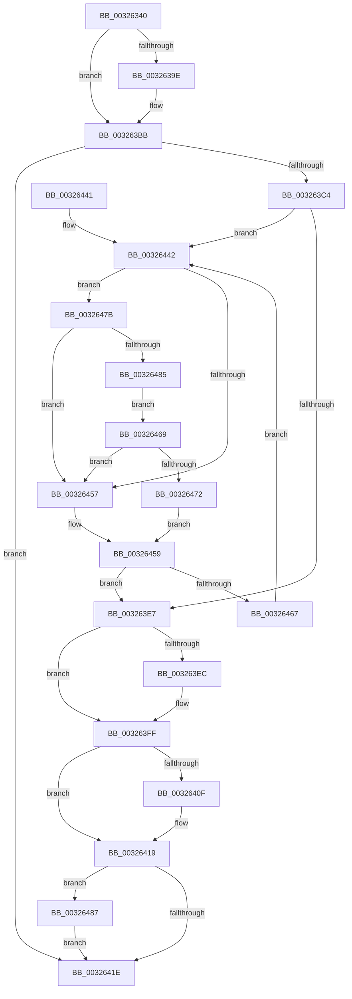

# MiDeleteSubsectionPages

- RVA: `0x00326340`–`0x00326497` (길이 `343` bytes)
- VA: `0x0000000140326340`
- 실행 섹션: `.text`
- PDB 이름 있음: `예`; PDB Function 태그: `아니요`
- unwind 정보 RVA: `0x00075C70`
- 디코드: `105`개 명령, `343/343` bytes 표시
- 미해석 바이트: `0` (있으면 어셈블리에 `.byte`로 보존)

> 이 문서는 커널 이미지의 기계어와 PDB 기호를 분석해 생성했습니다. 4번과 5번은 함수 원형과 자료형을 바이너리 사용 방식에서 추정한 C 해석이며 원본 소스 복구 결과는 아닙니다.

## 1. Dependencies

- 직접 호출 지점: **11**; 고유 호출 대상: **9**
- 직접 호출자로 확인된 함수: **2**
- RIP 상대 이미지 참조: **3**

### Outgoing calls
- `0x003263B6` → [MiPurgeSubsection](../37/MiPurgeSubsection_function_003712F0.md) (function, `0x003712F0`)
- `0x003263C9` → [MiDecrementSubsectionViewCount](../29/MiDecrementSubsectionViewCount_function_00298E90.md) (function, `0x00298E90`)
- `0x003263DA` → [ExAcquireSpinLockExclusive](../24/ExAcquireSpinLockExclusive_function_00248690.md) (function, `0x00248690`)
- `0x003263F5` → [MiUpdateSystemProtoPtesTree](../29/MiUpdateSystemProtoPtesTree_function_00295F0C.md) (function, `0x00295F0C`)
- `0x00326405` → [MiReleaseSpinLockExclusive](../24/MiReleaseSpinLockExclusive_function_002482C0.md) (function, `0x002482C0`)
- `0x00326414` → [ExFreePoolWithTag](../../poolcode/B8/ExFreePoolWithTag_function_00B82870.md) (function, `0x00B82870`)
- `0x00326448` → [MiReleaseSpinLockExclusive](../24/MiReleaseSpinLockExclusive_function_002482C0.md) (function, `0x002482C0`)
- `0x0032645C` → [ExAcquireSpinLockExclusive](../24/ExAcquireSpinLockExclusive_function_00248690.md) (function, `0x00248690`)
- `0x00326469` → [KiCheckVpBackingLongSpinWaitHypercall](../30/KiCheckVpBackingLongSpinWaitHypercall_function_0030F490.md) (function, `0x0030F490`)
- `0x00326474` → [HvlNotifyLongSpinWait](../30/HvlNotifyLongSpinWait_function_0030F460.md) (function, `0x0030F460`)
- `0x00326490` → [MiReturnCrossPartitionSectionCharges](../4B/MiReturnCrossPartitionSectionCharges_function_004BA61C.md) (function, `0x004BA61C`)

### Direct callers
- [MiDeleteSegmentPages](MiDeleteSegmentPages_function_003261D4.md) at `0x0032622E`
- [sub_00B2A916](../../page/B2/Unknown_function_00B2A916.md) at `0x00B2A93C`

### Static image references
- `0x0032638E` → RVA `0x00E30088` (`.data`; read)
- `0x0032644F` → RVA `0x00FC52AC` (`ALMOSTRO`; reference)
- `0x0032647B` → RVA `0x00FC6AB8` (`ALMOSTRO`; read)

## 2. Other-region calls and transfers

- 다른 실행 섹션으로 향하는 call: **1**
  - `0x00326414` → [ExFreePoolWithTag](../../poolcode/B8/ExFreePoolWithTag_function_00B82870.md) (`.text` → `POOLCODE`)
- 별도 외부 분기/꼬리 이동을 확인하지 못했습니다.

## 3. Assembly (complete function range)

```asm
00326340  4C 8B DC                        mov r11, rsp
00326343  49 89 5B 08                     mov qword ptr [r11 + 8], rbx
00326347  49 89 6B 10                     mov qword ptr [r11 + 0x10], rbp
0032634B  49 89 73 18                     mov qword ptr [r11 + 0x18], rsi
0032634F  57                              push rdi
00326350  41 54                           push r12
00326352  41 55                           push r13
00326354  41 56                           push r14
00326356  41 57                           push r15
00326358  48 83 EC 60                     sub rsp, 0x60
0032635C  48 8B 31                        mov rsi, qword ptr [rcx]
0032635F  33 C0                           xor eax, eax
00326361  48 8B 79 08                     mov rdi, qword ptr [rcx + 8]
00326365  45 33 E4                        xor r12d, r12d
00326368  0F 57 C0                        xorps xmm0, xmm0
0032636B  48 8B D9                        mov rbx, rcx
0032636E  0F 11 44 24 30                  movups xmmword ptr [rsp + 0x30], xmm0
00326373  0F B7 56 3C                     movzx edx, word ptr [rsi + 0x3c]
00326377  81 E2 FF 03 00 00               and edx, 0x3ff
0032637D  4C 39 66 40                     cmp qword ptr [rsi + 0x40], r12
00326381  0F 11 44 24 40                  movups xmmword ptr [rsp + 0x40], xmm0
00326386  49 89 43 C8                     mov qword ptr [r11 - 0x38], rax
0032638A  41 0F 95 C4                     setne r12b
0032638E  48 8B 05 F3 9C B0 00            mov rax, qword ptr [rip + 0xb09cf3]
00326395  4C 8B 2C D0                     mov r13, qword ptr [rax + rdx*8]
00326399  48 85 FF                        test rdi, rdi
0032639C  74 1D                           je 0x1403263bb
0032639E  8B 41 2C                        mov eax, dword ptr [rcx + 0x2c]
003263A1  41 B9 02 00 00 00               mov r9d, 2
003263A7  48 8B D7                        mov rdx, rdi
003263AA  4C 8D 04 C7                     lea r8, [rdi + rax*8]
003263AE  49 8D 43 A8                     lea rax, [r11 - 0x58]
003263B2  49 89 43 98                     mov qword ptr [r11 - 0x68], rax
003263B6  E8 35 AF 04 00                  call 0x1403712f0
003263BB  8B 46 38                        mov eax, dword ptr [rsi + 0x38]
003263BE  24 A0                           and al, 0xa0
003263C0  3C 80                           cmp al, 0x80
003263C2  75 5A                           jne 0x14032641e
003263C4  33 D2                           xor edx, edx
003263C6  48 8B CB                        mov rcx, rbx
003263C9  E8 C2 2A F7 FF                  call 0x140298e90
003263CE  48 83 C6 48                     add rsi, 0x48
003263D2  4C 8B F0                        mov r14, rax
003263D5  48 8B CE                        mov rcx, rsi
003263D8  33 ED                           xor ebp, ebp
003263DA  E8 B1 22 F2 FF                  call 0x140248690
003263DF  44 8A F8                        mov r15b, al
003263E2  39 6B 68                        cmp dword ptr [rbx + 0x68], ebp
003263E5  75 5B                           jne 0x140326442
003263E7  48 85 FF                        test rdi, rdi
003263EA  74 13                           je 0x1403263ff
003263EC  48 8D 4B 78                     lea rcx, [rbx + 0x78]
003263F0  BA 02 00 00 00                  mov edx, 2
003263F5  E8 12 FB F6 FF                  call 0x140295f0c
003263FA  48 83 63 08 00                  and qword ptr [rbx + 8], 0
003263FF  41 8A D7                        mov dl, r15b
00326402  48 8B CE                        mov rcx, rsi
00326405  E8 B6 1E F2 FF                  call 0x1402482c0
0032640A  48 85 FF                        test rdi, rdi
0032640D  74 0A                           je 0x140326419
0032640F  33 D2                           xor edx, edx
00326411  48 8B CF                        mov rcx, rdi
00326414  E8 57 C4 85 00                  call 0x140b82870
00326419  4D 85 F6                        test r14, r14
0032641C  75 69                           jne 0x140326487
0032641E  48 8B 44 24 50                  mov rax, qword ptr [rsp + 0x50]
00326423  4C 8D 5C 24 60                  lea r11, [rsp + 0x60]
00326428  49 8B 5B 30                     mov rbx, qword ptr [r11 + 0x30]
0032642C  49 8B 6B 38                     mov rbp, qword ptr [r11 + 0x38]
00326430  49 8B 73 40                     mov rsi, qword ptr [r11 + 0x40]
00326434  49 8B E3                        mov rsp, r11
00326437  41 5F                           pop r15
00326439  41 5E                           pop r14
0032643B  41 5D                           pop r13
0032643D  41 5C                           pop r12
0032643F  5F                              pop rdi
00326440  C3                              ret
00326441  CC                              int3
00326442  41 8A D7                        mov dl, r15b
00326445  48 8B CE                        mov rcx, rsi
00326448  E8 73 1E F2 FF                  call 0x1402482c0
0032644D  FF C5                           inc ebp
0032644F  85 2D 57 EE C9 00               test dword ptr [rip + 0xc9ee57], ebp
00326455  74 24                           je 0x14032647b
00326457  F3 90                           pause
00326459  48 8B CE                        mov rcx, rsi
0032645C  E8 2F 22 F2 FF                  call 0x140248690
00326461  83 7B 68 00                     cmp dword ptr [rbx + 0x68], 0
00326465  74 80                           je 0x1403263e7
00326467  EB D9                           jmp 0x140326442
00326469  E8 22 90 FE FF                  call 0x14030f490
0032646E  84 C0                           test al, al
00326470  74 E5                           je 0x140326457
00326472  8B CD                           mov ecx, ebp
00326474  E8 E7 8F FE FF                  call 0x14030f460
00326479  EB DE                           jmp 0x140326459
0032647B  8B 05 37 06 CA 00               mov eax, dword ptr [rip + 0xca0637]
00326481  A8 40                           test al, 0x40
00326483  74 D2                           je 0x140326457
00326485  EB E2                           jmp 0x140326469
00326487  4D 8B C6                        mov r8, r14
0032648A  41 8B D4                        mov edx, r12d
0032648D  49 8B CD                        mov rcx, r13
00326490  E8 87 41 19 00                  call 0x1404ba61c
00326495  EB 87                           jmp 0x14032641e
```

## 4. C-style interpretation (structured pseudocode)

```c
__int64 __fastcall MiDeleteSubsectionPages(__int64 a1)
{
    __int64 result;
    __int64 v_r12;
    __int64 v_rbp;
    __int64 v_rsi;
    __int64 v_rsp;
    unsigned __int64 v_stack_m28;
    unsigned __int64 v_stack_m38;
    unsigned __int64 v_stack_m48;
    unsigned __int64 v_stack_m58;

    *(unsigned __int64 *)(v_rsp + 8) = v_rbx;
    *(unsigned __int64 *)(v_rsp + 16) = v_rbp;
    *(unsigned __int64 *)(v_rsp + 24) = v_rsi;
    v_rsp = (v_rsp) - (96);
    result = 0;
    v_r12 = 0;
    v_stack_m58 = v_xmm0;
    a2 = (unsigned int)((*(unsigned __int16 *)(*(unsigned __int64 *)(a1) + 60)) & (0x3FFULL));
    v_stack_m48 = v_xmm0;
    *(unsigned __int64 *)(v_rsp - 56) = 0;
    v_r12 = ((*(unsigned __int64 *)(*(unsigned __int64 *)(a1) + 64)) != 0) ? 1 : 0;
    result = *(unsigned __int64 *)(v_rip + 11574515);
    if (*(unsigned __int64 *)(a1 + 8) != 0) {
        result = *(unsigned int *)(a1 + 44);
        a4 = 2;
        a2 = *(unsigned __int64 *)(a1 + 8);
        a3 = *(unsigned __int64 *)(a1 + 8) + result * 8;
        result = v_rsp - 88;
        *(unsigned __int64 *)(v_rsp - 104) = result;
        result = MiPurgeSubsection(a1, a2, a3, a4);
    }
    result = (unsigned __int8)(((unsigned int)(*(unsigned int *)(*(unsigned __int64 *)(a1) + 56))) & (160));
    if (((unsigned __int8)(result)) != 128) goto loc_0032641E;
    a2 = 0;
    result = MiDecrementSubsectionViewCount(a1, a2, a3, a4);
    v_rsi = (*(unsigned __int64 *)(a1)) + (72);
    v_rbp = 0;
    result = ExAcquireSpinLockExclusive(v_rsi, a2, a3, a4);
    if ((*(unsigned int *)(a1 + 104)) != 0) goto loc_00326442;
loc_003263E7:
    if (*(unsigned __int64 *)(a1 + 8) != 0) {
        a1 = a1 + 120;
        a2 = 2;
        result = MiUpdateSystemProtoPtesTree(a1, a2, a3, a4);
    }
    result = MiReleaseSpinLockExclusive(v_rsi, (unsigned __int8)((unsigned __int8)(result)), a3, a4);
    if (*(unsigned __int64 *)(a1 + 8) != 0) {
        a2 = 0;
        a1 = *(unsigned __int64 *)(a1 + 8);
        result = ExFreePoolWithTag(a1, a2, a3, a4);
    }
    if (result != 0) goto loc_00326487;
loc_0032641E:
    return v_stack_m38;
loc_00326442:
    result = MiReleaseSpinLockExclusive(*(unsigned __int64 *)(v_stack_m28 + 64), (unsigned __int8)((unsigned __int8)(result)), a3, a4);
    v_rbp = (unsigned int)((*(unsigned __int64 *)(v_stack_m28 + 56)) + 1);
    if (((*(unsigned int *)(v_rip + 13233751)) & ((unsigned int)(v_rbp))) == 0) goto loc_0032647B;
loc_00326457:
loc_00326459:
    result = ExAcquireSpinLockExclusive(*(unsigned __int64 *)(v_stack_m28 + 64), (unsigned __int8)((unsigned __int8)(result)), a3, a4);
    if ((*(unsigned int *)(*(unsigned __int64 *)(v_stack_m28 + 48) + 104)) == 0) goto loc_003263E7;
    goto loc_00326442;
loc_00326469:
    result = KiCheckVpBackingLongSpinWaitHypercall(*(unsigned __int64 *)(v_stack_m28 + 64), (unsigned __int8)((unsigned __int8)(result)), a3, a4);
    if ((unsigned __int8)(result) == 0) goto loc_00326457;
    result = HvlNotifyLongSpinWait((unsigned int)((unsigned int)(v_rbp)), (unsigned __int8)((unsigned __int8)(result)), a3, a4);
    goto loc_00326459;
loc_0032647B:
    if ((((unsigned __int8)((unsigned int)(*(unsigned int *)(v_rip + 13239863)))) & (64)) == 0) goto loc_00326457;
    goto loc_00326469;
loc_00326487:
    result = MiReturnCrossPartitionSectionCharges(*(unsigned __int64 *)(*(unsigned __int64 *)(v_rip + 11574515) + a2 * 8), (unsigned int)((unsigned int)(v_r12)), result, a4);
    goto loc_0032641E;
}
```

## 5. (Beta) C Style

```c
int64_t MiDeleteSubsectionPages(void *Arg1)
{
    uint8_t *arg1 = (uint8_t *)Arg1;

    int64_t result;
    int64_t local_r12;
    int64_t local_rbp;
    int64_t local_rsi;
    int64_t local_rsp;
    uint64_t v_stack_m28;
    uint64_t v_stack_m38;
    uint64_t v_stack_m48;
    uint64_t v_stack_m58;

    *(uint64_t *)(local_rsp + 0x8) = local_rbx;
    *(uint64_t *)(local_rsp + 0x10) = local_rbp;
    *(uint64_t *)(local_rsp + 0x18) = local_rsi;
    local_rsp = (local_rsp) - (96);
    result = 0;
    local_r12 = 0;
    v_stack_m58 = v_xmm0;
    a2 = (uint32_t)((*(uint16_t *)(*(uint64_t *)(arg1) + 0x3C)) & (0x3FFULL));
    v_stack_m48 = v_xmm0;
    *(uint64_t *)(local_rsp - 0x38) = 0;
    local_r12 = ((*(uint64_t *)(*(uint64_t *)(arg1) + 0x40)) != 0) ? 1 : 0;
    result = *(uint64_t *)(v_rip + 0xB09CF3);
    if (*(uint64_t *)(arg1 + 0x8) != 0) {
        result = *(uint32_t *)(arg1 + 0x2C);
        a4 = 2;
        a2 = *(uint64_t *)(arg1 + 0x8);
        a3 = *(uint64_t *)(arg1 + 0x8) + result * 8;
        result = local_rsp - 88;
        *(uint64_t *)(local_rsp - 0x68) = result;
        result = MiPurgeSubsection(Arg1, a2, a3, a4);
    }
    result = (uint8_t)(((uint32_t)(*(uint32_t *)(*(uint64_t *)(arg1) + 0x38))) & (160));
    if (((uint8_t)(result)) != 128) goto loc_0032641E;
    a2 = 0;
    result = MiDecrementSubsectionViewCount(Arg1, a2, a3, a4);
    local_rsi = (*(uint64_t *)(arg1)) + (72);
    local_rbp = 0;
    result = ExAcquireSpinLockExclusive(local_rsi, a2, a3, a4);
    if ((*(uint32_t *)(arg1 + 0x68)) != 0) goto loc_00326442;
loc_003263E7:
    if (*(uint64_t *)(arg1 + 0x8) != 0) {
        Arg1 = Arg1 + 120;
        a2 = 2;
        result = MiUpdateSystemProtoPtesTree(Arg1, a2, a3, a4);
    }
    result = MiReleaseSpinLockExclusive(local_rsi, (uint8_t)((uint8_t)(result)), a3, a4);
    if (*(uint64_t *)(arg1 + 0x8) != 0) {
        a2 = 0;
        Arg1 = *(uint64_t *)(arg1 + 0x8);
        result = ExFreePoolWithTag(Arg1, a2, a3, a4);
    }
    if (result != 0) goto loc_00326487;
loc_0032641E:
    return v_stack_m38;
loc_00326442:
    result = MiReleaseSpinLockExclusive(*(uint64_t *)(v_stack_m28 + 0x40), (uint8_t)((uint8_t)(result)), a3, a4);
    local_rbp = (uint32_t)((*(uint64_t *)(v_stack_m28 + 0x38)) + 1);
    if (((*(uint32_t *)(v_rip + 0xC9EE57)) & ((uint32_t)(local_rbp))) == 0) goto loc_0032647B;
loc_00326457:
loc_00326459:
    result = ExAcquireSpinLockExclusive(*(uint64_t *)(v_stack_m28 + 0x40), (uint8_t)((uint8_t)(result)), a3, a4);
    if ((*(uint32_t *)(*(uint64_t *)(v_stack_m28 + 0x30) + 0x68)) == 0) goto loc_003263E7;
    goto loc_00326442;
loc_00326469:
    result = KiCheckVpBackingLongSpinWaitHypercall(*(uint64_t *)(v_stack_m28 + 0x40), (uint8_t)((uint8_t)(result)), a3, a4);
    if ((uint8_t)(result) == 0) goto loc_00326457;
    result = HvlNotifyLongSpinWait((uint32_t)((uint32_t)(local_rbp)), (uint8_t)((uint8_t)(result)), a3, a4);
    goto loc_00326459;
loc_0032647B:
    if ((((uint8_t)((uint32_t)(*(uint32_t *)(v_rip + 0xCA0637)))) & (64)) == 0) goto loc_00326457;
    goto loc_00326469;
loc_00326487:
    result = MiReturnCrossPartitionSectionCharges(*(uint64_t *)(*(uint64_t *)(v_rip + 0xB09CF3) + a2 * 8), (uint32_t)((uint32_t)(local_r12)), result, a4);
    goto loc_0032641E;
}
```

### 관측된 메모리 오프셋

구조체 형식이 확인되지 않은 접근은 인자 기준의 오프셋으로만 기록했습니다.

| 기준 인자 | 오프셋 표현 | 폭 (bit) | 접근 |
|---|---:|---:|---|
| `Arg1` | `+ 0x0` | `64` | `R` |
| `Arg1` | `+ 0x8` | `64` | `R` |
| `Arg1` | `+ 0x8` | `64` | `R/W` |
| `Arg1` | `+ 0x2C` | `32` | `R` |
| `Arg1` | `+ 0x68` | `32` | `R` |
| `Arg1` | `+ 0x78` | `64` | `R` |

## 6. Execution-region graph

[열기: 2D/3D 그래프와 함수 탐색 컨트롤 패널](../../../control-panel.html?section=text&rva=0x00326340&view=graph)

- 2D 그래프는 위에서 아래로 흐르고, 3D 그래프는 빈 공간을 드래그해 회전합니다. Shift+드래그는 이동, 휠은 확대·축소, 함수 노드 선택은 대상 보고서 이동입니다.

### Static fallback


