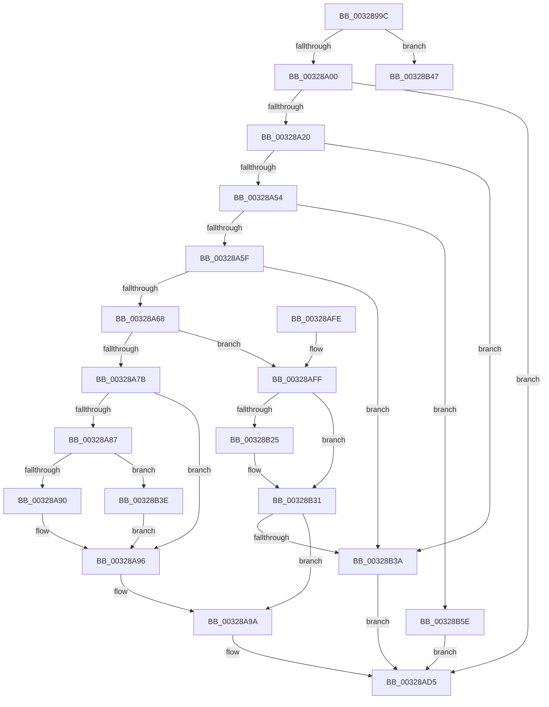

# MiFindActualFaultingPte

- RVA: `0x0032899C`–`0x00328B66` (길이 `458` bytes)
- VA: `0x000000014032899C`
- 실행 섹션: `.text`
- PDB 이름 있음: `예`; PDB Function 태그: `예`
- unwind 정보 RVA: `0x00075F18`
- 디코드: `113`개 명령, `458/458` bytes 표시
- 미해석 바이트: `0` (있으면 어셈블리에 `.byte`로 보존)

> 이 문서는 커널 이미지의 기계어와 PDB 기호를 분석해 생성했습니다. 4번과 5번은 함수 원형과 자료형을 바이너리 사용 방식에서 추정한 C 해석이며 원본 소스 복구 결과는 아닙니다.

## 1. Dependencies

- 직접 호출 지점: **8**; 고유 호출 대상: **8**
- 직접 호출자로 확인된 함수: **2**
- RIP 상대 이미지 참조: **2**

### Outgoing calls
- `0x003289E7` → [memset](../6C/memset_function_006C6C40.md) (function, `0x006C6C40`)
- `0x00328A44` → [MI_READ_PTE_LOCK_FREE](../28/MI_READ_PTE_LOCK_FREE_function_002828A0.md) (function, `0x002828A0`)
- `0x00328A6B` → [MiIsPrototypePteVadLookup](MiIsPrototypePteVadLookup_function_00328B70.md) (function, `0x00328B70`)
- `0x00328AC9` → [MiFindActualFaultingPte](MiFindActualFaultingPte_function_0032899C.md) (function, `0x0032899C`)
- `0x00328ADC` → [_security_check_cookie](../6A/_security_check_cookie_function_006AC640.md) (function, `0x006AC640`)
- `0x00328B16` → [MiCheckVirtualAddress](MiCheckVirtualAddress_function_0032E4F0.md) (function, `0x0032E4F0`)
- `0x00328B2C` → [MiUnlockVadTree](../29/MiUnlockVadTree_function_00297020.md) (function, `0x00297020`)
- `0x00328B4F` → [MiFillPteHierarchy](../3F/MiFillPteHierarchy_function_003F7F90.md) (function, `0x003F7F90`)

### Direct callers
- [MiIsFaultPteIntact](MiIsFaultPteIntact_function_003288A0.md) at `0x003288C1`
- [MiFindActualFaultingPte](MiFindActualFaultingPte_function_0032899C.md) at `0x00328AC9`

### Static image references
- `0x003289BB` → RVA `0x00E0A740` (`.data`; read)
- `0x00328A7B` → RVA `0x00E2DC80` (`.data`; read)

## 2. Other-region calls and transfers

- 다른 실행 섹션으로 향하는 call: **0**
- call이 아닌 외부 분기/꼬리 이동: **1**
  - `0x00328B59` → [sub_006E1DF6](../6E/Unknown_function_006E1DF6.md) (`tail-transfer`)

## 3. Assembly (complete function range)

```asm
0032899C  48 8B C4                        mov rax, rsp
0032899F  48 89 58 08                     mov qword ptr [rax + 8], rbx
003289A3  48 89 70 18                     mov qword ptr [rax + 0x18], rsi
003289A7  48 89 78 20                     mov qword ptr [rax + 0x20], rdi
003289AB  55                              push rbp
003289AC  41 54                           push r12
003289AE  41 56                           push r14
003289B0  48 8D 68 A1                     lea rbp, [rax - 0x5f]
003289B4  48 81 EC 00 01 00 00            sub rsp, 0x100
003289BB  48 8B 05 7E 1D AE 00            mov rax, qword ptr [rip + 0xae1d7e]
003289C2  48 33 C4                        xor rax, rsp
003289C5  48 89 45 37                     mov qword ptr [rbp + 0x37], rax
003289C9  0F 57 C0                        xorps xmm0, xmm0
003289CC  48 8B F2                        mov rsi, rdx
003289CF  48 8B D9                        mov rbx, rcx
003289D2  33 D2                           xor edx, edx
003289D4  48 8D 4D 97                     lea rcx, [rbp - 0x69]
003289D8  41 B8 98 00 00 00               mov r8d, 0x98
003289DE  0F 11 44 24 30                  movups xmmword ptr [rsp + 0x30], xmm0
003289E3  0F 11 45 87                     movups xmmword ptr [rbp - 0x79], xmm0
003289E7  E8 54 E2 39 00                  call 0x1406c6c40
003289EC  F6 43 45 01                     test byte ptr [rbx + 0x45], 1
003289F0  49 BC 00 00 00 40 FB F6 FF FF   movabs r12, 0xfffff6fb40000000
003289FA  0F 85 47 01 00 00               jne 0x140328b47
00328A00  48 8B 43 48                     mov rax, qword ptr [rbx + 0x48]
00328A04  48 8B D6                        mov rdx, rsi
00328A07  48 C1 EA 12                     shr rdx, 0x12
00328A0B  81 E2 F8 FF FF 3F               and edx, 0x3ffffff8
00328A11  49 8B CC                        mov rcx, r12
00328A14  48 03 D1                        add rdx, rcx
00328A17  48 3B C2                        cmp rax, rdx
00328A1A  0F 85 B5 00 00 00               jne 0x140328ad5
00328A20  48 8B FE                        mov rdi, rsi
00328A23  48 B8 F8 FF FF FF 7F 00 00 00   movabs rax, 0x7ffffffff8
00328A2D  48 C1 EF 09                     shr rdi, 9
00328A31  48 23 F8                        and rdi, rax
00328A34  48 B8 00 00 00 00 80 F6 FF FF   movabs rax, 0xfffff68000000000
00328A3E  48 03 F8                        add rdi, rax
00328A41  48 8B CF                        mov rcx, rdi
00328A44  E8 57 9E F5 FF                  call 0x1402828a0
00328A49  48 8B D8                        mov rbx, rax
00328A4C  A8 01                           test al, 1
00328A4E  0F 85 E6 00 00 00               jne 0x140328b3a
00328A54  48 0F BA E0 0A                  bt rax, 0xa
00328A59  0F 83 FF 00 00 00               jae 0x140328b5e
00328A5F  F6 C3 02                        test bl, 2
00328A62  0F 85 D2 00 00 00               jne 0x140328b3a
00328A68  48 8B C8                        mov rcx, rax
00328A6B  E8 00 01 00 00                  call 0x140328b70
00328A70  45 33 F6                        xor r14d, r14d
00328A73  85 C0                           test eax, eax
00328A75  0F 85 84 00 00 00               jne 0x140328aff
00328A7B  48 8B 05 FE 51 B0 00            mov rax, qword ptr [rip + 0xb051fe]
00328A82  48 85 C0                        test rax, rax
00328A85  74 0F                           je 0x140328a96
00328A87  F6 C3 10                        test bl, 0x10
00328A8A  0F 85 AE 00 00 00               jne 0x140328b3e
00328A90  48 F7 D0                        not rax
00328A93  48 23 D8                        and rbx, rax
00328A96  48 C1 FB 10                     sar rbx, 0x10
00328A9A  80 65 DC FE                     and byte ptr [rbp - 0x24], 0xfe
00328A9E  48 8B CB                        mov rcx, rbx
00328AA1  48 C1 E9 12                     shr rcx, 0x12
00328AA5  81 E1 F8 FF FF 3F               and ecx, 0x3ffffff8
00328AAB  48 89 5D 97                     mov qword ptr [rbp - 0x69], rbx
00328AAF  C6 45 DB 11                     mov byte ptr [rbp - 0x25], 0x11
00328AB3  66 44 89 75 D9                  mov word ptr [rbp - 0x27], r14w
00328AB8  49 8B C4                        mov rax, r12
00328ABB  48 03 C8                        add rcx, rax
00328ABE  48 8B D3                        mov rdx, rbx
00328AC1  48 89 4D DF                     mov qword ptr [rbp - 0x21], rcx
00328AC5  48 8D 4D 97                     lea rcx, [rbp - 0x69]
00328AC9  E8 CE FE FF FF                  call 0x14032899c
00328ACE  48 85 C0                        test rax, rax
00328AD1  48 0F 44 C7                     cmove rax, rdi
00328AD5  48 8B 4D 37                     mov rcx, qword ptr [rbp + 0x37]
00328AD9  48 33 CC                        xor rcx, rsp
00328ADC  E8 5F 3B 38 00                  call 0x1406ac640
00328AE1  4C 8D 9C 24 00 01 00 00         lea r11, [rsp + 0x100]
00328AE9  49 8B 5B 20                     mov rbx, qword ptr [r11 + 0x20]
00328AED  49 8B 73 30                     mov rsi, qword ptr [r11 + 0x30]
00328AF1  49 8B 7B 38                     mov rdi, qword ptr [r11 + 0x38]
00328AF5  49 8B E3                        mov rsp, r11
00328AF8  41 5E                           pop r14
00328AFA  41 5C                           pop r12
00328AFC  5D                              pop rbp
00328AFD  C3                              ret
00328AFE  CC                              int3
00328AFF  4C 8D 44 24 28                  lea r8, [rsp + 0x28]
00328B04  4C 89 74 24 28                  mov qword ptr [rsp + 0x28], r14
00328B09  48 8D 54 24 20                  lea rdx, [rsp + 0x20]
00328B0E  44 89 74 24 20                  mov dword ptr [rsp + 0x20], r14d
00328B13  48 8B CE                        mov rcx, rsi
00328B16  E8 D5 59 00 00                  call 0x14032e4f0
00328B1B  48 8B D8                        mov rbx, rax
00328B1E  4C 39 74 24 28                  cmp qword ptr [rsp + 0x28], r14
00328B23  74 0C                           je 0x140328b31
00328B25  B2 11                           mov dl, 0x11
00328B27  B9 01 00 00 00                  mov ecx, 1
00328B2C  E8 EF E4 F6 FF                  call 0x140297020
00328B31  48 85 DB                        test rbx, rbx
00328B34  0F 85 60 FF FF FF               jne 0x140328a9a
00328B3A  33 C0                           xor eax, eax
00328B3C  EB 97                           jmp 0x140328ad5
00328B3E  48 83 E3 EF                     and rbx, 0xffffffffffffffef
00328B42  E9 4F FF FF FF                  jmp 0x140328a96
00328B47  48 8D 54 24 30                  lea rdx, [rsp + 0x30]
00328B4C  48 8B CE                        mov rcx, rsi
00328B4F  E8 3C F4 0C 00                  call 0x1403f7f90
00328B54  BB 04 00 00 00                  mov ebx, 4
00328B59  E9 98 92 3B 00                  jmp 0x1406e1df6
00328B5E  48 8B C7                        mov rax, rdi
00328B61  E9 6F FF FF FF                  jmp 0x140328ad5
```

## 4. C-style interpretation (structured pseudocode)

```c
__int64 __fastcall MiFindActualFaultingPte(__int64 a1, __int64 a2)
{
    __int64 result;
    __int64 v_r14;
    __int64 v_rbx;
    __int64 v_rdi;
    __int64 v_rsp;
    unsigned __int64 v_stack_m18;
    unsigned __int64 v_stack_mD0;
    unsigned __int64 v_stack_mD8;
    unsigned __int64 v_stack_mE0;
    unsigned __int64 v_stack_mE8;

    *(unsigned __int64 *)(v_rsp + 8) = v_rbx;
    *(unsigned __int64 *)(v_rsp + 24) = v_rsi;
    *(unsigned __int64 *)(v_rsp + 32) = v_rdi;
    v_rsp = (v_rsp) - (256);
    result = (*(unsigned __int64 *)(v_rip + 11410814)) ^ (v_rsp);
    *(unsigned __int64 *)(v_rsp - 95 + 55) = result;
    a2 = 0;
    v_stack_mE8 = v_xmm0;
    *(unsigned __int64 *)(v_rsp - 95 - 121) = v_xmm0;
    result = memset(v_rsp - 95 - 105, a2, 152, a4);
    if (((*(unsigned __int8 *)(a1 + 69)) & (1)) != 0) goto loc_00328B47;
    a2 = (0) >> (18);
    a2 = (unsigned int)((a2) & (0x3FFFFFF8ULL));
    a2 = (a2) + (v_r12);
    if ((*(unsigned __int64 *)(a1 + 72)) != a2) goto loc_00328AD5;
    v_rdi = (a2) >> (9);
    v_rdi = (v_rdi) & (*(unsigned __int64 *)(a1 + 72));
    v_rdi = (v_rdi) + (*(unsigned __int64 *)(a1 + 72));
    result = MI_READ_PTE_LOCK_FREE(v_rdi, a2, 152, a4);
    if ((((unsigned __int8)(result)) & (1)) != 0) goto loc_00328B3A;
    if (condition_is_above_or_equal) goto loc_00328B5E;
    if ((((unsigned __int8)(result)) & (2)) != 0) goto loc_00328B3A;
    result = MiIsPrototypePteVadLookup(result, a2, 152, a4);
    v_r14 = 0;
    if ((unsigned int)(result) != 0) goto loc_00328AFF;
    if (*(unsigned __int64 *)(v_rip + 11555326) == 0) goto loc_00328A96;
    if ((((unsigned __int8)(result)) & (16)) != 0) goto loc_00328B3E;
    result = ~(*(unsigned __int64 *)(v_rip + 11555326));
    v_rbx = (result) & (result);
loc_00328A96:
    v_rbx = (v_rbx) >> (16);
loc_00328A9A:
    a1 = (v_rbx) >> (18);
    a1 = (unsigned int)((a1) & (0x3FFFFFF8ULL));
    *(unsigned __int64 *)(v_rsp - 95 - 105) = v_rbx;
    *(unsigned __int8 *)(v_rsp - 95 - 37) = 17;
    *(unsigned __int16 *)(v_rsp - 95 - 39) = 0;
    a1 = (a1) + (v_r12);
    *(unsigned __int64 *)(v_rsp - 95 - 33) = a1;
    result = MiFindActualFaultingPte(v_rsp - 95 - 105, v_rbx, 152, a4);
    if (result == 0) { result = v_rdi; }
loc_00328AD5:
    a1 = (*(unsigned __int64 *)(v_rsp - 95 + 55)) ^ (v_rsp);
    result = _security_check_cookie(a1, v_rbx, 152, a4);
    return result;
loc_00328AFF:
    v_stack_mD8 = 0;
    v_stack_mE0 = 0;
    result = MiCheckVirtualAddress(*(unsigned __int64 *)(v_stack_m18 + 48), v_stack_mE0, v_stack_mD8, a4);
    if (v_stack_mD8 != 0) {
        a2 = 17;
        a1 = 1;
        result = MiUnlockVadTree(a1, a2, v_stack_mD8, a4);
    }
    if (result != 0) goto loc_00328A9A;
loc_00328B3A:
    result = 0;
    goto loc_00328AD5;
loc_00328B3E:
    v_rbx = (result) & (-17);
    goto loc_00328A96;
loc_00328B47:
    result = MiFillPteHierarchy(*(unsigned __int64 *)(v_stack_m18 + 48), v_stack_mD0, v_stack_mD8, a4);
loc_00328B5E:
    goto loc_00328AD5;
}
```

## 5. (Beta) C Style

```c
int64_t MiFindActualFaultingPte(void *Arg1, int64_t Arg2)
{
    uint8_t *arg1 = (uint8_t *)Arg1;

    int64_t result;
    int64_t local_r14;
    int64_t local_rbx;
    int64_t local_rdi;
    int64_t local_rsp;
    uint64_t v_stack_m18;
    uint64_t v_stack_mD0;
    uint64_t v_stack_mD8;
    uint64_t v_stack_mE0;
    uint64_t v_stack_mE8;

    *(uint64_t *)(local_rsp + 0x8) = local_rbx;
    *(uint64_t *)(local_rsp + 0x18) = local_rsi;
    *(uint64_t *)(local_rsp + 0x20) = local_rdi;
    local_rsp = (local_rsp) - (256);
    result = (*(uint64_t *)(v_rip + 0xAE1D7E)) ^ (local_rsp);
    *(uint64_t *)(local_rsp - 0x5F + 0x37) = result;
    Arg2 = 0;
    v_stack_mE8 = v_xmm0;
    *(uint64_t *)(local_rsp - 0x5F - 0x79) = v_xmm0;
    result = memset(local_rsp - 95 - 105, Arg2, 152, a4);
    if (((*(uint8_t *)(arg1 + 0x45)) & (1)) != 0) goto loc_00328B47;
    Arg2 = (0) >> (18);
    Arg2 = (uint32_t)((Arg2) & (0x3FFFFFF8ULL));
    Arg2 = (Arg2) + (local_r12);
    if ((*(uint64_t *)(arg1 + 0x48)) != Arg2) goto loc_00328AD5;
    local_rdi = (Arg2) >> (9);
    local_rdi = (local_rdi) & (*(uint64_t *)(arg1 + 0x48));
    local_rdi = (local_rdi) + (*(uint64_t *)(arg1 + 0x48));
    result = MI_READ_PTE_LOCK_FREE(local_rdi, Arg2, 152, a4);
    if ((((uint8_t)(result)) & (1)) != 0) goto loc_00328B3A;
    if (condition_is_above_or_equal) goto loc_00328B5E;
    if ((((uint8_t)(result)) & (2)) != 0) goto loc_00328B3A;
    result = MiIsPrototypePteVadLookup(result, Arg2, 152, a4);
    local_r14 = 0;
    if ((uint32_t)(result) != 0) goto loc_00328AFF;
    if (*(uint64_t *)(v_rip + 0xB051FE) == 0) goto loc_00328A96;
    if ((((uint8_t)(result)) & (16)) != 0) goto loc_00328B3E;
    result = ~(*(uint64_t *)(v_rip + 0xB051FE));
    local_rbx = (result) & (result);
loc_00328A96:
    local_rbx = (local_rbx) >> (16);
loc_00328A9A:
    Arg1 = (local_rbx) >> (18);
    Arg1 = (uint32_t)((Arg1) & (0x3FFFFFF8ULL));
    *(uint64_t *)(local_rsp - 0x5F - 0x69) = local_rbx;
    *(uint8_t *)(local_rsp - 0x5F - 0x25) = 17;
    *(uint16_t *)(local_rsp - 0x5F - 0x27) = 0;
    Arg1 = (Arg1) + (local_r12);
    *(void **)(local_rsp - 0x5F - 0x21) = Arg1;
    result = MiFindActualFaultingPte(local_rsp - 95 - 105, local_rbx, 152, a4);
    if (result == 0) { result = local_rdi; }
loc_00328AD5:
    Arg1 = (*(uint64_t *)(local_rsp - 0x5F + 0x37)) ^ (local_rsp);
    result = _security_check_cookie(Arg1, local_rbx, 152, a4);
    return result;
loc_00328AFF:
    v_stack_mD8 = 0;
    v_stack_mE0 = 0;
    result = MiCheckVirtualAddress(*(uint64_t *)(v_stack_m18 + 0x30), v_stack_mE0, v_stack_mD8, a4);
    if (v_stack_mD8 != 0) {
        Arg2 = 17;
        Arg1 = 1;
        result = MiUnlockVadTree(Arg1, Arg2, v_stack_mD8, a4);
    }
    if (result != 0) goto loc_00328A9A;
loc_00328B3A:
    result = 0;
    goto loc_00328AD5;
loc_00328B3E:
    local_rbx = (result) & (-17);
    goto loc_00328A96;
loc_00328B47:
    result = MiFillPteHierarchy(*(uint64_t *)(v_stack_m18 + 0x30), v_stack_mD0, v_stack_mD8, a4);
loc_00328B5E:
    goto loc_00328AD5;
}
```

### 관측된 메모리 오프셋

구조체 형식이 확인되지 않은 접근은 인자 기준의 오프셋으로만 기록했습니다.

| 기준 인자 | 오프셋 표현 | 폭 (bit) | 접근 |
|---|---:|---:|---|
| `Arg1` | `+ 0x45` | `8` | `R` |
| `Arg1` | `+ 0x48` | `64` | `R` |

## 6. Execution-region graph

[열기: 2D/3D 그래프와 함수 탐색 컨트롤 패널](../../../control-panel.html?section=text&rva=0x0032899C&view=graph)

- 2D 그래프는 위에서 아래로 흐르고, 3D 그래프는 빈 공간을 드래그해 회전합니다. Shift+드래그는 이동, 휠은 확대·축소, 함수 노드 선택은 대상 보고서 이동입니다.

### Static fallback


