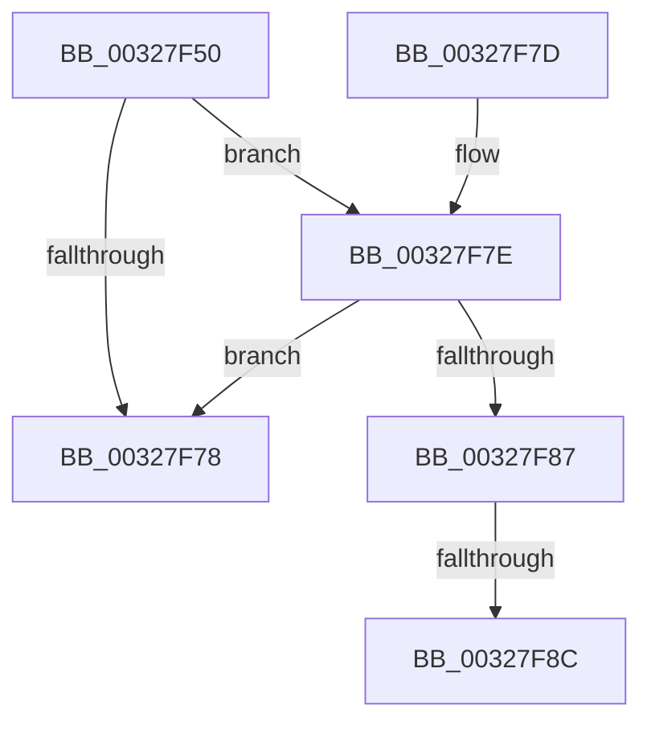

# MiFreeExcessSegments

- RVA: `0x00327F50`–`0x00327F8E` (길이 `62` bytes)
- VA: `0x0000000140327F50`
- 실행 섹션: `.text`
- PDB 이름 있음: `예`; PDB Function 태그: `아니요`
- unwind 정보 RVA: `0x00075E70`
- 디코드: `18`개 명령, `62/62` bytes 표시
- 미해석 바이트: `0` (있으면 어셈블리에 `.byte`로 보존)

> 이 문서는 커널 이미지의 기계어와 PDB 기호를 분석해 생성했습니다. 4번과 5번은 함수 원형과 자료형을 바이너리 사용 방식에서 추정한 C 해석이며 원본 소스 복구 결과는 아닙니다.

## 1. Dependencies

- 직접 호출 지점: **1**; 고유 호출 대상: **1**
- 직접 호출자로 확인된 함수: **4**
- RIP 상대 이미지 참조: **1**

### Outgoing calls
- `0x00327F7E` → [MiShouldTrimUnusedSegments](../49/MiShouldTrimUnusedSegments_function_0049D7AC.md) (function, `0x0049D7AC`)

### Direct callers
- [MiChargeCommit](../28/MiChargeCommit_function_00286EB0.md) at `0x002873E3`
- [MiCommitPoolMemory](MiCommitPoolMemory_function_00329520.md) at `0x003295F1`
- [MiCountSystemPool](../45/MiCountSystemPool_function_0045C444.md) at `0x0045C4BA`
- [sub_006EED3B](../6E/Unknown_function_006EED3B.md) at `0x006EED92`

### Static image references
- `0x00327F57` → RVA `0x00E38D00` (`.data`; read)

## 2. Other-region calls and transfers

- 다른 실행 섹션으로 향하는 call: **0**
- call이 아닌 외부 분기/꼬리 이동: **1**
  - `0x00327F8A` → [sub_00327FD5](Unknown_function_00327FD5.md) (`tail-transfer`)

## 3. Assembly (complete function range)

```asm
00327F50  48 83 EC 28                     sub rsp, 0x28
00327F54  48 85 C9                        test rcx, rcx
00327F57  48 8D 05 A2 0D B1 00            lea rax, [rip + 0xb10da2]
00327F5E  4C 8B D1                        mov r10, rcx
00327F61  48 0F 44 C8                     cmove rcx, rax
00327F65  48 8B 91 40 4B 00 00            mov rdx, qword ptr [rcx + 0x4b40]
00327F6C  48 8B 81 E0 41 00 00            mov rax, qword ptr [rcx + 0x41e0]
00327F73  48 3B D0                        cmp rdx, rax
00327F76  73 06                           jae 0x140327f7e
00327F78  48 83 C4 28                     add rsp, 0x28
00327F7C  C3                              ret
00327F7D  CC                              int3
00327F7E  E8 29 58 17 00                  call 0x14049d7ac
00327F83  85 C0                           test eax, eax
00327F85  74 F1                           je 0x140327f78
00327F87  4D 85 D2                        test r10, r10
00327F8A  75 49                           jne 0x140327fd5
00327F8C  33 C9                           xor ecx, ecx
```

## 4. C-style interpretation (structured pseudocode)

```c
__int64 __fastcall MiFreeExcessSegments(__int64 a1)
{
    __int64 result;
    __int64 v_rsp;

    v_rsp = (v_rsp) - (40);
    if (a1 == 0) { a1 = v_rip + 11603362; }
    if ((*(unsigned __int64 *)(a1 + 19264)) >= (*(unsigned __int64 *)(a1 + 16864))) goto loc_00327F7E;
loc_00327F78:
    v_rsp = (v_rsp) + (40);
    return *(unsigned __int64 *)(a1 + 16864);
loc_00327F7E:
    result = MiShouldTrimUnusedSegments(a1, *(unsigned __int64 *)(a1 + 19264), a3, a4);
    if ((unsigned int)(result) == 0) goto loc_00327F78;
    a1 = 0;
    return result;
}
```

## 5. (Beta) C Style

```c
int64_t MiFreeExcessSegments(int64_t Arg1)
{
    int64_t result;
    int64_t local_rsp;

    local_rsp = (local_rsp) - (40);
    if (Arg1 == 0) { Arg1 = v_rip + 11603362; }
    if ((*(uint64_t *)(Arg1 + 0x4B40)) >= (*(uint64_t *)(Arg1 + 0x41E0))) goto loc_00327F7E;
loc_00327F78:
    local_rsp = (local_rsp) + (40);
    return *(uint64_t *)(Arg1 + 0x41E0);
loc_00327F7E:
    result = MiShouldTrimUnusedSegments(Arg1, *(uint64_t *)(Arg1 + 0x4B40), a3, a4);
    if ((uint32_t)(result) == 0) goto loc_00327F78;
    Arg1 = 0;
    return result;
}
```

## 6. Execution-region graph

[열기: 2D/3D 그래프와 함수 탐색 컨트롤 패널](../../../control-panel.html?section=text&rva=0x00327F50&view=graph)

- 2D 그래프는 위에서 아래로 흐르고, 3D 그래프는 빈 공간을 드래그해 회전합니다. Shift+드래그는 이동, 휠은 확대·축소, 함수 노드 선택은 대상 보고서 이동입니다.

### Static fallback


