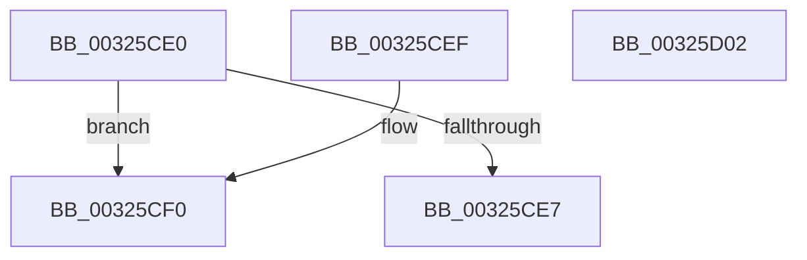

# MiGetCommittedPages

- RVA: `0x00325CE0`–`0x00325D03` (길이 `35` bytes)
- VA: `0x0000000140325CE0`
- 실행 섹션: `.text`
- PDB 이름 있음: `예`; PDB Function 태그: `아니요`
- unwind 정보 RVA: `0x000DB714`
- 디코드: `11`개 명령, `35/35` bytes 표시
- 미해석 바이트: `0` (있으면 어셈블리에 `.byte`로 보존)

> 이 문서는 커널 이미지의 기계어와 PDB 기호를 분석해 생성했습니다. 4번과 5번은 함수 원형과 자료형을 바이너리 사용 방식에서 추정한 C 해석이며 원본 소스 복구 결과는 아닙니다.

## 1. Dependencies

- 직접 호출 지점: **0**; 고유 호출 대상: **0**
- 직접 호출자로 확인된 함수: **9**
- RIP 상대 이미지 참조: **0**

### Outgoing calls
- 직접 디코드된 call 명령이 없습니다.

### Direct callers
- [MiCreatePrototypePtes](../29/MiCreatePrototypePtes_function_002950FC.md) at `0x002955D3`
- [MiCreatePrototypePtes](../29/MiCreatePrototypePtes_function_002950FC.md) at `0x002955E6`
- [MiReferenceActiveSubsection](MiReferenceActiveSubsection_function_00325060.md) at `0x003255C3`
- [MiComputeCrossPartitionSectionCharges](MiComputeCrossPartitionSectionCharges_function_00325BBC.md) at `0x00325BD8`
- [MiDeleteSegmentPages](MiDeleteSegmentPages_function_003261D4.md) at `0x003262A2`
- [MiSetPagesModified](../49/MiSetPagesModified_function_0049DC2C.md) at `0x0049E094`
- [MiInitializeImageExtents](../../page/80/MiInitializeImageExtents_function_00800FE8.md) at `0x0080104A`
- [sub_00885634](../../page/88/Unknown_function_00885634.md) at `0x00885667`
- [sub_008873D4](../../page/88/Unknown_function_008873D4.md) at `0x0088741C`
- [sub_00888AF0](../../page/88/Unknown_function_00888AF0.md) at `0x00888AFB`

### Static image references
- 디코드된 RIP-relative 메모리 참조가 없습니다.

## 2. Other-region calls and transfers

- 다른 실행 섹션으로 향하는 call: **0**
- 별도 외부 분기/꼬리 이동을 확인하지 못했습니다.

## 3. Assembly (complete function range)

```asm
00325CE0  48 83 79 40 00                  cmp qword ptr [rcx + 0x40], 0
00325CE5  74 09                           je 0x140325cf0
00325CE7  48 8B 01                        mov rax, qword ptr [rcx]
00325CEA  48 8B 40 10                     mov rax, qword ptr [rax + 0x10]
00325CEE  C3                              ret
00325CEF  CC                              int3
00325CF0  48 8B 41 78                     mov rax, qword ptr [rcx + 0x78]
00325CF4  48 B9 FF FF FF FF 0F 00 00 00   movabs rcx, 0xfffffffff
00325CFE  48 23 C1                        and rax, rcx
00325D01  C3                              ret
00325D02  CC                              int3
```

## 4. C-style interpretation (structured pseudocode)

```c
__int64 __fastcall MiGetCommittedPages(__int64 a1)
{
    __int64 result;

    if ((*(unsigned __int64 *)(a1 + 64)) == 0) goto loc_00325CF0;
    return *(unsigned __int64 *)(*(unsigned __int64 *)(a1) + 16);
loc_00325CF0:
    result = (*(unsigned __int64 *)(a1 + 120)) & (a1);
    return result;
}
```

## 5. (Beta) C Style

```c
int64_t MiGetCommittedPages(void *Arg1)
{
    uint8_t *arg1 = (uint8_t *)Arg1;

    int64_t result;

    if ((*(uint64_t *)(arg1 + 0x40)) == 0) goto loc_00325CF0;
    return *(uint64_t *)(*(uint64_t *)(arg1) + 0x10);
loc_00325CF0:
    result = (*(uint64_t *)(arg1 + 0x78)) & (Arg1);
    return result;
}
```

### 관측된 메모리 오프셋

구조체 형식이 확인되지 않은 접근은 인자 기준의 오프셋으로만 기록했습니다.

| 기준 인자 | 오프셋 표현 | 폭 (bit) | 접근 |
|---|---:|---:|---|
| `Arg1` | `+ 0x0` | `64` | `R` |
| `Arg1` | `+ 0x40` | `64` | `R` |
| `Arg1` | `+ 0x78` | `64` | `R` |

## 6. Execution-region graph

[열기: 2D/3D 그래프와 함수 탐색 컨트롤 패널](../../../control-panel.html?section=text&rva=0x00325CE0&view=graph)

- 2D 그래프는 위에서 아래로 흐르고, 3D 그래프는 빈 공간을 드래그해 회전합니다. Shift+드래그는 이동, 휠은 확대·축소, 함수 노드 선택은 대상 보고서 이동입니다.

### Static fallback


