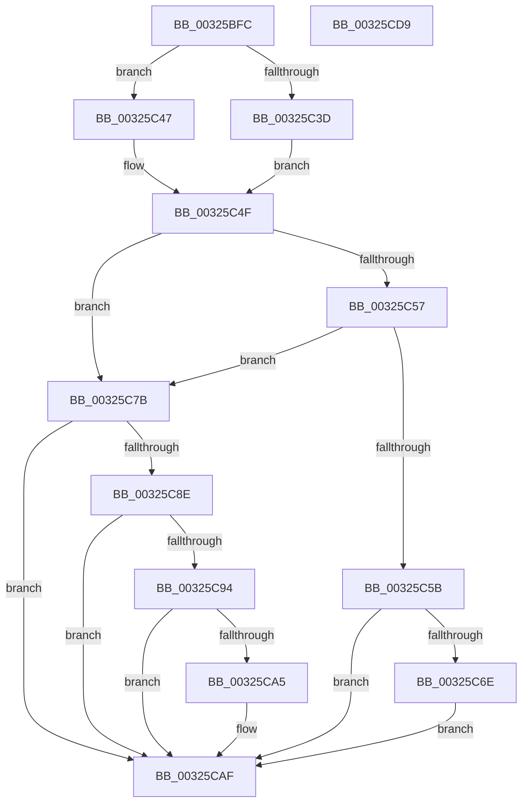

# MiGetCrossPartitionCharges

- RVA: `0x00325BFC`–`0x00325CDA` (길이 `222` bytes)
- VA: `0x0000000140325BFC`
- 실행 섹션: `.text`
- PDB 이름 있음: `예`; PDB Function 태그: `아니요`
- unwind 정보 RVA: `0x00075C18`
- 디코드: `70`개 명령, `222/222` bytes 표시
- 미해석 바이트: `0` (있으면 어셈블리에 `.byte`로 보존)

> 이 문서는 커널 이미지의 기계어와 PDB 기호를 분석해 생성했습니다. 4번과 5번은 함수 원형과 자료형을 바이너리 사용 방식에서 추정한 C 해석이며 원본 소스 복구 결과는 아닙니다.

## 1. Dependencies

- 직접 호출 지점: **6**; 고유 호출 대상: **5**
- 직접 호출자로 확인된 함수: **5**
- RIP 상대 이미지 참조: **0**

### Outgoing calls
- `0x00325C40` → [ExAcquireSpinLockExclusiveAtDpcLevel](../24/ExAcquireSpinLockExclusiveAtDpcLevel_function_00248E80.md) (function, `0x00248E80`)
- `0x00325C47` → [ExAcquireSpinLockExclusive](../24/ExAcquireSpinLockExclusive_function_00248690.md) (function, `0x00248690`)
- `0x00325C83` → [MiApplyCrossPartitionCharges](../4D/MiApplyCrossPartitionCharges_function_004D60E0.md) (function, `0x004D60E0`)
- `0x00325C9A` → [MiApplyCrossPartitionCharges](../4D/MiApplyCrossPartitionCharges_function_004D60E0.md) (function, `0x004D60E0`)
- `0x00325CAA` → [MiReturnCrossPartitionCharge](../4D/MiReturnCrossPartitionCharge_function_004D8E24.md) (function, `0x004D8E24`)
- `0x00325CB5` → [MiReleaseSpinLockExclusive](../24/MiReleaseSpinLockExclusive_function_002482C0.md) (function, `0x002482C0`)

### Direct callers
- [MiGetCloneCharges](../22/MiGetCloneCharges_function_0022CB5C.md) at `0x0022CC13`
- [MiReferenceActiveSubsection](MiReferenceActiveSubsection_function_00325060.md) at `0x003252EE`
- [MiCreateLargePfnList](../3D/MiCreateLargePfnList_function_003D2DA8.md) at `0x003D2FE7`
- [MiGetSubsectionCharges](../45/MiGetSubsectionCharges_function_00458A04.md) at `0x00458A4B`
- [MiAllocateUserPhysicalPages](../../page/80/MiAllocateUserPhysicalPages_function_00809828.md) at `0x0080A359`

### Static image references
- 디코드된 RIP-relative 메모리 참조가 없습니다.

## 2. Other-region calls and transfers

- 다른 실행 섹션으로 향하는 call: **0**
- 별도 외부 분기/꼬리 이동을 확인하지 못했습니다.

## 3. Assembly (complete function range)

```asm
00325BFC  48 89 5C 24 08                  mov qword ptr [rsp + 8], rbx
00325C01  48 89 6C 24 10                  mov qword ptr [rsp + 0x10], rbp
00325C06  48 89 74 24 18                  mov qword ptr [rsp + 0x18], rsi
00325C0B  57                              push rdi
00325C0C  41 54                           push r12
00325C0E  41 55                           push r13
00325C10  41 56                           push r14
00325C12  41 57                           push r15
00325C14  48 83 EC 20                     sub rsp, 0x20
00325C18  48 63 F2                        movsxd rsi, edx
00325C1B  4D 8B E1                        mov r12, r9
00325C1E  48 8B EE                        mov rbp, rsi
00325C21  45 8B E8                        mov r13d, r8d
00325C24  48 C1 E5 05                     shl rbp, 5
00325C28  48 8B D9                        mov rbx, rcx
00325C2B  44 0F 20 C0                     mov rax, cr8
00325C2F  4C 8D B1 C0 06 00 00            lea r14, [rcx + 0x6c0]
00325C36  49 8B CE                        mov rcx, r14
00325C39  3C 02                           cmp al, 2
00325C3B  75 0A                           jne 0x140325c47
00325C3D  41 B7 11                        mov r15b, 0x11
00325C40  E8 3B 32 F2 FF                  call 0x140248e80
00325C45  EB 08                           jmp 0x140325c4f
00325C47  E8 44 2A F2 FF                  call 0x140248690
00325C4C  44 8A F8                        mov r15b, al
00325C4F  8B 4B 04                        mov ecx, dword ptr [rbx + 4]
00325C52  F6 C1 01                        test cl, 1
00325C55  74 24                           je 0x140325c7b
00325C57  85 F6                           test esi, esi
00325C59  74 20                           je 0x140325c7b
00325C5B  48 8B 84 2B C0 09 00 00         mov rax, qword ptr [rbx + rbp + 0x9c0]
00325C63  BF A0 04 00 C0                  mov edi, 0xc00004a0
00325C68  48 83 F8 FF                     cmp rax, -1
00325C6C  74 41                           je 0x140325caf
00325C6E  48 FF C0                        inc rax
00325C71  48 89 84 2B C0 09 00 00         mov qword ptr [rbx + rbp + 0x9c0], rax
00325C79  EB 34                           jmp 0x140325caf
00325C7B  4D 8B C4                        mov r8, r12
00325C7E  8B D6                           mov edx, esi
00325C80  48 8B CB                        mov rcx, rbx
00325C83  E8 58 04 1B 00                  call 0x1404d60e0
00325C88  8B F8                           mov edi, eax
00325C8A  85 C0                           test eax, eax
00325C8C  78 21                           js 0x140325caf
00325C8E  41 F6 C5 01                     test r13b, 1
00325C92  74 1B                           je 0x140325caf
00325C94  8D 56 01                        lea edx, [rsi + 1]
00325C97  48 8B CB                        mov rcx, rbx
00325C9A  E8 41 04 1B 00                  call 0x1404d60e0
00325C9F  8B F8                           mov edi, eax
00325CA1  85 C0                           test eax, eax
00325CA3  79 0A                           jns 0x140325caf
00325CA5  8B D6                           mov edx, esi
00325CA7  48 8B CB                        mov rcx, rbx
00325CAA  E8 75 31 1B 00                  call 0x1404d8e24
00325CAF  41 8A D7                        mov dl, r15b
00325CB2  49 8B CE                        mov rcx, r14
00325CB5  E8 06 26 F2 FF                  call 0x1402482c0
00325CBA  48 8B 5C 24 50                  mov rbx, qword ptr [rsp + 0x50]
00325CBF  8B C7                           mov eax, edi
00325CC1  48 8B 6C 24 58                  mov rbp, qword ptr [rsp + 0x58]
00325CC6  48 8B 74 24 60                  mov rsi, qword ptr [rsp + 0x60]
00325CCB  48 83 C4 20                     add rsp, 0x20
00325CCF  41 5F                           pop r15
00325CD1  41 5E                           pop r14
00325CD3  41 5D                           pop r13
00325CD5  41 5C                           pop r12
00325CD7  5F                              pop rdi
00325CD8  C3                              ret
00325CD9  CC                              int3
```

## 4. C-style interpretation (structured pseudocode)

```c
__int64 __fastcall MiGetCrossPartitionCharges(__int64 a1, int a2, int a3, __int64 a4)
{
    __int64 result;
    __int64 v_rbp;
    __int64 v_rsp;
    unsigned __int64 v_stack_p10;
    unsigned __int64 v_stack_p18;
    unsigned __int64 v_stack_p8;

    v_stack_p8 = v_rbx;
    v_stack_p10 = v_rbp;
    v_stack_p18 = v_rsi;
    v_rsp = (v_rsp) - (32);
    v_rbp = ((int)(a2)) << (5);
    if (((unsigned __int8)(v_cr8)) != 2) goto loc_00325C47;
    result = ExAcquireSpinLockExclusiveAtDpcLevel(a1 + 1728, a2, a3, a4);
    goto loc_00325C4F;
loc_00325C47:
    result = ExAcquireSpinLockExclusive(a1 + 1728, a2, a3, a4);
loc_00325C4F:
    if ((((unsigned __int8)((unsigned int)(*(unsigned int *)(a1 + 4)))) & (1)) == 0) goto loc_00325C7B;
    if ((unsigned int)((int)(a2)) == 0) goto loc_00325C7B;
    if ((*(unsigned __int64 *)(a1 + v_rbp * 1 + 2496)) == -1) goto loc_00325CAF;
    result = (*(unsigned __int64 *)(a1 + v_rbp * 1 + 2496)) + 1;
    *(unsigned __int64 *)(a1 + v_rbp * 1 + 2496) = result;
    goto loc_00325CAF;
loc_00325C7B:
    result = MiApplyCrossPartitionCharges(a1, (unsigned int)((unsigned int)((int)(a2))), a4, a4);
    if (sign_flag) goto loc_00325CAF;
    if ((((unsigned __int8)((unsigned int)(a3))) & (1)) == 0) goto loc_00325CAF;
    result = MiApplyCrossPartitionCharges(a1, (int)(a2) + 1, a4, a4);
    if (sign_flag) {
        a2 = (unsigned int)((int)(a2));
        a1 = a1;
        result = MiReturnCrossPartitionCharge(a1, a2, a4, a4);
    }
    result = MiReleaseSpinLockExclusive(a1 + 1728, (unsigned __int8)((unsigned __int8)(result)), a4, a4);
    v_rsp = (v_rsp) + (32);
    return (unsigned int)((unsigned int)((unsigned int)((unsigned int)(result))));
}
```

## 5. (Beta) C Style

```c
int64_t MiGetCrossPartitionCharges(void *Arg1, int32_t Arg2, int32_t Arg3, int64_t Arg4)
{
    uint8_t *arg1 = (uint8_t *)Arg1;

    int64_t result;
    int64_t local_rbp;
    int64_t local_rsp;
    uint64_t v_stack_p10;
    uint64_t v_stack_p18;
    uint64_t v_stack_p8;

    v_stack_p8 = local_rbx;
    v_stack_p10 = local_rbp;
    v_stack_p18 = local_rsi;
    local_rsp = (local_rsp) - (32);
    local_rbp = ((int32_t)(Arg2)) << (5);
    if (((uint8_t)(v_cr8)) != 2) goto loc_00325C47;
    result = ExAcquireSpinLockExclusiveAtDpcLevel(Arg1 + 1728, Arg2, Arg3, Arg4);
    goto loc_00325C4F;
loc_00325C47:
    result = ExAcquireSpinLockExclusive(Arg1 + 1728, Arg2, Arg3, Arg4);
loc_00325C4F:
    if ((((uint8_t)((uint32_t)(*(uint32_t *)(arg1 + 0x4)))) & (1)) == 0) goto loc_00325C7B;
    if ((uint32_t)((int32_t)(Arg2)) == 0) goto loc_00325C7B;
    if ((*(uint64_t *)(arg1 + local_rbp * 1 + 0x9C0)) == -1) goto loc_00325CAF;
    result = (*(uint64_t *)(arg1 + local_rbp * 1 + 0x9C0)) + 1;
    *(uint64_t *)(arg1 + local_rbp * 1 + 0x9C0) = result;
    goto loc_00325CAF;
loc_00325C7B:
    result = MiApplyCrossPartitionCharges(Arg1, (uint32_t)((uint32_t)((int32_t)(Arg2))), Arg4, Arg4);
    if (sign_flag) goto loc_00325CAF;
    if ((((uint8_t)((uint32_t)(Arg3))) & (1)) == 0) goto loc_00325CAF;
    result = MiApplyCrossPartitionCharges(Arg1, (int32_t)(Arg2) + 1, Arg4, Arg4);
    if (sign_flag) {
        Arg2 = (uint32_t)((int32_t)(Arg2));
        Arg1 = Arg1;
        result = MiReturnCrossPartitionCharge(Arg1, Arg2, Arg4, Arg4);
    }
    result = MiReleaseSpinLockExclusive(Arg1 + 1728, (uint8_t)((uint8_t)(result)), Arg4, Arg4);
    local_rsp = (local_rsp) + (32);
    return (uint32_t)((uint32_t)((uint32_t)((uint32_t)(result))));
}
```

### 관측된 메모리 오프셋

구조체 형식이 확인되지 않은 접근은 인자 기준의 오프셋으로만 기록했습니다.

| 기준 인자 | 오프셋 표현 | 폭 (bit) | 접근 |
|---|---:|---:|---|
| `Arg1` | `+ 0x4` | `32` | `R` |
| `Arg1` | `+ 0x6C0` | `64` | `R` |
| `Arg1` | `+ 0x9C0 + rbp*1` | `64` | `R` |
| `Arg1` | `+ 0x9C0 + rbp*1` | `64` | `W` |

## 6. Execution-region graph

[열기: 2D/3D 그래프와 함수 탐색 컨트롤 패널](../../../control-panel.html?section=text&rva=0x00325BFC&view=graph)

- 2D 그래프는 위에서 아래로 흐르고, 3D 그래프는 빈 공간을 드래그해 회전합니다. Shift+드래그는 이동, 휠은 확대·축소, 함수 노드 선택은 대상 보고서 이동입니다.

### Static fallback


